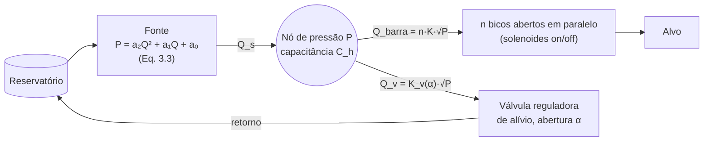
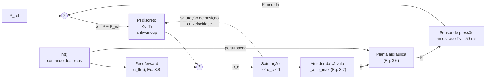
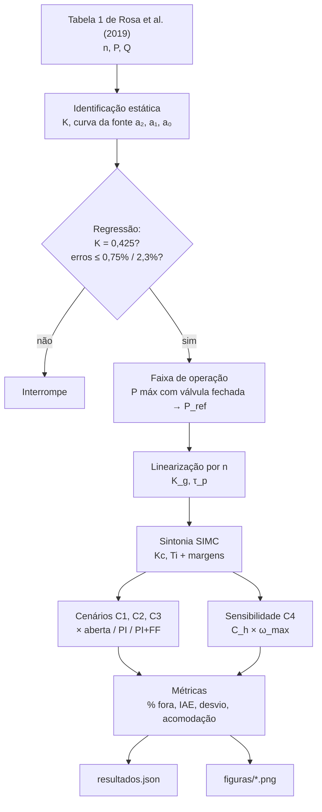

# UNIVERSIDADE DO ESTADO DE MATO GROSSO
**FACULDADE DE CIÊNCIAS EXATAS E TECNOLÓGICAS**
**CURSO DE BACHARELADO EM ENGENHARIA ELÉTRICA**

**ALEX DE JESUS TEROLTI**

**MODELAGEM DE SISTEMA DE CONTROLE PARA PULVERIZAÇÃO AGRÍCOLA DE PRECISÃO**

SINOP – MT
[ANO DA DEFESA]

---

## FOLHA DE ROSTO

**ALEX DE JESUS TEROLTI**

**MODELAGEM DE SISTEMA DE CONTROLE PARA PULVERIZAÇÃO AGRÍCOLA DE PRECISÃO**

> Trabalho de Conclusão de Curso apresentado à Banca Examinadora do Curso de Engenharia Elétrica - UNEMAT, Campus Universitário de Sinop - MT, como pré-requisito para a obtenção do título de Bacharel em Engenharia Elétrica.
>
> Orientador: Prof. Dr. Rogério Bastos Quirino

SINOP – MT
[ANO DA DEFESA]

---

[FICHA CATALOGRÁFICA — gerar em http://biblioteca.unemat.br/gfc]

[FOLHA DE APROVAÇÃO — avaliadores, orientador, presidente da banca, "Aprovado em __/__/__"; imprimir, assinar na defesa e digitalizar]

---

## RESUMO

A aplicação localizada de defensivos agrícolas, em que cada bico da barra é aberto ou fechado individualmente, reduz o volume aplicado, mas altera a carga hidráulica do pulverizador a cada comutação. Em barras com alimentação em série, a abertura e o fechamento dos bicos modificam a pressão na linha e, com ela, a vazão de cada bico e o tamanho das gotas, o que pode resultar em subdosagem, superdosagem ou deriva. Este trabalho propõe a modelagem matemática do circuito hidráulico de uma barra de pulverização e o projeto, em simulação, de um sistema de controle que mantenha a pressão estável durante o acionamento bico a bico. O modelo parte do conceito de resistência fluídica, em que a queda de pressão em cada elemento é proporcional ao quadrado da vazão, e o estende com três elementos: a associação em paralelo dos bicos abertos, uma curva pressão-vazão para a fonte de alimentação e uma válvula reguladora de alívio como atuador. Os parâmetros estáticos foram identificados a partir de dados experimentais publicados para uma barra de sete bicos. Uma constante de bico única, de 0,425 (L/min)/√(kgf/cm²), e uma curva de fonte de segunda ordem reproduziram os sete pontos de operação ensaiados com erro máximo de 0,7% na pressão e de 2,3% na vazão. Ao modelo foram acrescentadas a dinâmica da pressão e a de um atuador com saturação, e foi projetado um controlador proporcional-integral com compensação antecipativa em função do número de bicos abertos, simulado em Python. Com parâmetros dinâmicos assumidos, o controlador manteve a pressão dentro da faixa equivalente a ±5% na vazão do bico durante 100% do tempo no fechamento e na reabertura sequenciais e 97% do tempo sob comutação aleatória de bicos, contra 29% e 7% sem controle. Degraus simultâneos de vários bicos ainda produzem picos curtos, limitados pela velocidade do atuador. A validação dinâmica com dados experimentais permanece como etapa necessária.

**Palavras-chave:** Pulverização agrícola. Controle bico a bico. Resistência fluídica. Controle de pressão. Modelagem matemática.

## ABSTRACT

Spot spraying, in which each boom nozzle is switched on or off individually, reduces the applied volume but changes the hydraulic load of the sprayer at every switching event. In series-fed booms, opening and closing nozzles changes the line pressure and, therefore, the flow rate of each nozzle and the droplet size, which may lead to under-dosing, over-dosing or drift. This work proposes a mathematical model of the hydraulic circuit of a spray boom and the simulation-based design of a control system that keeps the pressure stable during nozzle-by-nozzle actuation. The model builds on the fluidic-resistance concept, in which the pressure drop across each element is proportional to the square of the flow rate, and extends it with three elements: the parallel connection of the open nozzles, a pressure–flow curve for the supply, and a relief control valve as the actuator. The static parameters were identified from published experimental data for a seven-nozzle boom. A single nozzle constant of 0.425 (L/min)/√(kgf/cm²) and a second-order supply curve reproduced the seven tested operating points with a maximum error of 0.7% in pressure and 2.3% in flow rate. Pressure dynamics and a saturating actuator were then added, and a proportional-integral controller with feedforward compensation based on the number of open nozzles was designed and simulated in Python. With assumed dynamic parameters, the controller kept the pressure within the band equivalent to ±5% of nozzle flow 100% of the time during sequential closing and reopening and 97% of the time under random nozzle switching, against 29% and 7% without control. Simultaneous steps of several nozzles still cause short peaks, limited by the actuator speed. Dynamic validation with experimental data remains a required step.

**Keywords:** Agricultural spraying. Nozzle-by-nozzle control. Fluidic resistance. Pressure control. Mathematical modeling.

---

## LISTA DE ABREVIATURAS E SIGLAS

| Sigla | Significado |
|---|---|
| AP | Agricultura de Precisão |
| FT | Transmissor de vazão (*flow transmitter*, ISA 5.1) |
| IAE | Integral do erro absoluto (*Integral of Absolute Error*) |
| INCA | Instituto Nacional do Câncer |
| ISA | *International Society of Automation* |
| ODS | Objetivos de Desenvolvimento Sustentável |
| PI | Proporcional-Integral |
| PID | Proporcional-Integral-Derivativo |
| PT | Transmissor de pressão (*pressure transmitter*, ISA 5.1) |
| PV | Válvula de controle de pressão (*pressure valve*, ISA 5.1) |
| TDP | Tomada de Potência |
| VRT | Tecnologia de aplicação em taxa variável (*Variable Rate Technology*) |

## LISTA DE SÍMBOLOS

| Símbolo | Significado | Unidade |
|---|---|---|
| $P$ | Pressão manométrica na barra | kgf/cm² (1 kgf/cm² = 98,0665 kPa) |
| $Q$ | Vazão volumétrica | L/min |
| $R_F$ | Resistência fluídica | (kgf/cm²)/(L/min)² |
| $K$ | Constante de vazão de um bico | (L/min)/√(kgf/cm²) |
| $n$ | Número de bicos abertos | — |
| $Q_s$ | Vazão fornecida pela fonte (bomba + regulação interna) | L/min |
| $Q_v$ | Vazão desviada pela válvula reguladora | L/min |
| $K_v(\alpha)$ | Constante de vazão da válvula reguladora | (L/min)/√(kgf/cm²) |
| $\alpha$ | Abertura da válvula reguladora | 0 a 1 |
| $C_h$ | Capacitância hidráulica equivalente da linha | L/(kgf/cm²) |
| $\tau_a$, $\omega_{max}$ | Constante de tempo e velocidade máxima do atuador da válvula | s, 1/s |
| $K_g$, $\tau_p$ | Ganho e constante de tempo da planta linearizada (α → P) | kgf/cm², s |
| $K_c$, $T_i$ | Ganho proporcional e tempo integral do PI | (kgf/cm²)⁻¹, s |
| $\lambda$, $\theta$ | Constante de tempo desejada e atraso efetivo na sintonia | s |
| $T_s$ | Período de amostragem do controlador | s |
| $Re$ | Número de Reynolds | — |
| $C_D$ | Coeficiente de descarga | — |

## SUMÁRIO

1 INTRODUÇÃO
 1.1 Problema e hipótese
 1.2 Objetivos
  1.2.1 Objetivo geral
  1.2.2 Objetivos específicos
 1.3 Justificativa
 1.4 Estrutura do trabalho
2 FUNDAMENTAÇÃO TEÓRICA
 2.1 Pulverizadores agrícolas de barras
 2.2 Agricultura de precisão e pulverização localizada
 2.3 Circuito hidráulico do pulverizador
 2.4 Modelagem por resistência fluídica
 2.5 Pressão, vazão e tamanho de gota
 2.6 Controle de pulverização
3 METODOLOGIA
 3.1 Tipo de pesquisa
 3.2 Sistema de referência
 3.3 Modelo estático
 3.4 Modelo dinâmico
 3.5 Estratégia de controle
 3.6 Parâmetros, simulação e cenários
 3.7 Métricas de avaliação e validação
 3.8 Limitações
4 RESULTADOS
 4.1 Modelo estático
 4.2 Simulação
  4.2.1 Sintonia e estabilidade
  4.2.2 Desempenho nos cenários
  4.2.3 Sensibilidade aos parâmetros assumidos
5 CONCLUSÃO
REFERÊNCIAS
APÊNDICE A – Script de modelagem e simulação

---

# 1 INTRODUÇÃO

A modernização agrícola da segunda metade do século XX, conhecida como Revolução Verde, trouxe mecanização, cultivares de alto rendimento e uso intensivo de insumos, incluindo os agrotóxicos, cujo consumo cresceu a partir da década de 1950 (MACHADO et al., 2005). Segundo o Instituto Nacional do Câncer (INCA), o consumo médio no Brasil equivale a cerca de 5 litros de agrotóxico por habitante por ano (MILHORANCE, 2015 apud ROSA; TERRA; DREWS JR, 2019). Em alguns casos, por efeito da deriva, até 99,9% do produto aplicado pode alcançar águas superficiais e subterrâneas (RIBEIRO et al., 2007 apud ROSA; TERRA; DREWS JR, 2019). A redução desse desperdício está alinhada aos Objetivos de Desenvolvimento Sustentável (ODS), em particular aos de agricultura sustentável e de consumo e produção responsáveis (BRASIL, 2025).

Na aplicação por pulverizadores de barras, a calda (mistura de água, defensivo e, quando necessário, adjuvantes) é armazenada em um tanque, pressurizada por uma bomba, conduzida por mangueiras e válvulas e fragmentada em gotas pelos bicos (JACTO, 2017; AGRIQ, 2025). O desempenho da aplicação depende da estabilidade da pressão: é ela que define a vazão de cada bico e o espectro de gotas produzido.

A agricultura de precisão oferece duas formas de reduzir a área tratada sem necessidade: o controle por seções, que abre e fecha grupos de bicos, e o controle bico a bico, em que cada ponta é comandada individualmente (ROSA; TERRA; DREWS JR, 2019). O segundo é mais seletivo, mas impõe ao circuito hidráulico variações bruscas e frequentes de carga, pois cada comutação altera a vazão total demandada pela barra.

## 1.1 Problema e hipótese

Em uma barra com alimentação em série, uma única linha-tronco (*header*) alimenta todos os bicos. O atrito nas tubulações e conexões e as restrições impostas pelas pontas e pelas válvulas comportam-se como resistências fluídicas. Por isso, quando bicos são fechados, a pressão na linha sobe; quando são abertos, a pressão cai (ROSA; TERRA; DREWS JR, 2019). Rosa, Terra e Drews Jr (2019) mediram esse efeito em uma barra de sete bicos: com a válvula de recirculação fechada, a pressão passou de 3,57 kgf/cm² com sete bicos abertos para 5,58 kgf/cm² com um bico aberto, uma variação de 56%. Os mesmos autores mostraram, em malha aberta e com ajuste manual, que a abertura de uma válvula de alívio restabelece a pressão, e indicaram como trabalho futuro a inclusão dessa válvula no modelo e o controle em malha fechada.

O problema tratado neste trabalho é, portanto, **manter a pressão da barra próxima do valor de referência enquanto os bicos são abertos e fechados individualmente**, a partir de um modelo matemático que represente o circuito e o atuador.

**Hipótese:** um modelo de resistências fluídicas que inclua a associação em paralelo dos bicos, a curva de alimentação e a válvula reguladora, complementado pela dinâmica da pressão e do atuador, permite projetar um controlador que mantenha a pressão dentro de ±10% da referência (faixa equivalente a ±5% na vazão de cada bico, conforme a seção 3.7) durante sequências de abertura e fechamento de bicos.

## 1.2 Objetivos

### 1.2.1 Objetivo geral

Desenvolver o modelo matemático e a simulação de um sistema de controle de pressão para uma barra de pulverização com acionamento bico a bico, visando à estabilidade da pressão e da vazão durante a abertura e o fechamento dos bicos.

### 1.2.2 Objetivos específicos

- Modelar a relação entre pressão e vazão da barra em função do número de bicos abertos.
- Incorporar ao modelo a fonte de alimentação e a válvula reguladora de alívio.
- Acrescentar a dinâmica da pressão e do atuador da válvula, incluindo sua saturação.
- Projetar um controlador em malha fechada para a pressão da barra.
- Simular cenários de abertura e fechamento de bicos e avaliar o desempenho por métricas quantitativas.
- Comparar o modelo estático com os dados experimentais publicados por Rosa, Terra e Drews Jr (2019).

## 1.3 Justificativa

A pressão de trabalho define a vazão de cada bico e o volume aplicado por área. Quando ela varia durante a abertura ou o fechamento dos bicos, o volume aplicado se afasta da dose prescrita (MANTOVANI; QUEIROZ; DIAS, 2009), com dois efeitos opostos (HARTMANN-SCHMIDT, 2006):

- **Superdosagem:** aumenta o custo sem ganho de produtividade, desperdiça produto no solo e no ambiente e pode causar fitotoxicidade, com queimaduras em folhas, queda de flores e frutos ou redução do crescimento.
- **Subdosagem:** compromete o controle de pragas, doenças e plantas daninhas, exige reaplicação e favorece o surgimento de populações resistentes (MANTOVANI; QUEIROZ; DIAS, 2009).

Além disso, a variação de pressão modifica o tamanho das gotas, o que afeta a cobertura do alvo e o risco de deriva (HOLTERMAN et al., 2016 apud ROSA; TERRA; DREWS JR, 2019).

Os sistemas comerciais com controle bico a bico em série têm custo elevado (ROSA; TERRA; DREWS JR, 2019), e ensaios em máquina real envolvem consumo de calda, disponibilidade do equipamento e riscos operacionais. A modelagem seguida de simulação permite testar estratégias de controle, ajustar parâmetros e identificar limitações do atuador antes de qualquer implementação física, com custo e risco reduzidos. Esse foi o caminho adotado por Steward e Humburg (2000), que modelaram os subsistemas de um injetor comercial, validaram os modelos em bancada e usaram a simulação para avaliar variações de controlador, de velocidade do atuador e de taxa de amostragem.

## 1.4 Estrutura do trabalho

O Capítulo 2 apresenta os pulverizadores de barras, a pulverização localizada, o circuito hidráulico, a modelagem por resistência fluídica e os fundamentos do controle de pulverização. O Capítulo 3 descreve o sistema de referência, os modelos estático e dinâmico, a estratégia de controle, os cenários de simulação e as métricas. O Capítulo 4 traz a identificação do modelo estático a partir dos dados publicados e os resultados da simulação em malha aberta e fechada, incluindo a análise de sensibilidade. O Capítulo 5 apresenta a conclusão, e o Apêndice A descreve o script de simulação.

---

# 2 FUNDAMENTAÇÃO TEÓRICA

## 2.1 Pulverizadores agrícolas de barras

Os pulverizadores são usados para aplicar defensivos (herbicidas, inseticidas, fungicidas, acaricidas), fertilizantes e nutrientes (JACTO, 2017). Na aplicação líquida, o produto é fragmentado em gotas cujo tamanho influencia a penetração, a cobertura e a deriva: gotas pequenas são mais facilmente arrastadas pelo vento, enquanto gotas grandes aderem menos às folhas. O ideal é um espectro homogêneo, determinado principalmente pelos bicos hidráulicos (MACHADO et al., 2005). Entre os equipamentos disponíveis estão o costal manual, o atomizador, o pulverizador tratorizado de barras, o autopropelido e as aeronaves agrícolas (SCHLOSSER, 2002) [REF. PENDENTE]. Este trabalho trata dos pulverizadores de barras.

Nos **pulverizadores tratorizados**, acoplados ao trator pelo engate de três pontos ou por arrasto, a bomba é acionada pela Tomada de Potência (TDP). O sistema reúne o reservatório de calda, a bomba de pressurização e as barras com os bicos; um dispositivo antigotejo impede o vazamento quando a bomba é desligada.

Os **pulverizadores autopropelidos** têm locomoção própria e são usados principalmente em grandes propriedades. Muitos modelos incorporam controle individual de bicos, georreferenciamento e ajuste automático de altura da barra. Oferecem maior capacidade operacional, mas exigem manutenção mais complexa e operadores qualificados (CASALI, 2012). A Figura 1 ilustra esse tipo de equipamento.

> **Figura 1 – Pulverizador autopropelido de barras.**
> *[Descrição: fotografia de um pulverizador autopropelido em operação no campo, com as barras laterais abertas e os bicos aplicando calda sobre a cultura. Usar a mesma imagem da Figura 4 do projeto (04.docx).]*
> Fonte: KUHN (2025).

## 2.2 Agricultura de precisão e pulverização localizada

A agricultura de precisão (AP) começou a se desenvolver no final da década de 1980, com monitores de rendimento, sensores de solo, sistemas de posicionamento e tecnologias de aplicação em taxa variável (VRT) (ZHANG; PIERCE, 2016) [REF. PENDENTE]. Na aplicação convencional, o defensivo é distribuído uniformemente, embora as plantas daninhas, pragas e doenças se distribuam de forma irregular na lavoura (SHIRATSUCHI; CHRISTOFFOLETI; FONTES, 2013) [REF. PENDENTE]. Isso leva a deposição em locais desnecessários, sobreposição e desperdício nas bordas e manobras.

A **pulverização localizada** aplica o produto apenas onde ele é necessário, a partir de sensores, imagens ou mapas que identificam as regiões a tratar. Além de reduzir o volume aplicado e os custos, diminui a exposição desnecessária de plantas e pragas ao produto e, com isso, a seleção de organismos resistentes (SHIRATSUCHI; CHRISTOFFOLETI, 2002).

Do ponto de vista do equipamento, há dois níveis de seletividade (ROSA; TERRA; DREWS JR, 2019), representados na Figura 2:

- **Controle por seções:** grupos de bicos são abertos ou fechados em conjunto. Não atende trechos menores que uma seção nem falhas na linha de plantio.
- **Controle bico a bico:** cada ponta é comandada individualmente. Pode ser **em paralelo**, quando cada bico tem conexão própria com o reservatório, ou **em série**, quando uma linha-tronco alimenta vários bicos. A configuração em série, empregada em equipamentos comerciais, é a que acopla hidraulicamente os bicos e é o foco deste trabalho.

> **Figura 2 – Controle por seções e controle bico a bico.**
> *[Descrição: dois esquemas de uma barra vista de frente, um acima do outro. Em cima, a barra dividida em duas seções de três bicos: a seção 1 com os três bicos verdes (abertos) pulverizando e a seção 2 com os três bicos vermelhos (fechados). Embaixo, a mesma barra com bicos verdes e vermelhos intercalados individualmente, pulverizando apenas sobre as plantas. Reproduzir as Figuras 2 e 3 de Rosa, Terra e Drews Jr (2019).]*
> Fonte: adaptado de Rosa, Terra e Drews Jr (2019).

## 2.3 Circuito hidráulico do pulverizador

Os elementos principais do circuito são o tanque de calda, a bomba, a linha de condução, a válvula reguladora e os bicos (JACTO, 2017). Dois tipos de bomba aparecem nas referências consultadas:

- **Deslocamento positivo (pistão):** a vazão é proporcional à rotação. Rosa, Terra e Drews Jr (2019) usaram uma bomba de pistão de 14 L/min acionada por motor elétrico com inversor de frequência, simulando a TDP.
- **Centrífuga:** a pressão gerada cai com a vazão, segundo uma curva característica. Steward e Humburg (2000) representaram essa curva por um polinômio de segundo grau ajustado experimentalmente.

A regulação da pressão pode ser feita pela rotação da bomba ou por uma **válvula reguladora instalada para aliviar o excedente de vazão** de volta ao reservatório. Rosa, Terra e Drews Jr (2019) usaram uma válvula agulha de 1/4" acionada por servomotor. Steward e Humburg (2000) usaram uma válvula borboleta movida por um motorredutor de corrente contínua.

Os **bicos** convertem a calda pressurizada em gotas. Na bancada de Rosa, Terra e Drews Jr (2019) foram usados bicos de leque FanTip 0,2 com 110° de abertura, comandados por válvulas solenoides *on/off* com antigotejo; segundo o fabricante, cada bico fornece cerca de 0,92 L/min a 4,0 bar.

## 2.4 Modelagem por resistência fluídica

### 2.4.1 Regime de escoamento

A relação entre pressão e vazão depende do perfil de escoamento, caracterizado pelo número de Reynolds (HUGHES, 2002 apud ROSA; TERRA; DREWS JR, 2019):

$$Re = \frac{\rho \, d_i \, v}{\mu} \tag{2.1}$$

em que $\rho$ é a massa específica do fluido [kg/m³], $d_i$ o diâmetro interno da tubulação [m], $v$ a velocidade média [m/s] e $\mu$ a viscosidade dinâmica [Pa·s]. Segundo Garcia (2005 apud ROSA; TERRA; DREWS JR, 2019), o escoamento é laminar para $Re < 1100$, turbulento para $Re > 3500$ e transitório entre esses valores, limites que variam entre autores. Na bancada de Rosa, Terra e Drews Jr (2019), $Re$ cresceu de cerca de 1700 com um bico aberto para cerca de 9400 com sete, ou seja, o escoamento na linha passa do regime transitório ao turbulento conforme os bicos são abertos.

### 2.4.2 Lei de orifício

Para escoamento estacionário entre dois pontos na mesma altura, o teorema de Bernoulli e a equação da continuidade fornecem (ROSA; TERRA; DREWS JR, 2019):

$$P_1 + \tfrac{1}{2}\rho v_1^2 = P_2 + \tfrac{1}{2}\rho v_2^2, \qquad A_1 v_1 = A_2 v_2 \tag{2.2}$$

Combinando as duas expressões e corrigindo a vazão teórica pelo coeficiente de descarga $C_D = Q_r/Q_t$, que incorpora as perdas por turbulência e pela *vena contracta*, obtém-se:

$$Q = C_D \, A_1 \sqrt{\frac{2\,\Delta P}{\rho\left[(A_1/A_2)^2 - 1\right]}} \tag{2.3}$$

A mesma forma, $Q = C_D A_0 \sqrt{2\Delta P/\rho}$, foi usada por Steward e Humburg (2000) para todos os componentes do circuito exceto a bomba, como escoamento turbulento por orifício (MERRITT, 1967 apud STEWARD; HUMBURG, 2000).

### 2.4.3 Resistência fluídica

Isolando a queda de pressão, a Equação (2.3) se reduz a uma relação quadrática:

$$\Delta P = R_F \, Q^2 \tag{2.4}$$

em que $R_F$ é a resistência fluídica do elemento (ROSA; TERRA; DREWS JR, 2019); Steward e Humburg (2000) chamam a mesma grandeza de coeficiente pressão-vazão, $K_Q$. Para elementos de restrição localizada, como pontas e válvulas, e para trechos de tubulação, Rosa, Terra e Drews Jr (2019) apresentam, respectivamente:

$$R_{F,D} = \frac{\rho}{2\,C_D^2\,A_i^2}, \qquad R_{F,T} = \frac{f_a\,L\,\rho}{2\,d_i\,A_i^2} \tag{2.5}$$

em que $A_i$ é a área interna de escoamento, $L$ o comprimento do trecho e $f_a$ o coeficiente de perda distribuída, obtido do diagrama de Moody em função de $Re$ (BEGA et al., 2006 apud ROSA; TERRA; DREWS JR, 2019). A pressão do sistema resulta da soma das resistências percorridas pela vazão:

$$P_S = (R_{F,D} + R_{F,T})\,Q^2 \tag{2.6}$$

A Figura 3 mostra o diagrama de blocos correspondente. Trata-se de um modelo **estático**: não há termos de armazenamento, inércia ou dinâmica de válvula.

> **Figura 3 – Diagrama de blocos do modelo de resistência fluídica.**
> *[Descrição: três entradas à esquerda, Q, R_F,D e R_F,T. R_F,D e R_F,T entram num somador; Q passa por um bloco "u²", gerando Q². A saída do somador e Q² entram num multiplicador, cuja saída é P_S. Reproduzir a Figura 4 de Rosa, Terra e Drews Jr (2019).]*
> Fonte: Rosa, Terra e Drews Jr (2019).

A partir de ensaios com 1 a 7 bicos abertos, Rosa, Terra e Drews Jr (2019) ajustaram uma expressão empírica para a resistência equivalente da barra em função do número $n$ de bicos abertos:

$$R_F(n) = 42{,}59\,e^{-2{,}335\,n} + 2{,}307\,e^{-0{,}4591\,n} \tag{2.7}$$

### 2.4.4 Associação de elementos e equação de malha

Quando $n$ elementos idênticos de coeficiente $K_Q$ operam em paralelo sob a mesma queda de pressão, a vazão se divide igualmente entre eles. O coeficiente equivalente é então $K_Q/n^2$, pois $K_Q$ é inversamente proporcional ao quadrado da área de passagem. Steward e Humburg (2000) aplicaram esse resultado a cinco reguladores de vazão que simulavam os bicos.

Esses autores modelaram o circuito como uma malha em que a pressão gerada pela bomba centrífuga, descrita por uma curva de segundo grau, é igual à soma das quedas de pressão na válvula, nos bicos, no medidor de vazão e na tubulação:

$$a_2 Q^2 + a_1 Q + a_0 = \left[K_{QV}(\theta) + K_{QN} + K_{QFM} + K_{QP}\right] Q^2 \tag{2.8}$$

A raiz positiva dessa equação quadrática fornece a vazão em função do ângulo $\theta$ da válvula. Nesse circuito, o coeficiente da tubulação (0,022 kPa/(L/min)²) foi maior que o dos bicos (0,012 kPa/(L/min)²) (STEWARD; HUMBURG, 2000). Já na barra de Rosa, Terra e Drews Jr (2019), os transmissores de pressão no início e no fim da barra registraram valores muito próximos, indicando perda de carga desprezível ao longo da barra naquelas condições. Essa diferença decorre da escala do escoamento (cerca de 90 L/min contra no máximo 5,6 L/min) e indica que a relevância da perda distribuída deve ser avaliada para cada configuração.

## 2.5 Pressão, vazão e tamanho de gota

Cada bico é projetado para produzir uma população de gotas com diâmetro médio adequado ao alvo biológico. Uma variação de pressão altera a vazão do bico e o espectro de gotas, o que compromete a uniformidade da aplicação e aumenta o risco de deriva ou escorrimento (HOLTERMAN et al., 2016 apud ROSA; TERRA; DREWS JR, 2019). A intensidade do vento, a pressão e o tipo de ponta influenciam a deriva (COSTA et al., 2007). Para bicos que seguem a lei de orifício, a vazão varia com a raiz quadrada da pressão. Assim, a estabilidade da pressão é condição para manter a dose aplicada por bico.

## 2.6 Controle de pulverização

Os controladores eletrônicos embarcados ajustam a vazão aplicada às variações de velocidade do equipamento e, nos sistemas mais recentes, também comandam a abertura e o fechamento de seções e a altura da barra. O sistema integra sensores de vazão e de velocidade e um atuador que ajusta o fluxo de calda. A vazão de referência é calculada a partir da dose desejada, da velocidade de deslocamento e da largura da barra, e um sensor de vazão fecha a malha para correção automática (MERCALDI, 2012). Em unidades usuais, a conversão dimensional fornece:

$$Q_{ref}\,[\text{L/min}] = \frac{D\,[\text{L/ha}] \cdot v\,[\text{km/h}] \cdot L\,[\text{m}]}{600} \tag{2.9}$$

A forma do fator 600 decorre de 1 ha = 10⁴ m² e 1 km/h = 1000/60 m/min; trata-se de uma dedução do autor a partir das unidades.

Entre os controladores em malha fechada mais usados está o proporcional-integral-derivativo (PID), cuja ação de controle combina termos proporcional, integral e derivativo do erro $e(t)$ entre o valor desejado e o medido (OGATA, 2003) [REF. PENDENTE — ver notas]:

$$u(t) = K_p\,e(t) + K_i \int_0^t e(\tau)\,d\tau + K_d\,\frac{de(t)}{dt} \tag{2.10}$$

O desempenho do controle de pulverização é limitado também pelo atuador e pela aquisição de dados. Steward e Humburg (2000) identificaram três limitações em um sistema comercial de controle de vazão:

- a **saturação da tensão** do motor da válvula, que limita a velocidade angular do atuador e domina o tempo de subida;
- a **taxa lenta de atualização do medidor de vazão**, cerca de 0,2 s no pior caso;
- a **relação não linear** entre abertura da válvula, pressão e vazão.

Ao dobrar a velocidade da válvula, o tempo de subida caiu pela metade, mas o sistema se tornou instável com o mesmo ganho, e foi necessário reduzir o ganho proporcional de 20 para 10. Como o sistema é não linear, a estabilidade dependia do ganho e do ponto de operação da válvula (STEWARD; HUMBURG, 2000).

---

# 3 METODOLOGIA

## 3.1 Tipo de pesquisa

A pesquisa é aplicada, com abordagem quantitativa e caráter exploratório. É aplicada porque busca uma solução para um problema prático da pulverização. É quantitativa porque o sistema é descrito por equações e avaliado por métricas numéricas. As etapas são: (i) revisão bibliográfica; (ii) modelagem estática e identificação de parâmetros; (iii) modelagem dinâmica; (iv) projeto do controlador; (v) simulação; (vi) avaliação e validação. A sequência segue o procedimento de Steward e Humburg (2000): modelos por componente, verificação com dados experimentais e simulação de variações do controle.

## 3.2 Sistema de referência

Adota-se como sistema de referência a bancada de Rosa, Terra e Drews Jr (2019), pelas seguintes razões:

- representa uma barra com **controle bico a bico e alimentação em série**, que é o caso estudado;
- tem dados publicados de pressão e vazão para 1 a 7 bicos abertos;
- inclui uma válvula reguladora de alívio, o atuador previsto neste trabalho.

A bancada é composta por:

- reservatório de 100 L;
- bomba de pistão de 14 L/min acionada por motor elétrico com inversor de frequência;
- barra de 5 m com sete bicos FanTip 0,2/110° e solenoides individuais;
- transmissores de pressão (PT) e de vazão (FT);
- manômetro;
- válvula agulha (PV) acionada por servomotor;
- aquisição por microcontrolador ATmega2560.

A Figura 4 mostra o fluxograma da bancada.

> **Figura 4 – Fluxograma de processo da bancada de referência.**
> *[Descrição: reservatório de calda à esquerda; bomba de pistão na saída do reservatório; após a bomba, o ramo de recirculação com a válvula reguladora PV comandada por um controlador PC; a linha principal segue com medidores FT-01/PT-01 até a barra com sete bicos numerados de 1 a 7, cada um com sua válvula solenoide; PT-02 no fim da barra; retorno da PV ao reservatório. Tags conforme ISA 5.1. Reproduzir a Figura 7 de Rosa, Terra e Drews Jr (2019).]*
> Fonte: Rosa, Terra e Drews Jr (2019).

A Tabela 1 reproduz os dados obtidos com a válvula de recirculação fechada. As pressões são manométricas, em kgf/cm².

**Tabela 1 – Pressão e vazão da barra em função do número de bicos abertos.**

| Bicos abertos ($n$) | $P$ [kgf/cm²] | $Q$ [L/min] | $R_F$ equivalente = $P/Q^2$ |
|---|---|---|---|
| 7 | 3,57 | 5,60 | 0,114 |
| 6 | 3,88 | 5,07 | 0,151 |
| 5 | 4,24 | 4,40 | 0,219 |
| 4 | 4,64 | 3,60 | 0,358 |
| 3 | 4,96 | 2,80 | 0,633 |
| 2 | 5,27 | 2,00 | 1,318 |
| 1 | 5,58 | 1,00 | 5,580 |

Fonte: Rosa, Terra e Drews Jr (2019).

O ensaio dinâmico com a válvula reguladora (ROSA; TERRA; DREWS JR, 2019) partiu de 4,00 kgf/cm² com a válvula fechada e seguiu esta sequência:

| Etapa | Ação | Pressão resultante [kgf/cm²] |
|---|---|---|
| 1 | Fechamento dos bicos 1, 4 e 7 | 5,80 |
| 2 | Abertura da válvula em 11% | 4,40 |
| 3 | Fechamento dos bicos 2, 3 e 5 | 6,10 |
| 4 | Abertura da válvula em 33% | ≈ 4,00 |

A válvula foi ajustada manualmente, em malha aberta, e a Figura 5 resume o ensaio.

> **Figura 5 – Ensaio de regulação da pressão pela válvula de alívio.**
> *[Descrição: sequência de cinco manômetros ligados por setas, com indicações 4,00 → 5,80 → 4,40 → 6,10 → 4,00 kgf/cm². Sobre cada seta, a ação correspondente ("fechamento dos bicos 1, 4 e 7", "abertura de 11% da válvula", "fechamento dos bicos 2, 3 e 5", "abertura de 33% da válvula") e uma faixa de sete quadrados verdes/vermelhos indicando os bicos abertos e fechados. Reproduzir a Figura 12 de Rosa, Terra e Drews Jr (2019).]*
> Fonte: Rosa, Terra e Drews Jr (2019).

## 3.3 Modelo estático

O modelo estático estende a Equação (2.6) com o mínimo necessário para representar o atuador. Três elementos ficam em paralelo no mesmo nó de pressão $P$: a fonte, os bicos abertos e a válvula de alívio, conforme a Figura 6.

**Figura 6 – Circuito hidráulico equivalente proposto.**



Fonte: elaborada pelo autor.

**Hipóteses adotadas** (propostas pelo autor):
- **H1:** escoamento estacionário e barra horizontal (como em ROSA; TERRA; DREWS JR, 2019).
- **H2:** perda de carga ao longo da barra desprezível, de modo que todos os bicos operam na mesma pressão $P$. A hipótese é sustentada pela leitura próxima de PT-01 e PT-02 na bancada de referência (ROSA; TERRA; DREWS JR, 2019) e deve ser revista para barras longas (seção 2.4.4).
- **H3:** bicos idênticos, cada um seguindo a lei de orifício.
- **H4:** a fonte (bomba com sua regulação interna e as perdas a montante da barra) é representada por uma curva pressão-vazão de segundo grau, a forma usada por Steward e Humburg (2000).

**Bicos.** Por H2 e H3, a vazão de um bico é dada pela Equação (3.1) e a vazão da barra pela Equação (3.2):

$$q = K\sqrt{P} \tag{3.1}$$

$$Q_{barra} = n\,K\sqrt{P} \;\;\Longleftrightarrow\;\; P = \frac{R_b}{n^2}\,Q_{barra}^2,\quad R_b = \frac{1}{K^2} \tag{3.2}$$

A Equação (3.2) é a resistência equivalente de $n$ bicos em paralelo (seção 2.4.4). Ela substitui a Equação (2.7), empírica, por uma expressão com um único parâmetro físico.

**Fonte.** Com a válvula de recirculação fechada, a vazão total caiu de 5,60 para 1,00 L/min conforme os bicos foram fechados (Tabela 1). Com uma bomba de vazão constante, esse valor não mudaria. A vazão entregue depende, portanto, da pressão, provavelmente por alguma regulação interna do conjunto da bomba que o artigo não descreve. Por H4:

$$P = a_2\,Q_s^2 + a_1\,Q_s + a_0 \tag{3.3}$$

**Válvula reguladora.** Pela lei de orifício, a vazão desviada pela válvula é dada pela Equação (3.4). Adota-se a hipótese **H7** de característica linear da válvula, $K_v(\alpha) = K_{v,max}\,\alpha$, porque a curva real não está disponível nas fontes:

$$Q_v = K_v(\alpha)\sqrt{P} \tag{3.4}$$

**Ponto de operação.** O balanço de vazões no nó dá a Equação (3.5). A pressão de regime é a raiz de $Q_s(P) - [nK + K_v(\alpha)]\sqrt{P} = 0$, resolvida numericamente por bissecção.

$$Q_s(P) = \left[n\,K + K_v(\alpha)\right]\sqrt{P} \tag{3.5}$$

## 3.4 Modelo dinâmico

Acrescentam-se dois efeitos, ambos **hipóteses do autor**:

**H5 — armazenamento na linha.** A elasticidade de mangueiras e conexões e a compressibilidade do fluido são agregadas em uma capacitância hidráulica $C_h$, em L/(kgf/cm²) [REF. PENDENTE — fundamentar o conceito, por exemplo em Garcia (2005), após consulta direta]. O fator 60 converte L/min em L/s.

$$C_h\,\frac{dP}{dt} = \frac{1}{60}\left\{Q_s(P) - \left[n(t)\,K + K_v(\alpha)\right]\sqrt{P}\right\} \tag{3.6}$$

O número de bicos abertos $n(t)$ entra como **perturbação** em degrau; a comutação das solenoides é considerada instantânea.

**H6 — atuador com saturação.** A abertura da válvula segue o comando $\alpha_c$ com constante de tempo $\tau_a$, velocidade limitada a $\omega_{max}$ e curso entre 0 e 1:

$$\frac{d\alpha}{dt} = \mathrm{sat}_{\pm\omega_{max}}\!\left(\frac{\alpha_c - \alpha}{\tau_a}\right), \qquad 0 \le \alpha \le 1 \tag{3.7}$$

A Equação (3.7) incorpora a saturação de velocidade que limitou o desempenho do sistema analisado por Steward e Humburg (2000).

**Linearização.** Em torno do ponto de operação $(P_{ref}, \alpha_{ff})$, a Equação (3.6) é aproximada por uma função de transferência de primeira ordem entre a abertura e a pressão, $G_p(s) = K_g/(\tau_p s + 1)$, com $K_g$ e $\tau_p$ obtidos das derivadas parciais do lado direito.

**Resultado da linearização.** No ponto de operação, a vazão total que a barra mais a válvula precisam escoar é a mesma para qualquer $n$, igual a $Q_s(P_{ref})$, e o mesmo vale para a abertura equivalente total $nK + K_v$. Por isso, **$K_g$ e $\tau_p$ não dependem de $n$** enquanto a pressão estiver regulada. A não linearidade só se manifesta durante os transitórios e pela saturação da válvula.

## 3.5 Estratégia de controle

A variável controlada é $P$, a variável manipulada é $\alpha$ e a perturbação é $n(t)$. A Figura 7 mostra a estrutura do controle.

**Figura 7 – Diagrama de blocos do controle proposto.**



Fonte: elaborada pelo autor.

1. **Compensação antecipativa (*feedforward*).** Como $n(t)$ é conhecido pelo próprio sistema de comando dos bicos, a Equação (3.5) é invertida para obter a abertura que mantém $P = P_{ref}$ em regime:

$$\alpha_{ff}(n) = \frac{1}{K_{v,max}}\left[\frac{Q_s(P_{ref})}{\sqrt{P_{ref}}} - n\,K\right] \tag{3.8}$$

2. **Correção por realimentação PI.** Elimina o erro em regime causado por incertezas do modelo. O sinal do erro é definido como $P - P_{ref}$ porque abrir a válvula reduz a pressão. O controlador é implementado em tempo discreto com período $T_s$ e segurador de ordem zero:

$$\alpha_c = \alpha_{ff}(n) + K_c\left[e(t) + \frac{1}{T_i}\int_0^t e(\tau)\,d\tau\right], \qquad e = P - P_{ref} \tag{3.9}$$

   O termo derivativo da Equação (2.10) não foi incluído, porque a planta linearizada é de primeira ordem e as margens obtidas (seção 4.2.1) dispensam essa ação.

3. **Anti-windup por integração condicional.** O integrador é congelado quando o comando satura em posição (0 ou 1) **ou** quando o atuador está no limite de velocidade $\omega_{max}$. A segunda condição foi acrescentada após a simulação: sem ela, o integrador acumulava erro enquanto a válvula se movia na velocidade máxima, o que causava sobressinal em degraus grandes de $n$.

**Sintonia.** Usa-se a regra SIMC (SKOGESTAD, 2003) [REF. A CONFERIR — não consta de `contexto/`] para uma planta de primeira ordem com atraso. O atraso efetivo $\theta$ agrega a constante de tempo do atuador e meio período de amostragem, $\theta = \tau_a + T_s/2$, uma aproximação adotada pelo autor. A constante de tempo desejada em malha fechada é $\lambda$:

$$K_c = \frac{\tau_p}{|K_g|\,(\lambda + \theta)}, \qquad T_i = \min\left[\tau_p,\; 4(\lambda + \theta)\right] \tag{3.10}$$

Como $K_g$ e $\tau_p$ não dependem de $n$ (seção 3.4), uma única sintonia vale para todos os pontos de operação. As margens de estabilidade são calculadas pela malha aberta $L(s) = C_{PI}(s)\,G_a(s)\,G_p(s)\,e^{-sT_s/2}$, com $G_a(s) = 1/(\tau_a s+1)$, por varredura em frequência.

## 3.6 Parâmetros, simulação e cenários

A Tabela 2 lista os parâmetros e a origem de cada um.

**Tabela 2 – Parâmetros do modelo e do controle.**

| Parâmetro | Valor | Origem |
|---|---|---|
| $K$ | 0,425 (L/min)/√(kgf/cm²) | Identificado (Tabela 1 de Rosa et al.) |
| $a_2$, $a_1$, $a_0$ | −0,0355; −0,2018; 5,815 | Identificado (Tabela 1 de Rosa et al.) |
| $P_{ref}$ | 3,5 kgf/cm² | Escolha de projeto (ver 4.1) |
| $K_{v,max}$ | 3,5 (L/min)/√(kgf/cm²) | Escolha de projeto: margem sobre o necessário com 1 bico (2,63) |
| $C_h$ | 8 mL/(kgf/cm²) | **Assumido** (resulta em $\tau_p$ ≈ 0,2 s) |
| $\tau_a$ | 0,2 s | **Assumido** |
| $\omega_{max}$ | 0,5 s⁻¹ (curso total em 2 s) | **Assumido** |
| $T_s$ | 50 ms | **Assumido** |
| $\lambda$ | 0,5 s | Escolha de projeto |
| $K_c$, $T_i$ | 0,101 (kgf/cm²)⁻¹; 0,195 s | Calculados pela Eq. (3.10) |

Fonte: elaborada pelo autor.

O modelo foi implementado em Python (Apêndice A) e integrado pelo método de Euler com passo de 1 ms. Os cenários (Tabela 3) reproduzem as sequências ensaiadas na bancada de referência e acrescentam a comutação aleatória.

**Tabela 3 – Cenários de simulação.**

| Cenário | Sequência de $n(t)$ | Objetivo |
|---|---|---|
| C1 | 7 → 1 → 7, um bico por degrau, a cada 2 s (26 s) | Toda a faixa de operação |
| C2 | 7 → 4 em t = 2 s (fecha 1, 4 e 7) → 1 em t = 8 s (fecha 2, 3 e 5) | Sequência da Figura 5, degraus de três bicos |
| C3 | Um bico aleatório comuta a cada 0,1–0,5 s, $n$ entre 1 e 7 (20 s, 66 comutações, semente fixa) | Comutação frequente, típica da aplicação localizada |
| C4 | C1 com $C_h$ ∈ {2; 8; 32} mL/(kgf/cm²) e $\omega_{max}$ ∈ {0,25; 0,5; 2} s⁻¹, ganhos fixos | Sensibilidade aos parâmetros assumidos |

Fonte: elaborada pelo autor.

Cada cenário foi simulado em três configurações:
- **malha aberta:** válvula fixa na abertura que dá $P_{ref}$ com 7 bicos;
- **PI:** sem *feedforward*, com polarização igual à abertura inicial;
- **PI+FF:** com *feedforward*.

## 3.7 Métricas de avaliação e validação

**Tolerância.** Steward e Humburg (2000) adotam como referência um erro de aplicação de no máximo 5%. Pela Equação (3.1), $q \propto \sqrt{P}$, de modo que ±5% na vazão do bico correspondem à faixa de pressão:

$$0{,}9025\,P_{ref} \;\le\; P \;\le\; 1{,}1025\,P_{ref} \tag{3.11}$$

Para $P_{ref}$ = 3,5 kgf/cm², a faixa vai de 3,16 a 3,86 kgf/cm².

**Métricas** (por cenário):
- porcentagem do tempo fora da faixa da Equação (3.11), análoga à "área com erro acima de 5%" de Steward e Humburg (2000);
- integral do erro absoluto, $\mathrm{IAE} = \int |P - P_{ref}|\,dt$, em kgf/cm²·s;
- desvio máximo de $P$ em relação a $P_{ref}$;
- tempo médio de acomodação a ±2% de $P_{ref}$ após cada degrau.

**Validação.**
- **Estática:** pontos de operação previstos com a válvula fechada comparados com a Tabela 1 (seção 4.1).
- **Dinâmica:** qualitativa, comparando o comportamento em malha aberta do cenário C2 com a Figura 5. A comparação quantitativa depende de dados que o artigo não traz.
- **Com dados de campo:** a validação com registros de pulverizadores em operação no Mato Grosso, prevista no projeto, permanece como etapa posterior.

## 3.8 Limitações

- Os parâmetros estáticos vêm de uma bancada de 7 bicos e 5 m; uma barra comercial tem dezenas de bicos e perdas distribuídas possivelmente relevantes (H2).
- A curva da fonte é válida na faixa ensaiada (1,0 a 5,6 L/min; 3,57 a 5,58 kgf/cm²). Com a válvula aberta, a vazão da fonte chega a 5,7 L/min em $P_{ref}$ = 3,5 kgf/cm², uma pequena extrapolação.
- Os parâmetros dinâmicos ($C_h$, $\tau_a$, $\omega_{max}$, $T_s$) e a característica da válvula (H7) são assumidos. Os resultados dinâmicos valem para essas hipóteses e são acompanhados da análise de sensibilidade.
- O modelo não representa ruído e atraso de sensores, dinâmica das solenoides, perturbações climáticas ou falhas mecânicas.

---

# 4 RESULTADOS

Todos os números deste capítulo são gerados pelo script do Apêndice A e gravados em `simulacao/resultados.json`.

## 4.1 Modelo estático

**Constante do bico.** A razão $K = Q/(n\sqrt{P})$ ficou entre 0,418 e 0,436 nos sete ensaios, com média **$K$ = 0,425 (L/min)/√(kgf/cm²)**, o que confirma a lei de orifício da Equação (3.1). Para 4,0 bar (4,079 kgf/cm²), esse valor prevê 0,86 L/min por bico, cerca de 7% abaixo dos 0,92 L/min informados pelo fabricante (ROSA; TERRA; DREWS JR, 2019).

**Resistência equivalente.** A Tabela 4 e a Figura 8 comparam a Equação (3.2), com $R_1$ = 5,58, e a expressão empírica (2.7) com os valores medidos.

**Tabela 4 – Resistência equivalente da barra: medida e modelos.**

| $n$ | Medida | $R_1/n^2$ (3.2) | Erro | Eq. (2.7) | Erro |
|---|---|---|---|---|---|
| 7 | 0,114 | 0,114 | 0,0% | 0,093 | −18,5% |
| 6 | 0,151 | 0,155 | +2,7% | 0,147 | −2,7% |
| 5 | 0,219 | 0,223 | +1,9% | 0,233 | +6,3% |
| 4 | 0,358 | 0,349 | −2,6% | 0,371 | +3,8% |
| 3 | 0,633 | 0,620 | −2,0% | 0,621 | −1,9% |
| 2 | 1,318 | 1,395 | +5,9% | 1,320 | +0,2% |
| 1 | 5,580 | 5,580 | 0,0% | 5,581 | 0,0% |

Unidade: (kgf/cm²)/(L/min)². Fonte: elaborada pelo autor com dados de Rosa, Terra e Drews Jr (2019).

A Equação (2.7) tem menor erro absoluto (RMSE de 0,012 contra 0,030), porque se ajusta melhor aos valores altos de $n$ = 1 e 2. A Equação (3.2) tem erro relativo mais uniforme: no máximo 5,9%, contra 18,5% da Equação (2.7) em $n$ = 7, o que corresponde a superestimar a vazão em cerca de 11%. Além disso, a Equação (3.2) usa um único parâmetro físico e se estende a qualquer número de bicos.

**Figura 8 – Resistência equivalente em função do número de bicos abertos.**


Fonte: elaborada pelo autor com dados de Rosa, Terra e Drews Jr (2019).

**Curva da fonte.** O ajuste por mínimos quadrados da Equação (3.3) resultou em:

$$P = -0{,}0355\,Q_s^2 - 0{,}2018\,Q_s + 5{,}815 \quad [\text{kgf/cm}^2,\ \text{L/min}] \tag{4.1}$$

com RMSE de 0,006 kgf/cm² e R² de 0,9999, contra RMSE de 0,073 kgf/cm² de um ajuste linear.

**Pontos de operação.** Com a válvula fechada, a intersecção da Equação (4.1) com a curva de carga da barra reproduziu os sete pontos ensaiados com erro máximo de **0,7% na pressão** ($n$ = 4) e **2,3% na vazão** ($n$ = 2) (Tabela 5 e Figura 9).

**Tabela 5 – Pontos de operação previstos e medidos (válvula fechada).**

| $n$ | $P$ previsto | $P$ medido | $Q$ previsto | $Q$ medido |
|---|---|---|---|---|
| 7 | 3,56 | 3,57 | 5,62 | 5,60 |
| 6 | 3,90 | 3,88 | 5,04 | 5,07 |
| 5 | 4,25 | 4,24 | 4,38 | 4,40 |
| 4 | 4,61 | 4,64 | 3,65 | 3,60 |
| 3 | 4,96 | 4,96 | 2,84 | 2,80 |
| 2 | 5,29 | 5,27 | 1,95 | 2,00 |
| 1 | 5,58 | 5,58 | 1,00 | 1,00 |

$P$ em kgf/cm², $Q$ em L/min. Fonte: elaborada pelo autor com dados de Rosa, Terra e Drews Jr (2019).

**Figura 9 – Curva da fonte e curvas de carga da barra.**


Fonte: elaborada pelo autor com dados de Rosa, Terra e Drews Jr (2019).

**Faixa de operação do controle.** Como a válvula de alívio só pode **reduzir** a pressão, a referência precisa ficar abaixo da pressão obtida com a válvula fechada no maior número de bicos. Pela Tabela 5, isso dá 3,56 kgf/cm² com sete bicos. Uma referência de 4,0 kgf/cm², próxima da pressão de catálogo do bico, seria inatingível com 6 ou 7 bicos abertos (3,90 e 3,56 kgf/cm²). Por isso adotou-se $P_{ref}$ = 3,5 kgf/cm². Em uma máquina real, esse limite se traduz numa exigência de projeto: a fonte deve fornecer vazão suficiente para a barra inteira na pressão de trabalho, com sobra a ser aliviada.

**Ressalvas.** O ajuste foi avaliado com os mesmos sete pontos usados para identificá-lo, e não há conjunto independente de validação. A Equação (4.1) prevê no máximo 5,82 kgf/cm² com vazão nula, mas o ensaio da Figura 5 registrou 6,10 kgf/cm² com um bico aberto e a válvula já 11% aberta. Esse ensaio foi feito em outra condição de alimentação, provavelmente outra rotação da bomba, e não serve para validar a Equação (4.1).

## 4.2 Simulação

### 4.2.1 Sintonia e estabilidade

A linearização forneceu, para qualquer $n$ (seção 3.4), $K_g$ = −2,66 kgf/cm² por unidade de abertura e $\tau_p$ = 0,195 s. As aberturas de regime pela Equação (3.8) vão de 0,023 com sete bicos a 0,752 com um bico (0,873 com todos fechados), o que confirma que $K_{v,max}$ = 3,5 cobre toda a faixa. Com $\theta$ = 0,225 s e $\lambda$ = 0,5 s, a Equação (3.10) deu $K_c$ = 0,101 (kgf/cm²)⁻¹ e $T_i$ = 0,195 s. Para esses valores, a margem de fase é de **73°** e a de ganho de **29 dB**, iguais para todos os $n$.

A margem depende de $C_h$, o parâmetro menos conhecido do modelo. Mantidos os ganhos, a margem de fase cai de 73° ($C_h$ = 8 mL/(kgf/cm²)) para 49° com $C_h$ quatro vezes maior e para 36° com oito vezes maior, enquanto a margem de ganho fica em torno de 29 dB (Figura 10). A sintonia é, portanto, robusta para capacitâncias menores que a nominal. Se a capacitância real for muito maior, os ganhos precisam ser recalculados, o que se faz diretamente pela Equação (3.10) com o $\tau_p$ medido.

**Figura 10 – Margens de estabilidade em função da capacitância real da linha (ganhos fixos).**


Fonte: elaborada pelo autor.

### 4.2.2 Desempenho nos cenários

A Tabela 6 resume as métricas, e as Figuras 11 a 13 mostram as respostas no tempo.

**Tabela 6 – Desempenho por cenário e configuração.**

| Cenário | Configuração | Tempo fora da faixa | IAE [kgf/cm²·s] | Desvio máximo | Acomodação média (±2%) |
|---|---|---|---|---|---|
| C1 | Malha aberta | 71,1% | 24,72 | 57,8% | não acomoda (11 de 12 degraus) |
| C1 | PI | 0,0% | 2,80 | 7,1% | 1,27 s |
| C1 | PI+FF | **0,0%** | **0,92** | **3,6%** | **0,36 s** |
| C2 | Malha aberta | 85,1% | 18,02 | 57,8% | não acomoda |
| C2 | PI | 12,6% | 1,41 | 21,4% | 1,70 s |
| C2 | PI+FF | **7,6%** | **0,84** | **16,9%** | **0,93 s** |
| C3 | Malha aberta | 92,9% | 23,11 | 57,8% | — |
| C3 | PI | 27,7% | 4,72 | 20,7% | — |
| C3 | PI+FF | **3,0%** | **2,52** | **12,6%** | — |

No C3 o intervalo entre comutações (0,1 a 0,5 s) é menor que o tempo de acomodação, então essa métrica não se aplica. Fonte: elaborada pelo autor.

**Figura 11 – Cenário C1: fechamento e reabertura sequencial, um bico por vez.**


Fonte: elaborada pelo autor.

**Figura 12 – Cenário C2: sequência do ensaio de Rosa, Terra e Drews Jr (2019).**


Fonte: elaborada pelo autor.

**Figura 13 – Cenário C3: comutação aleatória de bicos.**


Fonte: elaborada pelo autor.

Principais observações:

- **Malha aberta.** A pressão sobe de 3,5 para até 5,5 kgf/cm² (desvio de 58%) quando os bicos fecham, reproduzindo o comportamento da Tabela 1 e o sentido das variações da Figura 5. A barra passa de 71% a 93% do tempo fora da faixa de ±5% na vazão.
- **PI.** Mantém a pressão dentro da faixa em C1, mas cada degrau provoca um pico de cerca de 7% que leva 1,3 s para acomodar. Na comutação frequente (C3), o PI sozinho não acompanha: a pressão fica fora da faixa em 28% do tempo.
- **PI+FF.** Como $n(t)$ é conhecido, a válvula começa a se mover no mesmo instante da comutação. Em relação ao PI, o desvio máximo cai pela metade em C1 (3,6% contra 7,1%) e o IAE cai cerca de 3 vezes. Em C3 o tempo fora da faixa cai de 28% para **3%**.
- **Degraus de três bicos (C2).** Mesmo com *feedforward*, a pressão excede a faixa por alguns décimos de segundo, com pico de 17%. A causa é a velocidade do atuador: a abertura precisa variar 0,36 de uma vez, o que leva cerca de 0,7 s a 0,5 s⁻¹, enquanto a pressão responde em cerca de 0,2 s. Esse comportamento repete a conclusão de Steward e Humburg (2000) de que a velocidade da válvula limita a rapidez da correção.
- **Anti-windup.** Congelar o integrador também durante a saturação de velocidade reduziu, em C2, o IAE do PI+FF de 1,37 para 0,84 kgf/cm²·s e o tempo de acomodação de 2,5 para 0,9 s, eliminando o sobressinal negativo que a primeira versão produzia.

### 4.2.3 Sensibilidade aos parâmetros assumidos

A Figura 14 mostra o desvio máximo no cenário C1 para as nove combinações de $C_h$ e $\omega_{max}$. Em todas elas, tanto o PI quanto o PI+FF mantiveram a pressão 100% do tempo dentro da faixa.

**Figura 14 – Desvio máximo de pressão no cenário C1 em função de $C_h$ e $\omega_{max}$.**


Fonte: elaborada pelo autor.

- **$C_h$ menor** (linha mais rígida, $\tau_p$ menor) gera picos maiores: no PI+FF, 6% com $C_h$ = 2 contra 2% com $C_h$ = 32 mL/(kgf/cm²). A pressão reage antes que a válvula se mova.
- **$\omega_{max}$** só afeta o PI+FF, que comanda variações bruscas de abertura; com 0,25 s⁻¹ o desvio sobe de 3,6% para 4,8%. O PI comanda variações lentas e não chega ao limite de velocidade.
- **O pior caso simulado**, linha rígida com válvula lenta, ainda ficou em 7,2% de desvio no C1. Isso indica que a conclusão qualitativa (PI+FF melhor que PI, que é melhor que malha aberta) não depende dos valores assumidos dentro dessas faixas. Os valores absolutos, por outro lado, dependem.

---

# 5 CONCLUSÃO

[Versão parcial — revisar após validação com dados adicionais.]

O trabalho partiu da questão de se é possível manter estável a pressão de uma barra com alimentação em série durante o acionamento bico a bico, usando uma válvula reguladora de alívio e um modelo de resistências fluídicas.

O modelo estático, com uma constante de bico e uma curva de alimentação de segundo grau, reproduziu os pontos de operação publicados para uma barra de sete bicos com erro de até 0,7% na pressão e 2,3% na vazão, e substituiu a expressão empírica da literatura por uma formulação com significado físico. Esse modelo também deixou claro um limite de projeto: a válvula de alívio só reduz a pressão, então a referência precisa ficar abaixo da pressão que a fonte sustenta com todos os bicos abertos.

Com a dinâmica acrescentada, a simulação mostrou que, nas hipóteses adotadas, o controlador PI com compensação antecipativa pelo número de bicos abertos mantém a pressão dentro da faixa de ±5% na vazão em 100% do tempo na abertura e fechamento sequencial e em 97% do tempo sob comutação aleatória. Sem controle, os valores caem para 29% e 7% do tempo. Os degraus simultâneos de vários bicos continuam produzindo picos curtos fora da faixa, limitados pela velocidade do atuador. Uma única sintonia serve para todos os números de bicos, porque a dinâmica linearizada no ponto de regulação não depende de $n$.

A hipótese foi, portanto, confirmada **em simulação e para os parâmetros assumidos**. Os parâmetros dinâmicos da linha e do atuador não foram medidos, e a validação dinâmica com dados experimentais ou de campo é o passo que falta para transformar esses resultados em uma conclusão sobre um sistema real. Como trabalhos futuros, ficam:
- identificar $C_h$, $\tau_a$, $\omega_{max}$ e a curva da válvula em bancada;
- antecipar o comando da válvula ao comando das solenoides, para reduzir os picos de degraus grandes;
- estender o modelo a barras comerciais com perda distribuída.

---

# REFERÊNCIAS

AGRIQ. **Preparo da calda de agrotóxico**: como fazer com segurança? Disponível em: https://agriq.com.br/preparo-da-calda-de-agrotoxico/. Acesso em: 25 maio 2025.

BRASIL. **Movimento Nacional ODS – Mato Grosso**. Movimento ODS. Disponível em: https://movimentoods.org.br/mato-grosso/. Acesso em: 25 jun. 2025.

CASALI, A. L. **Condições de uso de pulverizadores e tratores na região Central do Rio Grande do Sul**. 2012. 109 f. Dissertação (Mestrado em Engenharia Agrícola) – Universidade Federal de Santa Maria, Santa Maria, 2012.

COSTA, A. G. F. et al. Efeito da intensidade do vento, da pressão e de pontas de pulverização na deriva de aplicações de herbicidas em pré-emergência. **Planta Daninha**, v. 25, p. 203-210, 2007.

HARTMANN-SCHMIDT, M. A. **Deposição da calda de pulverização na cultura da soja em função do tipo de ponta e do volume aplicado**. 2006. 47 f. Dissertação (Mestrado em Agronomia) – Universidade Estadual do Oeste do Paraná, Marechal Cândido Rondon, 2006.

JACTO. **Pulverizador agrícola**: tudo o que você precisa saber. 2017. Disponível em: https://blog.jacto.com.br/pulverizador-agricola-tudo-o-que-voce-precisa-saber/. Acesso em: 24 maio 2025.

KUHN. **Pulverizadores agrícolas**. Disponível em: https://www.kuhnbrasil.com.br/cultivos/pulverizadores. Acesso em: 25 maio 2025.

MACHADO, A. L. et al. **Máquinas para preparo do solo, semeadura, adubação e tratamentos culturais**. Pelotas: UFPel, 2005.

MANTOVANI, E. C.; QUEIROZ, D. M.; DIAS, G. P. Máquinas e operações utilizadas na agricultura de precisão. In: MANTOVANI, E. C. (org.). **Agricultura de precisão**: fundamentos e aplicações. Viçosa: Editora UFV, 2009. cap. 4, p. 109.

MERCALDI, H. V. **Automação de um sistema de pulverização para aplicação de agroquímicos a taxa variada usando injeção direta**. 2012. Dissertação (Mestrado) – Escola de Engenharia de São Carlos, Universidade de São Paulo, São Carlos, 2012.

ROSA, G. R. A. da; TERRA, F. P.; DREWS JR, P. L. J. Pulverizador agrícola em barras com aplicação a taxa variada: modelagem física. In: SIMPÓSIO BRASILEIRO DE AUTOMAÇÃO INTELIGENTE, 14., 2019, Ouro Preto. **Anais** [...]. Campinas: Galoá, 2019. p. 2286-2291. DOI: 10.17648/sbai-2019-111478.

SHIRATSUCHI, L. S.; CHRISTOFFOLETI, P. J. Aplicação localizada de herbicidas em pós-emergência na cultura de soja. **Planta Daninha**, Viçosa, v. 20, n. 1, p. 71-76, abr. 2002.

SKOGESTAD, S. Simple analytic rules for model reduction and PID controller tuning. **Journal of Process Control**, v. 13, n. 4, p. 291-309, 2003. [A CONFERIR]

STEWARD, B. L.; HUMBURG, D. S. Modeling the Raven SCS-700 chemical injection system with carrier control with sprayer simulation. **Transactions of the ASAE**, St. Joseph, v. 43, n. 2, p. 231-245, 2000.

---

# APÊNDICE A – Script de modelagem e simulação

O script `simulacao/modelo_barra.py` (Python 3, com numpy e matplotlib) implementa as Equações (3.1) a (3.11) e gera todos os números e figuras do Capítulo 4. Para rodar, a partir da pasta do TCC:

```
py -3 simulacao/modelo_barra.py
```

**Saídas:**
- `simulacao/resultados.json`: parâmetros identificados, Tabelas 4 e 5, sintonia, margens e métricas de todos os cenários;
- `simulacao/figuras/*.png`: Figuras 8 a 14;
- um resumo no terminal.

**Teste de regressão.** O script interrompe a execução se a identificação estática não reproduzir $K$ = 0,425 e os erros máximos da seção 4.1.

**Figura A.1 – Fluxo de execução do script.**



Fonte: elaborada pelo autor.

**Organização do código** (seções do arquivo):

| Seção | Conteúdo | Equações |
|---|---|---|
| 1 | Dados da Tabela 1; `q_fonte`, `p_regime`, `identificacao` | (2.7), (3.1)–(3.5), (4.1) |
| 2 | Parâmetros de projeto e assumidos; `alpha_ff`, `linearizar`, `sintonia`, `margens` | (3.8), (3.10) |
| 3 | `simular` (Euler, PI amostrado, anti-windup), `metricas`, `cenarios` | (3.6), (3.7), (3.9), (3.11) |
| 4 | Figuras | — |
| 5 | `main`: executa tudo e grava as saídas | — |

Para testar outros valores, basta alterar as constantes da seção 2 (`P_REF`, `KV_MAX`, `BASE`, `TS`, `LAMBDA`) e rodar de novo.

---
---

# NOTAS DE REVISÃO — remover antes da entrega

## A. Alterações em relação ao 05.md
- **Novo:** script `simulacao/modelo_barra.py` (Apêndice A) e Capítulo 4 com resultados de simulação reais (4.2), em vez de resultados esperados.
- **Diagramas:** as Figuras 6 e 7 (circuito e controle) e a Figura A.1 agora são diagramas Mermaid, que renderizam no VS Code e no GitHub; para o Word, exportar como imagem. As Figuras 8 a 14 são PNG gerados pelo script. As Figuras 1 a 5 continuam como descrição.
- **Correção numérica:** o erro máximo do modelo estático é de **0,7% na pressão e 2,3% na vazão**. O 05 trazia 0,6% e 2,5%, calculados com valores arredondados.
- **Modelo:**
  - hipótese H7 (válvula linear);
  - equação (3.6) com o fator 60 explícito;
  - achado de que $K_g$ e $\tau_p$ não dependem de $n$;
  - limite de $P_{ref}$ imposto pela fonte (4,0 kgf/cm² é inatingível com 6–7 bicos).
- **Controle:**
  - sintonia SIMC (eq. 3.10);
  - anti-windup estendido à saturação de velocidade;
  - tabela de parâmetros com a origem de cada um (Tabela 2).
- **Conclusão:** reescrita com os resultados, deixando explícito que valem para os parâmetros assumidos.
- **Referências:** entrou SKOGESTAD (2003), marcada como a conferir.
- **Equações e tabelas renumeradas:** tolerância (3.10 → 3.11), sintonia nova (3.10); Tabelas 2 a 6 novas.

## B. Lacunas
1. **$C_h$, $\tau_a$, $\omega_{max}$, $T_s$:** assumidos. São os parâmetros que mais afetam os valores absolutos (seção 4.2.3). Precisam de ensaio de degrau em bancada ou de dados de fabricante.
2. **Curva real da válvula, $K_v(\alpha)$:** foi assumida linear (H7); válvulas agulha costumam ser bem não lineares. Com a curva real, o *feedforward* passa a exigir a inversão dessa curva.
3. **Mecanismo que regula a vazão da fonte** na bancada de Rosa: desconhecido; foi coberto pela curva empírica.
4. **Validação dinâmica:** não há série temporal publicada. A Figura 5 de Rosa foi feita em outra condição de alimentação.
5. **Fonte para capacitância hidráulica** (H5): falta referência consultada diretamente.
6. **Unidade de $R_F$ em Rosa:** a eq. 10 diz kPa, a Tabela 1 usa kgf/cm². O texto adota kgf/cm².

## C. Referências pendentes
- ZHANG; PIERCE (2016), SHIRATSUCHI; CHRISTOFFOLETI; FONTES (2013) e SCHLOSSER (2002) não estão na lista.
- OGATA (2003) aparece como RATSUIKO no 04; conferir no livro.
- SKOGESTAD (2003): conferir os dados da referência e ler o artigo antes de citar.
- Ler as originais citadas *apud*: Garcia (2005), Holterman et al. (2016), Merritt (1967), Hughes (2002), Bega et al. (2006).
- DOI de Steward e Humburg (2000).
- Autoria de BRASIL (2025): a entrada é do Movimento ODS.

## D. Pendências (prioridade)
1. Obter ou ensaiar os parâmetros dinâmicos e a curva da válvula, e rodar o script de novo com eles.
2. Validação dinâmica com algum dado temporal (bancada ou campo).
3. Resolver as referências pendentes.
4. Exportar os diagramas Mermaid como imagem e inserir as Figuras 1 a 5.
5. Pré-textuais finais: ficha, folha de aprovação, sumário com páginas; atualizar o Resumo se os números mudarem.
6. (Opcional) Cenário com antecipação do comando da válvula em relação às solenoides.

## E. Dúvidas para o autor
1. Ano da defesa.
2. Atuador: válvula de alívio (adotada) ou rotação da bomba (prevista no 04)?
3. Os valores assumidos (Tabela 2) são razoáveis para a bancada ou para a máquina de interesse?
4. $P_{ref}$ = 3,5 kgf/cm² está bom, ou prefere-se modelar uma fonte maior para trabalhar a 4 bar?
5. Formato final: Word ou LaTeX/abnTeX2. Os diagramas Mermaid precisam virar imagem nos dois casos.
