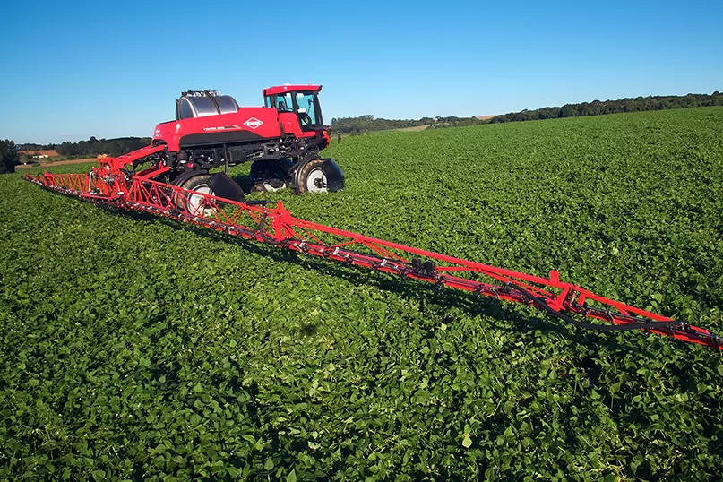
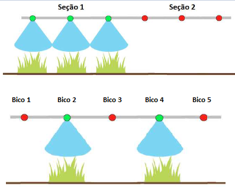
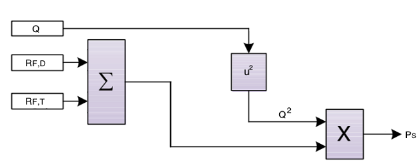
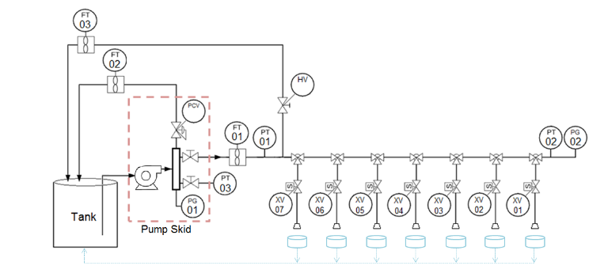
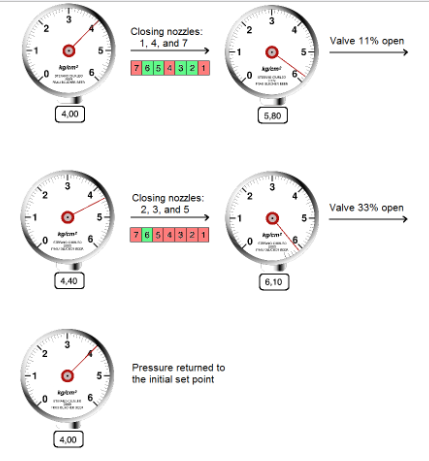
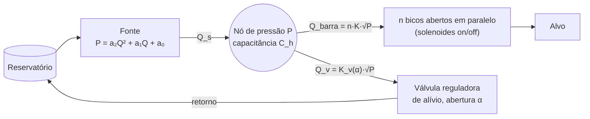
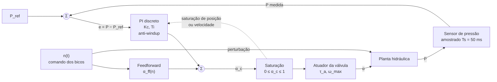
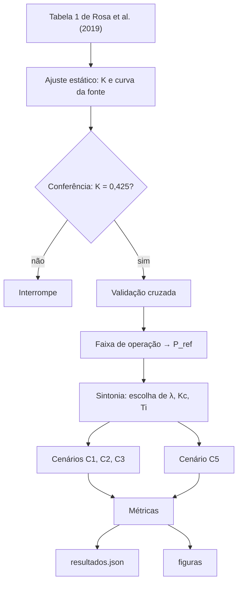
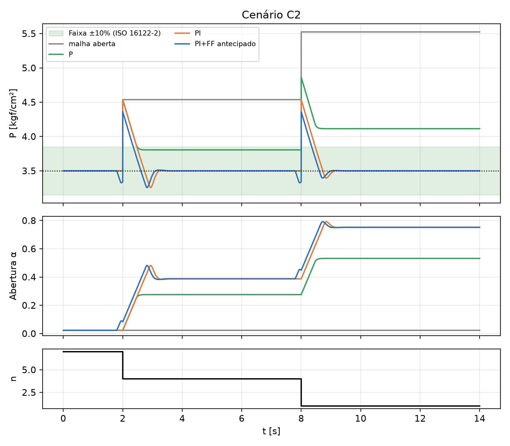

# UNIVERSIDADE DO ESTADO DE MATO GROSSO
**FACULDADE DE CIÊNCIAS EXATAS E TECNOLÓGICAS**
**CURSO DE BACHARELADO EM ENGENHARIA ELÉTRICA**

**ALEX DE JESUS TEROLTI**

**MODELAGEM DE SISTEMA DE CONTROLE PARA PULVERIZAÇÃO AGRÍCOLA DE PRECISÃO**

SINOP – MT
[ANO DA DEFESA]

---

## FOLHA DE ROSTO

**ALEX DE JESUS TEROLTI**

**MODELAGEM DE SISTEMA DE CONTROLE PARA PULVERIZAÇÃO AGRÍCOLA DE PRECISÃO**

> Trabalho de Conclusão de Curso apresentado à Banca Examinadora do Curso de Engenharia Elétrica - UNEMAT, Campus Universitário de Sinop - MT, como pré-requisito para a obtenção do título de Bacharel em Engenharia Elétrica.
>
> Orientador: Prof. Dr. Rogério Bastos Quirino

SINOP – MT
[ANO DA DEFESA]

---

[FICHA CATALOGRÁFICA — gerar em http://biblioteca.unemat.br/gfc]

[FOLHA DE APROVAÇÃO — avaliadores, orientador, presidente da banca, "Aprovado em __/__/__"; imprimir, assinar na defesa e digitalizar]

---

## RESUMO

Na pulverização localizada, cada bico da barra é aberto ou fechado separadamente, o que economiza produto. O problema é que, quando os bicos são alimentados por uma mesma mangueira, cada abertura ou fechamento muda a pressão na barra e, com ela, a vazão dos outros bicos e o tamanho das gotas. Este trabalho monta um modelo matemático simples da barra e usa esse modelo para testar, em simulação, um controlador que mantém a pressão estável enquanto os bicos comutam. O modelo usa a ideia de resistência fluídica, em que a queda de pressão em cada peça é proporcional ao quadrado da vazão, e acrescenta três elementos: os bicos abertos em paralelo, uma curva de pressão por vazão para a bomba e uma válvula de alívio como atuador. Os parâmetros foram tirados de dados publicados de uma bancada com sete bicos. Com uma constante de bico de 0,425 (L/min)/√(kgf/cm²) e uma curva de segundo grau para a bomba, o modelo reproduziu os sete pontos medidos com erro máximo de 0,7% na pressão e 2,3% na vazão; ao prever cada ponto sem usá-lo no ajuste, o erro máximo ficou em 0,9% e 2,7%. Depois foram acrescentadas a dinâmica da pressão, com uma capacitância estimada pelo volume e pela elasticidade da mangueira, e a dinâmica da válvula, que tem curso e velocidade limitados. Foi projetado um controlador proporcional-integral, com e sem uma correção antecipada pelo número de bicos abertos, e tudo foi simulado em Python. O controlador manteve a pressão dentro da faixa que corresponde a ±5% na vazão do bico durante 100% do tempo quando os bicos fecham e abrem um de cada vez, e durante cerca de 95% do tempo com comutação aleatória, contra 31% e 9% sem controle. Quando três bicos fecham ao mesmo tempo, a pressão ainda sai da faixa por alguns décimos de segundo, porque a válvula não consegue se mover rápido o bastante. A correção antecipada trouxe ganho pequeno com o modelo exato e piorou o resultado quando o modelo usado pelo controlador tinha erros, o que mostra que a parte integral do controlador é a que garante o resultado. A hipótese foi, portanto, confirmada em parte, e a validação com medições no tempo continua necessária.

**Palavras-chave:** Pulverização agrícola. Controle bico a bico. Resistência fluídica. Controle de pressão. Modelagem matemática.

## ABSTRACT

In spot spraying, each boom nozzle is switched on or off separately, which saves product. The problem is that, when the nozzles share the same feed line, every switching event changes the boom pressure and, with it, the flow rate of the other nozzles and the droplet size. This work builds a simple mathematical model of the boom and uses it to test, in simulation, a controller that keeps the pressure stable while the nozzles switch. The model uses the idea of fluidic resistance, in which the pressure drop across each component is proportional to the square of the flow rate, and adds three elements: the open nozzles in parallel, a pressure-flow curve for the pump and a relief valve as the actuator. The parameters were taken from published data of a seven-nozzle test bench. With a nozzle constant of 0.425 (L/min)/√(kgf/cm²) and a second-order pump curve, the model reproduced the seven measured points with a maximum error of 0.7% in pressure and 2.3% in flow rate; when each point was predicted without being used in the fit, the maximum error was 0.9% and 2.7%. Then the pressure dynamics, with a capacitance estimated from the hose volume and elasticity, and the valve dynamics, with limited stroke and speed, were added. A proportional-integral controller was designed, with and without a feedforward correction based on the number of open nozzles, and everything was simulated in Python. The controller kept the pressure inside the band that corresponds to ±5% of nozzle flow 100% of the time when the nozzles close and open one at a time, and about 95% of the time under random switching, against 31% and 9% without control. When three nozzles close at once, the pressure still leaves the band for a few tenths of a second, because the valve cannot move fast enough. The feedforward correction gave a small gain with the exact model and made the result worse when the model used by the controller had errors, which shows that the integral part of the controller is what guarantees the result. The hypothesis was therefore partly confirmed, and validation with time measurements is still needed.

**Keywords:** Agricultural spraying. Nozzle-by-nozzle control. Fluidic resistance. Pressure control. Mathematical modeling.

---

## LISTA DE ABREVIATURAS E SIGLAS

| Sigla | Significado |
|---|---|
| AP | Agricultura de Precisão |
| FF | Compensação antecipativa (*feedforward*) |
| FT | Transmissor de vazão (*flow transmitter*, ISA 5.1) |
| HV | Válvula manual ou de recirculação (*hand valve*, ISA 5.1) |
| IAE | Integral do erro absoluto (*Integral of Absolute Error*) |
| INCA | Instituto Nacional do Câncer |
| ISA | *International Society of Automation* |
| LOO | Validação cruzada "deixa um de fora" (*leave-one-out*) |
| ODS | Objetivos de Desenvolvimento Sustentável |
| PI | Proporcional-Integral |
| PID | Proporcional-Integral-Derivativo |
| PCV | Válvula de controle de pressão autorregulada (*pressure control valve*, ISA 5.1) |
| PG | Manômetro (*pressure gauge*, ISA 5.1) |
| PT | Transmissor de pressão (*pressure transmitter*, ISA 5.1) |
| PV | Válvula de controle de pressão (*pressure valve*, ISA 5.1) |
| RMSE | Raiz do erro quadrático médio (*Root Mean Square Error*) |
| SIMC | Regra de sintonia de Skogestad (*Simple Internal Model Control*) |
| TDP | Tomada de Potência |
| XV | Válvula solenoide liga/desliga (ISA 5.1) |
| VRT | Tecnologia de aplicação em taxa variável (*Variable Rate Technology*) |

## LISTA DE SÍMBOLOS

| Símbolo | Significado | Unidade |
|---|---|---|
| $P$ | Pressão manométrica na barra | kgf/cm² (1 kgf/cm² = 98,0665 kPa) |
| $Q$ | Vazão volumétrica | L/min |
| $R_F$ | Resistência fluídica | (kgf/cm²)/(L/min)² |
| $K$ | Constante de vazão de um bico | (L/min)/√(kgf/cm²) |
| $n$ | Número de bicos abertos | — |
| $Q_s$ | Vazão fornecida pela fonte (bomba + regulação interna) | L/min |
| $a_2$, $a_1$, $a_0$ | Coeficientes da curva da fonte | — |
| $Q_v$ | Vazão desviada pela válvula reguladora | L/min |
| $K_v(\alpha)$, $K_{v,max}$ | Constante de vazão da válvula e seu valor com a válvula toda aberta | (L/min)/√(kgf/cm²) |
| $\alpha$, $\alpha_c$ | Abertura da válvula e abertura comandada | 0 a 1 |
| $\alpha_{ff}$ | Abertura calculada pela compensação antecipativa | 0 a 1 |
| $C_h$ | Capacitância hidráulica da linha | mL/(kgf/cm²) |
| $V$, $\beta$ | Volume da mangueira e módulo volumétrico efetivo | mL, MPa |
| $\tau_a$, $\omega_{max}$ | Constante de tempo e velocidade máxima do atuador da válvula | s, 1/s |
| $K_g$, $\tau_p$ | Ganho e constante de tempo da planta linearizada | kgf/cm², s |
| $\tau_1$, $\theta$ | Constante de tempo dominante e atraso usados na sintonia | s |
| $K_c$, $T_i$ | Ganho proporcional e tempo integral do PI | (kgf/cm²)⁻¹, s |
| $K_p$, $K_i$, $K_d$ | Ganhos proporcional, integral e derivativo do PID (Equação 2.10) | — |
| $T_d$ | Tempo derivativo do PID | s |
| $\lambda$ | Constante de tempo desejada em malha fechada | s |
| $T_s$, $\Delta t$ | Período de amostragem do controlador e passo da simulação | s |
| $e$ | Erro de pressão, $P - P_{ref}$ | kgf/cm² |
| $Re$ | Número de Reynolds | — |
| $C_D$ | Coeficiente de descarga | — |

## SUMÁRIO

1 INTRODUÇÃO
2 FUNDAMENTAÇÃO TEÓRICA
3 METODOLOGIA
4 RESULTADOS
5 CONCLUSÃO
REFERÊNCIAS

---

# 1 INTRODUÇÃO

A modernização da agricultura na segunda metade do século XX, conhecida como Revolução Verde, trouxe máquinas, sementes de alto rendimento e o uso intenso de insumos, entre eles os agrotóxicos, cujo consumo cresceu a partir da década de 1950 (MACHADO et al., 2005). Segundo o Instituto Nacional do Câncer (INCA), o consumo médio no Brasil equivale a cerca de 5 litros de agrotóxico por habitante por ano (MILHORANCE, 2015 apud ROSA; TERRA; DREWS JR, 2019). Em alguns casos, por causa da deriva, até 99,9% do produto aplicado pode chegar às águas superficiais e subterrâneas (RIBEIRO et al., 2007 apud ROSA; TERRA; DREWS JR, 2019). Diminuir esse desperdício está de acordo com os Objetivos de Desenvolvimento Sustentável (ODS), principalmente os de agricultura sustentável e de consumo e produção responsáveis (BRASIL, 2025).

No pulverizador de barras, a calda (mistura de água, defensivo e, às vezes, adjuvantes) fica em um tanque, é pressurizada por uma bomba, passa por mangueiras e válvulas e é quebrada em gotas pelos bicos (JACTO, 2017; AGRIQ, 2025). A pressão é a variável mais importante desse caminho: é ela que define quanto líquido sai de cada bico e o tamanho das gotas.

A agricultura de precisão oferece duas formas de não aplicar produto onde ele não é necessário: o controle por seções, que liga e desliga grupos de bicos, e o controle bico a bico, em que cada ponta é comandada sozinha (ROSA; TERRA; DREWS JR, 2019). O controle bico a bico é mais preciso, mas cria um problema hidráulico: cada vez que um bico abre ou fecha, a vazão total que a barra pede muda de repente.

## 1.1 Problema e hipótese

Na barra com alimentação em série, uma única mangueira principal alimenta todos os bicos. As mangueiras, as conexões, as pontas e as válvulas oferecem resistência à passagem do líquido. Por isso, quando bicos fecham, sobra líquido na linha e a pressão sobe; quando bicos abrem, a pressão cai (ROSA; TERRA; DREWS JR, 2019). Rosa, Terra e Drews Jr (2019) mediram esse efeito em uma barra de sete bicos: com a válvula de recirculação fechada, a pressão foi de 3,57 kgf/cm² com sete bicos abertos para 5,58 kgf/cm² com um bico aberto, um aumento de 56%. Os mesmos autores mostraram que, abrindo à mão uma válvula de alívio, a pressão volta ao valor desejado, e sugeriram como trabalho futuro colocar essa válvula no modelo e fazer o controle automático.

O problema deste trabalho é, então: **como manter a pressão da barra perto do valor desejado enquanto os bicos abrem e fecham um a um**, usando um modelo matemático do circuito e da válvula.

**Hipótese:** um modelo de resistências fluídicas que inclua os bicos em paralelo, a curva da bomba e a válvula de alívio, junto com a dinâmica da pressão e da válvula, é suficiente para projetar um controlador que mantenha a pressão dentro de cerca de ±10% do valor de referência (o que corresponde a ±5% na vazão de cada bico, como explicado na seção 3.6) durante sequências de abertura e fechamento de bicos.

## 1.2 Objetivos

### 1.2.1 Objetivo geral

Desenvolver o modelo matemático e a simulação de um sistema de controle de pressão para uma barra de pulverização com acionamento bico a bico, buscando manter estáveis a pressão e a vazão enquanto os bicos abrem e fecham.

### 1.2.2 Objetivos específicos

- Modelar a relação entre pressão e vazão da barra em função do número de bicos abertos.
- Incluir no modelo a bomba (fonte) e a válvula de alívio.
- Acrescentar a dinâmica da pressão e da válvula, incluindo seus limites.
- Projetar um controlador em malha fechada para a pressão.
- Simular sequências de abertura e fechamento de bicos e avaliar o resultado com métricas numéricas.
- Comparar o modelo com os dados publicados por Rosa, Terra e Drews Jr (2019).

## 1.3 Justificativa

A pressão de trabalho define a vazão de cada bico e, portanto, quanto produto cai em cada metro quadrado. Se ela varia quando os bicos abrem ou fecham, a dose aplicada se afasta da dose recomendada (MANTOVANI; QUEIROZ; DIAS, 2009), com dois efeitos opostos (HARTMANN-SCHMIDT, 2006):

- **Superdosagem:** gasta mais dinheiro sem aumentar a produção, desperdiça produto no solo e no ambiente e pode queimar folhas, derrubar flores e frutos ou atrasar o crescimento.
- **Subdosagem:** não controla bem pragas, doenças e plantas daninhas, obriga a reaplicar e favorece o aparecimento de populações resistentes (MANTOVANI; QUEIROZ; DIAS, 2009).

Além disso, a pressão muda o tamanho das gotas, o que afeta a cobertura das folhas e o risco de deriva (HOLTERMAN et al., 2016 apud ROSA; TERRA; DREWS JR, 2019).

Os sistemas comerciais com controle bico a bico em série são caros (ROSA; TERRA; DREWS JR, 2019), e testar em uma máquina real gasta calda, exige a máquina disponível e tem riscos. Fazer primeiro o modelo e a simulação permite testar ideias de controle, ajustar parâmetros e descobrir os limites da válvula antes de montar qualquer coisa, com custo e risco baixos. Esse também foi o caminho de Steward e Humburg (2000), que modelaram as partes de um sistema comercial, conferiram os modelos em bancada e usaram a simulação para comparar variações do controlador, da velocidade da válvula e da taxa de amostragem.

Um modelo só é útil se puder ser conferido com medidas reais. Por isso este trabalho parte da bancada de Rosa, Terra e Drews Jr (2019), que publicou dados de pressão e vazão para cada número de bicos abertos, medidos em condições controladas: cada bico tem o seu estado conhecido, a pressão é medida na entrada e no fim da barra e a vazão é medida antes da barra. Com esses dados é possível identificar os parâmetros do modelo e verificar se ele reproduz o que foi medido.

A mesma escolha define o atuador. Existem duas formas comuns de ajustar a pressão na barra: mudar a rotação da bomba ou usar uma válvula que devolve o excesso de vazão para o tanque (seção 2.3). Neste trabalho foi escolhida a **válvula de alívio**, por três motivos:

- é o atuador da bancada de referência, e os autores mostraram em ensaio que abrir essa válvula traz a pressão de volta ao valor desejado depois que bicos fecham (ROSA; TERRA; DREWS JR, 2019). Há, portanto, uma medida real do efeito do atuador;
- válvulas reguladoras também são usadas em sistemas comerciais de controle de vazão, como o estudado por Steward e Humburg (2000), o que deixa o resultado mais próximo do que existe nas máquinas;
- para usar a rotação da bomba como atuador seria preciso modelar também o motor e o inversor de frequência, e não há dados publicados dessa bancada para conferir esse modelo.

Como visto na seção 1.1, no ensaio da bancada a válvula foi ajustada à mão, e os próprios autores deixaram como trabalho futuro incluí-la no modelo e fechar a malha de controle. Este trabalho dá esse passo em simulação. A comparação com registros de máquinas em operação no campo fica para uma etapa seguinte, depois que o modelo e o controlador estiverem bem entendidos.

## 1.4 Estrutura do trabalho

O Capítulo 2 apresenta os pulverizadores de barras, a pulverização localizada, o circuito hidráulico, a ideia de resistência fluídica e o básico do controle de pulverização. O Capítulo 3 mostra, passo a passo, como o modelo e o controlador foram montados, como a simulação funciona e como o programa em Python foi organizado. O Capítulo 4 traz os resultados: o ajuste do modelo aos dados publicados e as simulações com e sem controle. O Capítulo 5 traz a conclusão.

---

# 2 FUNDAMENTAÇÃO TEÓRICA

## 2.1 Pulverizadores agrícolas de barras

Os pulverizadores servem para aplicar defensivos (herbicidas, inseticidas, fungicidas, acaricidas), fertilizantes e nutrientes (JACTO, 2017). Na aplicação líquida, o produto é quebrado em gotas cujo tamanho influencia a penetração, a cobertura e a deriva: gotas pequenas são levadas pelo vento com mais facilidade, e gotas grandes grudam menos nas folhas. O ideal é um tamanho de gota uniforme, que depende principalmente dos bicos (MACHADO et al., 2005). Existem vários tipos de equipamento, como o costal manual, o atomizador, o pulverizador de barras puxado por trator, o autopropelido e o avião agrícola (SCHLOSSER, 2002) [REF. PENDENTE]. Este trabalho trata dos pulverizadores de barras.

Nos **pulverizadores tratorizados**, presos ao trator pelo engate de três pontos ou puxados, a bomba é girada pela Tomada de Potência (TDP). O conjunto tem o tanque de calda, a bomba e as barras com os bicos; um dispositivo antigotejo evita que pingue líquido quando a bomba para.

Os **pulverizadores autopropelidos** andam sozinhos e são usados principalmente em propriedades grandes. Muitos modelos já vêm com controle individual de bicos, posicionamento por satélite e ajuste automático da altura da barra. Trabalham mais rápido, mas a manutenção é mais complicada e exigem operadores treinados (CASALI, 2012). A Figura 1 mostra esse tipo de máquina.

**Figura 1 – Pulverizador autopropelido de barras.**



Fonte: KUHN (2025).

## 2.2 Agricultura de precisão e pulverização localizada

A agricultura de precisão (AP) começou a se desenvolver no fim da década de 1980, com monitores de colheita, sensores de solo, posicionamento por satélite e tecnologias de aplicação em taxa variável (VRT) (ZHANG; PIERCE, 2016) [REF. PENDENTE]. Na aplicação convencional, o defensivo é espalhado de forma igual em toda a área, embora as plantas daninhas, pragas e doenças apareçam em manchas (SHIRATSUCHI; CHRISTOFFOLETI; FONTES, 2013) [REF. PENDENTE]. Isso leva a aplicar produto onde não precisa, a sobrepor faixas e a desperdiçar nas bordas e manobras.

Na **pulverização localizada**, o produto só é aplicado onde é necessário, a partir de sensores, imagens ou mapas que mostram as áreas a tratar. Além de gastar menos produto, isso diminui a exposição desnecessária das plantas e pragas ao produto e, com isso, a seleção de organismos resistentes (SHIRATSUCHI; CHRISTOFFOLETI, 2002).

Do lado da máquina, existem dois níveis de seletividade (ROSA; TERRA; DREWS JR, 2019), mostrados na Figura 2:

- **Controle por seções:** grupos de bicos abrem e fecham juntos. Não consegue tratar trechos menores que uma seção.
- **Controle bico a bico:** cada ponta é comandada sozinha. Pode ser **em paralelo**, quando cada bico tem sua própria ligação com o tanque, ou **em série**, quando uma mangueira principal alimenta vários bicos. A ligação em série, usada nas máquinas comerciais, é a que faz um bico "sentir" o que acontece com os outros, e é o foco deste trabalho.

**Figura 2 – Controle por seções e controle bico a bico.**



Fonte: adaptado de Rosa, Terra e Drews Jr (2019).

Na Figura 2, os bicos verdes estão abertos e os vermelhos, fechados. Em cima, no controle por seções, os três bicos da seção 1 abrem e fecham juntos, e a seção 2 inteira fica fechada. Embaixo, no controle bico a bico, só os bicos 2 e 4, que estão sobre as plantas, ficam abertos.

## 2.3 Circuito hidráulico do pulverizador

As partes principais do circuito são o tanque, a bomba, a linha de condução, a válvula reguladora e os bicos (JACTO, 2017). Nas referências consultadas aparecem dois tipos de bomba:

- **Deslocamento positivo (pistão):** a vazão é proporcional à rotação. Rosa, Terra e Drews Jr (2019) usaram uma bomba de pistão de 14 L/min girada por um motor elétrico com inversor de frequência, imitando a TDP.
- **Centrífuga:** a pressão gerada cai quando a vazão aumenta, seguindo uma curva característica. Steward e Humburg (2000) representaram essa curva com um polinômio de segundo grau ajustado a medições.

A pressão pode ser ajustada mudando a rotação da bomba ou com uma **válvula reguladora que devolve o excesso de vazão** para o tanque. Rosa, Terra e Drews Jr (2019) usaram uma válvula agulha de 1/4" movida por um servomotor. Steward e Humburg (2000) usaram uma válvula borboleta movida por um motorredutor de corrente contínua.

Os **bicos** transformam a calda sob pressão em gotas. Na bancada de Rosa, Terra e Drews Jr (2019) foram usados bicos de leque FanTip 0,2 com 110° de abertura, cada um com uma válvula solenoide liga-desliga com antigotejo; segundo o fabricante, cada bico solta cerca de 0,92 L/min a 4,0 bar.

## 2.4 Modelagem por resistência fluídica

### 2.4.1 Regime de escoamento

O jeito como pressão e vazão se relacionam depende do tipo de escoamento, que é indicado pelo número de Reynolds (HUGHES, 2002 apud ROSA; TERRA; DREWS JR, 2019):

$$Re = \frac{\rho \, d_i \, v}{\mu} \tag{2.1}$$

em que $\rho$ é a massa específica do líquido [kg/m³], $d_i$ o diâmetro interno do tubo [m], $v$ a velocidade média [m/s] e $\mu$ a viscosidade [Pa·s]. Segundo Garcia (2005 apud ROSA; TERRA; DREWS JR, 2019), o escoamento é laminar (em camadas, sem mistura) para $Re < 1100$, turbulento para $Re > 3500$ e de transição entre esses valores; esses limites mudam um pouco de autor para autor. Na bancada de Rosa, Terra e Drews Jr (2019), $Re$ foi de cerca de 1700 com um bico aberto para cerca de 9400 com sete, ou seja, o escoamento passa de transição para turbulento conforme os bicos abrem.

### 2.4.2 Lei de orifício

Para um escoamento que não muda com o tempo, entre dois pontos na mesma altura, a equação de Bernoulli e a conservação da massa dizem que (ROSA; TERRA; DREWS JR, 2019):

$$P_1 + \frac{1}{2}\rho v_1^2 = P_2 + \frac{1}{2}\rho v_2^2, \qquad A_1 v_1 = A_2 v_2 \tag{2.2}$$

A primeira parte diz que a energia do líquido se conserva: se a velocidade aumenta (no estreitamento), a pressão diminui. A segunda diz que a mesma quantidade de líquido passa por qualquer seção. Juntando as duas e corrigindo a vazão teórica com o coeficiente de descarga $C_D = Q_r/Q_t$, que leva em conta as perdas reais, chega-se a:

$$Q = C_D \, A_1 \sqrt{\frac{2\,\Delta P}{\rho\left[(A_1/A_2)^2 - 1\right]}} \tag{2.3}$$

O ponto importante dessa equação é que **a vazão é proporcional à raiz quadrada da diferença de pressão**. Steward e Humburg (2000) usaram a mesma forma para todas as peças do circuito, menos a bomba (MERRITT, 1967 apud STEWARD; HUMBURG, 2000).

### 2.4.3 Resistência fluídica

Elevando a Equação (2.3) ao quadrado e isolando a queda de pressão, sobra uma relação quadrática:

$$\Delta P = R_F \, Q^2 \tag{2.4}$$

em que $R_F$ é a resistência fluídica da peça (ROSA; TERRA; DREWS JR, 2019). Ou seja, a queda de pressão em cada peça cresce com o quadrado da vazão que passa por ela: dobrando a vazão, a queda de pressão fica quatro vezes maior. Quanto maior $R_F$, mais a peça dificulta a passagem do líquido. Steward e Humburg (2000) chamam a mesma grandeza de coeficiente pressão-vazão, $K_Q$. Para restrições localizadas, como pontas e válvulas, e para trechos de tubo, Rosa, Terra e Drews Jr (2019) dão, respectivamente:

$$R_{F,D} = \frac{\rho}{2\,C_D^2\,A_i^2}, \qquad R_{F,T} = \frac{f_a\,L\,\rho}{2\,d_i\,A_i^2} \tag{2.5}$$

em que $A_i$ é a área interna, $L$ o comprimento do trecho e $f_a$ o coeficiente de perda, tirado do diagrama de Moody em função de $Re$ (BEGA et al., 2006 apud ROSA; TERRA; DREWS JR, 2019). Como as resistências estão em série, a pressão do sistema é a soma:

$$P_S = \left(R_{F,D} + R_{F,T}\right)Q^2 \tag{2.6}$$

A Figura 3 mostra o diagrama de blocos dessa conta. É um modelo **estático**: ele diz qual é a pressão para uma certa vazão, mas não diz quanto tempo a pressão leva para mudar.

**Figura 3 – Diagrama de blocos do modelo de resistência fluídica.**



Fonte: Rosa, Terra e Drews Jr (2019).

A Figura 3 deve ser lida da esquerda para a direita e repete a Equação (2.6) em forma de blocos. As duas resistências, $R_{F,D}$ e $R_{F,T}$, entram no somador (Σ) e são somadas. A vazão $Q$ passa pelo bloco "u²", que a eleva ao quadrado. No fim, o multiplicador (X) multiplica a soma das resistências por $Q^2$, e a saída é a pressão do sistema $P_S$.

Com ensaios de 1 a 7 bicos abertos, Rosa, Terra e Drews Jr (2019) ajustaram uma fórmula empírica (sem significado físico direto) para a resistência da barra em função do número $n$ de bicos abertos:

$$R_F(n) = 42{,}59\,e^{-2{,}335\,n} + 2{,}307\,e^{-0{,}4591\,n} \tag{2.7}$$

### 2.4.4 Associação de elementos e equação de malha

Quando $n$ peças iguais, de coeficiente $K_Q$, trabalham em paralelo com a mesma diferença de pressão, a vazão se divide igualmente entre elas. O coeficiente equivalente é $K_Q/n^2$: com $n$ bicos, cada um leva $Q/n$, e a queda de pressão fica $K_Q(Q/n)^2 = (K_Q/n^2)Q^2$. Steward e Humburg (2000) usaram esse resultado para cinco reguladores de vazão que faziam o papel dos bicos.

Esses autores trataram o circuito como uma malha em que a pressão gerada pela bomba centrífuga, dada por uma curva de segundo grau, é igual à soma das quedas de pressão na válvula, nos bicos, no medidor de vazão e na tubulação:

$$a_2 Q^2 + a_1 Q + a_0 = \left[K_{QV}(\theta) + K_{QN} + K_{QFM} + K_{QP}\right] Q^2 \tag{2.8}$$

Resolvendo essa equação de segundo grau, sai a vazão em função do ângulo $\theta$ da válvula. Nesse circuito, a tubulação tinha coeficiente maior (0,022 kPa/(L/min)²) que os bicos (0,012 kPa/(L/min)²) (STEWARD; HUMBURG, 2000). Já na barra de Rosa, Terra e Drews Jr (2019), os sensores de pressão do começo e do fim da barra marcaram valores muito próximos, ou seja, a perda ao longo da barra era pequena. A diferença vem da vazão (cerca de 90 L/min contra no máximo 5,6 L/min), e mostra que a perda na tubulação precisa ser avaliada em cada caso.

## 2.5 Pressão, vazão e tamanho de gota

Cada bico é feito para produzir gotas de um certo tamanho, adequado ao alvo. Se a pressão muda, mudam a vazão e o tamanho das gotas, o que prejudica a uniformidade e aumenta o risco de deriva ou escorrimento (HOLTERMAN et al., 2016 apud ROSA; TERRA; DREWS JR, 2019). O vento, a pressão e o tipo de ponta influenciam a deriva (COSTA et al., 2007). Como a vazão do bico varia com a raiz quadrada da pressão (Equação 2.3), manter a pressão estável é a condição para manter a dose de cada bico.

## 2.6 Controle de pulverização

Os controladores eletrônicos das máquinas ajustam a vazão aplicada quando a velocidade do equipamento muda e, nos sistemas mais novos, também ligam e desligam seções e controlam a altura da barra. Eles juntam sensores de vazão e de velocidade e um atuador que ajusta o fluxo de calda. A vazão desejada é calculada a partir da dose, da velocidade e da largura da barra, e um sensor de vazão "fecha a malha", ou seja, mede o resultado e corrige automaticamente (MERCALDI, 2012). Em unidades práticas:

$$Q_{ref}\,[\text{L/min}] = \frac{D\,[\text{L/ha}] \cdot v\,[\text{km/h}] \cdot L\,[\text{m}]}{600} \tag{2.9}$$

O fator 600 sai da conversão de unidades: 1 ha = 10⁴ m² e 1 km/h = 1000/60 m/min.

**Malha aberta e malha fechada.** Em malha aberta, o comando é calculado uma vez e aplicado sem conferir o resultado. Em malha fechada, o controlador mede a saída a todo momento, compara com o valor desejado e corrige a diferença, chamada de erro. O controlador em malha fechada mais usado é o proporcional-integral-derivativo (PID), que soma três ações calculadas a partir do erro $e(t)$ (OGATA, 2003) [REF. PENDENTE — ver notas].

Uma malha fechada tem sempre as mesmas partes, e no pulverizador cada uma tem um papel claro:

- **referência** (*setpoint*): o valor desejado, aqui a pressão de trabalho $P_{ref}$;
- **sensor**: o transmissor de pressão, que mede o valor real $P$;
- **erro**: a diferença entre o valor desejado e o medido;
- **controlador**: o cálculo que transforma o erro em um comando $u(t)$;
- **atuador**: a peça que obedece ao comando, aqui a válvula reguladora;
- **planta**: o sistema que se quer controlar, aqui a barra com seus bicos.

A cada instante o sensor mede, o controlador calcula o erro e o comando, e o atuador muda de posição. A pressão então muda, o sensor mede de novo, e o ciclo se repete. Por isso a malha fechada corrige sozinha perturbações que o projetista não previu, como um bico que fecha ou uma bomba que perde rendimento. Na malha aberta isso não acontece, porque ninguém confere o resultado.

O PID calcula o comando somando três parcelas, cada uma com o seu ganho:

$$u(t) = K_p\,e(t) + K_i \int_0^t{e(\tau)\,d\tau} + K_d\,\frac{de(t)}{dt} \tag{2.10}$$

em que $K_p$, $K_i$ e $K_d$ são os ganhos proporcional, integral e derivativo. Cada parcela olha para o erro de um jeito diferente:

- **Ação proporcional** ($K_p\,e$): olha para o erro **agora**. O comando é proporcional ao erro: erro grande, correção grande; erro pequeno, correção pequena. É a parte que reage mais rápido. Sozinha, porém, ela costuma deixar um erro no fim, chamado de **erro em regime permanente**. O motivo é que, se o erro chegasse a zero, o comando também iria a zero, e a válvula voltaria para onde estava antes. Para manter a válvula na nova posição, precisa sobrar algum erro. Aumentar $K_p$ diminui esse erro restante, mas deixa a resposta mais oscilatória e, se exagerado, instável.
- **Ação integral** ($K_i\int e\,d\tau$): olha para o erro **acumulado no passado**. Ela vai somando o erro ao longo do tempo, como uma área embaixo da curva do erro. Enquanto existir qualquer erro, por menor que seja, essa soma continua crescendo e o comando continua mudando. A soma só para de crescer quando o erro chega a zero. Assim ela elimina o erro em regime permanente: depois que o erro zera, a parcela integral fica parada no valor que mantém a válvula na posição certa. O lado ruim é que ela é mais lenta e, com ganho alto demais, faz a saída passar do ponto e oscilar. Ela também causa o problema de *windup* quando o atuador chega no limite, tratado na seção 3.5.3.
- **Ação derivativa** ($K_d\,de/dt$): olha para a **tendência** do erro, ou seja, para a velocidade com que ele está mudando. Se o erro está diminuindo rápido, ela freia o comando antes de a saída passar do ponto, como quem tira o pé do acelerador antes de chegar no carro da frente. Ela ajuda a reduzir oscilações, mas amplifica o ruído do sensor: uma medida que treme um pouco tem derivada grande, e o comando passa a tremer também.

Os mesmos três termos também são escritos com um ganho só, $K_c$, e dois tempos, o tempo integral $T_i$ e o tempo derivativo $T_d$:

$$u(t) = K_c\left[e(t) + \frac{1}{T_i}\int_0^t{e(\tau)\,d\tau} + T_d\,\frac{de(t)}{dt}\right] \tag{2.11}$$

Comparando com a Equação (2.10), $K_p = K_c$, $K_i = K_c/T_i$ e $K_d = K_c\,T_d$. A vantagem dessa forma é que $T_i$ e $T_d$ têm unidade de tempo e um significado fácil de imaginar. Um $T_i$ pequeno quer dizer ação integral forte, que corrige o erro restante rápido. Um $T_i$ grande quer dizer ação integral fraca. Essa é a forma usada na sintonia da seção 3.5.4.

O sinal do erro depende do atuador. Em geral se usa $e = $ referência $-$ medida. No pulverizador deste trabalho, porém, abrir a válvula **diminui** a pressão, então o erro é definido ao contrário (seção 3.5.3), para que pressão alta demais gere o comando de abrir.

Neste trabalho foram usadas só as ações proporcional e integral, o chamado **controlador PI**. A ação integral é necessária para que a pressão volte exatamente à referência depois de cada troca de bicos. A derivativa foi deixada de fora por dois motivos: o modelo da barra é simples o bastante para que o PI tenha boas margens de estabilidade (seção 4.2.1), e a medida de pressão tem ruído, que a derivada amplificaria.

O desempenho também é limitado pelo atuador e pela medição. Steward e Humburg (2000) encontraram três limitações em um sistema comercial de controle de vazão:

- a **saturação da tensão** do motor da válvula, que limita a velocidade com que a válvula gira e é o que mais pesa no tempo de resposta;
- a **taxa lenta de atualização do medidor de vazão**, de cerca de 0,2 s no pior caso;
- a **relação não linear** entre a abertura da válvula, a pressão e a vazão.

Quando eles dobraram a velocidade da válvula, o tempo de resposta caiu pela metade, mas o sistema ficou instável com o mesmo ganho, e foi preciso reduzir o ganho proporcional de 20 para 10 (STEWARD; HUMBURG, 2000). Esse exemplo mostra que velocidade do atuador e ganho do controlador precisam ser pensados juntos.

---

# 3 METODOLOGIA

## 3.1 Tipo de pesquisa

A pesquisa é aplicada, porque busca resolver um problema prático da pulverização, e quantitativa, porque o sistema é descrito por equações e avaliado por números. As etapas foram: (i) revisão bibliográfica; (ii) modelo estático e ajuste dos parâmetros; (iii) modelo dinâmico; (iv) projeto do controlador; (v) simulação em Python; (vi) avaliação. Essa sequência segue a ideia de Steward e Humburg (2000): modelar cada parte, conferir com dados medidos e só então usar a simulação para testar o controle.

## 3.2 Sistema de referência

O sistema usado como referência é a bancada de Rosa, Terra e Drews Jr (2019), por três motivos:

- é uma barra com **controle bico a bico e alimentação em série**, que é o caso estudado;
- tem dados publicados de pressão e vazão para 1 a 7 bicos abertos;
- tem uma válvula reguladora de alívio, que é o atuador escolhido aqui.

A bancada tem:

- tanque de 100 L;
- bomba de pistão de 14 L/min com motor elétrico e inversor de frequência;
- barra de 5 m com sete bicos FanTip 0,2/110° e uma solenoide por bico;
- transmissores de pressão (PT) e de vazão (FT) e manômetros (PG);
- válvula agulha movida por servomotor, chamada de PV no texto em português do artigo e de HV no fluxograma.

A Figura 4 mostra o fluxograma de processo da bancada. Um fluxograma de processo é um desenho que mostra por onde o líquido passa e onde fica cada instrumento. Cada instrumento aparece num círculo com uma sigla (*tag*) da norma ISA 5.1: a primeira letra diz o que é medido ou controlado (P de pressão, F de vazão, H de manual) e as seguintes dizem a função (T de transmissor, G de indicador local, V de válvula). O número diferencia instrumentos do mesmo tipo.

**Figura 4 – Fluxograma de processo da bancada de referência.**



Fonte: Rosa, Terra e Drews Jr (2019).

Seguindo o caminho da calda na Figura 4:

1. **Tanque e conjunto da bomba.** A bomba puxa a calda do tanque. Ela e os componentes ao seu redor ficam dentro do retângulo tracejado, chamado de conjunto da bomba (*pump skid*). Na saída da bomba há um distribuidor com três saídas:
   - uma **válvula de controle de pressão (PCV)**, que devolve calda ao tanque passando pelo medidor de vazão FT-02. Pelo símbolo, é uma válvula autorregulada por mola: ela abre sozinha quando a pressão passa de um valor ajustado, sem comando eletrônico;
   - o transmissor PT-03 e o manômetro PG-01, que medem a pressão na saída da bomba;
   - uma válvula manual que libera a calda para a linha principal.
2. **Entrada da barra.** Na linha principal ficam o FT-01, que mede a vazão que vai para a barra, e o PT-01, que mede a pressão na entrada da barra.
3. **Válvula de recirculação (HV).** Logo depois do PT-01 sai um ramo com a válvula agulha HV, que devolve parte da calda ao tanque passando pelo FT-03. É essa válvula que os autores ajustaram à mão no ensaio da Tabela 2, e é ela o atuador do controle proposto neste trabalho.
4. **Barra e bicos.** A linha-tronco passa pelas sete solenoides (XV-07, perto da entrada, até XV-01, na ponta). O "S" no símbolo indica acionamento por solenoide. Cada solenoide abre ou fecha um bico. Embaixo dos bicos há recipientes que recolhem a calda pulverizada, e a linha pontilhada indica que ela volta ao tanque. Assim a bancada funciona em circuito fechado, sem gastar líquido.
5. **Fim da barra.** O PT-02 e o PG-02 medem a pressão na ponta da barra. Como PT-01 e PT-02 marcaram valores muito próximos, a perda de pressão ao longo da barra é pequena (hipótese H2, seção 3.3).

Com esse caminho dá para escrever dois balanços de vazão. Na saída da bomba, a vazão bombeada se divide entre a PCV (medida por FT-02) e a barra (FT-01). Na entrada da barra, a vazão do FT-01 se divide entre a HV (FT-03) e os bicos abertos. Na Tabela 1 a HV estava fechada, então o FT-01 mede a vazão que sai pelos bicos.

Para o modelo deste trabalho, isso significa que a bomba e a PCV podem ser tratadas juntas como uma única "fonte", e que a HV e os bicos são as duas saídas de líquido ligadas ao mesmo ponto de pressão (seção 3.3, Figura 6).

A Tabela 1 mostra os dados medidos com a válvula de recirculação fechada. As pressões são manométricas, em kgf/cm².

**Tabela 1 – Pressão e vazão da barra em função do número de bicos abertos.**

| Bicos abertos ($n$) | $P$ [kgf/cm²] | $Q$ [L/min] | $R_F$ equivalente = $P/Q^2$ |
|---|---|---|---|
| 7 | 3,57 | 5,60 | 0,114 |
| 6 | 3,88 | 5,07 | 0,151 |
| 5 | 4,24 | 4,40 | 0,219 |
| 4 | 4,64 | 3,60 | 0,358 |
| 3 | 4,96 | 2,80 | 0,633 |
| 2 | 5,27 | 2,00 | 1,318 |
| 1 | 5,58 | 1,00 | 5,580 |

Fonte: Rosa, Terra e Drews Jr (2019).

Os autores também fizeram um ensaio com a válvula reguladora. Partindo de 4,00 kgf/cm² com a válvula fechada, seguiram a sequência da Tabela 2, ajustando a válvula à mão.

**Tabela 2 – Ensaio de regulação da pressão pela válvula de alívio.**

| Etapa | Ação | Pressão resultante [kgf/cm²] |
|---|---|---|
| 1 | Fechamento dos bicos 1, 4 e 7 | 5,80 |
| 2 | Abertura da válvula em 11% | 4,40 |
| 3 | Fechamento dos bicos 2, 3 e 5 | 6,10 |
| 4 | Abertura da válvula em 33% | ≈ 4,00 |

Fonte: Rosa, Terra e Drews Jr (2019).

A Figura 5 resume esse ensaio. Cada manômetro mostra a pressão no fim de uma etapa. A faixa de sete quadrados indica o estado dos bicos (verde aberto, vermelho fechado), e a seta indica a ação feita entre uma leitura e a próxima.

**Figura 5 – Ensaio de regulação da pressão pela válvula de alívio.**



Fonte: Rosa, Terra e Drews Jr (2019).

## 3.3 Modelo estático

O modelo estático responde à pergunta: **com $n$ bicos abertos e a válvula numa certa abertura, qual é a pressão quando tudo já se acomodou?** Ele parte da Equação (2.6) e acrescenta só o necessário para incluir a válvula. Três caminhos se encontram no mesmo ponto de pressão $P$: a fonte, que empurra líquido para dentro, e os bicos e a válvula, que deixam o líquido sair (Figura 6).

**Figura 6 – Circuito hidráulico equivalente proposto.**



Fonte: elaborada pelo autor.

**Como ler a Figura 6.** A Figura 6 é uma versão simplificada do fluxograma da bancada (Figura 4). Ela guarda só o que importa para calcular a pressão. As setas mostram o sentido do líquido, e o texto sobre cada seta é a vazão naquele trecho. Cada bloco corresponde a uma parte da bancada:

- **Reservatório:** é o tanque da Figura 4. No modelo ele é só o lugar de onde o líquido sai e para onde volta. O nível dele não entra nas contas.
- **Fonte:** junta a bomba, a PCV do conjunto da bomba e as perdas antes da barra (hipótese H4). Em vez de modelar cada peça, o conjunto é descrito por uma única curva, a Equação (3.5): quanto maior a vazão $Q_s$ que a fonte entrega, menor a pressão que ela consegue manter. É por isso que a seta da fonte até o nó leva o nome $Q_s$.
- **Nó de pressão $P$:** representa a barra inteira como um único ponto com uma única pressão. Isso só vale porque a perda ao longo da barra é pequena (hipótese H2). A capacitância $C_h$ escrita no nó não aparece no modelo estático. Ela é usada no modelo dinâmico (seção 3.4.1) e representa a mangueira e o líquido, que "guardam" um pouco de volume quando a pressão sobe.
- **Bicos abertos:** são as solenoides XV com seus bicos. Os $n$ bicos abertos ficam em paralelo, ou seja, todos ligados ao mesmo nó e com a mesma pressão. Juntos eles deixam sair $Q_{barra} = n\,K\sqrt{P}$ (Equação 3.3). Essa vazão vai para o alvo, que na bancada são os recipientes de coleta e no campo é a lavoura.
- **Válvula reguladora de alívio:** é a HV da Figura 4, o atuador do controle. Ela deixa sair $Q_v = K_v(\alpha)\sqrt{P}$ (Equação 3.7), em que $\alpha$ é a abertura, de 0 (fechada) a 1 (toda aberta). Esse líquido não vai para a lavoura: a seta "retorno" leva de volta ao reservatório.

O ponto principal da figura é que **todo líquido que entra no nó tem que sair por algum caminho**. Em regime, isto é, quando a pressão já parou de mudar, a vazão da fonte é igual à soma das duas saídas: $Q_s = Q_{barra} + Q_v$. É esse balanço que dá a Equação (3.8) na seção 3.3.4.

Com o balanço dá para entender o que acontece nos dois tipos de mudança:

- **Quando bicos fecham** ($n$ diminui), sobra menos caminho para o líquido sair. A pressão no nó sobe até a fonte, seguindo a sua curva, entregar uma vazão menor que caiba nas saídas que restaram. Foi o que aconteceu na Tabela 1, em que a pressão subiu de 3,57 para 5,58 kgf/cm².
- **Quando a válvula abre** ($\alpha$ aumenta), surge um caminho extra de saída. A pressão cai, porque parte do líquido que antes era forçado pelos bicos agora volta ao reservatório. Foi o que os autores fizeram à mão no ensaio da Tabela 2.

Os dois efeitos são opostos. Por isso o controle pode usar a válvula para compensar os bicos: quando bicos fecham, ele abre a válvula na medida certa para que a soma $n\,K + K_v(\alpha)$ fique parecida com a de antes, e a pressão volta para perto da referência.

**Hipóteses adotadas** (simplificações feitas pelo autor):
- **H1:** o escoamento não muda com o tempo e a barra é horizontal (como em ROSA; TERRA; DREWS JR, 2019).
- **H2:** a perda de pressão ao longo da barra é desprezível, então todos os bicos trabalham com a mesma pressão $P$. Isso se apoia nas leituras quase iguais de PT-01 e PT-02 na bancada (ROSA; TERRA; DREWS JR, 2019) e precisaria ser revisto para barras longas (seção 2.4.4).
- **H3:** os bicos são iguais e todos seguem a lei de orifício.
- **H4:** a fonte (bomba, sua regulação interna e as perdas antes da barra) é representada por uma curva pressão-vazão de segundo grau, como em Steward e Humburg (2000).
- **H5:** a característica da válvula é linear, ou seja, sua constante de vazão é proporcional à abertura, porque a curva real da válvula não está nas fontes consultadas.

### 3.3.1 Bicos

Pela Equação (2.3), a vazão de um bico é proporcional à raiz da pressão. Juntando todas as constantes ($C_D$, área, massa específica) em um número só, $K$, a vazão de um bico fica:

$$q = K\sqrt{P} \tag{3.1}$$

Para encontrar $K$, basta isolar: $K = q/\sqrt{P}$. Na Tabela 1, a vazão de cada bico é $Q/n$, então cada linha da tabela dá um valor de $K$, e o valor usado é a média das sete linhas:

$$K = \frac{1}{7}\sum_{i=1}^{7}{\frac{Q_i}{n_i\sqrt{P_i}}} \tag{3.2}$$

Com $n$ bicos iguais em paralelo (H2 e H3), a vazão da barra é $n$ vezes a de um bico. Elevando ao quadrado e isolando $P$, aparece a forma de resistência da Equação (2.4):

$$Q_{barra} = n\,K\sqrt{P} \quad\Longleftrightarrow\quad P = \frac{R_b}{n^2}\,Q_{barra}^2, \qquad R_b = \frac{1}{K^2} \tag{3.3}$$

Ou seja, a resistência de $n$ bicos é a de um bico dividida por $n^2$, que é o resultado da seção 2.4.4. Essa fórmula substitui a Equação (2.7): em vez de quatro números ajustados sem significado físico, ela usa um só, $K$.

### 3.3.2 Fonte

Com a válvula de recirculação fechada, a vazão total caiu de 5,60 para 1,00 L/min conforme os bicos foram fechados (Tabela 1). Se a bomba de pistão entregasse sempre a mesma vazão, esse valor não mudaria. Então a vazão que chega à barra depende da pressão. O texto do artigo não explica por quê, mas o fluxograma (Figura 4) mostra uma **válvula de controle de pressão por mola (PCV)** dentro do conjunto da bomba, que devolve o excesso ao tanque. O formato dos dados é o esperado para esse tipo de válvula: com vazão quase zero (um bico aberto) a pressão fica perto de um máximo, e conforme mais bicos abrem a pressão cai devagar. Seja qual for o mecanismo, ele é representado pela curva de segundo grau da hipótese H4.

Os coeficientes $a_2$, $a_1$ e $a_0$ foram escolhidos pelo **método dos mínimos quadrados**, que procura os valores que deixam a menor soma dos erros ao quadrado entre a curva e os sete pontos medidos:

$$S = \sum_{i=1}^{7}{\left(P_i - a_2Q_i^2 - a_1Q_i - a_0\right)^2} \tag{3.4}$$

O menor valor de $S$ acontece onde as derivadas de $S$ em relação a $a_2$, $a_1$ e $a_0$ são zero. Isso dá um sistema de três equações lineares, que o Python resolve com a função `numpy.polyfit`. A curva fica:

$$P = a_2\,Q_s^2 + a_1\,Q_s + a_0 \tag{3.5}$$

No modelo, é mais útil ter a vazão em função da pressão. Isolando $Q_s$ na Equação (3.5) com a fórmula de Bhaskara e ficando com a raiz positiva:

$$Q_s(P) = \frac{-a_1 - \sqrt{a_1^2 - 4a_2(a_0 - P)}}{2a_2} \tag{3.6}$$

Como $a_2$ é negativo, o sinal de menos antes da raiz é o que dá vazão positiva. Acima de $P = a_0$ a fonte não consegue mais entregar líquido, e o programa considera $Q_s = 0$.

### 3.3.3 Válvula reguladora

A válvula também é uma restrição, então segue a lei de orifício. Pela hipótese H5, sua constante cresce em linha reta com a abertura $\alpha$, que vai de 0 (fechada) a 1 (toda aberta):

$$Q_v = K_v(\alpha)\sqrt{P}, \qquad K_v(\alpha) = K_{v,max}\,\alpha \tag{3.7}$$

### 3.3.4 Ponto de operação

Quando tudo se acomoda, o líquido que entra no nó é igual ao que sai. Igualando a Equação (3.6) à soma das vazões dos bicos (3.3) e da válvula (3.7):

$$Q_s(P) = \left[n\,K + K_v(\alpha)\right]\sqrt{P} \tag{3.8}$$

Essa equação não tem solução direta para $P$, então foi resolvida pelo **método da bissecção**: começa-se com um intervalo que certamente contém a resposta (de 0 até $a_0$), testa-se o ponto do meio, e fica-se com a metade em que a diferença entre os dois lados da Equação (3.8) troca de sinal. Repetindo isso 100 vezes, o intervalo fica muito menor que qualquer erro que interesse.

## 3.4 Modelo dinâmico

O modelo estático diz para onde a pressão vai, mas não quanto tempo ela leva para chegar lá. Para simular o controle, foram acrescentados dois efeitos.

### 3.4.1 Armazenamento na linha (capacitância)

Quando a pressão sobe, a mangueira estica um pouco e o líquido é comprimido um pouco, então cabe um pouco mais de líquido na linha. Esse efeito funciona como um capacitor num circuito elétrico: ele "segura" a pressão por um instante. A capacitância hidráulica $C_h$ é o volume a mais que cabe na linha para cada aumento de pressão. Ela pode ser estimada pelo volume $V$ da mangueira e por um módulo volumétrico efetivo $\beta$, que diz quão "dura" é a mangueira cheia de líquido [REF. PENDENTE — fundamentar em livro de hidráulica, por exemplo Merritt (1967), após consulta direta]:

$$C_h = \frac{dV}{dP} \approx \frac{V}{\beta} \tag{3.9}$$

Para a barra de 5 m da bancada, com diâmetro interno entre 10 e 13 mm, o volume da mangueira fica entre 393 e 664 mL. Para mangueiras com água, $\beta$ fica na faixa de 100 a 1000 MPa (valores a confirmar na literatura). Lembrando que 1 kgf/cm² = 0,098 MPa, a Equação (3.9) dá $C_h$ entre 0,04 e 0,65 mL/(kgf/cm²). Foi adotado **$C_h$ = 0,5 mL/(kgf/cm²)**, perto do valor mais alto da faixa, que corresponde a uma mangueira mais flexível.

Com a capacitância, o balanço de vazões da Equação (3.8) passa a ter um termo a mais: a diferença entre o que entra e o que sai não some, ela vai sendo guardada na linha e faz a pressão subir ou descer. O fator 1/60 converte L/min em L/s:

$$C_h\,\frac{dP}{dt} = \frac{1}{60}\left\{Q_s(P) - \left[n(t)\,K + K_v(\alpha)\right]\sqrt{P}\right\} \tag{3.10}$$

O lado direito será chamado de $f(P, \alpha, n)$. O número de bicos abertos $n(t)$ entra como uma **perturbação**, ou seja, algo que muda o sistema e que o controlador não escolhe. A troca das solenoides foi considerada instantânea.

### 3.4.2 Atuador da válvula

A válvula não abre de uma vez. O comando $\alpha_c$ é seguido com uma constante de tempo $\tau_a$ (como um circuito RC), e a velocidade de movimento não passa de $\omega_{max}$, que é o limite do motor da válvula. A abertura também fica sempre entre 0 e 1:

$$\frac{d\alpha}{dt} = \mathrm{sat}_{\pm\omega_{max}}\left(\frac{\alpha_c - \alpha}{\tau_a}\right), \qquad 0 \le \alpha \le 1 \tag{3.11}$$

A função "sat" (saturação) corta o valor quando ele passa do limite: se a conta pedir uma velocidade maior que $\omega_{max}$, a válvula anda só a $\omega_{max}$. Essa é a mesma limitação que Steward e Humburg (2000) encontraram no sistema comercial. Foram usados $\tau_a$ = 0,2 s e $\omega_{max}$ = 0,5 s⁻¹ (curso inteiro em 2 s); esses valores são estimativas, porque a bancada de referência não informa a velocidade da válvula.

### 3.4.3 Resolvendo as equações no tempo

O computador não resolve a Equação (3.10) de forma exata; ele avança no tempo em passos pequenos $\Delta t$. Foi usado o **método de Euler**: a pressão no próximo passo é a pressão atual mais a derivada $dP/dt = f/C_h$ vezes o tamanho do passo:

$$P_{k+1} = P_k + \frac{\Delta t}{C_h}\,f\left(P_k, \alpha_k, n_k\right) \tag{3.12}$$

O mesmo é feito com a abertura $\alpha$ na Equação (3.11). Com $C_h$ = 0,5 mL/(kgf/cm²), a pressão responde em cerca de 12 ms, então o passo precisa ser bem menor que isso. Foi usado $\Delta t$ = 1 ms, e o resultado foi conferido repetindo a simulação com 0,5 ms (seção 4.2.1).

## 3.5 Estratégia de controle

A variável que se quer controlar é a pressão $P$. A variável que o controlador pode mexer é a abertura da válvula $\alpha$. A perturbação é o número de bicos abertos $n(t)$. A Figura 7 mostra como as peças se ligam.

**Figura 7 – Diagrama de blocos do controle proposto.**



Fonte: elaborada pelo autor.

**Como ler a Figura 7.** O sinal anda da esquerda para a direita. No primeiro somador (Σ), a pressão medida é comparada com a referência, gerando o erro $e$. O PI transforma o erro em uma correção da abertura. No segundo somador, essa correção é somada à abertura calculada pelo *feedforward*, que vem do número de bicos. O comando passa pela saturação (não pode ser menor que 0 nem maior que 1) e vai para o atuador, que move a válvula. A válvula muda a pressão da planta, que também é afetada pelos bicos (a seta de perturbação). Por fim, o sensor mede a pressão e o ciclo recomeça. A seta tracejada avisa o PI quando a válvula está no limite, para ele parar de acumular erro.

### 3.5.1 Linearização: o que o controlador "enxerga"

As regras de sintonia de controladores PI funcionam para sistemas lineares, mas a Equação (3.10) não é linear (tem raiz quadrada e a curva da fonte). A saída é **linearizar**: olhar só para pequenas variações em torno do ponto de trabalho, onde a curva pode ser trocada por uma reta. Pela série de Taylor de primeira ordem, uma pequena variação $\Delta P$ em torno de $P_{ref}$ e uma pequena variação $\Delta\alpha$ em torno da abertura de equilíbrio $\alpha_{ff}$ se relacionam por:

$$C_h\,\frac{d\,\Delta P}{dt} = \frac{\partial f}{\partial P}\,\Delta P + \frac{\partial f}{\partial \alpha}\,\Delta\alpha \tag{3.13}$$

em que $f$ é o lado direito da Equação (3.10). Derivando cada termo:

$$\frac{\partial f}{\partial P} = \frac{1}{60}\left[Q_s'(P_{ref}) - \frac{n\,K + K_v(\alpha_{ff})}{2\sqrt{P_{ref}}}\right], \qquad \frac{\partial f}{\partial \alpha} = -\frac{K_{v,max}\sqrt{P_{ref}}}{60} \tag{3.14}$$

Aqui aparece um resultado importante. No equilíbrio vale a Equação (3.8), então $n\,K + K_v(\alpha_{ff}) = Q_s(P_{ref})/\sqrt{P_{ref}}$. Substituindo:

$$\frac{\partial f}{\partial P} = \frac{1}{60}\left[Q_s'(P_{ref}) - \frac{Q_s(P_{ref})}{2\,P_{ref}}\right] \tag{3.15}$$

**O número de bicos $n$ sumiu da conta.** Isso tem uma explicação física: com a pressão regulada, a bomba entrega sempre a mesma vazão, e o que muda com $n$ é só como essa vazão se divide entre bicos e válvula. A soma das "aberturas" (bicos mais válvula) é sempre a mesma. Então o sistema linearizado é o mesmo para qualquer número de bicos, e **uma única sintonia serve para todos os casos**.

Rearranjando a Equação (3.13), chega-se à forma de um sistema de primeira ordem, com ganho $K_g$ e constante de tempo $\tau_p$:

$$\tau_p = -\frac{C_h}{\partial f/\partial P}, \qquad K_g = -\frac{\partial f/\partial \alpha}{\partial f/\partial P}, \qquad G_p(s) = \frac{K_g}{\tau_p\,s + 1} \tag{3.16}$$

Com os números do trabalho ($Q_s(P_{ref})$ = 5,72 L/min, $Q_s'(P_{ref})$ = −1,65 (L/min)/(kgf/cm²) e $\sqrt{3{,}5}$ = 1,871), o colchete da Equação (3.15) vale −2,46, o que dá $\tau_p$ = 12,2 ms e $K_g$ = −2,66 kgf/cm² por unidade de abertura. O sinal negativo quer dizer que abrir a válvula diminui a pressão. Repare que $K_g$ não depende de $C_h$: a capacitância só muda a velocidade da resposta, não o tamanho dela.

### 3.5.2 Compensação antecipativa (*feedforward*)

O próprio sistema que comanda os bicos sabe quantos estão abertos. Então dá para calcular **antes** qual abertura da válvula vai manter a pressão certa, sem esperar o erro aparecer. Isolando $\alpha$ na Equação (3.8) com $P = P_{ref}$:

$$\alpha_{ff}(n) = \frac{1}{K_{v,max}}\left[\frac{Q_s(P_{ref})}{\sqrt{P_{ref}}} - n\,K\right] \tag{3.17}$$

Essa é uma reta: cada bico a mais diminui a abertura necessária em $K/K_{v,max}$ = 0,121.

### 3.5.3 Controlador PI e sua forma discreta

O *feedforward* só acerta se o modelo estiver perfeito. Para corrigir o que sobra, foi usado um controlador PI. O erro é definido como $e = P - P_{ref}$ (pressão acima da referência dá erro positivo, e a resposta certa é **abrir** a válvula):

$$\alpha_c(t) = \alpha_{ff}(n) + K_c\left[e(t) + \frac{1}{T_i}\int_0^t{e(\tau)\,d\tau}\right] \tag{3.18}$$

O controlador não roda o tempo todo; ele lê a pressão e atualiza o comando a cada $T_s$ = 50 ms, e o comando fica parado entre uma atualização e outra. Por isso, a integral vira uma soma de retângulos de largura $T_s$:

$$I_k = I_{k-1} + e_k\,T_s, \qquad \alpha_{c,k} = \alpha_{ff}(n_k) + K_c\left(e_k + \frac{I_k}{T_i}\right) \tag{3.19}$$

**Anti-windup.** Quando a válvula está no limite (totalmente fechada, totalmente aberta ou se movendo na velocidade máxima), ela não consegue obedecer ao comando. Se a integral continuasse somando o erro nesse período, ela ficaria grande demais e, quando a válvula voltasse a obedecer, o comando passaria do ponto. Esse problema se chama *windup*. A solução usada foi simples: **a soma $I_k$ não é atualizada enquanto a válvula está no limite de posição ou de velocidade**.

O termo derivativo da Equação (2.10) não foi usado, porque a planta linearizada é de primeira ordem e as margens de estabilidade obtidas (seção 4.2.1) mostraram que ele não era necessário.

### 3.5.4 Sintonia: escolhendo $K_c$ e $T_i$

Para escolher os ganhos foi usada a regra SIMC (SKOGESTAD, 2003) [REF. A CONFERIR], que serve para sistemas de primeira ordem com atraso. No caso deste trabalho existem duas constantes de tempo: a da pressão ($\tau_p$ = 12 ms) e a da válvula ($\tau_a$ = 200 ms). Como a válvula é muito mais lenta, ela é a que "manda" na resposta. A mais lenta foi usada como constante de tempo principal, e a mais rápida, junto com meio período de amostragem (o atraso médio causado por atualizar o comando só a cada $T_s$), foi tratada como atraso:

$$\tau_1 = \max\left(\tau_p, \tau_a\right), \qquad \theta = \min\left(\tau_p, \tau_a\right) + \frac{T_s}{2} \tag{3.20}$$

A regra SIMC dá então:

$$K_c = \frac{\tau_1}{|K_g|\,(\lambda + \theta)}, \qquad T_i = \min\left[\tau_1,\; 4(\lambda + \theta)\right] \tag{3.21}$$

O único número a escolher é $\lambda$, a constante de tempo que se deseja para a malha fechada. $\lambda$ pequeno deixa o controle rápido, mas mais perto de oscilar; $\lambda$ grande deixa o controle lento e calmo. Para escolher, foram testados vários valores de $\lambda$ e ficou o **menor que ainda dá margem de fase de pelo menos 60°**.

### 3.5.5 Margens de estabilidade

A margem de fase é uma forma de medir "quanta folga" o sistema tem antes de começar a oscilar. Ela é calculada pela malha aberta completa, que junta o PI, a válvula, a planta e o atraso da amostragem:

$$L(s) = K_c\left(1 + \frac{1}{T_i\,s}\right)\frac{1}{\tau_a\,s + 1}\,\frac{K_g}{\tau_p\,s + 1}\,e^{-s\,T_s/2} \tag{3.22}$$

Primeiro se procura a frequência $\omega_c$ em que o ganho de $L$ vale 1. A margem de fase é quanto falta para a fase de $L$ nessa frequência chegar a −180°:

$$\left|L(j\omega_c)\right| = 1, \qquad MF = 180^{\circ} + \angle L(j\omega_c) \tag{3.23}$$

A margem de ganho é parecida: é quanto o ganho poderia aumentar, em decibéis, na frequência em que a fase chega a −180°. Como valores de referência comuns, margem de fase acima de 45° a 60° e margem de ganho acima de 6 dB indicam um sistema com folga. O programa calcula as duas varrendo 50 000 frequências entre 0,01 e 1000 rad/s.

## 3.6 Simulação e métricas

### 3.6.1 Parâmetros

A Tabela 3 reúne todos os parâmetros e de onde cada um veio.

**Tabela 3 – Parâmetros do modelo e do controle.**

| Parâmetro | Valor | Origem |
|---|---|---|
| $K$ | 0,425 (L/min)/√(kgf/cm²) | Ajustado aos dados (Tabela 1) |
| $a_2$, $a_1$, $a_0$ | −0,0355; −0,2018; 5,815 | Ajustados aos dados (Tabela 1) |
| $P_{ref}$ | 3,5 kgf/cm² | Escolha de projeto (ver seção 4.1) |
| $K_{v,max}$ | 3,5 (L/min)/√(kgf/cm²) | Escolha de projeto: folga sobre o necessário com nenhum bico aberto (3,06) |
| $C_h$ | 0,5 mL/(kgf/cm²) | Estimado pela Equação (3.9) |
| $\tau_a$ | 0,2 s | Estimado |
| $\omega_{max}$ | 0,5 s⁻¹ (curso total em 2 s) | Estimado |
| $T_s$ | 50 ms | Escolha de projeto |
| $\Delta t$ | 1 ms | Passo de integração |
| $\lambda$ | 0,05 s | Escolhido pela margem de fase (seção 4.2.1) |
| $K_c$, $T_i$ | 0,863 (kgf/cm²)⁻¹; 0,200 s | Calculados pela Equação (3.21) |

Fonte: elaborada pelo autor.

### 3.6.2 Como a simulação funciona, passo a passo

Cada simulação recebe uma lista de eventos, no formato "no instante $t$, passam a existir $n$ bicos abertos", e a duração total. A partir daí, o programa repete o seguinte laço a cada passo de 1 ms:

1. **Atualiza os bicos:** se chegou a hora de um evento, troca o valor de $n$.
2. **Roda o controlador, se for a vez dele:** a cada 50 passos (50 ms), lê a pressão, calcula o erro, decide se a soma do integrador pode ser atualizada (anti-windup) e calcula o novo comando $\alpha_c$ pela Equação (3.19). Nos outros 49 passos, o comando fica igual.
3. **Move a válvula:** calcula a velocidade pedida pela Equação (3.11), corta essa velocidade em $\pm\omega_{max}$, avança a abertura e mantém o valor entre 0 e 1.
4. **Atualiza a pressão:** calcula a vazão da fonte pela Equação (3.6), a vazão dos bicos e da válvula, e avança a pressão pela Equação (3.12).
5. **Guarda os valores** de tempo, pressão, abertura e número de bicos para as métricas e os gráficos.

No início, a pressão está em $P_{ref}$ e a válvula na abertura de equilíbrio para sete bicos, ou seja, o sistema começa parado no ponto certo.

### 3.6.3 Cenários e configurações

Os cenários (Tabela 4) repetem as sequências do ensaio da bancada de referência e acrescentam situações mais difíceis.

**Tabela 4 – Cenários de simulação.**

| Cenário | Sequência de $n(t)$ | Objetivo |
|---|---|---|
| C1 | 7 → 1 → 7, um bico por vez, a cada 2 s (26 s) | Passar por toda a faixa de operação |
| C2 | 7 → 4 em t = 2 s (fecha 1, 4 e 7) → 1 em t = 8 s (fecha 2, 3 e 5) | Repetir a sequência da Tabela 2, com degraus de três bicos |
| C3 | Um bico sorteado troca de estado a cada 0,1–0,5 s, com $n$ entre 1 e 7 (20 s, 66 trocas) | Imitar a aplicação localizada, com trocas frequentes |
| C5 | C3 com a planta diferente do modelo usado pelo controlador | Ver o que acontece quando o modelo tem erros |

Fonte: elaborada pelo autor.

No C3, o sorteio usa uma semente fixa, então a sequência é sempre a mesma e os resultados podem ser repetidos. No C5, a planta simulada foi alterada de quatro formas, enquanto o controlador continuou usando o modelo original: bicos com $K$ 10% menor (pontas parcialmente entupidas), bicos com $K$ 10% maior (pontas gastas), fonte com $a_0$ 5% maior (bomba girando mais rápido) e válvula com característica quadrática ($K_v = K_{v,max}\,\alpha^2$) em vez de linear. Antes de simular cada caso, o programa confere se a referência ainda pode ser atingida com sete bicos abertos.

Cada cenário foi simulado em três configurações:
- **malha aberta:** válvula parada na abertura que dá $P_{ref}$ com sete bicos, como se ninguém mexesse nela;
- **PI:** só o controlador PI, sem *feedforward*, partindo da abertura inicial;
- **PI+FF:** o controlador PI com o *feedforward* da Equação (3.17).

### 3.6.4 Métricas

**Faixa de tolerância.** Steward e Humburg (2000) usam como referência um erro de aplicação de no máximo 5%. Pela Equação (3.1), a vazão do bico é proporcional à raiz da pressão. Então, para a vazão ficar a até 5% do valor desejado:

$$0{,}95 \le \sqrt{\frac{P}{P_{ref}}} \le 1{,}05 \quad\Rightarrow\quad 0{,}9025\,P_{ref} \le P \le 1{,}1025\,P_{ref} \tag{3.24}$$

Basta elevar tudo ao quadrado. Para $P_{ref}$ = 3,5 kgf/cm², a faixa vai de 3,16 a 3,86 kgf/cm². Note que uma variação de cerca de 10% na pressão causa só 5% de variação na vazão, por causa da raiz quadrada.

**Métricas calculadas** em cada simulação, com $N$ amostras de 1 ms:

- **tempo fora da faixa:** a porcentagem das amostras em que a pressão ficou fora da Equação (3.24), parecida com a "área com erro acima de 5%" de Steward e Humburg (2000):

$$\text{fora} = \frac{100}{N}\sum_{k=1}^{N}{\left[P_k \notin \text{faixa}\right]} \tag{3.25}$$

  em que o colchete vale 1 quando a condição é verdadeira e 0 quando é falsa;
- **integral do erro absoluto (IAE):** soma do tamanho do erro ao longo do tempo; quanto menor, melhor:

$$\mathrm{IAE} = \sum_{k=1}^{N}{\left|P_k - P_{ref}\right|\Delta t} \tag{3.26}$$

- **desvio máximo:** o maior $|P - P_{ref}|$, em porcentagem de $P_{ref}$;
- **tempo de acomodação:** depois de cada troca de bicos, o tempo até a pressão entrar e não sair mais da faixa de ±2% de $P_{ref}$. No C3, as trocas acontecem mais rápido que isso, então essa métrica não foi usada.

**Validação.**
- **Estática:** os pontos de operação previstos com a válvula fechada foram comparados com a Tabela 1. Além disso, foi feita uma **validação cruzada "deixa um de fora"** (LOO): para cada um dos sete pontos, $K$ e a curva da fonte foram ajustados de novo usando só os outros seis, e o ponto que ficou de fora foi previsto. Assim o erro é medido em um ponto que o ajuste não "viu".
- **Dinâmica:** só qualitativa, comparando o comportamento em malha aberta do C2 com a Tabela 2, porque o artigo não traz medições no tempo.

## 3.7 Implementação em Python

O modelo, o controlador e a simulação foram programados em um único arquivo, `simulacao/modelo_barra.py`, em Python 3. Foram usadas só duas bibliotecas: **numpy**, para contas com vetores e para o ajuste por mínimos quadrados, e **matplotlib**, para os gráficos. A integração no tempo e a resposta em frequência foram programadas diretamente, sem bibliotecas de controle, para que cada passo ficasse visível no código. Para rodar, a partir da pasta do trabalho:

```
py -3 simulacao/modelo_barra.py
```

O programa grava todos os números em `simulacao/resultados.json`, salva os gráficos em `simulacao/figuras/` e mostra um resumo na tela. Todos os números e figuras do Capítulo 4 vêm dessa execução.

### 3.7.1 Organização do programa

O arquivo está dividido em cinco blocos, executados na ordem da Figura 8.

**Figura 8 – Fluxo de execução do programa.**



Fonte: elaborada pelo autor.

**Como ler a Figura 8.** O programa começa pelos dados da Tabela 1 e ajusta o modelo estático. Antes de seguir, confere se o ajuste deu os valores esperados; se não der, para com uma mensagem de erro, o que evita gerar resultados errados sem perceber. Depois faz a validação cruzada, define a pressão de referência, escolhe os ganhos do controlador, roda todos os cenários e, no fim, calcula as métricas e salva os resultados e os gráficos.

O Quadro 1 liga cada função do programa à equação que ela implementa.

**Quadro 1 – Funções do programa e equações correspondentes.**

| Função | O que faz | Equações |
|---|---|---|
| `q_fonte` | Calcula a vazão da fonte para uma pressão | (3.6) |
| `p_regime` | Acha a pressão de equilíbrio por bissecção | (3.8) |
| `identificacao` | Ajusta $K$ e a curva da fonte e compara com a Tabela 1 | (3.2), (3.4), (3.5) |
| `validacao_cruzada` | Refaz o ajuste sem um ponto e prevê esse ponto | (3.2), (3.4), (3.8) |
| `estimativa_ch` | Calcula a faixa de $C_h$ pelo volume da mangueira | (3.9) |
| `alpha_ff` | Calcula a abertura antecipada para $n$ bicos | (3.17) |
| `linearizar` | Calcula $K_g$ e $\tau_p$ no ponto de operação | (3.14)–(3.16) |
| `sintonia`, `escolhe_lambda` | Calculam $K_c$ e $T_i$ e escolhem $\lambda$ | (3.20), (3.21) |
| `margens` | Calcula as margens de fase e de ganho | (3.22), (3.23) |
| `simular` | Roda o laço no tempo | (3.10)–(3.12), (3.19) |
| `metricas` | Calcula tempo fora da faixa, IAE, desvio e acomodação | (3.24)–(3.26) |
| `cenarios`, `casos_c5` | Montam as sequências de bicos e as plantas com erro | Tabela 4 |

Fonte: elaborada pelo autor.

### 3.7.2 Trechos principais

O Quadro 2 mostra o cálculo do *feedforward*. A linha do meio é a Equação (3.17); a última garante que a abertura fique entre 0 e 1.

**Quadro 2 – Cálculo da abertura antecipada (função `alpha_ff`).**

```python
def alpha_ff(n, p_ref=P_REF):
    # Eq. (3.17): K_v necessário, depois dividido por K_v,max
    kv = q_fonte(p_ref) / math.sqrt(p_ref) - n * K
    return min(max(kv / KV_MAX, 0.0), 1.0)   # entre 0 e 1
```

Fonte: elaborada pelo autor.

O Quadro 3 mostra o coração da simulação, que é o laço da seção 3.6.2. O teste `k % cada == 0` faz o controlador rodar só a cada 50 passos. As variáveis `sat_pos` e `sat_vel` indicam se a válvula está no limite de posição ou de velocidade, e só quando nenhuma das duas é verdadeira a soma do integrador `integ` é atualizada (anti-windup). As três últimas linhas são o atuador e o método de Euler.

**Quadro 3 – Laço principal da simulação (função `simular`, trecho simplificado).**

```python
for k in range(passos):
    t = k * dt
    # 1. comutação dos bicos
    while ev and ev[0][0] <= t:
        n = ev.pop(0)[1]
    # 2. controlador, só a cada Ts (50 passos)
    if k % cada == 0 and modo != "aberta":
        e = p - P_REF                  # abrir a válvula reduz P
        ff = alpha_ff(n) if modo == "PI+FF" else bias
        u = ff + kc * (e + integ / ti)
        sat_pos = (u >= 1 and e > 0) or (u <= 0 and e < 0)
        sat_vel = abs(alpha_c - alpha) / tau_a >= w_max
        if not (sat_pos or sat_vel):   # anti-windup
            integ += e * TS
        alpha_c = min(max(ff + kc * (e + integ / ti), 0), 1)
    # 3. válvula: velocidade limitada a ±w_max
    v = min(max((alpha_c - alpha) / tau_a, -w_max), w_max)
    alpha = min(max(alpha + v * dt, 0), 1)
    # 4. pressão pelo método de Euler, Eq. (3.12)
    k_tot = n * K + KV_MAX * alpha
    dp = (q_fonte(p) - k_tot * math.sqrt(p)) / (60 * c)
    p = p + dp * dt
```

Fonte: elaborada pelo autor.

O Quadro 4 mostra como o tempo fora da faixa é calculado. Em vez de um laço, o numpy compara todas as amostras de uma vez e gera um vetor de verdadeiro/falso; a média desse vetor é a fração do tempo fora da faixa, que é a Equação (3.25).

**Quadro 4 – Cálculo do tempo fora da faixa (função `metricas`, trecho).**

```python
FAIXA = (0.95 ** 2, 1.05 ** 2)           # Eq. (3.24)
fora = (p < FAIXA[0] * P_REF) | (p > FAIXA[1] * P_REF)
fora_pct = fora.mean() * 100             # Eq. (3.25)
IAE = np.sum(np.abs(p - P_REF)) * dt     # Eq. (3.26)
```

Fonte: elaborada pelo autor.

### 3.7.3 Conferências automáticas

O programa tem conferências que interrompem a execução se algo sair do esperado:
- o ajuste estático precisa dar $K$ = 0,425 e erros máximos abaixo de 0,75% na pressão e 2,3% na vazão;
- a referência precisa ser atingível com sete bicos e a válvula fechada;
- o tempo integral $T_i$ não pode ser menor que o período de amostragem $T_s$.

Isso funciona como um teste: se alguém mudar um dado ou uma fórmula e quebrar o modelo, o programa avisa em vez de gerar gráficos errados.

## 3.8 Limitações

- Os parâmetros estáticos vêm de uma bancada de sete bicos e 5 m; uma barra comercial tem dezenas de bicos e pode ter perda de pressão relevante ao longo da barra (H2).
- A curva da fonte vale na faixa medida (1,0 a 5,6 L/min; 3,57 a 5,58 kgf/cm²). Com a válvula aberta, a vazão da fonte chega a 5,7 L/min em $P_{ref}$ = 3,5 kgf/cm², uma pequena extrapolação.
- $C_h$ foi estimado e não medido; $\tau_a$, $\omega_{max}$ e a curva da válvula (H5) foram estimados sem dados da bancada. Os resultados dinâmicos valem para esses valores.
- O modelo não inclui ruído do sensor, atraso das solenoides, vento ou falhas mecânicas.

---

# 4 RESULTADOS

Todos os números deste capítulo foram gerados pelo programa da seção 3.7 e estão gravados em `simulacao/resultados.json`.

## 4.1 Modelo estático

**Constante do bico.** Pela Equação (3.2), os sete valores de $K$ ficaram entre 0,418 e 0,436, com média **$K$ = 0,425 (L/min)/√(kgf/cm²)**. Valores tão próximos confirmam que a vazão de cada bico segue a raiz da pressão (Equação 3.1). Para 4,0 bar (4,079 kgf/cm²), esse $K$ dá 0,86 L/min por bico, cerca de 7% abaixo dos 0,92 L/min do catálogo do fabricante (ROSA; TERRA; DREWS JR, 2019). Uma explicação possível é a perda de pressão na solenoide e na válvula antigotejo, que ficam entre o sensor de pressão e a ponta, de modo que o bico trabalha com uma pressão um pouco menor que a medida.

**Resistência equivalente.** A Tabela 5 e a Figura 9 comparam a Equação (3.3), com $R_1$ = 5,58, a fórmula empírica (2.7) e os valores medidos.

**Tabela 5 – Resistência equivalente da barra: medida e modelos.**

| $n$ | Medida | $R_1/n^2$ (3.3) | Erro | Eq. (2.7) | Erro |
|---|---|---|---|---|---|
| 7 | 0,114 | 0,114 | 0,0% | 0,093 | −18,5% |
| 6 | 0,151 | 0,155 | +2,7% | 0,147 | −2,7% |
| 5 | 0,219 | 0,223 | +1,9% | 0,233 | +6,3% |
| 4 | 0,358 | 0,349 | −2,6% | 0,371 | +3,8% |
| 3 | 0,633 | 0,620 | −2,0% | 0,621 | −1,9% |
| 2 | 1,318 | 1,395 | +5,9% | 1,320 | +0,2% |
| 1 | 5,580 | 5,580 | 0,0% | 5,581 | 0,0% |

Unidade: (kgf/cm²)/(L/min)². Fonte: elaborada pelo autor com dados de Rosa, Terra e Drews Jr (2019).

**Figura 9 – Resistência equivalente em função do número de bicos abertos.**


Fonte: elaborada pelo autor com dados de Rosa, Terra e Drews Jr (2019).

**Como ler a Figura 9.** O eixo horizontal é o número de bicos abertos e o vertical é a resistência equivalente da barra, em escala logarítmica (cada marca vale dez vezes a anterior), porque os valores vão de 0,1 a 5,6. Os pontos pretos são as medições de Rosa, a linha azul contínua é o modelo deste trabalho ($R_1/n^2$) e a linha laranja tracejada é a fórmula empírica (2.7). As duas linhas passam perto dos pontos; a diferença aparece em $n$ = 7, onde a fórmula empírica fica abaixo do ponto medido.

A fórmula (2.7) tem erro absoluto menor (RMSE de 0,012 contra 0,030), porque acerta melhor os valores grandes de $n$ = 1 e 2. Já o erro relativo do modelo deste trabalho é mais uniforme: no máximo 5,9%, contra 18,5% da fórmula (2.7) em $n$ = 7, o que daria uma vazão cerca de 11% maior que a real. Além disso, o modelo usa um único número com significado físico e serve para qualquer número de bicos.

**Curva da fonte.** O ajuste por mínimos quadrados da Equação (3.4) deu:

$$P = -0{,}0355\,Q_s^2 - 0{,}2018\,Q_s + 5{,}815 \quad [\text{kgf/cm}^2,\ \text{L/min}] \tag{4.1}$$

com RMSE de 0,006 kgf/cm² e R² de 0,9999. Uma reta teria RMSE de 0,073 kgf/cm², doze vezes maior, o que justifica a curva de segundo grau.

**Pontos de operação.** Resolvendo a Equação (3.8) com a válvula fechada para cada $n$, o modelo reproduziu os sete pontos medidos com erro máximo de **0,7% na pressão** ($n$ = 4) e **2,3% na vazão** ($n$ = 2) (Tabela 6 e Figura 10).

**Tabela 6 – Pontos de operação previstos e medidos (válvula fechada).**

| $n$ | $P$ previsto | $P$ medido | $Q$ previsto | $Q$ medido |
|---|---|---|---|---|
| 7 | 3,56 | 3,57 | 5,62 | 5,60 |
| 6 | 3,90 | 3,88 | 5,04 | 5,07 |
| 5 | 4,25 | 4,24 | 4,38 | 4,40 |
| 4 | 4,61 | 4,64 | 3,65 | 3,60 |
| 3 | 4,96 | 4,96 | 2,84 | 2,80 |
| 2 | 5,29 | 5,27 | 1,95 | 2,00 |
| 1 | 5,58 | 5,58 | 1,00 | 1,00 |

$P$ em kgf/cm², $Q$ em L/min. Fonte: elaborada pelo autor com dados de Rosa, Terra e Drews Jr (2019).

**Figura 10 – Curva da fonte e curvas de carga da barra.**


Fonte: elaborada pelo autor com dados de Rosa, Terra e Drews Jr (2019).

**Como ler a Figura 10.** O eixo horizontal é a vazão e o vertical é a pressão. A curva preta grossa é a fonte (Equação 4.1): quanto mais vazão se pede, menor a pressão que ela consegue manter. As curvas azuis finas são as "curvas de carga" da barra, uma para cada número de bicos ($P = (Q/nK)^2$): com poucos bicos a curva sobe rápido, porque pouca vazão já exige muita pressão. O ponto de operação é onde a curva da fonte cruza a curva de carga, e os pontos laranja (medidos) caem praticamente em cima desses cruzamentos. A linha verde pontilhada marca $P_{ref}$ = 3,5 kgf/cm².

**Validação cruzada.** A Tabela 7 mostra o resultado da validação "deixa um de fora". Os erros de previsão ficaram com o mesmo tamanho dos erros de ajuste: no máximo **0,9% na pressão** e **2,7% na vazão**. Isso indica que o modelo não está só "decorando" os sete pontos, mas consegue prever um ponto que não foi usado para ajustá-lo.

**Tabela 7 – Validação cruzada: cada ponto previsto sem ser usado no ajuste.**

| $n$ | $K$ | $P$ prev. | $P$ med. | Erro $P$ | $Q$ prev. | $Q$ med. | Erro $Q$ |
|---|---|---|---|---|---|---|---|
| 7 | 0,4254 | 3,563 | 3,57 | −0,18% | 5,621 | 5,60 | +0,37% |
| 6 | 0,4244 | 3,902 | 3,88 | +0,56% | 5,030 | 5,07 | −0,78% |
| 5 | 0,4247 | 4,251 | 4,24 | +0,27% | 4,378 | 4,40 | −0,49% |
| 4 | 0,4263 | 4,597 | 4,64 | −0,92% | 3,656 | 3,60 | +1,56% |
| 3 | 0,4261 | 4,959 | 4,96 | −0,02% | 2,847 | 2,80 | +1,66% |
| 2 | 0,4233 | 5,288 | 5,27 | +0,34% | 1,947 | 2,00 | −2,66% |
| 1 | 0,4254 | 5,566 | 5,58 | −0,25% | 1,004 | 1,00 | +0,36% |

$n$: ponto retirado do ajuste; $K$: valor ajustado com os outros seis pontos; prev.: previsto; med.: medido. $P$ em kgf/cm², $Q$ em L/min. Fonte: elaborada pelo autor.

**Faixa de operação do controle.** A válvula de alívio só consegue **baixar** a pressão, porque ela só tira líquido da linha. Então a referência precisa ficar abaixo da pressão que a fonte consegue manter com a válvula fechada e o maior número de bicos abertos. Pela Tabela 6, isso dá 3,56 kgf/cm² com sete bicos. Uma referência de 4,0 kgf/cm², perto da pressão de catálogo do bico, não seria atingível com seis ou sete bicos abertos (3,90 e 3,56 kgf/cm²). Por isso foi adotado $P_{ref}$ = 3,5 kgf/cm². Numa máquina real, isso vira uma regra de projeto: a bomba precisa dar vazão suficiente para a barra inteira na pressão de trabalho e ainda sobrar um pouco para a válvula aliviar.

**Ressalva.** A Tabela 2 registra 6,10 kgf/cm² com um bico aberto e a válvula 11% aberta, mas a Equação (4.1) prevê no máximo 5,82 kgf/cm² mesmo com vazão zero. Esse ensaio deve ter sido feito com outra rotação da bomba e, por isso, não serve para conferir a Equação (4.1).

## 4.2 Simulação

### 4.2.1 Sintonia e estabilidade

**Escolha de $\lambda$.** A Tabela 8 mostra o que acontece com os ganhos e as margens para cada valor de $\lambda$ testado. Quanto menor $\lambda$, maior o ganho $K_c$ (controle mais "forte") e menor a margem de fase (menos folga). Todos os valores testados deram margem de fase acima de 60°, então foi escolhido o menor, **$\lambda$ = 0,05 s**. Mesmo com ele, a margem de ganho ficou em 12,6 dB, bem acima dos 6 dB usados como referência.

**Tabela 8 – Ganhos e margens para cada $\lambda$ testado.**

| $\lambda$ [s] | $K_c$ [(kgf/cm²)⁻¹] | $T_i$ [s] | Margem de fase | Margem de ganho |
|---|---|---|---|---|
| 0,05 | 0,863 | 0,200 | 65,8° | 12,6 dB |
| 0,10 | 0,548 | 0,200 | 74,5° | 16,6 dB |
| 0,20 | 0,317 | 0,200 | 81,0° | 21,3 dB |
| 0,50 | 0,140 | 0,200 | 86,0° | 28,4 dB |
| 1,00 | 0,073 | 0,200 | 87,9° | 34,1 dB |

Fonte: elaborada pelo autor.

**Resultado da linearização.** Para qualquer $n$, a linearização deu $K_g$ = −2,66 kgf/cm² por unidade de abertura e $\tau_p$ = 12,2 ms, exatamente como previsto pela Equação (3.15). Com $\tau_1$ = 0,200 s e $\theta$ = 0,037 s (Equação 3.20), a Equação (3.21) deu $K_c$ = 0,863 (kgf/cm²)⁻¹ e $T_i$ = 0,200 s, que é quatro vezes o período de amostragem. As margens são as mesmas para todos os números de bicos, o que confirma que uma única sintonia serve.

As aberturas de equilíbrio pela Equação (3.17) vão de 0,023 com sete bicos a 0,752 com um bico (0,873 com todos fechados), então $K_{v,max}$ = 3,5 cobre todos os casos com folga.

**Passo de integração.** Repetindo o cenário C3 com $\Delta t$ = 0,5 ms, o tempo fora da faixa mudou de 4,72% para 4,71% (PI) e de 4,76% para 4,71% (PI+FF). Diferenças tão pequenas mostram que o passo de 1 ms é suficiente.

### 4.2.2 Desempenho nos cenários

A Tabela 9 resume as métricas, e as Figuras 11 a 13 mostram as respostas no tempo.

**Tabela 9 – Desempenho por cenário e configuração.**

| Cenário | Configuração | Tempo fora da faixa | IAE [kgf/cm²·s] | Desvio máximo | Acomodação média (±2%) |
|---|---|---|---|---|---|
| C1 | Malha aberta | 69,3% | 24,72 | 57,8% | não acomoda (11 de 12 degraus) |
| C1 | PI | 0,0% | 0,77 | 9,4% | 0,26 s |
| C1 | PI+FF | **0,0%** | **0,61** | **8,0%** | **0,20 s** |
| C2 | Malha aberta | 85,7% | 18,35 | 57,8% | não acomoda |
| C2 | PI | 7,5% | 0,91 | 29,4% | 0,87 s |
| C2 | PI+FF | **6,8%** | **0,74** | **27,6%** | **0,69 s** |
| C3 | Malha aberta | 90,8% | 23,25 | 57,8% | — |
| C3 | PI | **4,7%** | 3,12 | **15,0%** | — |
| C3 | PI+FF | 4,8% | **3,11** | 16,4% | — |

No C3 as trocas de bicos (0,1 a 0,5 s) acontecem antes de a pressão acomodar, então essa métrica não se aplica. Fonte: elaborada pelo autor.

**Figura 11 – Cenário C1: fechamento e reabertura dos bicos, um por vez.**


Fonte: elaborada pelo autor.

**Como ler as Figuras 11 a 13.** As três figuras têm o mesmo formato, com três gráficos empilhados que dividem o mesmo eixo de tempo:
- **em cima**, a pressão na barra. A faixa verde é a tolerância da Equação (3.24) e a linha pontilhada é $P_{ref}$. A curva cinza é a malha aberta, a laranja é o PI e a azul é o PI+FF. O ideal é a curva ficar sempre dentro da faixa verde;
- **no meio**, a abertura da válvula $\alpha$ em cada configuração. Na malha aberta ela fica parada; nas outras, ela sobe quando bicos fecham (para aliviar o excesso) e desce quando bicos abrem;
- **embaixo**, o número de bicos abertos, que é a perturbação.

Na Figura 11, a curva cinza sobe em escada de 3,5 até 5,5 kgf/cm² conforme os bicos fecham, saindo da faixa verde logo no segundo degrau. As curvas laranja e azul ficam o tempo todo dentro da faixa: cada degrau causa só um pequeno pico, que é corrigido em cerca de 0,2 s.

**Figura 12 – Cenário C2: sequência do ensaio de Rosa, Terra e Drews Jr (2019).**



Fonte: elaborada pelo autor.

Na Figura 12, quando três bicos fecham de uma vez (t = 2 s e t = 8 s), a pressão sobe quase na hora para cerca de 4,5 kgf/cm², fora da faixa, nas três configurações. Em seguida as curvas laranja e azul descem em uma rampa quase reta e voltam para a faixa em cerca de 0,5 s. No gráfico do meio dá para ver o motivo: a abertura da válvula também sobe em rampa reta, ou seja, a válvula está andando na velocidade máxima. A curva cinza mostra o comportamento sem controle: a pressão vai para 4,5 e depois para 5,5 kgf/cm², o mesmo sentido do ensaio da Tabela 2.

**Figura 13 – Cenário C3: troca aleatória de bicos.**


Fonte: elaborada pelo autor.

Na Figura 13, a curva cinza passa quase todo o tempo bem acima da faixa. As curvas laranja e azul ficam a maior parte do tempo dentro da faixa, com picos rápidos a cada troca de bico. As poucas saídas acontecem quando várias trocas no mesmo sentido chegam seguidas, por exemplo perto de t = 11 s e t = 18 s, e a válvula não consegue acompanhar.

**O que os resultados mostram:**

- **Malha aberta.** A pressão sobe de 3,5 para até 5,5 kgf/cm² (desvio de 58%) quando os bicos fecham, igual à Tabela 1 e ao sentido da Tabela 2. A barra passa de 69% a 91% do tempo fora da faixa de ±5% na vazão.
- **PI.** Mantém a pressão dentro da faixa em 100% do tempo no C1 e em cerca de 95% no C3. Como a linha é rígida ($C_h$ pequeno), a pressão reage muito rápido, e quem limita a correção é a válvula.
- **PI+FF.** Com o modelo exato, o *feedforward* melhora um pouco: no C1 o desvio máximo cai de 9,4% para 8,0% e o IAE cai cerca de 20%; no C2 o tempo fora da faixa cai de 7,5% para 6,8%. No C3, os dois ficam praticamente iguais. A vantagem é pequena porque o PI escolhido já é rápido e, nas trocas grandes, as duas configurações esbarram no mesmo limite de velocidade da válvula.
- **Degraus de três bicos (C2).** Nenhuma configuração evita o pico de cerca de 28%. A abertura precisa mudar 0,36 de uma vez, o que leva cerca de 0,7 s a 0,5 s⁻¹, enquanto a pressão responde em 12 ms. É a mesma conclusão de Steward e Humburg (2000): a velocidade da válvula limita a rapidez da correção.
- **No campo.** Para ter uma ideia do que esses números significam, a 15 km/h a máquina anda cerca de 4,2 m por segundo. Os cerca de 0,9 s fora da faixa do PI+FF no C2 correspondem a uns 4 m de barra com dose fora dos ±5%.

### 4.2.3 Erro de modelo (cenário C5)

A Tabela 10 e a Figura 14 mostram o que acontece quando a planta não é igual ao modelo usado pelo controlador.

**Tabela 10 – Cenário C3 com a planta diferente do modelo (C5).**

| Caso | $P$ máxima com 7 bicos | PI: tempo fora | PI+FF: tempo fora | PI: IAE | PI+FF: IAE |
|---|---|---|---|---|---|
| Nominal (sem erro) | 3,56 | 4,7% | 4,8% | 3,12 | 3,11 |
| Bicos com $K$ −10% | 3,80 | **1,8%** | 2,6% | 2,70 | 2,76 |
| Fonte com $a_0$ +5% | 3,76 | **4,9%** | 6,3% | 3,17 | 3,26 |
| Válvula quadrática | 3,56 | **2,9%** | 6,7% | 2,84 | 3,08 |
| Bicos com $K$ +10% | 3,34 | inatingível | inatingível | — | — |

$P$ em kgf/cm²; IAE em kgf/cm²·s. Fonte: elaborada pelo autor.

**Figura 14 – Tempo fora da faixa no cenário C3 com erro de modelo.**


Fonte: elaborada pelo autor.

**Como ler a Figura 14.** Cada grupo de barras é um caso da Tabela 10. A barra laranja é o PI sozinho e a azul é o PI+FF; a altura é a porcentagem do tempo em que a pressão ficou fora da faixa. Barra mais baixa é melhor. No caso nominal as duas barras têm a mesma altura; nos casos com erro, a barra azul fica sempre mais alta.

Três observações:

- **O PI sozinho não piora com o erro de modelo.** Como ele não usa o modelo, só a medição, ele se adapta à planta real. Nos casos com bicos menores e com válvula quadrática ele até melhorou, porque nesses casos a planta fica mais "fácil" de controlar.
- **O *feedforward* piora quando o modelo está errado.** Ele calcula a abertura com o modelo nominal; se a planta for diferente, ele manda a válvula para o lugar errado e o PI precisa desfazer esse erro. No caso da válvula quadrática, o tempo fora da faixa mais que dobra (de 2,9% para 6,7%).
- **Bicos 10% mais "abertos" (pontas gastas) tornam a referência inatingível.** Com $K$ 10% maior, a fonte só sustenta 3,34 kgf/cm² com sete bicos abertos, abaixo dos 3,5 desejados, e a válvula de alívio não tem como subir a pressão. Isso reforça a regra de projeto da seção 4.1: a fonte precisa ter folga de vazão.

O resultado mostra que **a parte integral do PI é o que garante o desempenho**. O *feedforward* só vale a pena se a válvula e os bicos forem bem calibrados.

---

# 5 CONCLUSÃO

[Versão parcial — revisar após validação com dados adicionais.]

Este trabalho tentou responder se é possível manter estável a pressão de uma barra com alimentação em série, enquanto os bicos abrem e fecham um a um, usando uma válvula de alívio e um modelo baseado em resistências fluídicas.

O primeiro objetivo era modelar a relação entre pressão, vazão e número de bicos. O modelo estático, com uma única constante de bico e uma curva de segundo grau para a fonte, reproduziu os pontos publicados de uma barra de sete bicos com erro de até 0,7% na pressão e 2,3% na vazão. Na validação cruzada, prevendo cada ponto sem usá-lo no ajuste, o erro ficou em até 0,9% e 2,7%. O modelo também trocou a fórmula empírica da literatura por uma fórmula com significado físico, e mostrou um limite de projeto: a válvula de alívio só baixa a pressão, então a referência precisa ficar abaixo do que a fonte sustenta com todos os bicos abertos.

O segundo e o terceiro objetivos eram incluir a fonte, a válvula e as dinâmicas. Isso foi feito com uma capacitância estimada pelo volume e pela elasticidade da mangueira e com um modelo da válvula com limites de curso e de velocidade. A linearização mostrou que, com a pressão regulada, o comportamento do sistema não depende do número de bicos abertos, e por isso uma única sintonia serve para todos os casos.

O quarto e o quinto objetivos eram projetar o controlador e avaliá-lo em simulação. O PI manteve a pressão dentro da faixa de ±5% na vazão durante 100% do tempo na abertura e fechamento de um bico por vez e durante cerca de 95% do tempo na troca aleatória de bicos, contra 31% e 9% sem controle. Quando três bicos fecham ao mesmo tempo, porém, a pressão sai da faixa por alguns décimos de segundo em qualquer configuração, porque a válvula não se move rápido o bastante. A compensação antecipativa pelo número de bicos trouxe ganho pequeno com o modelo exato e piorou o resultado quando o modelo tinha erros.

Por isso, a hipótese foi **confirmada em parte e só em simulação**: o modelo permitiu projetar um controlador que atende a faixa nas trocas de um bico e na troca aleatória, mas não nas trocas simultâneas de vários bicos. Os parâmetros dinâmicos da linha e da válvula foram estimados, e não medidos; a validação com medições no tempo é o passo que falta para transformar esses resultados em uma conclusão sobre um sistema real.

Como trabalhos futuros, ficam:
- medir em bancada a capacitância da linha, a velocidade da válvula e sua curva de abertura;
- testar uma válvula mais rápida ou mandar o comando da válvula um pouco antes do comando das solenoides, para reduzir os picos das trocas grandes;
- estender o modelo para barras comerciais, com perda de pressão ao longo da barra;
- validar o modelo com registros de pulverizadores em campo.

---

# REFERÊNCIAS

AGRIQ. **Preparo da calda de agrotóxico**: como fazer com segurança? Disponível em: https://agriq.com.br/preparo-da-calda-de-agrotoxico/. Acesso em: 25 maio 2025.

BRASIL. **Movimento Nacional ODS – Mato Grosso**. Movimento ODS. Disponível em: https://movimentoods.org.br/mato-grosso/. Acesso em: 25 jun. 2025.

CASALI, A. L. **Condições de uso de pulverizadores e tratores na região Central do Rio Grande do Sul**. 2012. 109 f. Dissertação (Mestrado em Engenharia Agrícola) – Universidade Federal de Santa Maria, Santa Maria, 2012.

COSTA, A. G. F. et al. Efeito da intensidade do vento, da pressão e de pontas de pulverização na deriva de aplicações de herbicidas em pré-emergência. **Planta Daninha**, v. 25, p. 203-210, 2007.

HARTMANN-SCHMIDT, M. A. **Deposição da calda de pulverização na cultura da soja em função do tipo de ponta e do volume aplicado**. 2006. 47 f. Dissertação (Mestrado em Agronomia) – Universidade Estadual do Oeste do Paraná, Marechal Cândido Rondon, 2006.

JACTO. **Pulverizador agrícola**: tudo o que você precisa saber. 2017. Disponível em: https://blog.jacto.com.br/pulverizador-agricola-tudo-o-que-voce-precisa-saber/. Acesso em: 24 maio 2025.

KUHN. **Pulverizadores agrícolas**. Disponível em: https://www.kuhnbrasil.com.br/cultivos/pulverizadores. Acesso em: 25 maio 2025.

MACHADO, A. L. et al. **Máquinas para preparo do solo, semeadura, adubação e tratamentos culturais**. Pelotas: UFPel, 2005.

MANTOVANI, E. C.; QUEIROZ, D. M.; DIAS, G. P. Máquinas e operações utilizadas na agricultura de precisão. In: MANTOVANI, E. C. (org.). **Agricultura de precisão**: fundamentos e aplicações. Viçosa: Editora UFV, 2009. cap. 4, p. 109.

MERCALDI, H. V. **Automação de um sistema de pulverização para aplicação de agroquímicos a taxa variada usando injeção direta**. 2012. Dissertação (Mestrado) – Escola de Engenharia de São Carlos, Universidade de São Paulo, São Carlos, 2012.

ROSA, G. R. A. da; TERRA, F. P.; DREWS JR, P. L. J. Pulverizador agrícola em barras com aplicação a taxa variada: modelagem física. In: SIMPÓSIO BRASILEIRO DE AUTOMAÇÃO INTELIGENTE, 14., 2019, Ouro Preto. **Anais** [...]. Campinas: Galoá, 2019. p. 2286-2291. DOI: 10.17648/sbai-2019-111478.

SHIRATSUCHI, L. S.; CHRISTOFFOLETI, P. J. Aplicação localizada de herbicidas em pós-emergência na cultura de soja. **Planta Daninha**, Viçosa, v. 20, n. 1, p. 71-76, abr. 2002.

SKOGESTAD, S. Simple analytic rules for model reduction and PID controller tuning. **Journal of Process Control**, v. 13, n. 4, p. 291-309, 2003. [A CONFERIR]

STEWARD, B. L.; HUMBURG, D. S. Modeling the Raven SCS-700 chemical injection system with carrier control with sprayer simulation. **Transactions of the ASAE**, St. Joseph, v. 43, n. 2, p. 231-245, 2000.

---
---

# NOTAS DE REVISÃO — remover antes da entrega

## A0. Ajustes de 28/10/2026 (ainda versão 07)
- **3.2:** Figura 4 trocada pela imagem do fluxograma (Fig. 10 da versão em inglês do artigo), com a explicação das *tags* ISA, o caminho da calda e os dois balanços de vazão. Novas siglas: HV, PCV, PG e XV.
- **Figura 5:** trocada pela imagem do ensaio (Fig. 12 PT / Fig. 13 EN), com explicação de como ler.
- **3.3.2:** a interpretação de alívio por mola agora se apoia na PCV que aparece no fluxograma.
- **3.3:** "Como ler a Figura 6" detalhado, ligando cada bloco à bancada e incluindo o balanço $Q_s = Q_{barra} + Q_v$. Na Figura 6, o rótulo da fonte foi corrigido de Eq. 3.3 para Eq. 3.5.
- **2.4.3:** retirada a comparação com a lei de Ohm.
- **Cap. 1:** seção 1.4 (mudanças em relação ao projeto) removida, sem nenhuma menção ao pré-projeto. A escolha da bancada, do atuador (válvula de alívio, três motivos) e da validação com dados publicados passou para a Justificativa (1.3). "Estrutura do trabalho" virou 1.4.
- **2.6:** explicação do PID detalhada (partes da malha, cada ação, forma com $K_c$, $T_i$, $T_d$ como nova Equação 2.11, sinal do erro e motivo de usar PI).
- As Figuras 4 e 5 vêm de Rosa, Terra e Drews Jr com texto em inglês. Conferir se a banca aceita assim ou se é preciso traduzir os rótulos.

## A. Alterações em relação ao 06.md
- **Linguagem:** texto reescrito com linguagem mais simples, e cada termo de controle explicado na primeira vez que aparece.
- **Matemática:** deduções passo a passo, com equações intermediárias:
  - estimativa de $K$ (3.2) e mínimos quadrados (3.4);
  - fonte em função da pressão (3.6);
  - capacitância (3.9) e método de Euler (3.12);
  - linearização com a prova de que não depende de $n$ (3.13–3.16);
  - PI discreto (3.19), regra de sintonia (3.20–3.21) e margens (3.22–3.23);
  - fórmulas das métricas (3.25–3.26).
- **Simulação:** explicada passo a passo (3.6.2).
- **Programa:** explicado no corpo do texto (3.7), com a Figura 8 e os Quadros 1 a 4. O Apêndice A foi removido.
- **Gráficos:** cada figura tem um parágrafo "Como ler".
- **$C_h$:** 0,5 mL/(kgf/cm²), estimado pelo volume e elasticidade da mangueira (antes, 8 mL assumido).
- **Sintonia:** a constante de tempo dominante passou a ser a da válvula, e $\lambda$ é escolhido pela margem de fase. Novos valores: $\lambda$ 0,05, $K_c$ 0,863, $T_i$ 0,200. **Todos os resultados dinâmicos mudaram.**
- **Novo:** validação cruzada (Tabela 7) e cenário C5 de erro de modelo (Tabela 10, Figura 14).
- **Removido:**
  - a seção de sensibilidade (antiga 4.2.3);
  - o cenário C4;
  - a figura de margens × $C_h$;
  - a menção ao microcontrolador da bancada.
- **Conclusão:** "hipótese confirmada em parte", organizada pelos objetivos específicos.
- **Banca:**
  - justificativa da escolha do atuador e da validação com dados publicados (1.3);
  - interpretação da curva da fonte como alívio por mola (3.3.2);
  - explicação para a diferença de 7% em relação ao catálogo (4.1);
  - tabela do ensaio de Rosa numerada (Tabela 2).
- **Hipóteses renumeradas:** a característica linear da válvula agora é H5.

## B. Lacunas
1. **$\tau_a$, $\omega_{max}$:** estimados. São os parâmetros que mais limitam o resultado (C2). Precisam de ensaio ou de dados do fabricante da válvula.
2. **$\beta$ da mangueira (100–1000 MPa):** confirmar a faixa em literatura de hidráulica. **$C_h$** precisa ser medido.
3. **Curva real da válvula:** o C5 mostra que, se ela não for linear, o *feedforward* atrapalha.
4. **Mecanismo da fonte na bancada de Rosa:** o fluxograma (Figura 4) mostra uma PCV no conjunto da bomba, o que apoia a interpretação como alívio por mola. O artigo não informa a pressão de ajuste dela; confirmar com os autores.
5. **Validação dinâmica:** não há série temporal publicada.
6. **Seção 1.3:** confirmar com o orientador a justificativa do atuador e da validação com dados publicados.

## C. Referências pendentes
- ZHANG; PIERCE (2016), SHIRATSUCHI; CHRISTOFFOLETI; FONTES (2013) e SCHLOSSER (2002) não estão na lista.
- OGATA (2003) aparece como RATSUIKO no 04; conferir no livro.
- SKOGESTAD (2003): conferir os dados da referência e ler o artigo.
- Livro de hidráulica para capacitância e módulo volumétrico (por exemplo, MERRITT, 1967), lido diretamente.
- Ler as originais citadas *apud*: Garcia (2005), Holterman et al. (2016), Merritt (1967), Hughes (2002), Bega et al. (2006).
- DOI de Steward e Humburg (2000).
- Autoria de BRASIL (2025): a entrada é do Movimento ODS.

## D. Pendências
1. Medir ou obter os parâmetros da válvula e rodar o programa de novo.
2. Validação dinâmica com algum dado no tempo.
3. Resolver as referências pendentes.
4. Inserir as Figuras 1 a 5.
5. Ficha catalográfica, folha de aprovação e ano da defesa.

## E. Dúvidas para o autor
1. Ano da defesa.
2. O tom mais simples ficou no nível desejado, ou algumas partes devem voltar a ser mais formais?
3. $P_{ref}$ = 3,5 kgf/cm² está bom, ou prefere-se modelar uma fonte maior para trabalhar a 4 bar?
