# UNIVERSIDADE DO ESTADO DE MATO GROSSO
**FACULDADE DE CIÊNCIAS EXATAS E TECNOLÓGICAS**
**CURSO DE BACHARELADO EM ENGENHARIA ELÉTRICA**

**ALEX DE JESUS TEROLTI**

**MODELAGEM DE SISTEMA DE CONTROLE PARA PULVERIZAÇÃO AGRÍCOLA DE PRECISÃO**

SINOP – MT
[ANO DA DEFESA]

---

## FOLHA DE ROSTO

**ALEX DE JESUS TEROLTI**

**MODELAGEM DE SISTEMA DE CONTROLE PARA PULVERIZAÇÃO AGRÍCOLA DE PRECISÃO**

> Trabalho de Conclusão de Curso apresentado à Banca Examinadora do Curso de Engenharia Elétrica - UNEMAT, Campus Universitário de Sinop - MT, como pré-requisito para a obtenção do título de Bacharel em Engenharia Elétrica.
>
> Orientador: Prof. Dr. Rogério Bastos Quirino

SINOP – MT
[ANO DA DEFESA]

---

[FICHA CATALOGRÁFICA — gerar em http://biblioteca.unemat.br/gfc]

[FOLHA DE APROVAÇÃO — avaliadores, orientador, presidente da banca, "Aprovado em __/__/__"; imprimir, assinar na defesa e digitalizar]

---

## RESUMO

Na pulverização localizada, cada bico da barra é aberto ou fechado separadamente, o que economiza produto. O problema é que, quando os bicos são alimentados por uma mesma mangueira, cada abertura ou fechamento muda a pressão na barra e, com ela, a vazão dos outros bicos e o tamanho das gotas. Este trabalho monta um modelo matemático simples da barra e o usa para comparar, em simulação, três controladores que mantêm a pressão estável enquanto os bicos comutam. O modelo usa a ideia de resistência fluídica, em que a queda de pressão em cada peça é proporcional ao quadrado da vazão, com os bicos abertos em paralelo, uma curva de pressão por vazão para a bomba e uma válvula de alívio como atuador. Os parâmetros foram tirados de dados publicados de uma bancada com sete bicos. Com uma constante de bico de 0,425 (L/min)/√(kgf/cm²) e uma curva de segundo grau para a bomba, o modelo reproduziu os sete pontos medidos com erro máximo de 0,7% na pressão e 2,3% na vazão; ao prever cada ponto sem usá-lo no ajuste, o erro máximo ficou em 0,9% e 2,7%. Na parte dinâmica, a pressão foi tratada como instantânea e só a válvula, que tem curso e velocidade limitados, demora para responder. Os controladores proporcional (P) e proporcional-integral (PI) foram sintonizados pelo método do ganho crítico de Ziegler-Nichols, aplicado no próprio simulador, e o PI também foi testado com uma correção antecipada pelo número de bicos abertos (*feedforward*). Como tolerância, foi usada a faixa de ±10% na pressão da norma ISO 16122-2. O controlador P reduziu muito o tempo fora da faixa, mas deixou um erro permanente que, com seis bicos fechados, já tira a pressão da faixa. O PI eliminou esse erro e manteve a pressão dentro da faixa durante 100% do tempo quando os bicos fecham e abrem um de cada vez e durante 95% do tempo com comutação aleatória, contra 31% e 10% sem controle. A correção antecipada acelerou a resposta nas trocas espaçadas, mas piorou o resultado nas trocas muito rápidas e com erros no modelo, porque a válvula não chega à posição calculada antes da próxima troca. Quando três bicos fecham ao mesmo tempo, a pressão salta para fora da faixa no mesmo instante e leva alguns décimos de segundo para voltar. A hipótese foi, portanto, confirmada em parte, e a validação com medições no tempo continua necessária.

**Palavras-chave:** Pulverização agrícola. Controle bico a bico. Resistência fluídica. Controle de pressão. Ziegler-Nichols.

## ABSTRACT

In spot spraying, each boom nozzle is switched on or off separately, which saves product. The problem is that, when the nozzles share the same feed line, every switching event changes the boom pressure and, with it, the flow rate of the other nozzles and the droplet size. This work builds a simple mathematical model of the boom and uses it to compare, in simulation, three controllers that keep the pressure stable while the nozzles switch. The model uses the idea of fluidic resistance, in which the pressure drop across each component is proportional to the square of the flow rate, with the open nozzles in parallel, a pressure-flow curve for the pump and a relief valve as the actuator. The parameters were taken from published data of a seven-nozzle test bench. With a nozzle constant of 0.425 (L/min)/√(kgf/cm²) and a second-order pump curve, the model reproduced the seven measured points with a maximum error of 0.7% in pressure and 2.3% in flow rate; when each point was predicted without being used in the fit, the maximum error was 0.9% and 2.7%. In the dynamic part, the pressure was treated as instantaneous and only the valve, with limited stroke and speed, takes time to respond. The proportional (P) and proportional-integral (PI) controllers were tuned with the Ziegler-Nichols ultimate gain method, applied in the simulator itself, and the PI was also tested with a feedforward correction based on the number of open nozzles. The ±10% pressure tolerance of the ISO 16122-2 standard was used as the acceptance band. The P controller greatly reduced the time outside the band, but left a steady-state error that, with six nozzles closed, already takes the pressure out of the band. The PI removed this error and kept the pressure inside the band 100% of the time when the nozzles close and open one at a time, and 95% of the time under random switching, against 31% and 10% without control. The feedforward correction made the response faster when the switching events were spaced out, but made the result worse under very fast switching and with model errors, because the valve does not reach the computed position before the next switching event. When three nozzles close at once, the pressure jumps out of the band at the same instant and takes a few tenths of a second to return. The hypothesis was therefore partly confirmed, and validation with time measurements is still needed.

**Keywords:** Agricultural spraying. Nozzle-by-nozzle control. Fluidic resistance. Pressure control. Ziegler-Nichols.

---

## LISTA DE ABREVIATURAS E SIGLAS

| Sigla | Significado |
|---|---|
| AP | Agricultura de Precisão |
| FF | Compensação antecipativa (*feedforward*) |
| FT | Transmissor de vazão (*flow transmitter*, ISA 5.1) |
| HV | Válvula manual ou de recirculação (*hand valve*, ISA 5.1) |
| IAE | Integral do erro absoluto (*Integral of Absolute Error*) |
| INCA | Instituto Nacional do Câncer |
| ISA | *International Society of Automation* |
| ISO | *International Organization for Standardization* |
| LOO | Validação cruzada "deixa um de fora" (*leave-one-out*) |
| ODS | Objetivos de Desenvolvimento Sustentável |
| PI | Proporcional-Integral |
| PID | Proporcional-Integral-Derivativo |
| PCV | Válvula de controle de pressão autorregulada (*pressure control valve*, ISA 5.1) |
| PG | Manômetro (*pressure gauge*, ISA 5.1) |
| PT | Transmissor de pressão (*pressure transmitter*, ISA 5.1) |
| PV | Válvula de controle de pressão (*pressure valve*, ISA 5.1) |
| RMSE | Raiz do erro quadrático médio (*Root Mean Square Error*) |
| TDP | Tomada de Potência |
| XV | Válvula solenoide liga/desliga (ISA 5.1) |
| ZN | Regras de sintonia de Ziegler-Nichols |

## LISTA DE SÍMBOLOS

| Símbolo | Significado | Unidade |
|---|---|---|
| $P$ | Pressão manométrica na barra | kgf/cm² (1 kgf/cm² = 98,0665 kPa) |
| $Q$ | Vazão volumétrica | L/min |
| $R_F$ | Resistência fluídica | (kgf/cm²)/(L/min)² |
| $R_{F,D}$, $R_{F,T}$ | Resistência fluídica de elementos deprimogênios (pontas, válvulas) e de trechos de tubulação | kg/m⁷ |
| $K$ | Constante de vazão de um bico | (L/min)/√(kgf/cm²) |
| $n$ | Número de bicos abertos | — |
| $Q_s$ | Vazão fornecida pela fonte (bomba + regulação interna) | L/min |
| $a_2$, $a_1$, $a_0$ | Coeficientes da curva da fonte | — |
| $Q_v$ | Vazão desviada pela válvula reguladora | L/min |
| $K_v(\alpha)$, $K_{v,max}$ | Constante de vazão da válvula e seu valor com a válvula toda aberta | (L/min)/√(kgf/cm²) |
| $\alpha$, $\alpha_c$ | Abertura da válvula e abertura comandada | 0 a 1 |
| $\alpha_{ff}$ | Abertura calculada pela compensação antecipativa | 0 a 1 |
| $\tau_a$, $\omega_{max}$ | Constante de tempo e velocidade máxima do atuador da válvula | s, 1/s |
| $K_g$ | Ganho da planta: variação da pressão por unidade de abertura da válvula | kgf/cm² |
| $K_c$, $T_i$ | Ganho proporcional e tempo integral do controlador | (kgf/cm²)⁻¹, s |
| $K_{cr}$, $P_{cr}$ | Ganho crítico e período crítico (Ziegler-Nichols) | (kgf/cm²)⁻¹, s |
| $K_p$, $K_i$, $K_d$ | Ganhos proporcional, integral e derivativo do PID (Equação 2.10) | — |
| $T_d$ | Tempo derivativo do PID | s |
| $T_s$, $\Delta t$ | Período de amostragem do controlador e passo da simulação | s |
| $e$ | Erro de pressão, $P - P_{ref}$ | kgf/cm² |
| $Re$ | Número de Reynolds | — |
| $C_D$ | Coeficiente de descarga | — |
| $u_{ff}$, $u_{fb}$ | Parcelas antecipativa e de realimentação do comando | — |
| $I_k$, $s_k$ | Soma do integrador na amostra $k$ e indicador de atuador livre (1) ou saturado (0) | —, — |

## SUMÁRIO

1 INTRODUÇÃO
2 FUNDAMENTAÇÃO TEÓRICA
3 METODOLOGIA
4 RESULTADOS
5 CONCLUSÃO
REFERÊNCIAS

---

# 1 INTRODUÇÃO

A modernização da agricultura na segunda metade do século XX, conhecida como Revolução Verde, trouxe máquinas, sementes de alto rendimento e o uso intenso de insumos, entre eles os agrotóxicos, cujo consumo cresceu a partir da década de 1950 (MACHADO et al., 2005). Segundo o Instituto Nacional do Câncer (INCA), o consumo médio no Brasil equivale a cerca de 5 litros de agrotóxico por habitante por ano (MILHORANCE, 2015). Em alguns casos, por causa da deriva, até 99,9% do produto aplicado pode chegar às águas superficiais e subterrâneas (RIBEIRO et al., 2007). Diminuir esse desperdício está de acordo com os Objetivos de Desenvolvimento Sustentável (ODS), principalmente os de agricultura sustentável e de consumo e produção responsáveis (BRASIL, 2025).

No pulverizador de barras, a calda (mistura de água, defensivo e, às vezes, adjuvantes) fica em um tanque, é pressurizada por uma bomba, passa por mangueiras e válvulas e é quebrada em gotas pelos bicos (JACTO, 2017; AGRIQ, 2025). A pressão é a variável mais importante desse caminho: é ela que define quanto líquido sai de cada bico e o tamanho das gotas.

A agricultura de precisão oferece duas formas de não aplicar produto onde ele não é necessário: o controle por seções, que liga e desliga grupos de bicos, e o controle bico a bico, em que cada ponta é comandada sozinha (ROSA; TERRA; DREWS JR, 2019). O controle bico a bico é mais preciso, mas cria um problema hidráulico: cada vez que um bico abre ou fecha, a vazão total que a barra pede muda de repente.

## 1.1 Problema e hipótese

Na barra com alimentação em série, uma única mangueira principal alimenta todos os bicos. As mangueiras, as conexões, as pontas e as válvulas oferecem resistência à passagem do líquido. Por isso, quando bicos fecham, sobra líquido na linha e a pressão sobe; quando bicos abrem, a pressão cai (ROSA; TERRA; DREWS JR, 2019). Rosa, Terra e Drews Jr (2019) mediram esse efeito em uma barra de sete bicos: com a válvula de recirculação fechada, a pressão foi de 3,57 kgf/cm² com sete bicos abertos para 5,58 kgf/cm² com um bico aberto, um aumento de 56%. Os mesmos autores mostraram que, abrindo à mão uma válvula de alívio, a pressão volta ao valor desejado, e sugeriram como trabalho futuro colocar essa válvula no modelo e fazer o controle automático.

O problema deste trabalho é, então: **como manter a pressão da barra perto do valor desejado enquanto os bicos abrem e fecham um a um**, usando um modelo matemático do circuito e da válvula.

**Hipótese:** um modelo de resistências fluídicas que inclua os bicos em paralelo, a curva da bomba e a válvula de alívio, junto com a dinâmica da válvula, é suficiente para projetar um controlador simples que mantenha a pressão dentro de ±10% do valor de referência, a tolerância que a norma de inspeção de pulverizadores ISO 16122-2 exige dos dispositivos de ajuste de pressão (seção 2.5), durante sequências de abertura e fechamento de bicos.

## 1.2 Objetivos

### 1.2.1 Objetivo geral

Desenvolver o modelo matemático e a simulação de um sistema de controle de pressão para uma barra de pulverização com acionamento bico a bico, buscando manter estáveis a pressão e a vazão enquanto os bicos abrem e fecham.

### 1.2.2 Objetivos específicos

- Modelar a relação entre pressão e vazão da barra em função do número de bicos abertos, incluindo a bomba (fonte) e a válvula de alívio, e comparar o modelo com os dados publicados por Rosa, Terra e Drews Jr (2019).
- Acrescentar a dinâmica da válvula, incluindo seus limites de curso e de velocidade.
- Sintonizar, pelo método de Ziegler-Nichols, um controlador proporcional (P) e um proporcional-integral (PI) para a pressão.
- Acrescentar ao PI uma compensação antecipativa (*feedforward*) pelo número de bicos abertos.
- Simular sequências de abertura e fechamento de bicos, comparar os três controladores com métricas numéricas e verificar o efeito de erros no modelo.

## 1.3 Justificativa

A pressão de trabalho define a vazão de cada bico e, portanto, quanto produto cai em cada metro quadrado. Se ela varia quando os bicos abrem ou fecham, a dose aplicada se afasta da dose recomendada (MANTOVANI; QUEIROZ; DIAS, 2009), com dois efeitos opostos (HARTMANN-SCHMIDT, 2006):

- **Superdosagem:** gasta mais dinheiro sem aumentar a produção, desperdiça produto no solo e no ambiente e pode queimar folhas, derrubar flores e frutos ou atrasar o crescimento.
- **Subdosagem:** não controla bem pragas, doenças e plantas daninhas, obriga a reaplicar e favorece o aparecimento de populações resistentes (MANTOVANI; QUEIROZ; DIAS, 2009).

Além disso, a pressão muda o tamanho das gotas, o que afeta a cobertura das folhas e o risco de deriva (HOLTERMAN et al., 2016).

Os sistemas comerciais com controle bico a bico em série são caros (ROSA; TERRA; DREWS JR, 2019), e testar em uma máquina real gasta calda, exige a máquina disponível e tem riscos. Fazer primeiro o modelo e a simulação permite testar ideias de controle, ajustar parâmetros e descobrir os limites da válvula antes de montar qualquer coisa, com custo e risco baixos.

Um modelo só é útil se puder ser conferido com medidas reais. Por isso este trabalho parte da bancada de Rosa, Terra e Drews Jr (2019), que publicou dados de pressão e vazão para cada número de bicos abertos, medidos em condições controladas: cada bico tem o seu estado conhecido, a pressão é medida na entrada e no fim da barra e a vazão é medida antes da barra. Com esses dados é possível identificar os parâmetros do modelo e verificar se ele reproduz o que foi medido.

A mesma escolha define o atuador. Existem duas formas comuns de ajustar a pressão na barra: mudar a rotação da bomba ou usar uma válvula que devolve o excesso de vazão para o tanque (seção 2.3). Neste trabalho foi escolhida a **válvula de alívio**, por dois motivos:

- é o atuador da bancada de referência, e os autores mostraram em ensaio que abrir essa válvula traz a pressão de volta ao valor desejado depois que bicos fecham (ROSA; TERRA; DREWS JR, 2019). Há, portanto, uma medida real do efeito do atuador;
- para usar a rotação da bomba como atuador seria preciso modelar também o motor e o inversor de frequência, e não há dados publicados dessa bancada para conferir esse modelo.

Como visto na seção 1.1, no ensaio da bancada a válvula foi ajustada à mão, e os próprios autores deixaram como trabalho futuro incluí-la no modelo e fechar a malha de controle. Este trabalho dá esse passo em simulação. A comparação com registros de máquinas em operação no campo fica para uma etapa seguinte, depois que o modelo e o controlador estiverem bem entendidos.

## 1.4 Estrutura do trabalho

O Capítulo 2 apresenta os pulverizadores de barras, o circuito hidráulico, a ideia de resistência fluídica, a tolerância de pressão exigida pela norma e o básico do controle: as ações P, I e D, a sintonia de Ziegler-Nichols, a compensação antecipativa e o anti-windup. O Capítulo 3 mostra, passo a passo, como o modelo e os controladores foram montados, como a simulação funciona e como o programa em Python foi organizado. O Capítulo 4 traz os resultados: o ajuste do modelo aos dados publicados, a sintonia e o desempenho de cada controlador, um de cada vez. O Capítulo 5 traz a conclusão.

---

# 2 FUNDAMENTAÇÃO TEÓRICA

## 2.1 Pulverizadores agrícolas de barras

Os pulverizadores servem para aplicar defensivos (herbicidas, inseticidas, fungicidas, acaricidas), fertilizantes e nutrientes (JACTO, 2017). Na aplicação líquida, o produto é quebrado em gotas cujo tamanho influencia a penetração, a cobertura e a deriva: gotas pequenas são levadas pelo vento com mais facilidade, e gotas grandes grudam menos nas folhas. O ideal é um tamanho de gota uniforme, que depende principalmente dos bicos (MACHADO et al., 2005).

Este trabalho trata dos pulverizadores de barras. Nos modelos **tratorizados**, a bomba é girada pela Tomada de Potência (TDP) do trator. Os **autopropelidos** andam sozinhos, são usados principalmente em propriedades grandes e muitos já vêm com controle individual de bicos (CASALI, 2012). A Figura 1 mostra esse tipo de máquina.

**Figura 1 – Pulverizador autopropelido de barras.**


Fonte: KUHN (2025).

## 2.2 Agricultura de precisão e pulverização localizada

Na aplicação convencional, o defensivo é espalhado de forma igual em toda a área, embora as plantas daninhas, pragas e doenças apareçam em manchas. Na **pulverização localizada**, uma das técnicas da agricultura de precisão (AP), o produto só é aplicado onde é necessário, a partir de sensores, imagens ou mapas que mostram as áreas a tratar. Além de gastar menos produto, isso diminui a exposição desnecessária das plantas e pragas ao produto e, com isso, a seleção de organismos resistentes (SHIRATSUCHI; CHRISTOFFOLETI, 2002).

Do lado da máquina, existem dois níveis de seletividade (ROSA; TERRA; DREWS JR, 2019), mostrados na Figura 2:

- **Controle por seções:** grupos de bicos abrem e fecham juntos. Não consegue tratar trechos menores que uma seção.
- **Controle bico a bico:** cada ponta é comandada sozinha. Pode ser **em paralelo**, quando cada bico tem sua própria ligação com o tanque, ou **em série**, quando uma mangueira principal alimenta vários bicos. Na ligação em série, usada nas máquinas comerciais, a abertura ou o fechamento de um bico muda a pressão de todos os outros. Esse é o caso estudado neste trabalho.

**Figura 2 – Controle por seções e controle bico a bico.**

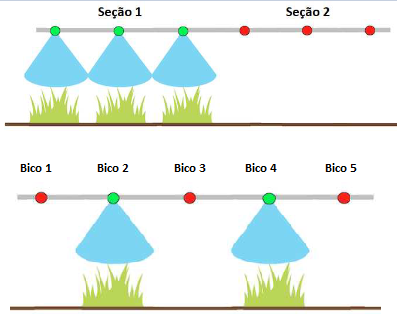

Fonte: adaptado de Rosa, Terra e Drews Jr (2019).

Na Figura 2, os bicos verdes estão abertos e os vermelhos, fechados. Em cima, no controle por seções, os três bicos da seção 1 abrem e fecham juntos, e a seção 2 inteira fica fechada. Embaixo, no controle bico a bico, só os bicos 2 e 4, que estão sobre as plantas, ficam abertos.

## 2.3 Circuito hidráulico do pulverizador

As partes principais do circuito são o tanque, a bomba, a linha de condução, a válvula reguladora e os bicos (JACTO, 2017). Na bancada de Rosa, Terra e Drews Jr (2019), a bomba é de pistão, de 14 L/min, girada por um motor elétrico com inversor de frequência que imita a TDP. Numa bomba de pistão a vazão é proporcional à rotação, mas a bancada tem também uma válvula de controle de pressão por mola que devolve parte da vazão ao tanque (seção 3.2), e por isso a vazão que chega à barra cai quando a pressão sobe.

Para ajustar a pressão ou a vazão há três caminhos: mudar a rotação da bomba, estrangular a linha com uma **válvula em série** com os bicos ou desviar parte da vazão com uma **válvula de alívio**, que devolve o excesso para o tanque. Rosa, Terra e Drews Jr (2019) usaram o terceiro, com uma válvula agulha de 1/4" movida por um servomotor.

Os **bicos** transformam a calda sob pressão em gotas. Na bancada de Rosa, Terra e Drews Jr (2019) foram usados bicos de leque FanTip 0,2 com 110° de abertura, cada um com uma válvula solenoide liga-desliga com antigotejo; segundo o fabricante, cada bico solta cerca de 0,92 L/min a 4,0 bar.

## 2.4 Modelagem por resistência fluídica

### 2.4.1 Regime de escoamento

A forma como pressão e vazão se relacionam depende do tipo de escoamento, que é indicado pelo número de Reynolds (HUGHES, 2002):

$$Re = \frac{\rho \, d_i \, v}{\mu} \tag{2.1}$$

em que $\rho$ é a massa específica do líquido [kg/m³], $d_i$ o diâmetro interno do tubo [m], $v$ a velocidade média [m/s] e $\mu$ a viscosidade [Pa·s]. Segundo Garcia (2005), o escoamento é laminar (em camadas, sem mistura) para $Re < 1100$, turbulento para $Re > 3500$ e de transição entre esses valores.

### 2.4.2 Lei de orifício

Para um escoamento que não muda com o tempo, entre dois pontos na mesma altura, a equação de Bernoulli e a conservação da massa dizem que (ROSA; TERRA; DREWS JR, 2019):

$$P_1 + \frac{1}{2}\rho v_1^2 = P_2 + \frac{1}{2}\rho v_2^2, \qquad A_1 v_1 = A_2 v_2 \tag{2.2}$$

em que o índice 1 indica a seção antes da restrição e o índice 2 a seção da restrição, $P$ é a pressão [Pa], $v$ a velocidade média [m/s], $A$ a área da seção [m²] e $\rho$ a massa específica [kg/m³]. A primeira parte diz que a energia do líquido se conserva: se a velocidade aumenta no estreitamento, a pressão diminui. A segunda diz que a mesma quantidade de líquido passa por qualquer seção, já que o líquido é incompressível e não há entrada nem saída no trecho.

A equação de orifício sai dessas duas relações em três passos (ROSA; TERRA; DREWS JR, 2019; GARCIA, 2005):

1. pela continuidade, a velocidade na restrição é $v_2 = v_1\,(A_1/A_2)$;
2. substituindo em Bernoulli, com $\Delta P = P_1 - P_2$: $\Delta P = \tfrac{1}{2}\rho\,v_1^2\left[(A_1/A_2)^2 - 1\right]$, e isolando $v_1$, tem-se $v_1 = \sqrt{2\Delta P / \rho[(A_1/A_2)^2 - 1]}$;
3. multiplicando pela área, a vazão teórica é $Q_t = A_1\,v_1$.

Essa vazão é **teórica**, porque Bernoulli supõe um líquido sem atrito e um jato que ocupa toda a área da restrição. Na prática passa menos líquido, por dois motivos. O primeiro é a **vena contracta**: depois de atravessar um orifício, o jato continua se estreitando por um pequeno trecho, e a área efetiva por onde o líquido passa fica menor que a área geométrica do furo. O segundo são as perdas de energia por atrito e turbulência na restrição. Os dois efeitos são reunidos num único número, o **coeficiente de descarga**, definido como a razão entre a vazão real medida, $Q_r$, e a vazão teórica, $Q_t$:

$C_D = Q_r / Q_t$, com $0 < C_D < 1$.

O coeficiente de descarga não é calculado pela teoria: ele é obtido em ensaio e depende da forma da restrição, como o formato do furo, o acabamento das bordas e a relação entre as áreas (ROSA; TERRA; DREWS JR, 2019; MERRITT, 1967). Multiplicando a vazão teórica por $C_D$, chega-se à vazão real:

$$Q = C_D \, A_1 \sqrt{\frac{2\,\Delta P}{\rho\left[(A_1/A_2)^2 - 1\right]}} \tag{2.3}$$

O ponto importante dessa equação é que **a vazão é proporcional à raiz quadrada da diferença de pressão**. Todos os outros termos ($C_D$, áreas e $\rho$) são constantes para uma peça e um líquido dados. Por isso, neste trabalho, o coeficiente de descarga, a área e a massa específica de um bico não precisam ser conhecidos separadamente: eles ficam reunidos numa única constante $K$, medida a partir dos dados de vazão e pressão (seção 3.3.1).

### 2.4.3 Resistência fluídica

Elevando a Equação (2.3) ao quadrado e isolando a queda de pressão, sobra uma relação quadrática:

$$\Delta P = R_F \, Q^2 \tag{2.4}$$

em que $R_F$ é a resistência fluídica da peça (ROSA; TERRA; DREWS JR, 2019). Ou seja, a queda de pressão em cada peça cresce com o quadrado da vazão que passa por ela: dobrando a vazão, a queda de pressão fica quatro vezes maior. Quanto maior $R_F$, mais a peça dificulta a passagem do líquido.

Rosa, Terra e Drews Jr (2019) separam as resistências do circuito em dois tipos, identificados pelo segundo índice:

- **$R_{F,D}$ — resistência dos elementos deprimogênios.** "Deprimogênio" é o elemento que provoca uma queda de pressão localizada, num ponto só do circuito, por causa de um estreitamento. Na barra, são as **pontas de pulverização e as válvulas**. Essa resistência vem diretamente da lei de orifício (FELIZARDO et al., 2016).
- **$R_{F,T}$ — resistência dos trechos de tubulação.** É a perda distribuída ao longo das mangueiras e tubos, causada pelo atrito do líquido com as paredes (GARCIA, 2005).

As duas são dadas por:

$$R_{F,D} = \frac{\rho}{2\,C_D^2\,A_i^2}, \qquad R_{F,T} = \frac{f_a\,L\,\rho}{2\,d_i\,A_i^2} \tag{2.5}$$

em que $A_i$ é a área interna da passagem [m²], $L$ o comprimento do trecho de tubo [m], $d_i$ o diâmetro interno [m] e $f_a$ o fator de atrito da tubulação, que o artigo chama de coeficiente de descarga distribuído. O fator $f_a$ depende do número de Reynolds e é tirado do diagrama de Moody (BEGA et al., 2006). Nas unidades do SI, as duas resistências ficam em kg/m⁷. A primeira expressão é a Equação (2.3) escrita na forma da Equação (2.4), para uma restrição em que a área antes do estreitamento é muito maior que a do estreitamento. A segunda tem a mesma forma, com $C_D^2$ trocado por $d_i/(f_a L)$: quanto mais longo e mais estreito o tubo, maior a resistência. Como as resistências estão em série, a pressão do sistema é a soma:

$$P_S = \left(R_{F,D} + R_{F,T}\right)Q^2 \tag{2.6}$$

A Figura 3 mostra o diagrama de blocos dessa conta. É um modelo **estático**: ele diz qual é a pressão para uma certa vazão, mas não diz quanto tempo a pressão leva para mudar.

**Figura 3 – Diagrama de blocos do modelo de resistência fluídica.**

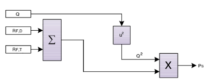

Fonte: Rosa, Terra e Drews Jr (2019).

A Figura 3 deve ser lida da esquerda para a direita e repete a Equação (2.6) em forma de blocos. As duas resistências, $R_{F,D}$ e $R_{F,T}$, entram no somador (Σ) e são somadas. A vazão $Q$ passa pelo bloco "u²", que a eleva ao quadrado. No fim, o multiplicador (X) multiplica a soma das resistências por $Q^2$, e a saída é a pressão do sistema $P_S$.

Com ensaios de 1 a 7 bicos abertos, Rosa, Terra e Drews Jr (2019) ajustaram uma fórmula empírica (sem significado físico direto) para a resistência da barra em função do número $n$ de bicos abertos:

$$R_F(n) = 42{,}59\,e^{-2{,}335\,n} + 2{,}307\,e^{-0{,}4591\,n} \tag{2.7}$$

### 2.4.4 Associação de elementos e equação de malha

Um circuito real tem várias restrições ligadas entre si, e o efeito conjunto delas depende da forma de ligação. Como em cada peça vale a Equação (2.4), basta saber como as vazões e as quedas de pressão se combinam.

**Em série.** As peças ficam uma depois da outra, e a mesma vazão $Q$ passa por todas. As quedas de pressão se somam, $\Delta P = R_1Q^2 + R_2Q^2 + … = (R_1 + R_2 + …)\,Q^2$, e a resistência equivalente é a soma das resistências. A Equação (2.6) é um caso desse tipo.

**Em paralelo.** As peças ficam ligadas aos mesmos dois pontos. Por isso todas têm a mesma queda de pressão, e a vazão total é a soma das vazões de cada uma. Com $n$ peças iguais, de resistência $R$, cada uma leva $Q/n$, e:

$$\Delta P = R\left(\frac{Q}{n}\right)^2 = \frac{R}{n^2}\,Q^2 \tag{2.8}$$

A resistência equivalente é a de uma peça dividida por $n^2$. O mesmo resultado sai da Equação (2.5): $n$ orifícios iguais em paralelo equivalem a um orifício com $n$ vezes a área, e como $R_{F,D}$ é inversamente proporcional ao quadrado da área, a resistência fica $n^2$ vezes menor. Assim, com o dobro de bicos abertos a resistência cai para um quarto, e não para a metade. É por isso que, na Tabela 1 (seção 3.2), a resistência equivalente da barra cai tão depressa quando os bicos abrem.

**Fonte e válvula de alívio.** Falta o elemento que fornece a pressão, a bomba, e o atuador. Na barra de Rosa, Terra e Drews Jr (2019), os bicos ficam em paralelo, pela Equação (2.8), e a válvula reguladora fica **em derivação**: ela não estrangula a linha, mas abre um caminho extra que alivia o excesso de vazão para o tanque. Por isso o modelo da seção 3.3 não soma quedas de pressão ao longo de uma malha. Ele faz um **balanço de vazões** num único ponto de pressão: a vazão que a fonte entrega é igual à soma da que sai pelos bicos e da que sai pela válvula.

**Perda na tubulação.** Na barra de Rosa, Terra e Drews Jr (2019), os sensores de pressão do começo e do fim da barra marcaram valores muito próximos, porque a vazão é pequena (no máximo 5,6 L/min) e a queda na tubulação cresce com o quadrado da vazão. A norma de inspeção de pulverizadores admite uma queda de até 10% entre o ponto onde a pressão é medida e a ponta de cada seção da barra (ISO, 2015, item 4.8.9). Em barras comerciais, com vazões dezenas de vezes maiores, essa perda precisa ser avaliada caso a caso. É essa avaliação que sustenta a hipótese H2 (seção 3.3).

## 2.5 Pressão, vazão e tamanho de gota

Cada bico é feito para produzir gotas de um certo tamanho, adequado ao alvo. Se a pressão muda, mudam a vazão e o tamanho das gotas, o que prejudica a uniformidade e aumenta o risco de deriva ou escorrimento (HOLTERMAN et al., 2016). O vento, a pressão e o tipo de ponta influenciam a deriva (COSTA et al., 2007). Como a vazão do bico varia com a raiz quadrada da pressão (Equação 2.3), manter a pressão estável é a condição para manter a dose de cada bico.

**Tolerância de pressão.** A norma ISO 16122-2, que define a inspeção de pulverizadores de barra em uso, traz dois requisitos de pressão que servem de referência para este trabalho (ISO, 2015):

- os dispositivos de ajuste de pressão devem manter a pressão constante, com tolerância de **±10%**, para uma mesma regulagem (item 4.5.4);
- em máquinas com retorno compensatório, 10 s depois de fechar uma seção da barra, a pressão não pode ter variado mais de 10% (item 4.8.8).

O segundo requisito é o caso mais parecido com o deste trabalho: fechar uma seção é fechar um grupo de bicos de uma vez. Por isso foi adotada como tolerância a faixa de **±10% em torno da pressão de referência**. Como a vazão do bico varia com a raiz da pressão, essa faixa corresponde a cerca de ±5% na vazão de cada bico: $\sqrt{0{,}9} \approx 0{,}95$ e $\sqrt{1{,}1} \approx 1{,}05$.

## 2.6 Controle de pulverização

Os controladores eletrônicos das máquinas ajustam a vazão aplicada quando a velocidade do equipamento muda e, nos sistemas mais novos, também ligam e desligam seções e controlam a altura da barra. Eles juntam sensores de vazão e de velocidade e um atuador que ajusta o fluxo de calda. A vazão desejada é calculada a partir da dose, da velocidade e da largura da barra, e um sensor de vazão fecha a malha, ou seja, mede o resultado e corrige automaticamente (MERCALDI, 2012). Steward e Humburg (2000) mostraram, para um controlador comercial desse tipo, que modelar cada parte por equações e simular a malha permite comparar ajustes do controlador e os limites da válvula antes de ir a campo. Em unidades práticas, a vazão desejada é:

$$Q_{ref}\,[\text{L/min}] = \frac{D\,[\text{L/ha}] \cdot v\,[\text{km/h}] \cdot L\,[\text{m}]}{600} \tag{2.9}$$

O fator 600 sai da conversão de unidades: 1 ha = 10⁴ m² e 1 km/h = 1000/60 m/min.

**Malha aberta e malha fechada.** Em malha aberta, o comando é calculado uma vez e aplicado sem conferir o resultado. Em malha fechada, o controlador mede a saída a todo momento, compara com o valor desejado e corrige a diferença, chamada de erro. O controlador em malha fechada mais usado é o proporcional-integral-derivativo (PID), que soma três ações calculadas a partir do erro $e(t)$ (OGATA, 2010).

Uma malha fechada tem sempre as mesmas partes, e no pulverizador cada uma tem um papel claro:

- **referência** (*setpoint*): o valor desejado, aqui a pressão de trabalho $P_{ref}$;
- **sensor**: o transmissor de pressão, que mede o valor real $P$;
- **erro**: a diferença entre o valor desejado e o medido;
- **controlador**: o cálculo que transforma o erro em um comando $u(t)$;
- **atuador**: a peça que obedece ao comando, aqui a válvula reguladora;
- **planta**: o sistema que se quer controlar, aqui a barra com seus bicos.

A cada instante o sensor mede, o controlador calcula o erro e o comando, e o atuador muda de posição. A pressão então muda, o sensor mede de novo, e o ciclo se repete. Por isso a malha fechada corrige sozinha perturbações que o projetista não previu, como um bico que fecha ou uma bomba que perde rendimento. Na malha aberta isso não acontece, porque ninguém confere o resultado.

O PID calcula o comando somando três parcelas, cada uma com o seu ganho:

$$u(t) = K_p\,e(t) + K_i \int_0^t{e(\tau)\,d\tau} + K_d\,\frac{de(t)}{dt} \tag{2.10}$$

em que $K_p$, $K_i$ e $K_d$ são os ganhos proporcional, integral e derivativo. Cada parcela olha para o erro de um jeito diferente:

- **Ação proporcional** ($K_p\,e$): olha para o erro **agora**. O comando é proporcional ao erro: erro grande, correção grande; erro pequeno, correção pequena. É a parte que reage mais rápido. Sozinha, porém, ela costuma deixar um erro no fim, chamado de **erro em regime permanente**. O motivo é que, se o erro chegasse a zero, o comando também iria a zero, e a válvula voltaria para onde estava antes. Para manter a válvula na nova posição, precisa sobrar algum erro. Aumentar $K_p$ diminui esse erro restante, mas deixa a resposta mais oscilatória e, se exagerado, instável.
- **Ação integral** ($K_i\int e\,d\tau$): olha para o erro **acumulado no passado**. Ela vai somando o erro ao longo do tempo, como uma área embaixo da curva do erro. Enquanto existir qualquer erro, por menor que seja, essa soma continua crescendo e o comando continua mudando. A soma só para de crescer quando o erro chega a zero. Assim ela elimina o erro em regime permanente: depois que o erro zera, a parcela integral fica parada no valor que mantém a válvula na posição certa. O lado ruim é que ela é mais lenta e, com ganho alto demais, faz a saída passar do ponto e oscilar. Ela também causa o problema de *windup* quando o atuador chega no limite, tratado na seção 2.7.2.
- **Ação derivativa** ($K_d\,de/dt$): olha para a **tendência** do erro, ou seja, para a velocidade com que ele está mudando. Se o erro está diminuindo rápido, ela freia o comando antes de a saída passar do ponto, como quem tira o pé do acelerador antes de chegar no carro da frente. Ela ajuda a reduzir oscilações, mas amplifica o ruído do sensor: uma medida que treme um pouco tem derivada grande, e o comando passa a tremer também.

Os mesmos três termos também são escritos com um ganho só, $K_c$, e dois tempos, o tempo integral $T_i$ e o tempo derivativo $T_d$:

$$u(t) = K_c\left[e(t) + \frac{1}{T_i}\int_0^t{e(\tau)\,d\tau} + T_d\,\frac{de(t)}{dt}\right] \tag{2.11}$$

Comparando com a Equação (2.10), $K_p = K_c$, $K_i = K_c/T_i$ e $K_d = K_c\,T_d$. A vantagem dessa forma é que $T_i$ e $T_d$ têm unidade de tempo e um significado fácil de imaginar. Um $T_i$ pequeno quer dizer ação integral forte, que corrige o erro restante rápido. Um $T_i$ grande quer dizer ação integral fraca. Essa é a forma usada na sintonia da seção 2.6.1.

O sinal do erro depende do atuador. Em geral se usa $e = $ referência $-$ medida. No pulverizador deste trabalho, porém, abrir a válvula **diminui** a pressão, então o erro é definido ao contrário (seção 3.5.3), para que pressão alta demais gere o comando de abrir.

**Quanto erro o controlador P deixa.** O tamanho do erro em regime permanente da ação proporcional sozinha pode ser calculado com uma conta simples (OGATA, 2010). Suponha que uma perturbação, sem nenhum controle, mudaria a saída em $d$, e que a planta muda a saída em $K_g$ para cada unidade de comando. Com o controlador P, o comando é $K_c\,e$, e em regime o erro que sobra é a perturbação menos a correção que esse comando produz: $e = d - K_c\,|K_g|\,e$. Isolando $e$:

$$e_{reg} = \frac{d}{1 + K_c\,|K_g|} \tag{2.12}$$

O produto $K_c\,|K_g|$ é o ganho da malha. Com ganho de malha 4, por exemplo, sobra um quinto da perturbação. Aumentar $K_c$ diminui o erro, mas nunca o zera, e um ganho alto demais deixa a malha instável. A ação integral resolve isso, porque continua mudando o comando até o erro chegar a zero.

Neste trabalho foram comparados três controladores, cada um acrescentando uma coisa ao anterior:

- **P:** só a ação proporcional. É o mais simples, e mostra o erro da Equação (2.12);
- **PI:** a ação integral elimina esse erro, e a pressão volta exatamente à referência depois de cada troca de bicos;
- **PI + *feedforward***: uma parcela calculada pelo número de bicos abertos antecipa a correção (seção 2.7).

A ação derivativa foi deixada de fora, porque a medida de pressão tem ruído, que a derivada amplificaria.

### 2.6.1 Sintonia pelo método de Ziegler-Nichols

Sintonizar um controlador é escolher os valores de $K_c$ e $T_i$. Ziegler e Nichols (1942) propuseram regras práticas para isso, que até hoje são o ponto de partida mais conhecido para sintonizar controladores PID (OGATA, 2010). Existem dois métodos:

- **primeiro método (curva de reação):** aplica-se um degrau na entrada da planta, sem controlador, e a curva em forma de S da resposta é aproximada por um ganho, um atraso e uma constante de tempo;
- **segundo método (ganho crítico):** usa-se só a ação proporcional e aumenta-se $K_c$ aos poucos, a partir de zero, até a saída oscilar sem parar, com amplitude constante. Esse ganho é o **ganho crítico** $K_{cr}$, e o tempo de uma oscilação completa é o **período crítico** $P_{cr}$.

Neste trabalho foi usado o segundo método. Com $K_{cr}$ e $P_{cr}$ medidos, as regras de Ziegler e Nichols dão os ganhos (OGATA, 2010, Tabela 8.2):

$$\text{P:}\; K_c = 0{,}5\,K_{cr} \qquad\qquad \text{PI:}\; K_c = 0{,}45\,K_{cr},\quad T_i = \frac{P_{cr}}{1{,}2} \tag{2.13}$$

A ideia por trás das regras é simples: o ganho crítico é o limite em que a malha deixa de se acalmar sozinha. Usar cerca de metade dele deixa uma folga, e o período crítico diz qual é o ritmo natural da malha, que serve para escolher o tempo integral. O PI usa um $K_c$ um pouco menor que o P porque a ação integral acrescenta um pouco de atraso à malha.

O método tem duas vantagens para este trabalho. Ele não exige um modelo matemático da planta, só um experimento, e esse experimento pode ser feito no próprio simulador, sem risco para nenhum equipamento. Ogata (2010) também avisa sobre o limite do método: os ganhos de Ziegler e Nichols costumam dar uma resposta rápida, mas com sobressinal grande, e devem ser vistos como um ponto de partida para ajustes finos. Neste trabalho eles foram usados sem ajuste, e o efeito disso é discutido nos resultados (seção 4.2) e nas limitações (seção 3.8).

## 2.7 Compensação antecipativa e anti-windup

O PID da seção 2.6 só reage depois que o erro aparece. Duas técnicas complementam o controlador quando a perturbação pode ser conhecida com antecedência e quando o atuador tem limites: a compensação antecipativa e o anti-windup [REF. PENDENTE — ver notas].

### 2.7.1 Compensação antecipativa (*feedforward*)

Na malha fechada, a correção começa só quando a saída já se afastou da referência. Se a perturbação puder ser medida ou for conhecida de antemão, é possível calcular o comando que a compensa **no mesmo instante em que ela acontece**, sem esperar o erro. Essa ideia se chama **compensação antecipativa**, ou *feedforward* (FF).

O caminho mais simples é inverter um modelo estático do sistema. Se o modelo diz qual saída resulta de cada combinação de comando e perturbação, basta resolver a conta ao contrário: dada a perturbação atual e a saída desejada, qual comando é necessário? O resultado é o comando antecipativo $u_{ff}$.

A compensação antecipativa sozinha é uma malha aberta: ela só acerta se o modelo for exato e se todas as perturbações forem conhecidas. Por isso ela é usada junto com a realimentação, somando as duas parcelas:

$$u(t) = u_{ff}(t) + u_{fb}(t) \tag{2.14}$$

em que $u_{ff}$ é a parcela antecipativa e $u_{fb}$ é a parcela de realimentação, calculada pelo PI a partir do erro. As duas parcelas têm papéis diferentes:

- a **antecipativa** leva o atuador para perto da posição certa logo que a perturbação acontece, o que acelera a correção;
- a **realimentação** corrige o que sobra: erros do modelo, perturbações que não foram medidas e diferenças entre a planta real e a suposta.

Se o modelo for bom, a realimentação só faz pequenos ajustes. Se o modelo for ruim, a parcela antecipativa leva o atuador para o lugar errado, e a realimentação precisa desfazer esse erro, o que pode deixar a resposta pior que a de um PI sozinho.

Duas condições precisam ser atendidas para usar a técnica:

- **a perturbação precisa ser conhecida.** No controle bico a bico, isso é natural: o próprio sistema que liga e desliga os bicos sabe quantos estão abertos, então o número de bicos $n$ está disponível sem nenhum sensor extra;
- **o modelo precisa relacionar perturbação, comando e saída.** Aqui, esse papel é do modelo estático da seção 3.3.

A compensação antecipativa também tem um limite: ela age no instante em que a perturbação é conhecida, mas o atuador ainda leva algum tempo para se mover. Se a perturbação muda a saída mais rápido que o atuador consegue responder, ainda haverá erro logo depois da troca. Para reduzir esse erro, seria preciso conhecer a perturbação **antes** de ela acontecer e adiantar o comando.

### 2.7.2 Anti-windup

Todo atuador real tem limites. Uma válvula não abre mais que toda aberta nem fecha mais que toda fechada, e o motor que a move tem uma velocidade máxima. Quando o comando pede mais do que o atuador consegue fazer, diz-se que o atuador está **saturado**.

Durante a saturação, o erro demora mais para diminuir, porque o atuador não acompanha o comando. A ação integral, que soma o erro ao longo do tempo (seção 2.6), continua acumulando esse erro e cresce muito além do necessário. Quando o atuador volta a responder, a parcela integral está grande demais e empurra a saída para além da referência. O resultado é um sobressinal e uma demora maior para acomodar. Esse efeito se chama ***windup*** (acúmulo indevido do integrador).

As técnicas de **anti-windup** impedem esse acúmulo. As duas mais comuns são:

- **integração condicional** (*clamping*): a soma do integrador é congelada enquanto o atuador estiver saturado e volta a ser atualizada quando ele sai da saturação;
- **recálculo** (*back-calculation*): a diferença entre o comando pedido e o que o atuador realmente faz é usada para descarregar o integrador.

A integração condicional é a mais simples de implementar. Em forma discreta, com $I_k$ sendo a soma do integrador na amostra $k$, $e_k$ o erro e $T_s$ o período de amostragem:

$$I_k = I_{k-1} + s_k\,e_k\,T_s \tag{2.15}$$

em que $s_k$ vale 1 quando o atuador não está saturado e 0 quando está. Com $s_k = 0$, a soma não muda.

No caso de uma válvula reguladora, por exemplo, se vários bicos fecham de uma vez, o controlador pede uma abertura grande, e a válvula se move na velocidade máxima. Sem anti-windup, o integrador seguiria somando o erro durante todo esse movimento e, quando a válvula chegasse à posição certa, o comando a levaria além dela. Com a integração condicional, o integrador fica parado enquanto a válvula está no limite, e a correção termina sem passar do ponto.

---

# 3 METODOLOGIA

## 3.1 Tipo de pesquisa

A pesquisa é aplicada, porque busca resolver um problema prático da pulverização, e quantitativa, porque o sistema é descrito por equações e avaliado por números. As etapas foram: (i) revisão bibliográfica; (ii) modelo estático e ajuste dos parâmetros; (iii) modelo dinâmico; (iv) projeto do controlador; (v) simulação em Python; (vi) avaliação. A ideia é modelar cada parte, conferir o modelo com os dados medidos e só então usar a simulação para testar o controle.

## 3.2 Sistema de referência

O sistema usado como referência é a bancada de Rosa, Terra e Drews Jr (2019), por três motivos:

- é uma barra com **controle bico a bico e alimentação em série**, que é o caso estudado;
- tem dados publicados de pressão e vazão para 1 a 7 bicos abertos;
- tem uma válvula reguladora de alívio, que é o atuador escolhido aqui.

A bancada tem:

- tanque de 100 L;
- bomba de pistão de 14 L/min com motor elétrico e inversor de frequência;
- barra de 5 m com sete bicos FanTip 0,2/110° e uma solenoide por bico;
- transmissores de pressão (PT) e de vazão (FT) e manômetros (PG);
- válvula agulha movida por servomotor, chamada de PV no texto em português do artigo e de HV no fluxograma.

As Figuras 4 a 7 mostram a montagem. A Figura 4 é a visão geral da barra.

**Figura 4 – Visão geral da bancada de referência.**


Fonte: Rosa, Terra e Drews Jr (2019).

Na Figura 4, a barra de 5 m fica presa a uma treliça metálica apoiada em dois cavaletes. A mangueira laranja que corre ao longo da barra é a linha-tronco que alimenta os sete bicos em série. Embaixo de cada bico há um recipiente que recolhe a calda pulverizada e a devolve ao tanque, de modo que a bancada funciona em circuito fechado. O manômetro na ponta direita da barra é o PG-02 do fluxograma (Figura 8).

**Figura 5 – Conjunto do inversor de frequência, motor elétrico e bomba de pistão de 14 L/min.**


Fonte: Rosa, Terra e Drews Jr (2019).

A Figura 5 mostra, da esquerda para a direita, o inversor de frequência, o motor elétrico trifásico e a bomba de pistão, ligada ao motor por correia. Esse conjunto faz o papel do trator: o inversor ajusta a rotação do motor, como a TDP faria no campo. Sobre a bomba ficam o regulador de pressão por mola e o manômetro do conjunto da bomba (PCV e PG-01 na Figura 8).

**Figura 6 – Válvula agulha de 1/4" acionada por servomotor (válvula reguladora PV).**

{width=55%}

Fonte: Rosa, Terra e Drews Jr (2019).

A Figura 6 mostra o atuador usado como referência neste trabalho. O servomotor, preso à estrutura da barra, gira a manopla da válvula agulha e muda a sua abertura. A válvula fica num ramo que sai da linha principal e devolve a calda ao tanque.

**Figura 7 – Válvula solenoide de um bico.**

{width=55%}

Fonte: Rosa, Terra e Drews Jr (2019).

Na Figura 7, de cima para baixo, aparecem a conexão com a mangueira e o dispositivo antigotejo, a válvula solenoide liga-desliga e a ponta de pulverização. É essa solenoide que abre e fecha cada bico, e é a sua comutação que causa a perturbação estudada neste trabalho.

A Figura 8 mostra o fluxograma de processo da bancada. Um fluxograma de processo é um desenho que mostra por onde o líquido passa e onde fica cada instrumento. Cada instrumento aparece num círculo com uma sigla (*tag*) da norma ISA 5.1: a primeira letra diz o que é medido ou controlado (P de pressão, F de vazão, H de manual) e as seguintes dizem a função (T de transmissor, G de indicador local, V de válvula). O número diferencia instrumentos do mesmo tipo.

**Figura 8 – Fluxograma de processo da bancada de referência.**

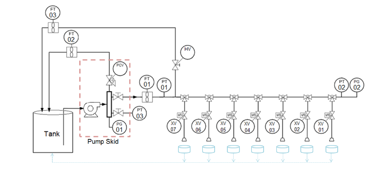

Fonte: Rosa, Terra e Drews Jr (2019).

Seguindo o caminho da calda na Figura 8:

1. **Tanque e conjunto da bomba.** A bomba puxa a calda do tanque. Ela e os componentes ao seu redor ficam dentro do retângulo tracejado, chamado de conjunto da bomba (*pump skid*). Na saída da bomba há um distribuidor com três saídas:
   - uma **válvula de controle de pressão (PCV)**, que devolve calda ao tanque passando pelo medidor de vazão FT-02. É uma válvula autorregulada por mola: ela abre sozinha quando a pressão passa de um valor ajustado, sem comando eletrônico;
   - o transmissor PT-03 e o manômetro PG-01, que medem a pressão na saída da bomba;
   - uma válvula manual que libera a calda para a linha principal.
2. **Entrada da barra.** Na linha principal ficam o FT-01, que mede a vazão que vai para a barra, e o PT-01, que mede a pressão na entrada da barra.
3. **Válvula de recirculação (HV).** Logo depois do PT-01 sai um ramo com a válvula agulha HV, que devolve parte da calda ao tanque passando pelo FT-03. É essa válvula que os autores ajustaram à mão no ensaio da Tabela 2, e é ela o atuador do controle proposto neste trabalho.
4. **Barra e bicos.** A linha-tronco passa pelas sete solenoides (XV-07, perto da entrada, até XV-01, na ponta). O "S" no símbolo indica acionamento por solenoide. Cada solenoide abre ou fecha um bico. Embaixo dos bicos há recipientes que recolhem a calda pulverizada, e a linha pontilhada indica que ela volta ao tanque. Assim a bancada funciona em circuito fechado, sem gastar líquido.
5. **Fim da barra.** O PT-02 e o PG-02 medem a pressão na ponta da barra. Como PT-01 e PT-02 marcaram valores muito próximos, a perda de pressão ao longo da barra é pequena (hipótese H2, seção 3.3).

Com esse caminho dá para escrever dois balanços de vazão. Na saída da bomba, a vazão bombeada se divide entre a PCV (medida por FT-02) e a barra (FT-01). Na entrada da barra, a vazão do FT-01 se divide entre a HV (FT-03) e os bicos abertos. Na Tabela 1 a HV estava fechada, então o FT-01 mede a vazão que sai pelos bicos.

Para o modelo deste trabalho, isso significa que a bomba e a PCV podem ser tratadas juntas como uma única fonte de líquido, e que a HV e os bicos são as duas saídas de líquido ligadas ao mesmo ponto de pressão (seção 3.3, Figura 10).

A Tabela 1 mostra os dados medidos com a válvula de recirculação fechada. As pressões são manométricas, em kgf/cm².

**Tabela 1 – Pressão e vazão da barra em função do número de bicos abertos.**

| Bicos abertos ($n$) | $P$ [kgf/cm²] | $Q$ [L/min] | $R_F$ equivalente = $P/Q^2$ |
|---|---|---|---|
| 7 | 3,57 | 5,60 | 0,114 |
| 6 | 3,88 | 5,07 | 0,151 |
| 5 | 4,24 | 4,40 | 0,219 |
| 4 | 4,64 | 3,60 | 0,358 |
| 3 | 4,96 | 2,80 | 0,633 |
| 2 | 5,27 | 2,00 | 1,318 |
| 1 | 5,58 | 1,00 | 5,580 |

Fonte: Rosa, Terra e Drews Jr (2019).

Os autores também fizeram um ensaio com a válvula reguladora. Partindo de 4,00 kgf/cm² com a válvula fechada, seguiram a sequência da Tabela 2, ajustando a válvula à mão.

**Tabela 2 – Ensaio de regulação da pressão pela válvula de alívio.**

| Etapa | Ação | Pressão resultante [kgf/cm²] |
|---|---|---|
| 1 | Fechamento dos bicos 1, 4 e 7 | 5,80 |
| 2 | Abertura da válvula em 11% | 4,40 |
| 3 | Fechamento dos bicos 2, 3 e 5 | 6,10 |
| 4 | Abertura da válvula em 33% | ≈ 4,00 |

Fonte: Rosa, Terra e Drews Jr (2019).

A Figura 9 resume esse ensaio. Cada manômetro mostra a pressão no fim de uma etapa. A faixa de sete quadrados indica o estado dos bicos (verde aberto, vermelho fechado), e a seta indica a ação feita entre uma leitura e a próxima.

**Figura 9 – Ensaio de regulação da pressão pela válvula de alívio.**

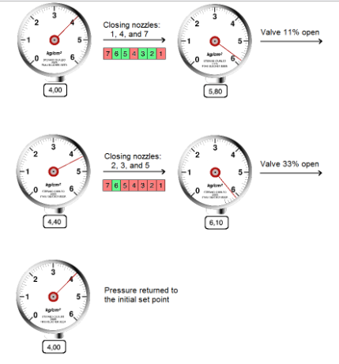{width=60%}

Fonte: Rosa, Terra e Drews Jr (2019).

## 3.3 Modelo estático

O modelo estático responde à pergunta: **com $n$ bicos abertos e a válvula numa certa abertura, qual é a pressão quando tudo já se acomodou?** Ele parte da Equação (2.6) e acrescenta só o necessário para incluir a válvula. Três caminhos se encontram no mesmo ponto de pressão $P$: a fonte, que empurra líquido para dentro, e os bicos e a válvula, que deixam o líquido sair (Figura 10).

**Figura 10 – Circuito hidráulico equivalente proposto.**

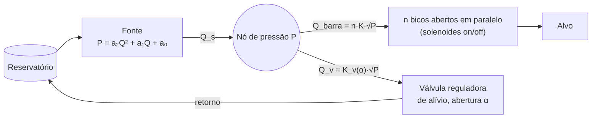

Fonte: elaborada pelo autor.

**Como ler a Figura 10.** A Figura 10 é uma versão simplificada do fluxograma da bancada (Figura 8). Ela guarda só o que importa para calcular a pressão. As setas mostram o sentido do líquido, e o texto sobre cada seta é a vazão naquele trecho. Cada bloco corresponde a uma parte da bancada:

- **Reservatório:** é o tanque da Figura 8. No modelo ele é só o lugar de onde o líquido sai e para onde volta. O nível dele não entra nas contas.
- **Fonte:** junta a bomba, a PCV do conjunto da bomba e as perdas antes da barra (hipótese H4). Em vez de modelar cada peça, o conjunto é descrito por uma única curva, a Equação (3.5): quanto maior a vazão $Q_s$ que a fonte entrega, menor a pressão que ela consegue manter. É por isso que a seta da fonte até o nó leva o nome $Q_s$.
- **Nó de pressão $P$:** representa a barra inteira como um único ponto com uma única pressão. Isso só vale porque a perda ao longo da barra é pequena (hipótese H2).
- **Bicos abertos:** são as solenoides XV com seus bicos. Os $n$ bicos abertos ficam em paralelo, ou seja, todos ligados ao mesmo nó e com a mesma pressão. Juntos eles deixam sair $Q_{barra} = n\,K\sqrt{P}$ (Equação 3.3). Essa vazão vai para o alvo, que na bancada são os recipientes de coleta e no campo é a lavoura.
- **Válvula reguladora de alívio:** é a HV da Figura 8, o atuador do controle. Ela deixa sair $Q_v = K_v(\alpha)\sqrt{P}$ (Equação 3.7), em que $\alpha$ é a abertura, de 0 (fechada) a 1 (toda aberta). Esse líquido não vai para a lavoura: a seta "retorno" leva de volta ao reservatório.

O ponto principal da figura é que **todo líquido que entra no nó tem que sair por algum caminho**. Em regime, isto é, quando a pressão já parou de mudar, a vazão da fonte é igual à soma das duas saídas: $Q_s = Q_{barra} + Q_v$. É esse balanço que dá a Equação (3.8) na seção 3.3.4.

Com o balanço dá para entender o que acontece nos dois tipos de mudança:

- **Quando bicos fecham** ($n$ diminui), sobra menos caminho para o líquido sair. A pressão no nó sobe até a fonte, seguindo a sua curva, entregar uma vazão menor que caiba nas saídas que restaram. Foi o que aconteceu na Tabela 1, em que a pressão subiu de 3,57 para 5,58 kgf/cm².
- **Quando a válvula abre** ($\alpha$ aumenta), surge um caminho extra de saída. A pressão cai, porque parte do líquido que antes era forçado pelos bicos agora volta ao reservatório. Foi o que os autores fizeram à mão no ensaio da Tabela 2.

Os dois efeitos são opostos. Por isso o controle pode usar a válvula para compensar os bicos: quando bicos fecham, ele abre a válvula na medida certa para que a soma $n\,K + K_v(\alpha)$ fique parecida com a de antes, e a pressão volta para perto da referência.

**Hipóteses adotadas** (simplificações feitas pelo autor):
- **H1:** o escoamento não muda com o tempo e a barra é horizontal (como em ROSA; TERRA; DREWS JR, 2019).
- **H2:** a perda de pressão ao longo da barra é desprezível, então todos os bicos trabalham com a mesma pressão $P$. Isso se apoia nas leituras quase iguais de PT-01 e PT-02 na bancada (ROSA; TERRA; DREWS JR, 2019) e precisaria ser revisto para barras longas (seção 2.4.4).
- **H3:** os bicos são iguais e todos seguem a lei de orifício.
- **H4:** a fonte (bomba, sua regulação interna e as perdas antes da barra) é representada por uma curva pressão-vazão de segundo grau, ajustada aos dados da Tabela 1 (seção 3.3.2).
- **H5:** a característica da válvula é linear, ou seja, sua constante de vazão é proporcional à abertura, porque a curva real da válvula não está nas fontes consultadas.

### 3.3.1 Bicos

Pela Equação (2.3), a vazão de um bico é proporcional à raiz da pressão. Juntando todas as constantes ($C_D$, área, massa específica) em um número só, $K$, a vazão de um bico fica:

$$q = K\sqrt{P} \tag{3.1}$$

Para encontrar $K$, basta isolar: $K = q/\sqrt{P}$. Na Tabela 1, a vazão de cada bico é $Q/n$, então cada linha da tabela dá um valor de $K$, e o valor usado é a média das sete linhas:

$$K = \frac{1}{7}\sum_{i=1}^{7}{\frac{Q_i}{n_i\sqrt{P_i}}} \tag{3.2}$$

Com $n$ bicos iguais em paralelo (H2 e H3), a vazão da barra é $n$ vezes a de um bico. Elevando ao quadrado e isolando $P$, aparece a forma de resistência da Equação (2.4):

$$Q_{barra} = n\,K\sqrt{P} \quad\Longleftrightarrow\quad P = \frac{R_b}{n^2}\,Q_{barra}^2, \qquad R_b = \frac{1}{K^2} \tag{3.3}$$

Ou seja, a resistência de $n$ bicos é a de um bico dividida por $n^2$, como na Equação (2.8). Essa fórmula substitui a Equação (2.7): em vez de quatro números ajustados sem significado físico, ela usa um só, $K$.

### 3.3.2 Fonte

Com a válvula de recirculação fechada, a vazão total caiu de 5,60 para 1,00 L/min conforme os bicos foram fechados (Tabela 1). Se a bomba de pistão entregasse sempre a mesma vazão, esse valor não mudaria. Então a vazão que chega à barra depende da pressão. O texto do artigo não explica por quê, mas o fluxograma (Figura 8) mostra uma **válvula de controle de pressão por mola (PCV)** dentro do conjunto da bomba, que devolve o excesso ao tanque. O formato dos dados é o esperado para esse tipo de válvula: com vazão quase zero (um bico aberto) a pressão fica perto de um máximo, e conforme mais bicos abrem a pressão cai devagar. Seja qual for o mecanismo, ele é representado pela curva de segundo grau da hipótese H4.

Os coeficientes $a_2$, $a_1$ e $a_0$ foram escolhidos pelo **método dos mínimos quadrados**, que procura os valores que deixam a menor soma dos erros ao quadrado entre a curva e os sete pontos medidos:

$$S = \sum_{i=1}^{7}{\left(P_i - a_2Q_i^2 - a_1Q_i - a_0\right)^2} \tag{3.4}$$

O menor valor de $S$ acontece onde as derivadas de $S$ em relação a $a_2$, $a_1$ e $a_0$ são zero. Isso dá um sistema de três equações lineares, que o Python resolve com a função `numpy.polyfit`. A curva fica:

$$P = a_2\,Q_s^2 + a_1\,Q_s + a_0 \tag{3.5}$$

No modelo, é mais útil ter a vazão em função da pressão. Isolando $Q_s$ na Equação (3.5) com a fórmula de Bhaskara e ficando com a raiz positiva:

$$Q_s(P) = \frac{-a_1 - \sqrt{a_1^2 - 4a_2(a_0 - P)}}{2a_2} \tag{3.6}$$

Como $a_2$ é negativo, o sinal de menos antes da raiz é o que dá vazão positiva. Acima de $P = a_0$ a fonte não consegue mais entregar líquido, e o programa considera $Q_s = 0$.

### 3.3.3 Válvula reguladora

A válvula também é uma restrição, então segue a lei de orifício. Pela hipótese H5, sua constante cresce em linha reta com a abertura $\alpha$, que vai de 0 (fechada) a 1 (toda aberta):

$$Q_v = K_v(\alpha)\sqrt{P}, \qquad K_v(\alpha) = K_{v,max}\,\alpha \tag{3.7}$$

### 3.3.4 Ponto de operação

Quando tudo se acomoda, o líquido que entra no nó é igual ao que sai. Igualando a Equação (3.6) à soma das vazões dos bicos (3.3) e da válvula (3.7):

$$Q_s(P) = \left[n\,K + K_v(\alpha)\right]\sqrt{P} \tag{3.8}$$

Essa equação não tem solução direta para $P$, então foi resolvida pelo **método da bissecção**: começa-se com um intervalo que certamente contém a resposta (de 0 até $a_0$), testa-se o ponto do meio, e fica-se com a metade em que a diferença entre os dois lados da Equação (3.8) troca de sinal. Repetindo isso 100 vezes, o intervalo fica muito menor que qualquer erro que interesse.

## 3.4 Modelo dinâmico

O modelo estático diz **para onde** a pressão vai, mas não diz **quanto tempo** o sistema leva para chegar lá. Para simular o controle, é preciso saber o que demora. Na barra, duas coisas poderiam demorar:

- **a pressão na linha**, porque a mangueira estica um pouco e o líquido se comprime um pouco quando a pressão sobe, e isso guarda um pequeno volume de líquido;
- **a válvula**, que é movida por um motor e não muda de posição de uma vez.

Este trabalho considera só a segunda. A seção 3.4.1 explica por quê, a seção 3.4.2 descreve a válvula e a seção 3.4.3 mostra como o computador junta as duas coisas.

### 3.4.1 Pressão instantânea

A mangueira da bancada é curta (5 m) e fica sempre cheia de líquido. Por isso ela guarda muito pouco volume quando a pressão muda, e a pressão se ajusta em um tempo bem menor que o da válvula. A válvula, ao contrário, leva cerca de 0,2 s para reagir a um comando e até 2 s para percorrer todo o curso (seção 3.4.2). Como a válvula é muito mais lenta, é ela que define a velocidade com que o sistema consegue corrigir a pressão.

Com isso foi adotada mais uma hipótese:

- **H6:** a pressão na barra se ajusta **na hora** à posição da válvula e ao número de bicos abertos. Em cada instante, ela é a pressão de equilíbrio dada pela Equação (3.8).

Na prática, isso quer dizer que, para saber a pressão em um instante qualquer, basta pegar a abertura $\alpha$ e o número de bicos $n$ daquele instante e resolver a Equação (3.8) pela bissecção, do mesmo jeito que na seção 3.3.4. O modelo estático é reaproveitado inteiro, e não é preciso nenhuma equação nova para a pressão.

O custo dessa simplificação é que o modelo não mostra a pequena subida gradual da pressão logo depois que um bico fecha: a pressão pula direto para o novo valor. A seção 4.2 mostra que isso muda muito pouco os resultados.

### 3.4.2 Atuador da válvula

A válvula reguladora é movida por um motor. O controlador envia a abertura desejada, chamada de **comando** $\alpha_c$, e a abertura real $\alpha$ se aproxima desse valor segundo:

$$\frac{d\alpha}{dt} = \mathrm{sat}_{\pm\omega_{max}}\left(\frac{\alpha_c - \alpha}{\tau_a}\right), \qquad 0 \le \alpha \le 1 \tag{3.9}$$

A velocidade da válvula, $d\alpha/dt$, é proporcional à distância que falta até o comando, $(\alpha_c - \alpha)$, dividida pela constante de tempo $\tau_a$. A função "sat" limita essa velocidade ao valor máximo $\omega_{max}$ que o motor consegue dar, e a abertura fica sempre entre 0 (fechada) e 1 (toda aberta). Foram usados $\tau_a$ = 0,2 s e $\omega_{max}$ = 0,5 s⁻¹, o que corresponde a um curso completo em 2 s.

A válvula tem, assim, dois comportamentos, separados pela distância $\omega_{max}\,\tau_a$ = 0,5 × 0,2 = 0,1:

- **longe do comando** (falta mais que 0,1): a velocidade fica no limite, e a abertura muda em rampa, a 0,5 por segundo;
- **perto do comando** (falta menos que 0,1): a velocidade diminui conforme a válvula se aproxima, e a abertura chega ao comando de forma exponencial, com constante de tempo $\tau_a$.

Por exemplo, no cenário C2, quando três bicos fecham, a abertura precisa subir 0,36. A válvula percorre os primeiros 0,26 em rampa, em 0,26/0,5 ≈ 0,5 s, e os últimos 0,1 em cerca de mais 0,2 s, o que dá cerca de 0,7 s no total (seção 4.3). Já a troca de um único bico pede 0,12 de abertura (Equação 3.12) e quase não chega a saturar.

Os valores de $\tau_a$ e $\omega_{max}$ são **estimativas**, porque a bancada de referência não informa a velocidade da válvula. Por isso os resultados também foram repetidos com válvulas duas e quatro vezes mais rápidas (seção 4.6).

### 3.4.3 Avançando no tempo

O computador não calcula o movimento da válvula de forma contínua. Ele divide o tempo em passos pequenos, de $\Delta t$ = 1 ms, e em cada passo usa o **método de Euler**: a posição nova é a posição atual mais a velocidade vezes o tamanho do passo. É a mesma conta de "distância = velocidade × tempo":

$$\alpha_{k+1} = \alpha_k + \Delta t \cdot \left(\frac{d\alpha}{dt}\right)_k \tag{3.10}$$

O índice $k$ é o número do passo: $\alpha_k$ é a abertura agora e $\alpha_{k+1}$ é a abertura 1 ms depois. A velocidade $(d\alpha/dt)_k$ é calculada pela Equação (3.9) com os valores do passo atual.

**Exemplo.** A válvula está em 0,20 e anda na velocidade máxima, 0,5 por segundo. Depois de um passo: $\alpha$ = 0,20 + 0,001 × 0,5 = 0,2005. Depois de cem passos (0,1 s), a válvula terá andado 0,05.

Em cada passo, então, o programa faz duas coisas: avança a válvula pela Equação (3.10) e, com a abertura nova, calcula a pressão pela Equação (3.8), seguindo a hipótese H6. O passo de 1 ms é duzentas vezes menor que $\tau_a$, o que basta para o método de Euler acompanhar bem o movimento da válvula. Ele também faz cada troca de bicos acontecer no instante certo: com um passo de 10 ms, as trocas do cenário C3 ficariam arredondadas para a grade de 10 ms, e o resultado mudaria em quase um ponto percentual (seção 4.2).

## 3.5 Estratégia de controle

A variável que se quer controlar é a pressão $P$. A variável que o controlador pode mexer é a abertura da válvula $\alpha$. A perturbação é o número de bicos abertos $n(t)$, ou seja, algo que muda o sistema e que o controlador não escolhe. A Figura 11 mostra como as peças se ligam.

**Figura 11 – Diagrama de blocos do controle proposto.**

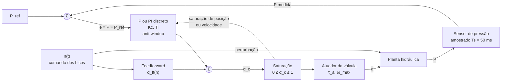

Fonte: elaborada pelo autor.

**Como ler a Figura 11.** O sinal anda da esquerda para a direita. No primeiro somador (Σ), a pressão medida é comparada com a referência, gerando o erro $e$. O controlador (P ou PI) transforma o erro em uma correção da abertura. No segundo somador, essa correção é somada à abertura calculada pelo *feedforward*, que vem do número de bicos; nas configurações sem *feedforward*, esse bloco é trocado por uma abertura fixa. O comando passa pela saturação (não pode ser menor que 0 nem maior que 1) e vai para o atuador, que move a válvula. A válvula muda a pressão da planta, que também é afetada pelos bicos (a seta de perturbação). Por fim, o sensor mede a pressão e o ciclo recomeça. A seta tracejada avisa o PI quando a válvula está no limite, para ele parar de acumular erro.

### 3.5.1 Quanto a pressão muda quando a válvula abre

Para escolher os ganhos do controlador, é preciso saber **quanto a pressão muda para cada pedaço de abertura da válvula**. Esse número é o **ganho da planta**, $K_g$. Ele pode ser medido no próprio modelo estático, sem nenhuma conta nova, com um experimento feito no computador:

1. Deixe $n$ bicos abertos e a válvula na abertura que dá $P_{ref}$ = 3,5 kgf/cm² (essa abertura é a $\alpha_{ff}$ da seção 3.5.2).
2. Abra a válvula um pouquinho, meio centésimo a mais, e calcule a pressão pela Equação (3.8).
3. Feche a válvula um pouquinho, meio centésimo a menos, e calcule a pressão de novo.
4. Divida a diferença das pressões pela diferença das aberturas:

$$K_g = \frac{P(\alpha_{ff} + 0{,}005) - P(\alpha_{ff} - 0{,}005)}{0{,}01} \tag{3.11}$$

A Tabela 3 mostra o resultado para cada número de bicos.

**Tabela 3 – Ganho da planta medido no modelo estático.**

| Bicos abertos ($n$) | $\alpha_{ff}$ | $P$ com a válvula um pouco mais aberta [kgf/cm²] | $P$ com a válvula um pouco mais fechada [kgf/cm²] | $K_g$ [kgf/cm²] |
|---|---|---|---|---|
| 7 | 0,023 | 3,4867 | 3,5133 | −2,66 |
| 4 | 0,388 | 3,4867 | 3,5133 | −2,66 |
| 1 | 0,752 | 3,4867 | 3,5133 | −2,66 |

Fonte: elaborada pelo autor.

**Exemplo da conta.** Com sete bicos: $K_g$ = (3,4867 − 3,5133)/0,01 = −0,0266/0,01 = −2,66. Ou seja, abrir a válvula 0,01 (um ponto percentual) baixa a pressão em cerca de 0,027 kgf/cm². O sinal negativo quer dizer exatamente isso: **abrir a válvula diminui a pressão**.

**O número de bicos não muda o ganho.** As três linhas da Tabela 3 deram o mesmo valor, e o mesmo acontece para 2, 3, 5 e 6 bicos. A explicação física é simples. Com a pressão regulada em 3,5 kgf/cm², a fonte entrega sempre a mesma vazão (5,72 L/min, pela Equação 3.6). O que muda com $n$ é só a divisão dessa vazão: com muitos bicos abertos, quase tudo sai pelos bicos e a válvula fica quase fechada; com poucos bicos, a válvula precisa abrir mais para escoar o resto. A soma das constantes dos bicos e da válvula é sempre a mesma, e por isso o efeito de abrir a válvula mais um pouco também é sempre o mesmo. A consequência prática é importante: **uma única sintonia serve para qualquer número de bicos**, e o ensaio de Ziegler-Nichols (seção 3.5.4) pode ser feito com qualquer $n$. O valor de $K_g$ também é usado na seção 4.4 para conferir o erro do controlador P pela Equação (2.12).

### 3.5.2 Compensação antecipativa (*feedforward*)

O próprio sistema que comanda os bicos sabe quantos estão abertos, então a perturbação é conhecida e pode ser compensada por *feedforward* (seção 2.7.1). A parcela antecipativa $u_{ff}$ da Equação (2.14) é a abertura que, pelo modelo estático, mantém $P = P_{ref}$ com $n$ bicos abertos. A conta é isolar $\alpha$ na Equação (3.8) com $P = P_{ref}$:

1. Equação (3.8) com $P = P_{ref}$: $Q_s(P_{ref}) = \left[n\,K + K_{v,max}\,\alpha\right]\sqrt{P_{ref}}$.
2. Dividindo os dois lados por $\sqrt{P_{ref}}$: $Q_s(P_{ref})/\sqrt{P_{ref}} = n\,K + K_{v,max}\,\alpha$.
3. Passando $n\,K$ para o lado esquerdo e dividindo por $K_{v,max}$:

$$\alpha_{ff}(n) = \frac{1}{K_{v,max}}\left[\frac{Q_s(P_{ref})}{\sqrt{P_{ref}}} - n\,K\right] \tag{3.12}$$

Com os números do trabalho, $Q_s(P_{ref})/\sqrt{P_{ref}}$ = 5,72/1,871 = 3,057. Com sete bicos: $\alpha_{ff}$ = (3,057 − 7 × 0,425)/3,5 = 0,023, ou seja, a válvula fica 2,3% aberta. Com um bico: $\alpha_{ff}$ = (3,057 − 0,425)/3,5 = 0,752.

A Equação (3.12) é uma reta: cada bico que fecha pede $K/K_{v,max}$ = 0,425/3,5 = 0,121 a mais de abertura. Faz sentido, porque o líquido que saía por aquele bico agora precisa sair pela válvula.

### 3.5.3 Os três controladores e sua forma discreta

O erro é definido como $e = P - P_{ref}$, ao contrário do que é mais comum, porque aqui pressão acima da referência pede **abrir** a válvula. Com o PI e o *feedforward* juntos, o comando da válvula é:

$$\alpha_c(t) = \alpha_{ff}(n) + K_c\left[e(t) + \frac{1}{T_i}\int_0^t{e(\tau)\,d\tau}\right] \tag{3.13}$$

São três parcelas somadas: a abertura calculada antes ($\alpha_{ff}$), uma correção proporcional ao erro de agora ($K_c\,e$) e uma correção proporcional ao erro acumulado (a integral dividida por $T_i$). Os três controladores comparados neste trabalho saem dessa mesma equação:

- **P:** a parcela integral é retirada ($T_i$ infinito) e $\alpha_{ff}(n)$ é trocado por uma abertura fixa $\alpha_0$, a do início da simulação: $\alpha_c = \alpha_0 + K_c\,e$;
- **PI:** a parcela integral volta, e $\alpha_{ff}(n)$ continua trocado por $\alpha_0$;
- **PI+FF:** a equação completa. O *feedforward* leva a válvula para perto da posição certa, e o PI faz o papel da parcela de realimentação $u_{fb}$ da Equação (2.14), corrigindo o que o modelo errar.

**Forma discreta.** O controlador não roda o tempo todo. Ele lê a pressão e atualiza o comando a cada $T_s$ = 50 ms, e o comando fica parado entre uma atualização e outra. Por isso a integral vira uma **soma de retângulos**: a cada leitura, soma-se o erro vezes 50 ms ao total que já existia. Chamando essa soma de $I_k$:

$$I_k = I_{k-1} + e_k\,T_s, \qquad \alpha_{c,k} = \alpha_{ff}(n_k) + K_c\left(e_k + \frac{I_k}{T_i}\right) \tag{3.14}$$

No controlador P, a soma $I_k$ fica sempre em zero.

**Exemplo.** Sete bicos abertos, pressão medida de 3,6 kgf/cm² (erro $e$ = +0,1) e soma anterior $I$ = 0. Com os ganhos do PI obtidos na seção 4.2 ($K_c$ = 1,32 e $T_i$ = 0,083 s):
- soma nova: $I$ = 0 + 0,1 × 0,05 = 0,005;
- correção: 1,32 × (0,1 + 0,005/0,083) = 1,32 × 0,160 = 0,211;
- comando: $\alpha_c$ = 0,023 + 0,211 = 0,234. A válvula recebe ordem de abrir de 2,3% para 23,4%.

Se na leitura seguinte o erro ainda for +0,1, a soma passa para 0,010 e a correção cresce mais um pouco. A ação integral continua aumentando a correção enquanto houver erro. No controlador P, com $K_c$ = 1,46, a correção seria só 1,46 × 0,1 = 0,146, e ela não cresceria nas leituras seguintes.

**Anti-windup.** Foi usada a integração condicional da Equação (2.15) (seção 2.7.2). A válvula é considerada saturada quando está no limite de posição (toda fechada ou toda aberta, com o erro pedindo para ir além) ou quando se move na velocidade máxima $\omega_{max}$. Nesses casos, **a soma $I_k$ não é atualizada**.

### 3.5.4 Sintonia pelo ganho crítico

Os ganhos foram escolhidos pelo segundo método de Ziegler e Nichols (seção 2.6.1). O ensaio que o método pede foi feito no próprio simulador, com o modelo completo (fonte, bicos, válvula com limite de velocidade e controlador amostrado a cada 50 ms):

1. Começar com sete bicos abertos, a pressão em $P_{ref}$ e a válvula parada na abertura de equilíbrio.
2. Usar só a ação proporcional, com um valor de $K_c$ escolhido.
3. Em t = 0,5 s, fechar um bico, para tirar a pressão do equilíbrio, e simular até t = 10 s.
4. Olhar os dois últimos segundos: se a pressão ainda oscila, o ganho está no crítico ou acima dele; se ela já parou, o ganho está abaixo.
5. Repetir com outros valores de $K_c$ até achar o menor ganho que mantém a oscilação. Em vez de testar um valor de cada vez, o programa usa a bissecção (seção 3.3.4): começa com o intervalo de 0,5 a 10 e o divide ao meio 14 vezes.

O ganho encontrado é o $K_{cr}$, e o tempo entre duas cristas da oscilação é o $P_{cr}$. Com esses dois números, a Equação (2.13) dá os ganhos do P e do PI. Os valores estão na seção 4.2.

Uma pergunta natural é **por que a malha oscila**, se a planta (válvula de primeira ordem e pressão instantânea) não oscilaria sozinha. A causa é a amostragem: o controlador só lê a pressão a cada 50 ms e mantém o comando parado entre duas leituras. Com um ganho alto, ele corrige demais numa leitura, a pressão passa do ponto, e na leitura seguinte ele corrige demais para o outro lado. Por isso a oscilação crítica tem período de duas leituras, 0,1 s. O ensaio pelo simulador mostra esse efeito sem que seja preciso modelá-lo à mão, e essa é uma das vantagens do método.

## 3.6 Simulação e métricas

### 3.6.1 Parâmetros

A Tabela 4 reúne todos os parâmetros e de onde cada um veio. Os parâmetros têm três origens, e vale saber qual é qual, porque isso diz o quanto se pode confiar em cada um: os **ajustados aos dados** ($K$ e a curva da fonte) são os mais confiáveis; os **calculados** ($K_g$, $K_{cr}$, $P_{cr}$, $K_c$ e $T_i$) dependem dos outros; os **estimados ou escolhidos** ($\tau_a$, $\omega_{max}$, $K_{v,max}$, $T_s$) são decisões ou suposições do autor.

**Tabela 4 – Parâmetros do modelo e do controle.**

| Parâmetro | Valor | Origem |
|---|---|---|
| $K$ | 0,425 (L/min)/√(kgf/cm²) | Ajustado aos dados (Tabela 1) |
| $a_2$, $a_1$, $a_0$ | −0,0355; −0,2018; 5,815 | Ajustados aos dados (Tabela 1) |
| $P_{ref}$ | 3,5 kgf/cm² | Escolha de projeto (ver seção 4.1) |
| $K_{v,max}$ | 3,5 (L/min)/√(kgf/cm²) | Escolha de projeto: folga sobre o necessário com nenhum bico aberto (3,06) |
| $\tau_a$ | 0,2 s | Estimado |
| $\omega_{max}$ | 0,5 s⁻¹ (curso total em 2 s) | Estimado |
| $T_s$ | 50 ms | Escolha de projeto |
| $\Delta t$ | 1 ms | Passo da simulação |
| $K_g$ | −2,66 kgf/cm² | Medido no modelo estático (Equação 3.11) |
| $K_{cr}$, $P_{cr}$ | 2,93 (kgf/cm²)⁻¹; 0,100 s | Medidos no simulador (seção 3.5.4) |
| $K_c$ do P | 1,46 (kgf/cm²)⁻¹ | Equação (2.13) |
| $K_c$, $T_i$ do PI | 1,32 (kgf/cm²)⁻¹; 0,083 s | Equação (2.13), também usados no PI+FF |

Fonte: elaborada pelo autor.

### 3.6.2 Como a simulação funciona, passo a passo

Cada simulação recebe uma lista de eventos, no formato "no instante $t$, passam a existir $n$ bicos abertos", e a duração total. A partir daí, o programa repete o seguinte laço a cada passo de 1 ms:

1. **Atualiza os bicos:** se chegou a hora de um evento, troca o valor de $n$.
2. **Roda o controlador, se for a vez dele:** a cada 50 passos (50 ms), lê a pressão, calcula o erro, decide se a soma do integrador pode ser atualizada (anti-windup; no P ela fica sempre em zero) e calcula o novo comando $\alpha_c$ pela Equação (3.14). Nos outros 49 passos, o comando fica igual.
3. **Move a válvula:** calcula a velocidade pedida pela Equação (3.9), corta essa velocidade em $\pm\omega_{max}$, avança a abertura pela Equação (3.10) e mantém o valor entre 0 e 1.
4. **Calcula a pressão:** com o $n$ e o $\alpha$ deste passo, resolve a Equação (3.8) pela bissecção (hipótese H6).
5. **Guarda os valores** de tempo, pressão, abertura e número de bicos para as métricas e os gráficos.

No início, a pressão está em $P_{ref}$ e a válvula na abertura de equilíbrio para sete bicos, ou seja, o sistema começa parado no ponto certo. Um cenário de 26 s, por exemplo, tem 26 000 passos, e o controlador calcula um novo comando em 520 deles.

### 3.6.3 Cenários e configurações

Os cenários (Tabela 5) repetem as sequências do ensaio da bancada de referência e acrescentam situações mais difíceis.

**Tabela 5 – Cenários de simulação.**

| Cenário | Sequência de $n(t)$ | Objetivo |
|---|---|---|
| C1 | 7 → 1 → 7, um bico por vez, a cada 2 s (26 s) | Passar por toda a faixa de operação |
| C2 | 7 → 4 em t = 2 s (fecha 1, 4 e 7) → 1 em t = 8 s (fecha 2, 3 e 5) | Repetir a sequência da Tabela 2, com degraus de três bicos |
| C3 | Um bico sorteado troca de estado a cada 0,1–0,5 s, com $n$ entre 1 e 7 (20 s, 66 trocas) | Imitar a aplicação localizada, com trocas frequentes |
| C4 | C3 com a planta diferente do modelo usado pelo controlador | Ver o que acontece quando o modelo tem erros |

Fonte: elaborada pelo autor.

No C3, o sorteio usa uma semente fixa, então a sequência é sempre a mesma e os resultados podem ser repetidos. No C4, a planta simulada foi alterada de quatro formas, enquanto o controlador continuou usando o modelo original: bicos com $K$ 10% menor (pontas parcialmente entupidas), bicos com $K$ 10% maior (pontas gastas), fonte com $a_0$ 5% maior (bomba girando mais rápido) e válvula com característica quadrática ($K_v = K_{v,max}\,\alpha^2$) em vez de linear. Antes de simular cada caso, o programa confere se a referência ainda pode ser atingida com sete bicos abertos.

Os cenários C1 a C3 foram simulados em quatro configurações:
- **malha aberta:** válvula parada na abertura que dá $P_{ref}$ com sete bicos, como se ninguém mexesse nela;
- **P:** só a ação proporcional, partindo da abertura inicial;
- **PI:** o controlador PI, sem *feedforward*, partindo da abertura inicial;
- **PI+FF:** o controlador PI com o *feedforward* da Equação (3.12).

O C4 foi simulado com o PI e o PI+FF, que são os dois que usam a ação integral. Além disso, os cenários C2 e C3 foram repetidos com o PI e o PI+FF para três velocidades máximas da válvula (0,5, 1,0 e 2,0 s⁻¹), porque $\omega_{max}$ é estimado e é o parâmetro que mais limita a correção.

### 3.6.4 Métricas

**Faixa de tolerância.** Foi usada a tolerância de ±10% na pressão da norma ISO 16122-2 (seção 2.5):

$$0{,}9\,P_{ref} \le P \le 1{,}1\,P_{ref} \tag{3.15}$$

Para $P_{ref}$ = 3,5 kgf/cm², a faixa vai de 3,5 × 0,9 = **3,15** a 3,5 × 1,1 = **3,85 kgf/cm²**. Pela Equação (3.1), a vazão do bico varia com a raiz da pressão, então essa faixa mantém a vazão de cada bico a cerca de ±5% do valor desejado.

**Métricas calculadas** em cada simulação, com $N$ amostras de 1 ms:

- **tempo fora da faixa:** a porcentagem das amostras em que a pressão ficou fora da Equação (3.15). Com a máquina em velocidade constante, a porcentagem do tempo é também a porcentagem da área aplicada com a pressão fora da tolerância:

$$\text{fora} = \frac{100}{N}\sum_{k=1}^{N}{\left[P_k \notin \text{faixa}\right]} \tag{3.16}$$

  O colchete vale 1 quando a amostra está fora da faixa e 0 quando está dentro, então a soma conta as amostras fora. Por exemplo, 946 amostras fora em um cenário de 14 s (14 000 amostras) dão 100 × 946/14 000 = 6,8%;
- **integral do erro absoluto (IAE):** soma o tamanho do erro em cada passo, vezes a duração do passo. Graficamente, é a área entre a curva da pressão e a linha de $P_{ref}$. O módulo $|\ldots|$ tira o sinal, para que erros para cima e para baixo não se cancelem. Quanto menor, melhor:

$$\mathrm{IAE} = \sum_{k=1}^{N}{\left|P_k - P_{ref}\right|\Delta t} \tag{3.17}$$

  As duas métricas se completam: o tempo fora da faixa só diz **se** a pressão saiu da faixa, enquanto o IAE mede **quanto** ela errou, mesmo dentro da faixa;
- **desvio máximo:** o maior $|P - P_{ref}|$, em porcentagem de $P_{ref}$. Por exemplo, um pico de 4,5 kgf/cm² dá (4,5 − 3,5)/3,5 = 29%;
- **tempo de acomodação:** depois de cada troca de bicos, o tempo até a pressão entrar e não sair mais da faixa de ±2% de $P_{ref}$ (3,43 a 3,57 kgf/cm²). No C3, as trocas acontecem mais rápido que isso, então essa métrica não foi usada.

**Validação.**
- **Estática:** os pontos de operação previstos com a válvula fechada foram comparados com a Tabela 1. Além disso, foi feita uma **validação cruzada "deixa um de fora"** (LOO): para cada um dos sete pontos, $K$ e a curva da fonte foram ajustados de novo usando só os outros seis, e o ponto que ficou de fora foi previsto. Assim o erro é medido em um ponto que não participou do ajuste.
- **Dinâmica:** só qualitativa, comparando o comportamento em malha aberta do C2 com a Tabela 2, porque o artigo não traz medições no tempo.

## 3.7 Implementação em Python

O modelo, o controlador e a simulação foram programados em um único arquivo, `simulacao/modelo_barra.py`, em Python 3. Foram usadas só duas bibliotecas: **numpy**, para contas com vetores e para o ajuste por mínimos quadrados, e **matplotlib**, para os gráficos. A simulação no tempo foi programada diretamente, sem bibliotecas de controle, para que cada passo ficasse visível no código. Para rodar, a partir da pasta do trabalho:

```
py -3 simulacao/modelo_barra.py
```

O programa grava todos os números em `simulacao/resultados.json`, salva os gráficos em `simulacao/figuras/` e mostra um resumo na tela. Todos os números e figuras do Capítulo 4 vêm dessa execução.

### 3.7.1 Organização do programa

O arquivo está dividido em blocos executados na ordem da Figura 12.

**Figura 12 – Fluxo de execução do programa.**

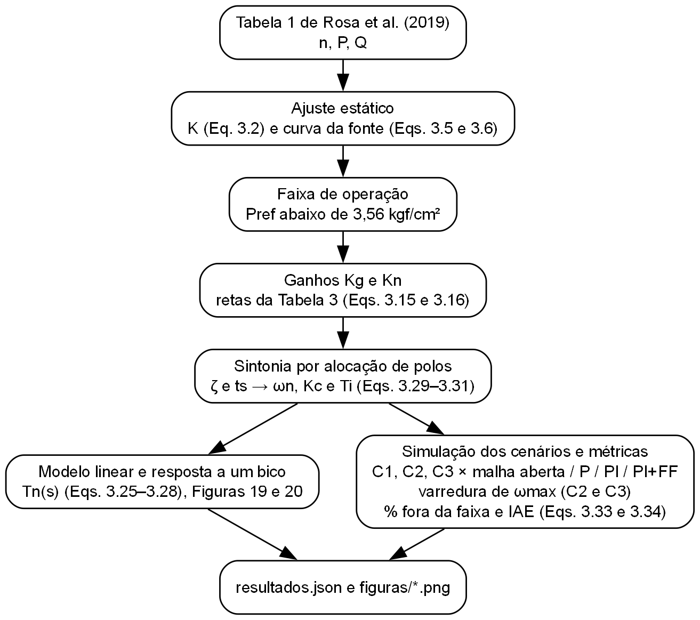{width=70%}

Fonte: elaborada pelo autor.

**Como ler a Figura 12.** O programa começa pelos dados da Tabela 1 e ajusta o modelo estático. Antes de seguir, confere se o ajuste deu os valores esperados; se não der, para com uma mensagem de erro, o que evita gerar resultados errados sem perceber. Depois faz a validação cruzada, confere se a pressão de referência pode ser atingida e mede o ganho $K_g$. Em seguida faz o ensaio de Ziegler-Nichols, que mede $K_{cr}$ e $P_{cr}$ e calcula os ganhos do P e do PI. Por fim, roda os cenários C1 a C4 e a varredura da velocidade da válvula, calcula as métricas e salva os resultados e os gráficos.

O Quadro 1 liga cada função do programa à equação que ela implementa.

**Quadro 1 – Funções do programa e equações correspondentes.**

| Função | O que faz | Equações |
|---|---|---|
| `q_fonte` | Calcula a vazão da fonte para uma pressão | (3.6) |
| `p_regime` | Acha a pressão de equilíbrio por bissecção | (3.8) |
| `identificacao` | Ajusta $K$ e a curva da fonte e compara com a Tabela 1 | (3.2), (3.4), (3.5) |
| `validacao_cruzada` | Refaz o ajuste sem um ponto e prevê esse ponto | (3.2), (3.4), (3.8) |
| `alpha_ff` | Calcula a abertura antecipada para $n$ bicos | (3.12) |
| `ganho_kg` | Mede o ganho da planta abrindo e fechando a válvula um pouco | (3.11) |
| `oscilacao`, `ganho_critico` | Fazem o ensaio só com P e acham $K_{cr}$ e $P_{cr}$ por bissecção | Seção 3.5.4 |
| `sintonia_zn` | Calcula $K_c$ e $T_i$ do P e do PI pelas regras de Ziegler-Nichols | (2.13) |
| `simular` | Roda o laço no tempo (modos malha aberta, P, PI e PI+FF) | (2.15), (3.8)–(3.10), (3.14) |
| `metricas` | Calcula tempo fora da faixa, IAE, desvio e acomodação | (3.15)–(3.17) |
| `cenarios`, `casos_c4` | Montam as sequências de bicos e as plantas com erro | Tabela 5 |

Fonte: elaborada pelo autor.

### 3.7.2 Trechos principais

Esta seção mostra as quatro funções que concentram as contas do modelo e do controle. Para cada uma, são repetidas as equações que ela implementa, seguidas de um fluxograma e do código.

**Abertura antecipada (`alpha_ff`).** A função calcula a abertura da válvula que, pelo modelo estático, mantém $P = P_{ref}$ com $n$ bicos abertos:

$$\alpha_{ff}(n) = \frac{1}{K_{v,max}}\left[\frac{Q_s(P_{ref})}{\sqrt{P_{ref}}} - n\,K\right] \tag{3.12}$$

em que a vazão da fonte vem da Equação (3.6):

$$Q_s(P) = \frac{-a_1 - \sqrt{a_1^2 - 4a_2(a_0 - P)}}{2a_2} \tag{3.6}$$

**Figura 13 – Fluxograma da função `alpha_ff`.**

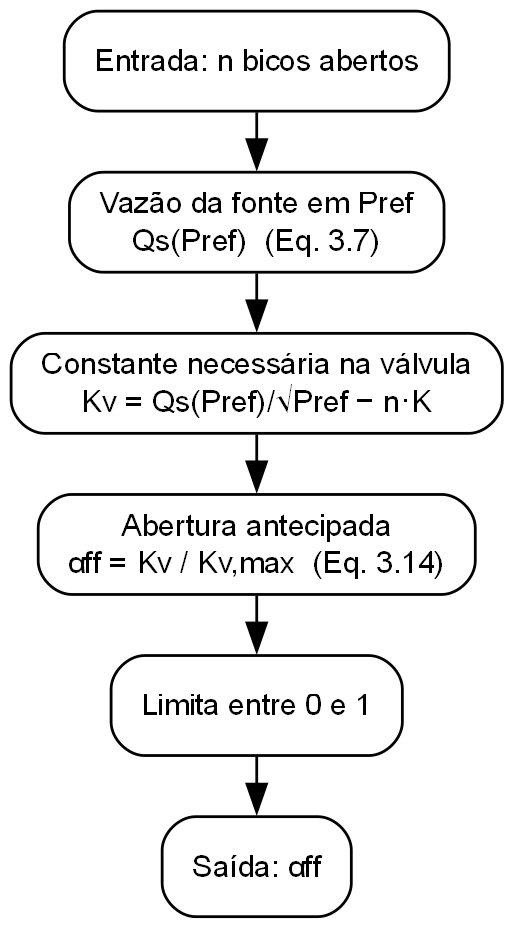{width=50%}

Fonte: elaborada pelo autor.

No Quadro 2, a primeira linha útil calcula a constante de vazão que a válvula precisa ter, $Q_s(P_{ref})/\sqrt{P_{ref}} - n\,K$, e a segunda a divide por $K_{v,max}$ e limita o resultado entre 0 e 1, como na Figura 13.

**Quadro 2 – Cálculo da abertura antecipada (função `alpha_ff`).**

```python
def alpha_ff(n, p_ref=P_REF):
    # Eq. (3.12): K_v necessário, depois dividido por K_v,max
    kv = q_fonte(p_ref) / math.sqrt(p_ref) - n * K
    return min(max(kv / KV_MAX, 0.0), 1.0)   # entre 0 e 1
```

Fonte: elaborada pelo autor.

**Pressão de equilíbrio (`p_regime`).** A função resolve a Equação (3.8), em que a vazão que a fonte entrega é igual à que sai pelos bicos e pela válvula:

$$Q_s(P) = \left[n\,K + K_v(\alpha)\right]\sqrt{P} \tag{3.8}$$

A função recebe a soma $n\,K + K_v(\alpha)$ e procura $P$ pelo método da bissecção (seção 3.3.4). A ideia, mostrada na Figura 14, é a seguinte: se, num certo valor de pressão, a fonte entrega **mais** líquido do que as saídas deixam passar, a pressão de equilíbrio está acima desse valor; se entrega **menos**, está abaixo. A cada repetição o intervalo de busca cai pela metade, e depois de 100 repetições ele é muito menor que qualquer erro de interesse.

**Figura 14 – Fluxograma da função `p_regime` (bissecção).**

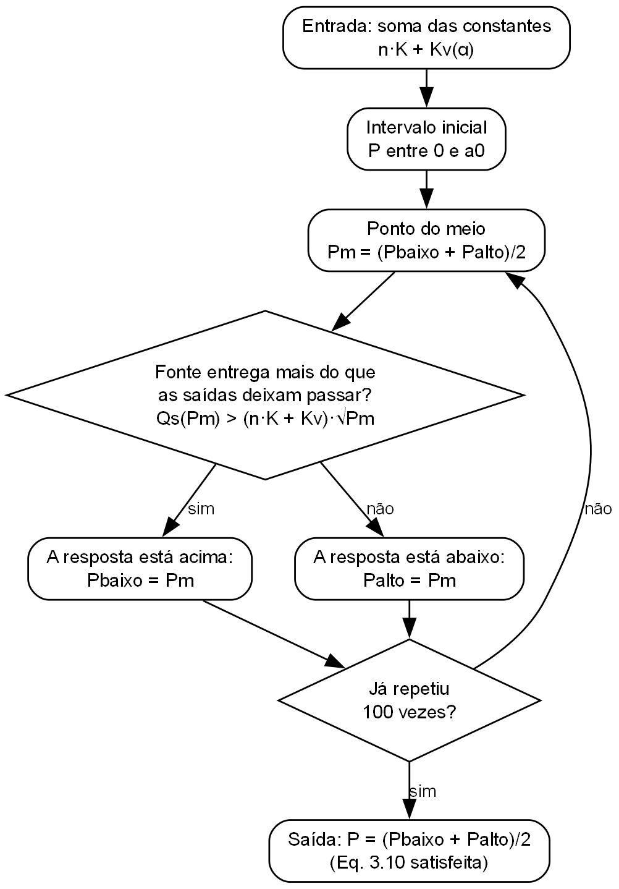{width=70%;altmax=16}

Fonte: elaborada pelo autor.

**Quadro 3 – Pressão de equilíbrio por bissecção (funções `q_fonte` e `p_regime`).**

```python
def q_fonte(p, fonte=FONTE):
    # Eq. (3.6): raiz positiva de a2 Q² + a1 Q + (a0 - p) = 0
    a2, a1, a0 = fonte
    if p >= a0:
        return 0.0
    return (-a1 - math.sqrt(a1 * a1 - 4 * a2 * (a0 - p))) / (2 * a2)

def p_regime(k_total, fonte=FONTE):
    # Eq. (3.8): Qs(P) = k_total·√P, por bissecção em [0, a0]
    lo, hi = 0.0, fonte[2]
    for _ in range(100):
        mid = 0.5 * (lo + hi)
        if q_fonte(mid, fonte) - k_total * math.sqrt(mid) > 0:
            lo = mid        # fonte entrega mais: P está acima
        else:
            hi = mid        # fonte entrega menos: P está abaixo
    return 0.5 * (lo + hi)
```

Fonte: elaborada pelo autor.

**Laço da simulação (`simular`).** É o coração do programa, que repete a seção 3.6.2 a cada passo de 1 ms. Ele junta quatro conjuntos de equações. O controlador PI discreto, rodado a cada $T_s$ = 50 ms:

$$I_k = I_{k-1} + e_k\,T_s, \qquad \alpha_{c,k} = \alpha_{ff}(n_k) + K_c\left(e_k + \frac{I_k}{T_i}\right) \tag{3.14}$$

com a soma $I_k$ congelada quando a válvula está saturada (anti-windup, Equação 2.15):

$$I_k = I_{k-1} + s_k\,e_k\,T_s \tag{2.15}$$

o atuador da válvula, com limite de velocidade, avançado pelo método de Euler:

$$\frac{d\alpha}{dt} = \mathrm{sat}_{\pm\omega_{max}}\left(\frac{\alpha_c - \alpha}{\tau_a}\right), \qquad 0 \le \alpha \le 1 \tag{3.9}$$

$$\alpha_{k+1} = \alpha_k + \Delta t \cdot \left(\frac{d\alpha}{dt}\right)_k \tag{3.10}$$

e, por fim, a pressão de equilíbrio da Equação (3.8), calculada pela função `p_regime` (hipótese H6).

**Figura 15 – Fluxograma da função `simular`.**

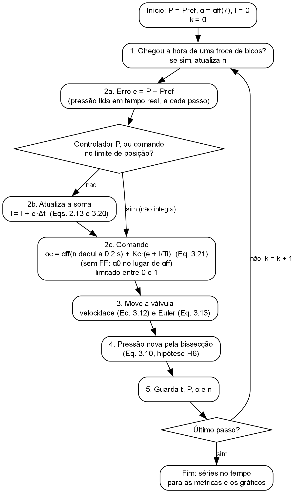{width=100%;altmax=21}

Fonte: elaborada pelo autor.

**Como ler a Figura 15.** Cada volta do laço é um passo de 1 ms. O losango de cima decide se é a vez do controlador: só a cada 50 passos ele lê a pressão e calcula um novo comando, e nos outros 49 o comando fica igual. Dentro do controlador, o segundo losango é o anti-windup: se a válvula está no limite, a soma do integrador não é atualizada. No controlador P, a soma nunca é atualizada. Depois, em todos os passos, a válvula anda e a pressão é recalculada. Nas configurações P e PI, sem *feedforward*, o termo $\alpha_{ff}(n)$ é trocado pela abertura fixa do início da simulação.

No Quadro 4, os números dos comentários correspondem aos blocos da Figura 15. As variáveis `sat_pos` e `sat_vel` indicam se a válvula está no limite de posição ou de velocidade, que é o $s_k = 0$ da Equação (2.15).

**Quadro 4 – Laço principal da simulação (função `simular`, trecho simplificado).**

```python
for k in range(passos):
    t = k * dt
    # 1. comutação dos bicos
    while ev and ev[0][0] <= t:
        n = ev.pop(0)[1]
    # 2. controlador, só a cada Ts (50 passos)
    if k % cada == 0 and modo != "aberta":
        e = p - P_REF                  # 2a. abrir a válvula reduz P
        ff = alpha_ff(n) if modo == "PI+FF" else bias
        u = ff + kc * (e + integ / ti)     # no P, ti = infinito
        sat_pos = (u >= 1 and e > 0) or (u <= 0 and e < 0)
        sat_vel = abs(alpha_c - alpha) / tau_a >= w_max
        if modo != "P" and not (sat_pos or sat_vel):   # 2b. anti-windup, Eq. (2.15)
            integ += e * TS
        alpha_c = min(max(ff + kc * (e + integ / ti), 0), 1)   # 2c. Eq. (3.14)
    # 3. válvula: Eq. (3.9) e Euler, Eq. (3.10)
    v = min(max((alpha_c - alpha) / tau_a, -w_max), w_max)
    alpha = min(max(alpha + v * dt, 0), 1)
    # 4. pressão pelo modelo estático, Eq. (3.8)
    p = p_regime(n * K + KV_MAX * alpha)
```

Fonte: elaborada pelo autor.

**Métricas (`metricas`).** A função recebe as séries de uma simulação e calcula os números das Tabelas 10 e 11. Ela usa a faixa de tolerância, o tempo fora da faixa e o IAE:

$$0{,}9\,P_{ref} \le P \le 1{,}1\,P_{ref} \tag{3.15}$$

$$\text{fora} = \frac{100}{N}\sum_{k=1}^{N}{\left[P_k \notin \text{faixa}\right]} \tag{3.16}$$

$$\mathrm{IAE} = \sum_{k=1}^{N}{\left|P_k - P_{ref}\right|\Delta t} \tag{3.17}$$

**Figura 16 – Fluxograma da função `metricas`.**

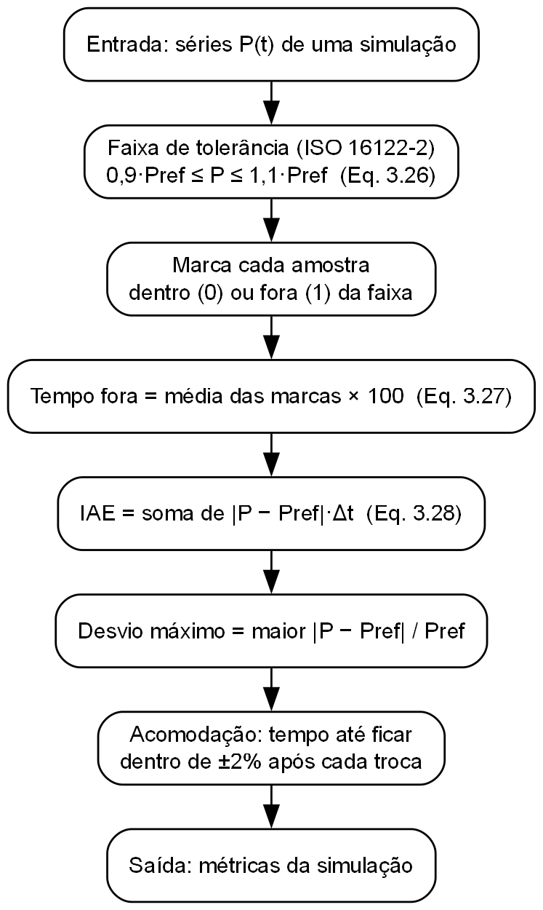{width=55%}

Fonte: elaborada pelo autor.

No Quadro 5, em vez de um laço, o numpy compara todas as amostras de uma vez e gera um vetor de verdadeiro/falso. A média desse vetor é a fração do tempo fora da faixa, que é a Equação (3.16); a soma dos erros absolutos vezes $\Delta t$ é a Equação (3.17).

**Quadro 5 – Cálculo do tempo fora da faixa e do IAE (função `metricas`, trecho).**

```python
FAIXA = (0.90, 1.10)                     # Eq. (3.15), ISO 16122-2
fora = (p < FAIXA[0] * P_REF) | (p > FAIXA[1] * P_REF)
fora_pct = fora.mean() * 100             # Eq. (3.16)
IAE = np.sum(np.abs(p - P_REF)) * dt     # Eq. (3.17)
desvio_max = np.max(np.abs(p - P_REF)) / P_REF * 100
```

Fonte: elaborada pelo autor.

### 3.7.3 Conferências automáticas

O programa tem conferências que interrompem a execução se algo sair do esperado:
- o ajuste estático precisa dar $K$ = 0,425 e erros máximos abaixo de 0,75% na pressão e 2,3% na vazão;
- a referência precisa ser atingível com sete bicos e a válvula fechada;
- o ganho $K_g$ medido para cada número de bicos não pode diferir mais de 2% do valor de $n$ = 4;
- o período crítico precisa ser o de duas leituras do controlador (0,1 s), como explicado na seção 3.5.4, e o ganho crítico precisa ficar a menos de 5% do valor calculado pela teoria de sistemas amostrados para uma válvula de primeira ordem (3,02);
- os ganhos do P e do PI precisam ficar abaixo do ganho crítico;
- o tempo integral $T_i$ não pode ser menor que o período de amostragem $T_s$.

Isso funciona como um teste: se alguém mudar um dado ou uma fórmula e quebrar o modelo, o programa avisa em vez de gerar gráficos errados.

## 3.8 Limitações

- Os parâmetros estáticos vêm de uma bancada de sete bicos e 5 m; uma barra comercial tem dezenas de bicos e pode ter perda de pressão relevante ao longo da barra (H2).
- A curva da fonte vale na faixa medida (1,0 a 5,6 L/min; 3,57 a 5,58 kgf/cm²). Com a válvula aberta, a vazão da fonte chega a 5,7 L/min em $P_{ref}$ = 3,5 kgf/cm², uma pequena extrapolação.
- A pressão foi tratada como instantânea (H6). Em barras longas, com mangueiras grossas ou com ar na linha, a pressão pode demorar mais para se ajustar, e essa hipótese precisaria ser revista.
- $\tau_a$, $\omega_{max}$ e a curva da válvula (H5) foram estimados sem dados da bancada. Os resultados dinâmicos valem para esses valores, e o ganho crítico do ensaio de Ziegler-Nichols também depende deles.
- O sensor de pressão foi tratado como perfeito. Os ganhos de Ziegler-Nichols são altos: o $K_c$ do PI (1,32) é cerca de metade do ganho crítico. Num teste à parte, com sete bicos abertos e um ruído aleatório de 1% a 2% na leitura de pressão, a pressão continuou dentro da faixa, mas a válvula se moveu de 2,6 a 3,4 vezes mais do que com um PI de ganho quatro vezes menor ($K_c$ = 0,33). Num equipamento real isso gastaria mais o motor da válvula, e talvez fosse preciso filtrar a medida ou reduzir o ganho, que é o ajuste fino que Ogata (2010) recomenda depois do Ziegler-Nichols.
- O modelo não inclui atraso das solenoides, vento ou falhas mecânicas.

---

# 4 RESULTADOS

Todos os números deste capítulo foram gerados pelo programa da seção 3.7 e estão gravados em `simulacao/resultados.json`.

## 4.1 Modelo estático

**Constante do bico.** Pela Equação (3.2), os sete valores de $K$ ficaram entre 0,418 e 0,436, com média **$K$ = 0,425 (L/min)/√(kgf/cm²)**. Valores tão próximos confirmam que a vazão de cada bico segue a raiz da pressão (Equação 3.1). Para 4,0 bar (4,079 kgf/cm²), esse $K$ dá 0,86 L/min por bico, cerca de 7% abaixo dos 0,92 L/min do catálogo do fabricante (ROSA; TERRA; DREWS JR, 2019). Uma explicação possível é a perda de pressão na solenoide e na válvula antigotejo, que ficam entre o sensor de pressão e a ponta, de modo que o bico trabalha com uma pressão um pouco menor que a medida.

**Resistência equivalente.** A Tabela 6 e a Figura 17 comparam a lei $R_1/n^2$ da Equação (3.3), a fórmula empírica (2.7) e os valores medidos.

O valor $R_1$ = 5,58 (kgf/cm²)/(L/min)² é a resistência medida com **um único bico aberto**, tirada diretamente da última linha da Tabela 1: $R_1 = P/Q^2$ = 5,58/1,00² = 5,58. Para $n$ bicos, a Equação (3.3) prevê então $R_1/n^2$; com sete bicos, por exemplo, 5,58/49 = 0,114. Usar o ponto de um bico como base permite testar só a **forma** da lei, isto é, se a resistência cai realmente com $n^2$, sem misturar esse teste com o ajuste de $K$. É também o ponto pelo qual a fórmula empírica (2.7) passa (5,581), o que deixa a comparação justa. O valor é coerente com o $K$ da média: um bico com $R_1$ = 5,58 tem $K_1 = 1/\sqrt{5{,}58}$ = 0,423, contra $K$ = 0,425 da Equação (3.2), que daria $R_b = 1/K^2$ = 5,54, uma diferença menor que 1%.

**Tabela 6 – Resistência equivalente da barra: medida e modelos.**

| $n$ | Medida | $R_1/n^2$ (3.3) | Erro | Eq. (2.7) | Erro |
|---|---|---|---|---|---|
| 7 | 0,114 | 0,114 | 0,0% | 0,093 | −18,5% |
| 6 | 0,151 | 0,155 | +2,7% | 0,147 | −2,7% |
| 5 | 0,219 | 0,223 | +1,9% | 0,233 | +6,3% |
| 4 | 0,358 | 0,349 | −2,6% | 0,371 | +3,8% |
| 3 | 0,633 | 0,620 | −2,0% | 0,621 | −1,9% |
| 2 | 1,318 | 1,395 | +5,9% | 1,320 | +0,2% |
| 1 | 5,580 | 5,580 | 0,0% | 5,581 | 0,0% |

Unidade: (kgf/cm²)/(L/min)². Fonte: elaborada pelo autor com dados de Rosa, Terra e Drews Jr (2019).

**Figura 17 – Resistência equivalente em função do número de bicos abertos.**


Fonte: elaborada pelo autor com dados de Rosa, Terra e Drews Jr (2019).

**Como ler a Figura 17.** O eixo horizontal é o número de bicos abertos e o vertical é a resistência equivalente da barra, em escala logarítmica (cada marca vale dez vezes a anterior), porque os valores vão de 0,1 a 5,6. Os pontos pretos são as medições de Rosa, a linha azul contínua é o modelo deste trabalho ($R_1/n^2$) e a linha laranja tracejada é a fórmula empírica (2.7). As duas linhas passam perto dos pontos; a diferença aparece em $n$ = 7, onde a fórmula empírica fica abaixo do ponto medido.

A fórmula (2.7) tem erro absoluto menor (RMSE de 0,012 contra 0,030), porque acerta melhor os valores grandes de $n$ = 1 e 2. Já o erro relativo do modelo deste trabalho é mais uniforme: no máximo 5,9%, contra 18,5% da fórmula (2.7) em $n$ = 7, o que daria uma vazão cerca de 11% maior que a real. Além disso, o modelo usa um único número com significado físico e serve para qualquer número de bicos.

**Curva da fonte.** O ajuste por mínimos quadrados da Equação (3.4) deu:

$$P = -0{,}0355\,Q_s^2 - 0{,}2018\,Q_s + 5{,}815 \quad [\text{kgf/cm}^2,\ \text{L/min}] \tag{4.1}$$

com RMSE de 0,006 kgf/cm² e R² de 0,9999. Uma reta teria RMSE de 0,073 kgf/cm², doze vezes maior, o que justifica a curva de segundo grau.

**Pontos de operação.** Resolvendo a Equação (3.8) com a válvula fechada para cada $n$, o modelo reproduziu os sete pontos medidos com erro máximo de **0,7% na pressão** ($n$ = 4) e **2,3% na vazão** ($n$ = 2) (Tabela 7 e Figura 18).

**Tabela 7 – Pontos de operação previstos e medidos (válvula fechada).**

| $n$ | $P$ previsto | $P$ medido | $Q$ previsto | $Q$ medido |
|---|---|---|---|---|
| 7 | 3,56 | 3,57 | 5,62 | 5,60 |
| 6 | 3,90 | 3,88 | 5,04 | 5,07 |
| 5 | 4,25 | 4,24 | 4,38 | 4,40 |
| 4 | 4,61 | 4,64 | 3,65 | 3,60 |
| 3 | 4,96 | 4,96 | 2,84 | 2,80 |
| 2 | 5,29 | 5,27 | 1,95 | 2,00 |
| 1 | 5,58 | 5,58 | 1,00 | 1,00 |

$P$ em kgf/cm², $Q$ em L/min. Fonte: elaborada pelo autor com dados de Rosa, Terra e Drews Jr (2019).

**Figura 18 – Curva da fonte e curvas de carga da barra.**


Fonte: elaborada pelo autor com dados de Rosa, Terra e Drews Jr (2019).

**Como ler a Figura 18.** O eixo horizontal é a vazão e o vertical é a pressão. A curva preta grossa é a fonte (Equação 4.1): quanto mais vazão se pede, menor a pressão que ela consegue manter. As curvas azuis finas são as curvas de carga da barra, uma para cada número de bicos ($P = (Q/nK)^2$): com poucos bicos a curva sobe rápido, porque pouca vazão já exige muita pressão. O ponto de operação é onde a curva da fonte cruza a curva de carga, e os pontos laranja (medidos) caem praticamente em cima desses cruzamentos. A linha verde pontilhada marca $P_{ref}$ = 3,5 kgf/cm².

**Validação cruzada.** A Tabela 8 mostra o resultado da validação "deixa um de fora". Os erros de previsão ficaram com o mesmo tamanho dos erros de ajuste: no máximo **0,9% na pressão** e **2,7% na vazão**. Isso indica que o modelo não apenas se ajusta aos sete pontos usados, mas também prevê bem um ponto que ficou de fora do ajuste.

**Tabela 8 – Validação cruzada: cada ponto previsto sem ser usado no ajuste.**

| $n$ | $K$ | $P$ prev. | $P$ med. | Erro $P$ | $Q$ prev. | $Q$ med. | Erro $Q$ |
|---|---|---|---|---|---|---|---|
| 7 | 0,4254 | 3,563 | 3,57 | −0,18% | 5,621 | 5,60 | +0,37% |
| 6 | 0,4244 | 3,902 | 3,88 | +0,56% | 5,030 | 5,07 | −0,78% |
| 5 | 0,4247 | 4,251 | 4,24 | +0,27% | 4,378 | 4,40 | −0,49% |
| 4 | 0,4263 | 4,597 | 4,64 | −0,92% | 3,656 | 3,60 | +1,56% |
| 3 | 0,4261 | 4,959 | 4,96 | −0,02% | 2,847 | 2,80 | +1,66% |
| 2 | 0,4233 | 5,288 | 5,27 | +0,34% | 1,947 | 2,00 | −2,66% |
| 1 | 0,4254 | 5,566 | 5,58 | −0,25% | 1,004 | 1,00 | +0,36% |

$n$: ponto retirado do ajuste; $K$: valor ajustado com os outros seis pontos; prev.: previsto; med.: medido. $P$ em kgf/cm², $Q$ em L/min. Fonte: elaborada pelo autor.

**Faixa de operação do controle.** A válvula de alívio só consegue **baixar** a pressão, porque ela só tira líquido da linha. Então a referência precisa ficar abaixo da pressão que a fonte consegue manter com a válvula fechada e o maior número de bicos abertos. Pela Tabela 7, isso dá 3,56 kgf/cm² com sete bicos. Uma referência de 4,0 kgf/cm², perto da pressão de catálogo do bico, não seria atingível com seis ou sete bicos abertos (3,90 e 3,56 kgf/cm²). Por isso foi adotado $P_{ref}$ = 3,5 kgf/cm². Numa máquina real, isso vira uma regra de projeto: a bomba precisa dar vazão suficiente para a barra inteira na pressão de trabalho e ainda sobrar um pouco para a válvula aliviar.

**Ressalva.** A Tabela 2 registra 6,10 kgf/cm² com um bico aberto e a válvula 11% aberta, mas a Equação (4.1) prevê no máximo 5,82 kgf/cm² mesmo com vazão zero. Esse ensaio deve ter sido feito com outra rotação da bomba e, por isso, não serve para conferir a Equação (4.1).

## 4.2 Sintonia e conferências

**Ganho da planta.** O experimento da Equação (3.11) deu $K_g$ = −2,66 kgf/cm² por unidade de abertura para **todos** os números de bicos, de 1 a 7 (Tabela 3). Por isso o ensaio de Ziegler-Nichols foi feito uma vez só, com sete bicos, e os ganhos servem para qualquer $n$.

**Ensaio do ganho crítico.** A Figura 19 mostra o ensaio da seção 3.5.4 para três valores de $K_c$, e a Tabela 9 resume a sintonia.

**Figura 19 – Ensaio de Ziegler-Nichols pelo ganho crítico.**


Fonte: elaborada pelo autor.

**Como ler a Figura 19.** Nos dois gráficos, o eixo horizontal é o tempo e o vertical é a pressão; só a ação proporcional está ligada. Em t = 0,5 s um bico fecha e a pressão sobe para cerca de 3,83 kgf/cm². Depois disso:

- com $K_c$ = 1,46, o ganho que as regras dão para o controlador P (curva verde), a pressão desce e para em cerca de 3,57 kgf/cm², sem oscilar, mas acima da referência. Esse é o erro do controlador P (Equação 2.12);
- com $K_c$ = 2,63, 90% do ganho crítico (curva laranja), a pressão oscila por alguns segundos e depois se acalma;
- com $K_c$ = 3,07, um pouco acima do ganho crítico (curva vermelha), a oscilação não para mais.

O gráfico de baixo amplia meio segundo do final do ensaio. A curva vermelha sobe e desce em dentes de serra, com uma crista a cada 0,1 s, ou seja, a cada duas leituras do controlador, como explicado na seção 3.5.4. A forma de dente de serra vem do limite de velocidade da válvula: em cada meio período ela anda para um lado na velocidade máxima.

**Tabela 9 – Sintonia pelo segundo método de Ziegler-Nichols.**

| Grandeza | Valor | Como foi obtida |
|---|---|---|
| Ganho crítico $K_{cr}$ | 2,93 (kgf/cm²)⁻¹ | Bissecção no simulador (seção 3.5.4) |
| Período crítico $P_{cr}$ | 0,100 s | Tempo entre cristas da oscilação |
| P: $K_c$ | 0,5 × 2,93 = **1,46** (kgf/cm²)⁻¹ | Equação (2.13) |
| PI: $K_c$ | 0,45 × 2,93 = **1,32** (kgf/cm²)⁻¹ | Equação (2.13) |
| PI: $T_i$ | 0,100/1,2 = **0,083 s** | Equação (2.13) |

Fonte: elaborada pelo autor.

O tempo integral ficou maior que o período de amostragem (0,083 contra 0,050 s), como pede a conferência da seção 3.7.3, mas com pouca folga: a soma de retângulos da Equação (3.14) acompanha a integral de forma grosseira. Com esses ganhos, o ganho da malha $K_c\,|K_g|$ vale 1,46 × 2,66 = 3,9 no P e 1,32 × 2,66 = 3,5 no PI.

O ganho crítico também confere com a teoria. Para um controlador P amostrado que comanda uma planta de primeira ordem, a teoria de sistemas amostrados dá um ganho crítico de 3,02 para os valores deste trabalho; o ensaio deu 2,93, cerca de 3% abaixo. A pequena diferença vem do limite de velocidade da válvula, que a teoria não considera.

**Conferência da hipótese H6.** Para saber quanto a hipótese de pressão instantânea muda os resultados, os cenários C2 e C3 foram repetidos com o modelo da versão anterior deste trabalho, que inclui o armazenamento de líquido na mangueira, usando os mesmos ganhos. A maior diferença no tempo fora da faixa foi de 1,7 ponto percentual (C3 com PI+FF), e as conclusões das seções seguintes não mudam. Com a mangueira, o ganho crítico sobe para cerca de 5,0, porque o líquido armazenado amortece a pressão. Ou seja, os ganhos tirados do modelo com pressão instantânea ficam ainda mais longe do limite de estabilidade se a mangueira for considerada.

**Passo de integração.** Repetindo o cenário C3 com $\Delta t$ = 2 ms, o tempo fora da faixa mudou no máximo 0,1 ponto percentual, o que mostra que o passo de 1 ms é suficiente. Com $\Delta t$ = 10 ms, o resultado do PI+FF mudava 0,9 ponto, porque os instantes das trocas de bicos ficavam arredondados; por isso o passo de 10 ms não foi usado.

## 4.3 Respostas nos cenários

A Tabela 10 reúne as métricas de todas as configurações, e as Figuras 20 a 22 mostram as respostas no tempo. As seções 4.4 a 4.6 discutem um controlador de cada vez, sempre comparando com o anterior.

**Tabela 10 – Desempenho por cenário e configuração.**

| Cenário | Configuração | Tempo fora da faixa | IAE [kgf/cm²·s] | Desvio máximo | Acomodação média (±2%) |
|---|---|---|---|---|---|
| C1 | Malha aberta | 69,2% | 24,72 | 57,8% | não acomoda (11 de 12 degraus) |
| C1 | P | 10,2% | 4,95 | 19,5% | não acomoda (9 de 12 degraus) |
| C1 | PI | **0,0%** | 0,77 | 9,5% | 0,35 s |
| C1 | PI+FF | **0,0%** | **0,61** | **9,5%** | **0,33 s** |
| C2 | Malha aberta | 85,7% | 18,38 | 57,8% | não acomoda |
| C2 | P | 46,6% | 4,16 | 35,8% | não acomoda |
| C2 | PI | 7,5% | 0,88 | 29,7% | 0,79 s |
| C2 | PI+FF | **6,8%** | **0,74** | **29,6%** | **0,68 s** |
| C3 | Malha aberta | 90,5% | 23,26 | 57,8% | — |
| C3 | P | 26,9% | 5,02 | 19,9% | — |
| C3 | PI | **5,0%** | **3,14** | 16,8% | — |
| C3 | PI+FF | 5,9% | 3,16 | **16,2%** | — |

No C3 as trocas de bicos (0,1 a 0,5 s) acontecem antes de a pressão acomodar, então essa métrica não se aplica. Fonte: elaborada pelo autor.

**Figura 20 – Cenário C1: fechamento e reabertura dos bicos, um por vez.**


Fonte: elaborada pelo autor.

**Como ler as Figuras 20 a 22.** As três figuras têm o mesmo formato, com três gráficos empilhados que dividem o mesmo eixo de tempo:
- **em cima**, a pressão na barra. A faixa verde é a tolerância de ±10% da Equação (3.15) e a linha pontilhada é $P_{ref}$. A curva cinza é a malha aberta, a verde é o P, a laranja é o PI e a azul é o PI+FF. O ideal é a curva ficar sempre dentro da faixa verde;
- **no meio**, a abertura da válvula $\alpha$ em cada configuração. Na malha aberta ela fica parada; nas outras, ela sobe quando bicos fecham (para aliviar o excesso) e desce quando bicos abrem;
- **embaixo**, o número de bicos abertos, que é a perturbação.

**Figura 21 – Cenário C2: sequência do ensaio de Rosa, Terra e Drews Jr (2019).**


Fonte: elaborada pelo autor.

**Figura 22 – Cenário C3: troca aleatória de bicos.**


Fonte: elaborada pelo autor.

**Malha aberta.** Sem controle, a pressão sobe de 3,5 para até 5,5 kgf/cm² (desvio de 58%) quando os bicos fecham, como na Tabela 1 e no mesmo sentido do ensaio da Tabela 2. Nas Figuras 20 e 21, a curva cinza sobe em escada e sai da faixa logo no segundo degrau. A barra passa de 69% a 91% do tempo fora da faixa. É desse ponto que os três controladores partem.

## 4.4 Controlador P

O controlador P já melhora muito a malha aberta: o tempo fora da faixa cai de 69% para 10% no C1, de 86% para 47% no C2 e de 91% para 27% no C3. Mas ele deixa a pressão parada **acima** da referência depois de cada fechamento de bicos.

Na Figura 21, quando três bicos fecham em t = 2 s, a curva verde desce rápido, mas para em cerca de 3,70 kgf/cm², e não em 3,5. Quando os outros três fecham, em t = 8 s, ela para em 3,90 kgf/cm², que já está fora da faixa. Por isso o P passa quase metade do C2 fora da faixa e não acomoda em nenhum degrau.

Esse é exatamente o erro em regime permanente da Equação (2.12). Com quatro bicos abertos, a malha aberta chegaria a 4,54 kgf/cm², ou seja, a perturbação é $d$ = 1,04 kgf/cm². Com o ganho de malha 3,9, a equação prevê $e_{reg}$ = 1,04/(1 + 3,9) = 0,21 kgf/cm², ou seja, uma pressão de 3,5 + 0,21 = 3,71 kgf/cm². O simulador deu 3,70 kgf/cm². Com um bico aberto, a perturbação é 2,03 kgf/cm², a equação prevê 3,91 e o simulador dá 3,90. A pequena diferença vem de o modelo da barra não ser exatamente linear. O controlador P sozinho, portanto, não atende a tolerância quando muitos bicos fecham. Seria possível aumentar $K_c$ para diminuir o erro, mas o ensaio da Figura 19 mostra que o limite está perto: com o dobro do ganho, a malha já oscilaria sem parar.

## 4.5 Controlador PI

A ação integral elimina o erro que o P deixava. Na Figura 21, a curva laranja volta para 3,5 kgf/cm² depois de cada fechamento, e o mesmo acontece em todos os degraus do C1. Com isso:

- no **C1**, a pressão fica dentro da faixa 100% do tempo. Cada troca de bico causa um pico de cerca de 9,5%, que fica dentro da faixa e é corrigido em cerca de 0,35 s;
- no **C2**, o tempo fora da faixa cai de 47% (P) para 7,5%, e o IAE cai de 4,16 para 0,88;
- no **C3**, o tempo fora da faixa cai de 27% (P) para 5,0%. As saídas da faixa que sobram acontecem quando várias trocas no mesmo sentido chegam seguidas e a válvula não consegue acompanhar.

**Por que o pico do C2 não some.** Quando três bicos fecham, a pressão salta para cerca de 4,54 kgf/cm² **no mesmo instante**, fora da faixa, em qualquer configuração. Nesse momento a válvula ainda está na posição antiga, porque o controlador só fica sabendo da troca depois que ela acontece. Por isso o desvio máximo do C2 (29,7%) é praticamente o mesmo salto da malha aberta. **O que o controlador define é quanto tempo a pressão leva para voltar.** No gráfico do meio da Figura 21, a abertura sobe em rampa quase reta: a válvula está andando na velocidade máxima, e precisa mudar 0,36 de abertura, o que leva cerca de 0,7 s a 0,5 s⁻¹. Para reduzir o próprio pico, seria preciso começar a abrir a válvula um pouco **antes** de fechar os bicos.

## 4.6 PI com *feedforward*

O *feedforward* leva a válvula direto para a abertura calculada pelo modelo estático no instante da troca, sem esperar o erro aparecer. O efeito foi diferente em cada cenário:

- no **C1**, o tempo fora da faixa continua em 0%, o IAE cai 21% (de 0,77 para 0,61) e a acomodação fica um pouco mais rápida (0,33 contra 0,35 s);
- no **C2**, o tempo fora da faixa cai de 7,5% para 6,8% e a acomodação de 0,79 para 0,68 s;
- no **C3**, o resultado **piora**: o tempo fora da faixa sobe de 5,0% para 5,9%, e o IAE fica praticamente igual.

**Por que o *feedforward* piora o C3.** A causa é a velocidade da válvula. No C3 os bicos trocam de estado, em média, a cada 0,3 s, e a válvula passa a maior parte do tempo correndo atrás do comando na velocidade máxima: 64% do tempo com o PI e 71% com o PI+FF. A cada troca, o *feedforward* manda a válvula para a nova abertura de equilíbrio de uma vez, mas antes de ela chegar lá outra troca já mudou o alvo. O PI, que só reage ao erro de pressão, pede movimentos menores e acaba acompanhando melhor uma sequência de trocas rápidas. Com uma válvula mais rápida isso muda. Repetindo os cenários com velocidades maiores:

- com $\omega_{max}$ = 1,0 s⁻¹ (curso total em 1 s), o C2 fica 4,1% do tempo fora com o PI e 3,4% com o PI+FF, e o C3 fica 1,2% e 1,6%;
- com $\omega_{max}$ = 2,0 s⁻¹ (curso total em 0,5 s), o C2 fica 2,4% e 1,8%, e o C3 fica 1,0% e 0,8%. Agora o *feedforward* ajuda nos dois cenários.

Ou seja, o *feedforward* só compensa quando a válvula consegue chegar à posição calculada antes da próxima troca. Com a válvula estimada para a bancada, que leva 2 s para o curso completo, ele ajuda nas trocas espaçadas (C1 e C2) e atrapalha nas trocas muito rápidas (C3). A velocidade da válvula é, também, o que mais pesa no resultado de qualquer controlador: dobrar $\omega_{max}$ corta o tempo fora da faixa do PI quase pela metade no C2 e para um quarto no C3.

**No campo.** Para ter uma ideia do que esses números significam, a 15 km/h a máquina anda cerca de 4,2 m por segundo. Os cerca de 0,95 s fora da faixa do PI+FF no C2 correspondem a uns 4 m de deslocamento com a pressão fora da tolerância.

## 4.7 Erro de modelo (cenário C4)

A Tabela 11 e a Figura 23 mostram o que acontece quando a planta não é igual ao modelo usado pelo controlador.

**Tabela 11 – Cenário C3 com a planta diferente do modelo (C4).**

| Caso | $P$ máxima com 7 bicos | PI: tempo fora | PI+FF: tempo fora | PI: IAE | PI+FF: IAE |
|---|---|---|---|---|---|
| Nominal (sem erro) | 3,56 | **5,0%** | 5,9% | 3,13 | 3,16 |
| Bicos com $K$ −10% | 3,80 | **2,0%** | 4,0% | 2,74 | 2,87 |
| Fonte com $a_0$ +5% | 3,76 | **6,2%** | 9,2% | 3,19 | 3,29 |
| Válvula quadrática | 3,56 | **4,9%** | 11,9% | 2,84 | 3,34 |
| Bicos com $K$ +10% | 3,34 | inatingível | inatingível | — | — |

$P$ em kgf/cm²; IAE em kgf/cm²·s. Fonte: elaborada pelo autor.

**Figura 23 – Tempo fora da faixa no cenário C3 com erro de modelo.**


Fonte: elaborada pelo autor.

**Como ler a Figura 23.** Cada grupo de barras é um caso da Tabela 11. A barra laranja é o PI sozinho e a azul é o PI+FF; a altura é a porcentagem do tempo em que a pressão ficou fora da faixa. Barra mais baixa é melhor. Em todos os casos a barra laranja é a mais baixa.

Três observações:

- **O PI quase não muda com o erro de modelo.** Ele não usa o modelo, só a medição, e por isso se adapta à planta real. O tempo fora da faixa ficou entre 2% e 6%. No caso dos bicos com $K$ 10% menor, ele até melhorou (2,0%), porque a fonte passa a ter mais folga de pressão.
- **O *feedforward* piora com qualquer erro de modelo, e muito com a válvula quadrática.** Como ele já atrapalhava no C3 nominal (seção 4.6), um modelo errado só aumenta a diferença. Com a válvula quadrática, a abertura que o *feedforward* calcula, supondo válvula linear, deixa passar muito menos líquido do que ele espera. A válvula vai para um lugar bem errado, e o PI precisa desfazer esse erro: o tempo fora da faixa sobe de 4,9% (PI) para 11,9% (PI+FF).
- **Bicos 10% mais abertos (pontas gastas) tornam a referência inatingível.** Com $K$ 10% maior, a fonte só sustenta 3,34 kgf/cm² com sete bicos abertos, abaixo dos 3,5 desejados, e a válvula de alívio não tem como subir a pressão. Isso reforça a regra de projeto da seção 4.1: a fonte precisa ter folga de vazão.

O resultado mostra que **a ação integral é o que garante que a pressão volte à referência**, com ou sem erro de modelo. O *feedforward* depende de duas condições para ajudar: a curva da válvula precisa ser conhecida, e a válvula precisa ser rápida o bastante para chegar à posição calculada antes da próxima troca de bicos.

---

# 5 CONCLUSÃO

[Versão parcial — revisar após validação com dados adicionais.]

Este trabalho tentou responder se é possível manter estável a pressão de uma barra com alimentação em série, enquanto os bicos abrem e fecham, usando uma válvula de alívio, um modelo baseado em resistências fluídicas e um controlador simples.

O primeiro objetivo era modelar a relação entre pressão, vazão e número de bicos, incluindo a fonte e a válvula. O modelo estático, com uma única constante de bico e uma curva de segundo grau para a fonte, reproduziu os pontos publicados por Rosa, Terra e Drews Jr (2019) com erro de até 0,7% na pressão e 2,3% na vazão. Na validação cruzada, prevendo cada ponto sem usá-lo no ajuste, o erro ficou em até 0,9% e 2,7%. O modelo também mostrou um limite de projeto: a válvula de alívio só baixa a pressão, então a referência precisa ficar abaixo do que a fonte sustenta com todos os bicos abertos.

O segundo objetivo era acrescentar a dinâmica da válvula. A pressão foi tratada como instantânea, e só a válvula, com seu atraso e seu limite de velocidade, tem dinâmica. Uma comparação com um modelo que inclui o armazenamento de líquido na mangueira mostrou diferença de no máximo 1,7 ponto percentual no tempo fora da faixa. O ganho da planta, medido no modelo estático, não depende do número de bicos abertos, e por isso uma única sintonia serve para todos os casos.

O terceiro e o quarto objetivos eram sintonizar os controladores. O segundo método de Ziegler-Nichols foi aplicado no próprio simulador: o ganho crítico foi de 2,93 e o período crítico de 0,1 s, igual a duas leituras do controlador, o que mostra que é a amostragem que limita o ganho. As regras deram $K_c$ = 1,46 para o P e $K_c$ = 1,32 com $T_i$ = 0,083 s para o PI, e o mesmo PI foi usado com o *feedforward* pelo número de bicos.

O quinto objetivo era comparar os controladores em simulação, usando como tolerância a faixa de ±10% na pressão da norma ISO 16122-2. Os três passos tiveram papéis diferentes:

- o **P** reduziu o tempo fora da faixa em relação à malha aberta (de 69% a 91% para 10% a 47%), mas deixou a pressão parada acima da referência, no valor previsto pela conta do erro em regime permanente. Com seis bicos fechados, esse erro já tira a pressão da faixa;
- o **PI** eliminou esse erro. Manteve a pressão dentro da faixa durante 100% do tempo na troca de um bico por vez e durante 95% do tempo na troca aleatória;
- o **PI com *feedforward*** acelerou a correção quando as trocas são espaçadas, mas piorou o resultado quando os bicos trocam muito depressa (de 5,0% para 5,9% fora da faixa) e quando o modelo tinha erros, principalmente na curva da válvula (de 4,9% para 11,9%). A causa é a velocidade da válvula: ela não chega à posição calculada antes da próxima troca. Com uma válvula duas a quatro vezes mais rápida, o *feedforward* voltou a ajudar.

Em todos os controladores, quando três bicos fecham ao mesmo tempo, a pressão salta para fora da faixa no mesmo instante e leva alguns décimos de segundo para voltar, porque a válvula não se move rápido o bastante.

Por isso, a hipótese foi **confirmada em parte e só em simulação**: o modelo permitiu sintonizar, por um método simples, um controlador PI que atende a tolerância nas trocas de um bico e na maior parte da troca aleatória, mas não nas trocas simultâneas de vários bicos. Os parâmetros da válvula foram estimados, e não medidos, e os ganhos de Ziegler-Nichols foram usados sem ajuste fino. A validação com medições no tempo é o passo que falta para transformar esses resultados em uma conclusão sobre um sistema real.

Como trabalhos futuros, ficam:
- medir em bancada a velocidade da válvula e sua curva de abertura, que são os parâmetros que mais pesam no resultado e no ganho crítico;
- refazer o ensaio de Ziegler-Nichols na bancada real e ajustar os ganhos considerando o ruído do sensor de pressão;
- testar uma válvula mais rápida ou mandar o comando da válvula um pouco antes do comando das solenoides, para reduzir os picos das trocas grandes;
- estender o modelo para barras comerciais, com perda de pressão ao longo da barra e, se necessário, com o armazenamento de líquido na mangueira;
- validar o modelo com registros de pulverizadores em campo.

---

# REFERÊNCIAS

AGRIQ. **Preparo da calda de agrotóxico**: como fazer com segurança? Disponível em: https://agriq.com.br/preparo-da-calda-de-agrotoxico/. Acesso em: 25 maio 2025.

BEGA, E. A. et al. **Instrumentação industrial**. 2. ed. Rio de Janeiro: Interciência, 2006.

BRASIL. **Movimento Nacional ODS – Mato Grosso**. Movimento ODS. Disponível em: https://movimentoods.org.br/mato-grosso/. Acesso em: 25 jun. 2025.

CASALI, A. L. **Condições de uso de pulverizadores e tratores na região Central do Rio Grande do Sul**. 2012. 109 f. Dissertação (Mestrado em Engenharia Agrícola) – Universidade Federal de Santa Maria, Santa Maria, 2012.

COSTA, A. G. F. et al. Efeito da intensidade do vento, da pressão e de pontas de pulverização na deriva de aplicações de herbicidas em pré-emergência. **Planta Daninha**, v. 25, p. 203-210, 2007.

FELIZARDO, K. R. et al. Modeling and model validation of a chemical injection sprayer system. **Applied Engineering in Agriculture**, St. Joseph, v. 32, n. 3, p. 285, 2016. [A CONFERIR — páginas]

GARCIA, C. **Modelagem e simulação de processos industriais e de sistemas eletromecânicos**. 2. ed. São Paulo: Editora da Universidade de São Paulo, 2005.

HARTMANN-SCHMIDT, M. A. **Deposição da calda de pulverização na cultura da soja em função do tipo de ponta e do volume aplicado**. 2006. 47 f. Dissertação (Mestrado em Agronomia) – Universidade Estadual do Oeste do Paraná, Marechal Cândido Rondon, 2006.

HOLTERMAN, H. J. et al. Modelling spray drift from boom sprayers. St. Joseph: American Society of Agricultural and Biological Engineers, 2016. [A CONFERIR — o artigo com este título parece ser de 1997, Computers and Electronics in Agriculture, v. 19, p. 1-22]

HUGHES, T. A. **Measurement and control basics**. 3. ed. Research Triangle Park: ISA Press, 2002.

INTERNATIONAL ORGANIZATION FOR STANDARDIZATION (ISO). **ISO 16122-2**: Agricultural and forestry machinery – Inspection of sprayers in use – Part 2: Horizontal boom sprayers. Geneva: ISO, 2015. (Adotada como BS EN ISO 16122-2:2015. London: BSI, 2015.)

JACTO. **Pulverizador agrícola**: tudo o que você precisa saber. 2017. Disponível em: https://blog.jacto.com.br/pulverizador-agricola-tudo-o-que-voce-precisa-saber/. Acesso em: 24 maio 2025.

KUHN. **Pulverizadores agrícolas**. Disponível em: https://www.kuhnbrasil.com.br/cultivos/pulverizadores. Acesso em: 25 maio 2025.

MACHADO, A. L. et al. **Máquinas para preparo do solo, semeadura, adubação e tratamentos culturais**. Pelotas: UFPel, 2005.

MANTOVANI, E. C.; QUEIROZ, D. M.; DIAS, G. P. Máquinas e operações utilizadas na agricultura de precisão. In: MANTOVANI, E. C. (org.). **Agricultura de precisão**: fundamentos e aplicações. Viçosa: Editora UFV, 2009. cap. 4, p. 109.

MERCALDI, H. V. **Automação de um sistema de pulverização para aplicação de agroquímicos a taxa variada usando injeção direta**. 2012. Dissertação (Mestrado) – Escola de Engenharia de São Carlos, Universidade de São Paulo, São Carlos, 2012.

MERRITT, H. E. **Hydraulic control systems**. New York: John Wiley & Sons, 1967.

MILHORANCE, F. Brasil lidera o ranking de consumo de agrotóxicos. **O Globo**, Rio de Janeiro, 2015.

OGATA, K. **Engenharia de controle moderno**. Tradução de Heloísa Coimbra de Souza. 5. ed. São Paulo: Pearson Prentice Hall, 2010.

RIBEIRO, M. L. et al. Contaminação de águas subterrâneas por pesticidas: avaliação preliminar. **Química Nova**, v. 30, n. 3, p. 688-694, 2007.

ROSA, G. R. A. da; TERRA, F. P.; DREWS JR, P. L. J. Pulverizador agrícola em barras com aplicação a taxa variada: modelagem física. In: SIMPÓSIO BRASILEIRO DE AUTOMAÇÃO INTELIGENTE, 14., 2019, Ouro Preto. **Anais** [...]. Campinas: Galoá, 2019. p. 2286-2291. DOI: 10.17648/sbai-2019-111478.

SHIRATSUCHI, L. S.; CHRISTOFFOLETI, P. J. Aplicação localizada de herbicidas em pós-emergência na cultura de soja. **Planta Daninha**, Viçosa, v. 20, n. 1, p. 71-76, abr. 2002.

STEWARD, B. L.; HUMBURG, D. S. Modeling the Raven SCS-700 chemical injection system with carrier control with sprayer simulation. **Transactions of the ASAE**, St. Joseph, v. 43, n. 2, p. 231-245, 2000.

ZIEGLER, J. G.; NICHOLS, N. B. Optimum settings for automatic controllers. **Transactions of the ASME**, v. 64, p. 759-768, 1942.

---
---

# NOTAS DE REVISÃO — remover antes da entrega

## A10. Alterações em relação ao 09.md (02/11/2026)
Plano e decisões em `contexto/plano_v10.md`.
- **Artigo base único:** Rosa, Terra e Drews Jr (2019). Steward e Humburg (2000) ficaram só como uma frase em 2.6. Saíram o Raven da 1.3, da 2.3, da 2.4.2, da 2.4.3, da 3.1, da H4 e da 3.4.2, a equação de malha (antiga Eq. 2.9) e o parágrafo da tubulação do Raven. A H2 agora se apoia também na ISO 16122-2, item 4.8.9.
- **Faixa de tolerância:** ±10% direto na pressão (ISO 16122-2:2015, item 4.5.4; o item 4.8.8 é citado junto). Antes era ±5% na vazão, via Steward. Nova parte sobre a tolerância na seção 2.5, e Eq. 3.15 = 0,9·Pref a 1,1·Pref (antes 0,9025 a 1,1025).
- **Controle:** sequência P → PI → PI+FF. Em 2.6 entram o erro do P (nova **Eq. 2.12**) e a nova seção **2.6.1, Ziegler-Nichols** (**Eq. 2.13**, Ogata 2010, Tabela 8.2).
- **Sintonia:** saiu o SIMC/lambda (λ, τ₁, θ, G(s) e a transformada de Laplace). Entrou o **segundo método de ZN (ganho crítico)**, com o ensaio feito no simulador (3.5.4): Kcr = 2,93 e Pcr = 0,100 s. Os ganhos ficaram em P: Kc = 1,46; PI: Kc = 1,32, Ti = 0,083 s.
  - A curva de reação (primeiro método) foi testada e descartada. Os ganhos dela (P 3,01; PI 2,71) ficavam acima ou perto do Kcr discreto e oscilavam a 10 Hz.
  - A tabela 8.1 do Ogata não divide pelo ganho K da planta.
- **Resultados novos (Cap. 4 reorganizado por controlador):** 4.2 sintonia (Tab. 9, nova Fig. 19), 4.3 respostas (Tab. 10, Figs. 20 a 22), 4.4 P, 4.5 PI, 4.6 PI+FF, 4.7 C4 (Tab. 11, Fig. 23).
  - C3: P 26,9%, PI 5,0%, PI+FF 5,9%.
  - C2: P 46,6%, PI 7,5%, PI+FF 6,8%.
- **Conclusão sobre o FF mudou de novo:** com o PI do ZN, o FF ajuda no C1 e no C2 e piora no C3 e em todos os casos do C4. A causa é a válvula, que fica 71% do tempo na velocidade máxima no C3. Com ωmax ≥ 2 s⁻¹ o FF volta a ajudar. Essa é a única varredura de ωmax citada, sem tabela.
- **Retiradas:** a Tabela 9 antiga (com/sem mangueira) e a Tabela 11 antiga (varredura de ωmax) viraram uma frase cada.
  - A conferência da H6 foi refeita com os ganhos novos, usando `simulacao/v07/`: diferença máxima de 1,7 p.p. Com a mangueira, Kcr ≈ 5,0.
  - O teste do passo de integração foi refeito: com 2 ms a diferença fica em até 0,1 p.p.; com 10 ms, 0,9 p.p.
- **Limitações (3.8):** entrou o ruído do sensor. Num teste à parte, com 1 a 2% de ruído, a válvula se move de 2,6 a 3,4 vezes mais que com o PI da v09 (Kc 0,33), e a pressão fica na faixa. Esse teste não faz parte do script.
- **Cap. 2 enxugado:** 2.1 e 2.2 mais curtas. Saíram as frases com SCHLOSSER, ZHANG; PIERCE e SHIRATSUCHI et al. 2013, que estavam com referência pendente.
- **Linguagem:** saíram "decorando", "como manda", "acorda", "insistindo", "enxerga", "viu", "sentir" e outras aspas coloquiais.
- **Equações renumeradas:**
  - Cap. 2: Q_ref = 2.9, PID = 2.10 e 2.11, erro do P = 2.12, ZN = 2.13, FF = 2.14, anti-windup = 2.15.
  - Cap. 3: αff = 3.12, PI = 3.13, PI discreto = 3.14, faixa = 3.15, fora = 3.16, IAE = 3.17. Saíram as antigas 3.12, 3.16 e 3.17.
- **Figuras:** a nova Fig. 19 (`f_ganho_critico.png`) entrou e as de resultado foram renumeradas para 20 a 23. Os fluxogramas 12, 13, 15 e 16 foram atualizados (P, ZN, faixa, equações).
- **Script:** `simulacao/modelo_barra.py`.
  - Funções novas: modo `"P"`, `oscilacao`, `ganho_critico` e `sintonia_zn`.
  - Saíram `sintonia` (SIMC), `margens` e `LAMBDA`; `FAIXA` = (0,90; 1,10).
  - Novas conferências: Kcr dentro de 5% do teórico (3,02), Pcr = 2·Ts e Kc < Kcr.
  - A versão 09 do script, de `resultados.json` e das figuras está em `simulacao/v09/`.
- **Referências:** entraram ISO (2015), Ogata (2010) e Ziegler e Nichols (1942); saiu Skogestad (2003).
- Corrigido o `\varphi` da nota A09.

## A09. Alterações em relação ao 08.md (29/10/2026)
- **Steward e Humburg (2000):** deixado explícito que o trabalho deles modela o **Raven SCS-700** (injeção direta com controle da vazão de calda) e que lá a válvula fica **em série**, estrangulando a vazão; aqui ela fica em derivação (1.3, 2.3, 2.4.2, 2.4.4, 3.1, H4, 3.4.2).
- **2.4.1:** retiradas a frase sobre os limites variarem entre autores e a frase sobre o Re da bancada.
- **2.4.2:** dedução da lei de orifício em três passos e explicação do coeficiente de descarga (vena contracta, perdas, valor obtido em ensaio, embutido em $K$).
- **2.4.3:** significado de $R_{F,D}$ (elementos deprimogênios: pontas e válvulas) e $R_{F,T}$ (trechos de tubulação), conforme o artigo base.
- **2.4.4 reescrita:** série → paralelo (nova **Eq. 2.8**) → malha de Steward (**Eq. 2.9**, notação $R_V(\varphi)$, $R_N$, $R_M$, $R_T$) → perda na tubulação ligada à H2. Equações seguintes renumeradas: $Q_{ref}$ = 2.10, PID = 2.11 e 2.12.
- **2.6:** retirado o trecho final sobre as três limitações de Steward e Humburg.
- **Nova seção 2.7** (compensação antecipativa e anti-windup), com as Eqs. 2.13 e 2.14. As seções 3.5.2 e 3.5.3 passaram a remeter a ela.
- **3.2:** quatro fotos novas da bancada (Figuras 4 a 7: visão geral, conjunto motor e bomba, válvula agulha, solenoide). Figuras antigas 4 a 14 renumeradas para 8 a 18. Retirado "Pelo símbolo,". Figura do ensaio (agora 9) em 60% da largura.
- **3.4.2 simplificada:** a saturação de velocidade continua no modelo; o texto explica os dois regimes (rampa e exponencial) com o exemplo do C2.
- **Folga de estabilidade retirada** do 3.5.4, do 4.2.1, do 3.5.3, do 2.6, do 3.7 (Quadro 1) e da Conclusão. A função `margens` continua no script, mas não é citada.
- **4.1:** explicada a origem de $R_1$ = 5,58 (resistência medida com um bico, Tabela 1) e a relação com $K$.
- **Citações *apud* retiradas** (Milhorance, Ribeiro, Holterman, Hughes, Garcia, Merritt, Bega) e incluídas nas Referências, junto com Felizardo et al. (2016). **Os originais ainda não foram lidos**: os dados vêm das listas de Rosa et al. (2019) e de Steward e Humburg (2000). Conferir antes da entrega, principalmente o ano de Holterman (provavelmente 1997) e as páginas de Felizardo.
- **3.7 reescrita:** cada trecho de código vem com as equações que implementa (repetidas com o mesmo número), um fluxograma (Figuras 13 a 16: `alpha_ff`, `p_regime`, `simular`, `metricas`) e o código. Novo Quadro 3 (`q_fonte` e `p_regime`); quadros agora 1 a 5. A Figura 12 virou imagem do Graphviz, sem a menção às margens. Figuras de resultados renumeradas para 17 a 22. Fontes dos fluxogramas em `build/fig/fig12_programa.dot` a `fig16_metricas.dot`.
- **Código nunca dividido entre páginas:** o `md2docx.py` marca as linhas dos blocos de código para ficarem juntas (e junto da linha "Fonte").
- **Nenhum resultado numérico mudou**: o script não foi alterado.

## A08. Alterações em relação ao 07.md (28/10/2026)
- **Modelo dinâmico simplificado (3.4):** saiu a capacitância da linha ($C_h$, $V$, $\beta$) e a equação diferencial da pressão. Nova hipótese H6: a pressão se ajusta na hora e é calculada pela Equação (3.8) a cada passo. Só a válvula tem dinâmica (Eq. 3.9) e o Euler vale só para ela (Eq. 3.10).
- **Linearização removida (3.5.1):** $K_g$ agora é medido no modelo estático com duas bissecções (Eq. 3.11, Tabela 3), e continua igual para todo $n$ (−2,66). A planta para a sintonia é $K_g/(\tau_a s + 1)\,e^{-\theta s}$ (Eq. 3.12).
- **Sintonia (3.5.4):** $\tau_1 = \tau_a$, $\theta = T_s/2$, **$\lambda$ = 0,2 s** fixo (item da banca sobre ruído). $K_c$ = 0,334, $T_i$ = 0,200 s, MF = 83,6°, MG = 23,0 dB. Saiu a busca de $\lambda$ e a seção de margens virou um parágrafo, sem equações.
- **C5 → C4** (item da banca).
- **Resultados novos (4.2):** C3 PI 9,7%, PI+FF 6,5%; C2 7,9%/6,7%. Novas tabelas: comparação com/sem armazenamento na mangueira (Tabela 9, diferença máx. 1,6 p.p.) e varredura de $\omega_{max}$ (Tabela 11). Pico do C2 (29,7%) explicado pelo salto no instante da troca, independente de $\omega_{max}$ (item da banca).
- **Conclusão sobre o *feedforward* mudou:** com o PI mais calmo, o FF ajuda no nominal e com erro nos bicos ou na fonte, e só piora com a válvula quadrática (9,2% → 11,7%).
- **Equações renumeradas:** 3.9 a 3.20 (antes 3.9 a 3.26). Tabelas 3 a 12. Figuras 6, 7 e 8 atualizadas.
- **Script:** `simulacao/modelo_barra.py` simplificado (Δt = 1 ms; 10 ms foi testado e distorce o C3). A versão 07 do script, `resultados.json` e figuras está em `simulacao/v07/`.

## A0. Ajustes de 28/10/2026 (na versão 07)
- **3.2:** Figura 4 trocada pela imagem do fluxograma (Fig. 10 da versão em inglês do artigo), com a explicação das *tags* ISA, o caminho da calda e os dois balanços de vazão. Novas siglas: HV, PCV, PG e XV.
- **Figura 5:** trocada pela imagem do ensaio (Fig. 12 PT / Fig. 13 EN), com explicação de como ler.
- **3.3.2:** a interpretação de alívio por mola agora se apoia na PCV que aparece no fluxograma.
- **3.3:** "Como ler a Figura 6" detalhado, ligando cada bloco à bancada e incluindo o balanço $Q_s = Q_{barra} + Q_v$. Na Figura 6, o rótulo da fonte foi corrigido de Eq. 3.3 para Eq. 3.5.
- **2.4.3:** retirada a comparação com a lei de Ohm.
- **Cap. 1:** seção 1.4 (mudanças em relação ao projeto) removida, sem nenhuma menção ao pré-projeto. A escolha da bancada, do atuador (válvula de alívio, três motivos) e da validação com dados publicados passou para a Justificativa (1.3). "Estrutura do trabalho" virou 1.4.
- **2.6:** explicação do PID detalhada (partes da malha, cada ação, forma com $K_c$, $T_i$, $T_d$ como nova Equação 2.11, sinal do erro e motivo de usar PI).
- As Figuras 4 e 5 vêm de Rosa, Terra e Drews Jr com texto em inglês. Conferir se a banca aceita assim ou se é preciso traduzir os rótulos.

## A. Alterações em relação ao 06.md
- **Linguagem:** texto reescrito com linguagem mais simples, e cada termo de controle explicado na primeira vez que aparece.
- **Matemática:** deduções passo a passo, com equações intermediárias:
  - estimativa de $K$ (3.2) e mínimos quadrados (3.4);
  - fonte em função da pressão (3.6);
  - capacitância (3.9) e método de Euler (3.12);
  - linearização com a prova de que não depende de $n$ (3.13–3.16);
  - PI discreto (3.19), regra de sintonia (3.20–3.21) e margens (3.22–3.23);
  - fórmulas das métricas (3.25–3.26).
- **Simulação:** explicada passo a passo (3.6.2).
- **Programa:** explicado no corpo do texto (3.7), com a Figura 8 e os Quadros 1 a 4. O Apêndice A foi removido.
- **Gráficos:** cada figura tem um parágrafo "Como ler".
- **$C_h$:** 0,5 mL/(kgf/cm²), estimado pelo volume e elasticidade da mangueira (antes, 8 mL assumido).
- **Sintonia:** a constante de tempo dominante passou a ser a da válvula, e $\lambda$ é escolhido pela margem de fase. Novos valores: $\lambda$ 0,05, $K_c$ 0,863, $T_i$ 0,200. **Todos os resultados dinâmicos mudaram.**
- **Novo:** validação cruzada (Tabela 7) e cenário C5 de erro de modelo (Tabela 10, Figura 14).
- **Removido:**
  - a seção de sensibilidade (antiga 4.2.3);
  - o cenário C4;
  - a figura de margens × $C_h$;
  - a menção ao microcontrolador da bancada.
- **Conclusão:** "hipótese confirmada em parte", organizada pelos objetivos específicos.
- **Banca:**
  - justificativa da escolha do atuador e da validação com dados publicados (1.3);
  - interpretação da curva da fonte como alívio por mola (3.3.2);
  - explicação para a diferença de 7% em relação ao catálogo (4.1);
  - tabela do ensaio de Rosa numerada (Tabela 2).
- **Hipóteses renumeradas:** a característica linear da válvula agora é H5.

## B. Lacunas
1. **$\tau_a$, $\omega_{max}$:** estimados. São os parâmetros que mais limitam o resultado (C2), decidem se o FF ajuda (4.6) e entram no ganho crítico. Precisam de ensaio ou de dados do fabricante da válvula.
2. **Hipótese H6 (pressão instantânea):** a conferência citada em 4.2 usa uma capacitância estimada (0,5 mL/(kgf/cm²), de $V/\beta$ com $\beta$ sem fonte). Os números (diferença máxima de 1,7 p.p.; Kcr ≈ 5,0 com mangueira) vêm de um teste à parte que roda o `simular` de `simulacao/v07/` com os ganhos do ZN. Esse teste não está no script principal.
3. **Curva real da válvula:** o C4 mostra que, se ela não for linear, o *feedforward* atrapalha muito (4,9% → 11,9%).
4. **ZN sem ajuste fino:** decisão do autor. O Ogata recomenda ajuste fino depois do ZN. Com ruído no sensor, os ganhos do ZN fazem a válvula trabalhar cerca de 3 vezes mais (3.8). A banca pode perguntar por que não foi feito o ajuste.
5. **Ganho crítico depende do período de amostragem:** Pcr = 2·Ts. Se o controlador real tiver outro Ts, o ensaio precisa ser refeito.
6. **Mecanismo da fonte na bancada de Rosa:** o fluxograma (Figura 8) mostra uma PCV no conjunto da bomba, o que apoia a interpretação como alívio por mola. O artigo não informa a pressão de ajuste dela; confirmar com os autores.
7. **Validação dinâmica:** não há série temporal publicada.
8. **Seção 1.3:** confirmar com o orientador a justificativa do atuador e da validação com dados publicados.

## C. Referências pendentes
- **Seção 2.7 (feedforward e anti-windup):** sem referência. O Ogata (2010) não trata desses temas; procurar um livro de controle de processos (ex.: Åström e Hägglund, *PID Controllers*) ou o Seborg.
- **ISO 16122-2:** a versão lida é a BS EN ISO 16122-2:2015. Conferir se existe adoção ABNT (NBR ISO 16122-2) para citar.
- **Ziegler e Nichols (1942):** os dados vêm da lista de referências do Ogata (2010); o artigo original não foi lido.
- Ler as originais agora citadas diretamente: Garcia (2005), Holterman et al. (2016 ou 1997), Merritt (1967), Hughes (2002), Bega et al. (2006), Felizardo et al. (2016), Milhorance (2015), Ribeiro et al. (2007).
- DOI de Steward e Humburg (2000).
- Autoria de BRASIL (2025): a entrada é do Movimento ODS.

## D. Pendências
1. Medir ou obter os parâmetros da válvula e rodar o programa de novo.
2. Validação dinâmica com algum dado no tempo.
3. Resolver as referências pendentes.
4. Ficha catalográfica, folha de aprovação e ano da defesa.

## E. Dúvidas para o autor
1. Ano da defesa.
2. O tom mais simples ficou no nível desejado, ou algumas partes devem voltar a ser mais formais?
3. $P_{ref}$ = 3,5 kgf/cm² está bom, ou prefere-se modelar uma fonte maior para trabalhar a 4 bar?
4. O FF piora o C3 e todo o C4. Ele continua no trabalho por decisão do autor (02/11). Confirmar com o orientador se a discussão da seção 4.6 basta.
