# UNIVERSIDADE DO ESTADO DE MATO GROSSO
**FACULDADE DE CIÊNCIAS EXATAS E TECNOLÓGICAS**
**CURSO DE BACHARELADO EM ENGENHARIA ELÉTRICA**

**ALEX DE JESUS TEROLTI**

**MODELAGEM DE SISTEMA DE CONTROLE PARA PULVERIZAÇÃO AGRÍCOLA DE PRECISÃO**

SINOP – MT
[ANO DA DEFESA]

---

## FOLHA DE ROSTO

**ALEX DE JESUS TEROLTI**

**MODELAGEM DE SISTEMA DE CONTROLE PARA PULVERIZAÇÃO AGRÍCOLA DE PRECISÃO**

> Trabalho de Conclusão de Curso apresentado à Banca Examinadora do Curso de Engenharia Elétrica - UNEMAT, Campus Universitário de Sinop - MT, como pré-requisito para a obtenção do título de Bacharel em Engenharia Elétrica.
>
> Orientador: Prof. Dr. Rogério Bastos Quirino

SINOP – MT
[ANO DA DEFESA]

---

[FICHA CATALOGRÁFICA — gerar em http://biblioteca.unemat.br/gfc]

[FOLHA DE APROVAÇÃO — avaliadores, orientador, presidente da banca, "Aprovado em __/__/__"; imprimir, assinar na defesa e digitalizar]

---

## RESUMO

Na pulverização localizada, cada bico da barra é aberto ou fechado separadamente, o que economiza produto. O problema é que, quando os bicos são alimentados por uma mesma mangueira, cada abertura ou fechamento muda a pressão na barra e, com ela, a vazão dos outros bicos e o tamanho das gotas. Este trabalho monta um modelo matemático simples da barra e o usa para comparar, em simulação, três controladores que mantêm a pressão estável enquanto os bicos comutam. O modelo usa a ideia de resistência fluídica, em que a queda de pressão em cada peça é proporcional ao quadrado da vazão, com os bicos abertos em paralelo, uma curva de pressão por vazão para a bomba e uma válvula de alívio como atuador. Os parâmetros foram tirados de dados publicados de uma bancada com sete bicos. Com uma constante de bico de 0,425 (L/min)/√(kgf/cm²) e uma curva de segundo grau para a bomba, o modelo reproduziu os sete pontos medidos com erro máximo de 0,7% na pressão e 2,3% na vazão (0,9% e 2,7% em validação cruzada). Na parte dinâmica, a pressão foi tratada como instantânea e só a válvula, que tem curso e velocidade limitados, demora para responder. Os controladores proporcional (P) e proporcional-integral (PI) foram sintonizados por alocação de polos: escolheram-se o amortecimento e o tempo de acomodação da malha, e os ganhos saíram da função de transferência. O PI também foi testado com uma compensação antecipativa (*feedforward*) pelo número de bicos abertos. Como tolerância, foi usada a faixa de ±10% na pressão da norma ISO 16122-2. Sem controle, a pressão ficou fora da faixa de 69% a 91% do tempo. O controlador P reduziu muito esse tempo, mas deixou um erro permanente que, com quatro bicos fechados, já tira a pressão da faixa. O PI eliminou esse erro: a pressão ficou fora da faixa 0% do tempo quando os bicos fecham e abrem um de cada vez e 11,5% com comutação aleatória. A compensação antecipativa acelerou a resposta nas trocas espaçadas, mas piorou um pouco o resultado nas trocas muito rápidas, porque a válvula não chega à posição calculada antes da próxima troca. Quando três bicos fecham ao mesmo tempo, a pressão salta para fora da faixa no mesmo instante e leva cerca de 1 s para voltar. A hipótese foi, portanto, confirmada em parte, e a validação com medições no tempo continua necessária.

**Palavras-chave:** Pulverização agrícola. Controle bico a bico. Resistência fluídica. Controle de pressão. Alocação de polos.

## ABSTRACT

In spot spraying, each boom nozzle is switched on or off separately, which saves product. The problem is that, when the nozzles share the same feed line, every switching event changes the boom pressure and, with it, the flow rate of the other nozzles and the droplet size. This work builds a simple mathematical model of the boom and uses it to compare, in simulation, three controllers that keep the pressure stable while the nozzles switch. The model uses the idea of fluidic resistance, in which the pressure drop across each component is proportional to the square of the flow rate, with the open nozzles in parallel, a pressure-flow curve for the pump and a relief valve as the actuator. The parameters were taken from published data of a seven-nozzle test bench. With a nozzle constant of 0.425 (L/min)/√(kgf/cm²) and a second-order pump curve, the model reproduced the seven measured points with a maximum error of 0.7% in pressure and 2.3% in flow rate (0.9% and 2.7% in cross-validation). In the dynamic part, the pressure was treated as instantaneous and only the valve, with limited stroke and speed, takes time to respond. The proportional (P) and proportional-integral (PI) controllers were tuned by pole placement: the damping ratio and the settling time of the loop were chosen, and the gains came from the transfer function. The PI was also tested with a feedforward correction based on the number of open nozzles. The ±10% pressure tolerance of the ISO 16122-2 standard was used as the acceptance band. Without control, the pressure stayed outside the band 69% to 91% of the time. The P controller greatly reduced this time, but left a steady-state error that, with four nozzles closed, already takes the pressure out of the band. The PI removed this error: the pressure was outside the band 0% of the time when the nozzles close and open one at a time, and 11.5% under random switching. The feedforward correction made the response faster when the switching events were spaced out, but made the result slightly worse under very fast switching, because the valve does not reach the computed position before the next switching event. When three nozzles close at once, the pressure jumps out of the band at the same instant and takes about 1 s to return. The hypothesis was therefore partly confirmed, and validation with time measurements is still needed.

**Keywords:** Agricultural spraying. Nozzle-by-nozzle control. Fluidic resistance. Pressure control. Pole placement.

---

## LISTA DE ABREVIATURAS E SIGLAS

| Sigla | Significado |
|---|---|
| FF | Compensação antecipativa (*feedforward*) |
| FT | Transmissor de vazão (*flow transmitter*, norma ISA 5.1 da *International Society of Automation*) |
| HV | Válvula de alívio, o atuador (rótulo do fluxograma de Rosa, Terra e Drews Jr (2019): *hand valve*, ISA 5.1, embora ali movida por servomotor) |
| IAE | Integral do erro absoluto (*Integral of Absolute Error*) |
| INCA | Instituto Nacional do Câncer |
| ISO | *International Organization for Standardization* |
| LOO | Validação cruzada "deixa um de fora" (*leave-one-out*) |
| ODS | Objetivos de Desenvolvimento Sustentável |
| PI | Proporcional-Integral |
| PID | Proporcional-Integral-Derivativo |
| PCV | Válvula de controle de pressão autorregulada (*pressure control valve*, ISA 5.1) |
| PG | Manômetro (*pressure gauge*, ISA 5.1) |
| PT | Transmissor de pressão (*pressure transmitter*, ISA 5.1) |
| PV | Válvula de controle de pressão (*pressure valve*, ISA 5.1) |
| RMSE | Raiz do erro quadrático médio (*Root Mean Square Error*) |
| XV | Válvula solenoide liga/desliga (ISA 5.1) |

## LISTA DE SÍMBOLOS

| Símbolo | Significado | Unidade |
|---|---|---|
| $P$ | Pressão manométrica na barra | kgf/cm² (1 kgf/cm² = 98,0665 kPa) |
| $P_{ref}$ | Pressão de referência (valor desejado) | kgf/cm² |
| $Q$ | Vazão volumétrica | L/min |
| $q$, $Q_{barra}$ | Vazão de um bico e vazão total dos bicos abertos | L/min |
| $Q_t$, $Q_r$ | Vazão teórica e vazão real por um orifício | m³/s |
| $\rho$, $v$, $A_1$, $A_2$ | Massa específica, velocidade média e áreas antes e na restrição (lei de orifício) | kg/m³, m/s, m² |
| $V$, $\beta$ | Volume da linha e módulo de compressibilidade efetivo | m³, Pa |
| $R_F$ | Resistência fluídica | (kgf/cm²)/(L/min)² |
| $R_{eq}(n)$, $R_1$ | Resistência equivalente da barra com $n$ bicos abertos e resistência de um bico (modelo $R_1/n^2$, Equação 3.4) | (kgf/cm²)/(L/min)² |
| $K$ | Constante de vazão de um bico | (L/min)/√(kgf/cm²) |
| $n$ | Número de bicos abertos | — |
| $Q_s$ | Vazão fornecida pela fonte (bomba + regulação interna) | L/min |
| $a_2$, $a_1$, $a_0$ | Coeficientes da curva da fonte | (kgf/cm²)/(L/min)², (kgf/cm²)/(L/min), kgf/cm² |
| $Q_v$ | Vazão desviada pela válvula de alívio | L/min |
| $C$ | Capacidade total de saída (bicos abertos mais válvula), $nK + K_{v,max}\alpha$ (Equação 3.11) | (L/min)/√(kgf/cm²) |
| $K_v(\alpha)$, $K_{v,max}$ | Constante de vazão da válvula e seu valor com a válvula toda aberta | (L/min)/√(kgf/cm²) |
| $\alpha$, $\alpha_c$ | Abertura da válvula e abertura comandada | 0 a 1 |
| $\alpha_{ff}$ | Abertura de equilíbrio, usada na compensação antecipativa (Equação 3.14) | 0 a 1 |
| $\alpha_0$ | Abertura fixa inicial, $\alpha_{ff}(7)$ = 0,023 | 0 a 1 |
| $\tau_a$, $\omega_{max}$ | Constante de tempo e velocidade máxima do atuador da válvula | s, 1/s |
| $K_g$ | Ganho da planta: variação da pressão por unidade de abertura da válvula | kgf/cm² |
| $K_n$ | Ganho do distúrbio: variação da pressão por bico aberto | kgf/cm² |
| $s$ | Variável da transformada de Laplace | 1/s |
| $G_c(s)$, $G_P(s)$, $G_{PI}(s)$, $G_{PI+FF}(s)$, $E(s)$ | Funções de transferência do controlador e da malha (com P, PI e PI+FF), e transformada do erro | — |
| $\Delta P$, $\Delta A$, $\Delta A_c$, $\Delta N$ | Desvios de pressão, abertura, comando e número de bicos em torno do ponto de operação | — |
| $t_s$ | Tempo de acomodação (critério de 2%) | s |
| $\omega_n$, $\zeta$ | Frequência natural e coeficiente de amortecimento da malha linear | rad/s, — |
| $K_c$, $T_i$ | Ganho proporcional e tempo integral do controlador | (kgf/cm²)⁻¹, s |
| $K_{c,lim}$ | Maior ganho estável do controlador P amostrado (Equação 3.29) | (kgf/cm²)⁻¹ |
| $a$ | Fração do caminho que falta para a válvula percorrer depois de um período de amostragem, $e^{-T_s/\tau_a}$ | — |
| $M_p$ | Máximo sobressinal da resposta ao degrau | — |
| $K_p$, $K_i$, $K_d$ | Ganhos proporcional, integral e derivativo do PID (Equação 2.7) | — |
| $T_d$ | Tempo derivativo do PID | s |
| $T_s$, $\Delta t$ | Período de amostragem do controlador e passo da simulação | s |
| $e$ | Erro de pressão, $P - P_{ref}$ | kgf/cm² |
| $d$, $e_{reg}$ | Efeito de uma perturbação sem controle e erro que sobra com o controlador P (Equação 2.9) | kgf/cm² |
| $C_D$ | Coeficiente de descarga | — |
| $u(t)$, $u_{ff}$, $u_{fb}$ | Comando do controlador e suas parcelas antecipativa e de realimentação | — |
| $G_d$, $G_p$, $G_f$ | Efeito do distúrbio e do comando na saída, e compensador antecipativo ideal | — |
| $e_k$, $I_k$, $s_k$ | Erro na amostra $k$, soma do integrador e indicador de atuador livre (1) ou no limite de posição (0) | kgf/cm², kgf/cm²·s, — |

Atenção a símbolos parecidos: $T_s$ é o período de amostragem e $t_s$, o tempo de acomodação; $C$ é a capacidade de saída e $C_D$, o coeficiente de descarga.

## SUMÁRIO

1 INTRODUÇÃO
2 FUNDAMENTAÇÃO TEÓRICA
3 METODOLOGIA
4 RESULTADOS
5 CONCLUSÃO
REFERÊNCIAS
APÊNDICE A – CÓDIGO-FONTE DA SIMULAÇÃO

---

# 1 INTRODUÇÃO

A modernização da agricultura na segunda metade do século XX, conhecida como Revolução Verde, trouxe máquinas, sementes de alto rendimento e o uso intenso de insumos, entre eles os agrotóxicos, cujo consumo cresceu a partir da década de 1950 (MACHADO et al., 2005). Segundo o Instituto Nacional do Câncer (INCA), o consumo médio no Brasil equivale a cerca de 5 litros de agrotóxico por habitante por ano (MILHORANCE, 2015). Em alguns casos, por causa da deriva, até 99,9% do produto aplicado pode chegar às águas superficiais e subterrâneas (RIBEIRO et al., 2007). Diminuir esse desperdício está de acordo com os Objetivos de Desenvolvimento Sustentável (ODS), principalmente os de agricultura sustentável e de consumo e produção responsáveis (MOVIMENTO NACIONAL ODS, [2025]).

No pulverizador de barras, a calda (mistura de água, defensivo e, às vezes, adjuvantes) fica em um tanque, é pressurizada por uma bomba, passa por mangueiras e válvulas e é quebrada em gotas pelos bicos (JACTO, 2017; AGRIQ, [2025]). A pressão é a variável mais importante desse caminho: é ela que define quanto líquido sai de cada bico e o tamanho das gotas.

A agricultura de precisão oferece duas formas de não aplicar produto onde ele não é necessário: o controle por seções, que liga e desliga grupos de bicos, e o controle bico a bico, em que cada ponta é comandada sozinha (ROSA; TERRA; DREWS JR, 2019). O controle bico a bico é mais preciso, mas cria um problema hidráulico: cada vez que um bico abre ou fecha, a vazão total que a barra pede muda de repente.

## 1.1 Problema e hipótese

Na barra com alimentação em série, uma única mangueira principal alimenta todos os bicos. As mangueiras, as conexões, as pontas e as válvulas oferecem resistência à passagem do líquido. Por isso, quando bicos fecham, sobra líquido na linha e a pressão sobe; quando bicos abrem, a pressão cai (ROSA; TERRA; DREWS JR, 2019). Rosa, Terra e Drews Jr (2019) mediram esse efeito em uma barra de sete bicos: com a válvula de alívio fechada, a pressão foi de 3,57 kgf/cm² com sete bicos abertos para 5,58 kgf/cm² com um bico aberto, um aumento de 56%. Os mesmos autores mostraram que, abrindo à mão uma válvula de alívio, a pressão volta ao valor desejado, e sugeriram como trabalho futuro colocar essa válvula no modelo e fazer o controle automático.

O problema deste trabalho é, então: **como manter a pressão da barra perto do valor desejado enquanto os bicos abrem e fecham um a um**, usando um modelo matemático do circuito e da válvula.

**Hipótese:** um modelo de resistências fluídicas que inclua os bicos em paralelo, a curva da bomba e a válvula de alívio, junto com a dinâmica da válvula, é suficiente para projetar um controlador simples que mantenha a pressão dentro de ±10% do valor de referência, a tolerância que a norma de inspeção de pulverizadores ISO 16122-2 exige dos dispositivos de ajuste de pressão (seção 2.5), durante sequências de abertura e fechamento de bicos.

## 1.2 Objetivos

### 1.2.1 Objetivo geral

Desenvolver o modelo matemático e a simulação de um sistema de controle de pressão para uma barra de pulverização com acionamento bico a bico, buscando manter estáveis a pressão e a vazão enquanto os bicos abrem e fecham.

### 1.2.2 Objetivos específicos

- Modelar a relação entre pressão e vazão da barra em função do número de bicos abertos, incluindo a bomba (fonte) e a válvula de alívio, e comparar o modelo com os dados publicados por Rosa, Terra e Drews Jr (2019).
- Acrescentar a dinâmica da válvula, incluindo seus limites de curso e de velocidade.
- Sintonizar, por alocação de polos, um controlador proporcional (P) e um proporcional-integral (PI) para a pressão.
- Acrescentar ao PI uma compensação antecipativa (*feedforward*) pelo número de bicos abertos.
- Simular sequências de abertura e fechamento de bicos e comparar os três controladores com métricas numéricas.

## 1.3 Justificativa

A pressão de trabalho define a vazão de cada bico e, portanto, quanto produto cai em cada metro quadrado. Se ela varia quando os bicos abrem ou fecham, a dose aplicada se afasta da dose recomendada (MANTOVANI; QUEIROZ; DIAS, 2009), com dois efeitos opostos (HARTMANN-SCHMIDT, 2006):

- **Superdosagem:** gasta mais dinheiro sem aumentar a produção, desperdiça produto no solo e no ambiente e pode queimar folhas, derrubar flores e frutos ou atrasar o crescimento.
- **Subdosagem:** não controla bem pragas, doenças e plantas daninhas, obriga a reaplicar e favorece o aparecimento de populações resistentes (MANTOVANI; QUEIROZ; DIAS, 2009).

Além disso, a pressão muda o tamanho das gotas, o que afeta a cobertura das folhas e o risco de deriva (HOLTERMAN et al., 2016).

Os sistemas comerciais com controle bico a bico em série são caros (ROSA; TERRA; DREWS JR, 2019), e testar em uma máquina real gasta calda, exige a máquina disponível e tem riscos. Fazer primeiro o modelo e a simulação permite testar ideias de controle, ajustar parâmetros e descobrir os limites da válvula antes de montar qualquer coisa, com custo e risco baixos.

Um modelo só é útil se puder ser conferido com medidas reais. Por isso este trabalho parte da bancada de Rosa, Terra e Drews Jr (2019), que publicou dados de pressão e vazão para cada número de bicos abertos, medidos em condições controladas: cada bico tem o seu estado conhecido, a pressão é medida na entrada e no fim da barra e a vazão é medida antes da barra. Com esses dados é possível identificar os parâmetros do modelo e verificar se ele reproduz o que foi medido.

A mesma escolha define o atuador. Entre as formas de ajustar a pressão na barra (seção 2.3), as duas que não estrangulam a linha são mudar a rotação da bomba e usar uma válvula que devolve o excesso de vazão para o tanque. Neste trabalho foi escolhida a **válvula de alívio**, por dois motivos:

- é o atuador da bancada de referência, e os autores mostraram em ensaio que abrir essa válvula traz a pressão de volta ao valor desejado depois que bicos fecham (ROSA; TERRA; DREWS JR, 2019). Há, portanto, uma medida real do efeito do atuador;
- para usar a rotação da bomba como atuador seria preciso modelar também o motor e o inversor de frequência, e não há dados publicados dessa bancada para conferir esse modelo.

Este trabalho dá, em simulação, o passo que os autores deixaram como trabalho futuro (seção 1.1). A comparação com registros de máquinas em operação no campo fica para uma etapa seguinte, depois que o modelo e o controlador estiverem bem entendidos.

## 1.4 Estrutura do trabalho

O Capítulo 2 apresenta os pulverizadores de barras, o circuito hidráulico, a ideia de resistência fluídica, a tolerância de pressão exigida pela norma e o básico do controle: as ações P, I e D, a sintonia por alocação de polos, a compensação antecipativa e o anti-windup. O Capítulo 3 começa com o roteiro do trabalho em sete etapas (seção 3.1) e segue essa ordem: os dados da bancada, o modelo estático, com a resistência equivalente da barra $R_1/n^2$, o modelo dinâmico, os controladores, a função de transferência da malha e a sintonia, a simulação e o programa em Python. O Capítulo 4 traz os resultados na mesma ordem: o ajuste do modelo aos dados publicados, a sintonia e o desempenho de cada controlador, um de cada vez. O Capítulo 5 traz a conclusão.

---

# 2 FUNDAMENTAÇÃO TEÓRICA

## 2.1 Pulverizadores agrícolas de barras

Os pulverizadores servem para aplicar defensivos (herbicidas, inseticidas, fungicidas, acaricidas), fertilizantes e nutrientes (JACTO, 2017). Na aplicação líquida, o produto é quebrado em gotas cujo tamanho influencia a penetração, a cobertura e a deriva: gotas pequenas são levadas pelo vento com mais facilidade, e gotas grandes grudam menos nas folhas. O ideal é um tamanho de gota uniforme, que depende principalmente dos bicos (MACHADO et al., 2005).

Este trabalho trata dos pulverizadores de barras. Os **autopropelidos**, como o da Figura 1, são usados principalmente em propriedades grandes, e muitos já vêm com controle individual de bicos (CASALI, 2012).

**Figura 1 – Pulverizador autopropelido de barras.**

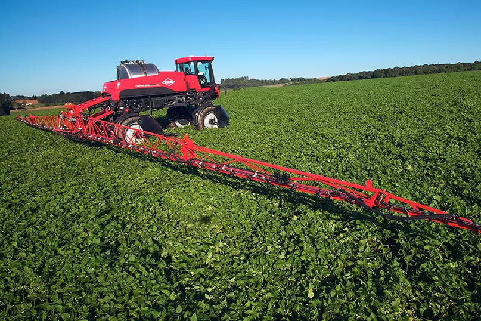

Fonte: KUHN ([2025]).

## 2.2 Agricultura de precisão e pulverização localizada

Na aplicação convencional, o defensivo é espalhado de forma igual em toda a área, embora as plantas daninhas, pragas e doenças apareçam em manchas. Na **pulverização localizada**, uma das técnicas da agricultura de precisão, o produto só é aplicado onde é necessário, a partir de sensores, imagens ou mapas que mostram as áreas a tratar. Além de gastar menos produto, isso diminui a exposição desnecessária das plantas e pragas ao produto e, com isso, a seleção de organismos resistentes (SHIRATSUCHI; CHRISTOFFOLETI, 2002).

Do lado da máquina, existem dois níveis de seletividade (ROSA; TERRA; DREWS JR, 2019), mostrados na Figura 2:

- **Controle por seções:** grupos de bicos abrem e fecham juntos. Não consegue tratar trechos menores que uma seção.
- **Controle bico a bico:** cada ponta é comandada sozinha. Pode ser **em paralelo**, quando cada bico tem sua própria ligação com o tanque, ou **em série**, quando uma mangueira principal alimenta vários bicos. A ligação em série, usada nas máquinas comerciais, é o caso estudado neste trabalho (seção 1.1).

**Figura 2 – Controle por seções e controle bico a bico.**

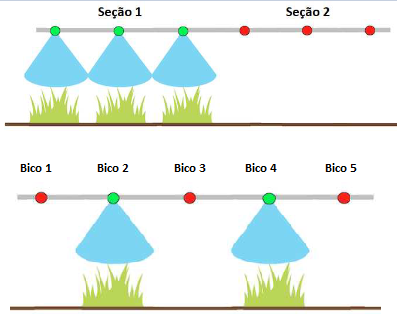

Fonte: adaptado de Rosa, Terra e Drews Jr (2019).

Na Figura 2, os bicos verdes estão abertos e os vermelhos, fechados. Em cima, no controle por seções, os três bicos da seção 1 abrem e fecham juntos, e a seção 2 inteira fica fechada. Embaixo, no controle bico a bico, só os bicos 2 e 4, que estão sobre as plantas, ficam abertos.

## 2.3 Circuito hidráulico do pulverizador

As partes principais do circuito são o tanque, a bomba, a linha de condução, a válvula reguladora e os bicos (JACTO, 2017). Na bancada de Rosa, Terra e Drews Jr (2019), a bomba é de pistão, de 14 L/min, girada por um motor elétrico com inversor de frequência, que imita a tomada de potência do trator. O fluxograma da bancada mostra também uma válvula de controle de pressão por mola (PCV), que devolve parte da vazão ao tanque (seções 3.2 e 3.3.2).

Para ajustar a pressão ou a vazão há três caminhos: mudar a rotação da bomba, estrangular a linha com uma **válvula em série** com os bicos ou desviar parte da vazão com uma **válvula de alívio**, que devolve o excesso para o tanque. Rosa, Terra e Drews Jr (2019) usaram o terceiro, com uma válvula agulha de 1/4" movida por um servomotor.

A **válvula agulha** é uma válvula globo em que o obturador, em vez de um disco, tem forma de agulha, mais comprida que larga (Figura 3). Ao girar o volante, a haste rosqueada afasta a agulha da sede e abre uma passagem em forma de anel em volta dela. Como essa passagem cresce aos poucos com o giro, a válvula permite uma regulagem fina da vazão (VAL AÇO, [20--]). Do ponto de vista do modelo, ela é uma restrição cuja área muda com a abertura, e segue a lei de orifício da seção 2.4.1.

**Figura 3 – Válvula globo tipo agulha: vista externa e corte com as partes principais.**

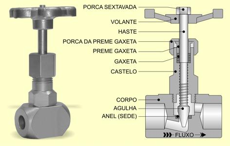{width=75%}

Fonte: Val Aço ([20--]).

Os **bicos** transformam a calda sob pressão em gotas. Na bancada de Rosa, Terra e Drews Jr (2019) foram usados bicos de leque FanTip 0,2 com 110° de abertura, cada um com uma válvula solenoide liga-desliga com antigotejo; segundo o fabricante, cada bico solta cerca de 0,92 L/min a 4,0 bar (4,08 kgf/cm²).

## 2.4 Modelagem por resistência fluídica

### 2.4.1 Lei de orifício

Nas pontas de pulverização e nas válvulas, a passagem é curta e estreita, e o escoamento é turbulento. Nessas peças, a relação entre pressão e vazão é dada pela lei de orifício, que sai de duas equações. Para um escoamento permanente de líquido incompressível, sem atrito e entre dois pontos na mesma altura, valem a equação de Bernoulli e a equação da continuidade (BRUNETTI, 2008):

$$P_1 + \frac{1}{2}\rho v_1^2 = P_2 + \frac{1}{2}\rho v_2^2 \tag{2.1}$$

$$A_1 v_1 = A_2 v_2 \tag{2.2}$$

em que o índice 1 indica a seção antes da restrição e o índice 2 a seção da restrição, $P$ é a pressão [Pa], $\rho$ a massa específica do líquido [kg/m³], $v$ a velocidade média [m/s] e $A$ a área da seção [m²]. A Equação (2.1) diz que a energia se conserva: se a velocidade aumenta no estreitamento, a pressão diminui. A Equação (2.2) diz que a mesma vazão passa por qualquer seção.

A vazão pela restrição sai dessas duas equações. Com $\Delta P = P_1 - P_2$, a continuidade dá $v_2$, que substituído em Bernoulli permite isolar $v_1$; multiplicando pela área, obtém-se a vazão teórica $Q_t$:

$$v_2 = v_1\,\frac{A_1}{A_2}$$

$$\Delta P = \frac{1}{2}\rho\,v_1^2\left[\left(\frac{A_1}{A_2}\right)^2 - 1\right]$$

$$Q_t = A_1\,v_1 = A_1\sqrt{\frac{2\,\Delta P}{\rho\left[(A_1/A_2)^2 - 1\right]}}$$

Na prática passa menos líquido que $Q_t$, por dois motivos. O primeiro é a **veia contraída** (*vena contracta*): por inércia, as partículas do líquido não conseguem contornar a borda do orifício, e o jato continua se estreitando logo depois do furo até uma seção menor que a do orifício, chamada veia contraída (BRUNETTI, 2008, p. 212; MERRITT, 1967, p. 40). O segundo são as perdas por atrito e turbulência. Os dois efeitos são reunidos no **coeficiente de descarga**, razão entre a vazão real $Q_r$ e a teórica, obtido em ensaio (BRUNETTI, 2008; MERRITT, 1967):

$$C_D = \frac{Q_r}{Q_t}, \qquad 0 < C_D < 1$$

A vazão real é então:

$$Q = C_D \, A_1 \sqrt{\frac{2\,\Delta P}{\rho\left[(A_1/A_2)^2 - 1\right]}} \tag{2.3}$$

O ponto importante é que **a vazão é proporcional à raiz quadrada da diferença de pressão**; os outros termos ($C_D$, áreas e $\rho$) são constantes para uma peça e um líquido dados. Reunindo-os numa única constante $K$, a Equação (2.3) fica:

$$Q = K\sqrt{\Delta P}, \qquad K = C_D\,A_1\sqrt{\frac{2}{\rho\left[(A_1/A_2)^2 - 1\right]}}$$

Por isso, neste trabalho, $C_D$, as áreas e $\rho$ não precisam ser conhecidos separadamente: basta o valor de $K$ de cada bico, calculado a partir dos dados de vazão e pressão (seção 3.3.1).

### 2.4.2 Resistência fluídica

Elevando a Equação (2.3) ao quadrado e isolando a queda de pressão, sobra uma relação quadrática:

$$\Delta P = R_F \, Q^2 \tag{2.4}$$

em que $R_F$ é a resistência fluídica da peça (ROSA; TERRA; DREWS JR, 2019). Dobrando a vazão, a queda de pressão fica quatro vezes maior. Rosa, Terra e Drews Jr (2019) separam as resistências em localizadas, nas pontas e válvulas, e distribuídas, ao longo das mangueiras; as duas seguem a forma da Equação (2.4). Esse é um modelo **estático**: dá a pressão para uma certa vazão, mas não o tempo que a pressão leva para mudar.

Com ensaios de 1 a 7 bicos abertos, Rosa, Terra e Drews Jr (2019) ajustaram uma fórmula empírica para a resistência da barra, em (kgf/cm²)/(L/min)², em função do número $n$ de bicos abertos:

$$R_F(n) = 42{,}59\,e^{-2{,}335\,n} + 2{,}307\,e^{-0{,}4591\,n} \tag{2.5}$$

### 2.4.3 Associação de elementos

**Em série.** A mesma vazão passa por todas as peças, as quedas de pressão se somam e a resistência equivalente é a soma das resistências:

$$\Delta P = (R_1 + R_2 + \ldots)\,Q^2$$

**Em paralelo.** As peças ficam ligadas aos mesmos dois pontos: todas têm a mesma queda de pressão, e a vazão total é a soma das vazões (continuidade). Com $n$ peças iguais de resistência $R$, cada uma leva $Q/n$:

$$\Delta P = R\left(\frac{Q}{n}\right)^2 = \frac{R}{n^2}\,Q^2 \tag{2.6}$$

A resistência equivalente é a de uma peça dividida por $n^2$. É por isso que, na Tabela 1 (seção 3.2), a resistência da barra cai tão depressa quando os bicos abrem.

**Fonte e válvula de alívio.** Na barra de Rosa, Terra e Drews Jr (2019), os bicos ficam em paralelo e a válvula de alívio (HV) fica **em derivação**: ela não estrangula a linha, mas abre um caminho extra que devolve o excesso de vazão ao tanque. Por isso o modelo da seção 3.3 faz um **balanço de vazões** num único ponto de pressão: a vazão da fonte é igual à soma das vazões dos bicos e da válvula.

**Perda na tubulação.** Na bancada, os sensores de pressão do começo e do fim da barra marcaram valores muito próximos, porque a vazão é pequena. Por isso a perda distribuída ao longo da barra foi desprezada (hipótese H2, seção 3.3).

## 2.5 Pressão, vazão e tamanho de gota

Cada bico é feito para produzir gotas de um certo tamanho. Se a pressão muda, mudam a vazão e o tamanho das gotas, o que prejudica a uniformidade e aumenta o risco de deriva ou escorrimento (HOLTERMAN et al., 2016). Como a vazão do bico varia com a raiz quadrada da pressão (Equação 2.3), manter a pressão estável é a condição para manter a dose de cada bico.

**Tolerância de pressão.** A norma ISO 16122-2, de inspeção de pulverizadores de barra em uso, traz dois requisitos de pressão (ISO, 2015):

- os dispositivos de ajuste devem manter a pressão constante, com tolerância de **±10%**, para uma mesma regulagem (item 4.5.4);
- em máquinas com retorno compensatório, 10 s depois de fechar uma seção da barra, a pressão não pode ter variado mais de 10% (item 4.8.8).

A faixa adotada neste trabalho é a do item 4.5.4: **±10% em torno da pressão de referência**. O item 4.8.8 mostra que a norma já trata o fechamento de parte da barra como uma perturbação de pressão; aqui o critério é mais exigente, porque cada instante fora da faixa é contado, e não só a pressão 10 s depois. Como a vazão varia com a raiz da pressão, essa faixa corresponde a cerca de ±5% na vazão de cada bico:

$$\sqrt{0{,}9} \approx 0{,}95 \qquad \sqrt{1{,}1} \approx 1{,}05$$

## 2.6 Controle de pulverização

Os controladores eletrônicos das máquinas calculam a vazão desejada a partir da dose, da velocidade e da largura da barra, medem a vazão com um sensor e corrigem a diferença automaticamente (MERCALDI, 2012). Steward e Humburg (2000) mostraram, para um controlador comercial, que modelar cada parte por equações e simular a malha permite comparar ajustes do controlador e limites da válvula antes de ir a campo. Neste trabalho a variável controlada é a **pressão**, que define a vazão de cada bico pela Equação (2.3); mantendo a pressão, mantém-se a vazão desejada.

**Malha aberta e malha fechada.** Em malha aberta, o comando é aplicado sem conferir o resultado. Em malha fechada, o controlador mede a saída, compara com o valor desejado e corrige a diferença, chamada de erro. Por isso a malha fechada corrige perturbações não previstas, como um bico que fecha ou uma bomba que perde rendimento. As partes da malha, no pulverizador, são:

- **referência** (*setpoint*): a pressão de trabalho $P_{ref}$;
- **sensor**: o transmissor de pressão, que mede $P$;
- **controlador**: o cálculo que transforma o erro em um comando $u(t)$;
- **atuador**: a válvula de alívio (HV);
- **planta**: a barra com seus bicos.

O controlador em malha fechada mais usado é o proporcional-integral-derivativo (PID), que soma três parcelas calculadas a partir do erro $e(t)$ (OGATA, 2010):

$$u(t) = K_p\,e(t) + K_i \int_0^t{e(\tau)\,d\tau} + K_d\,\frac{de(t)}{dt} \tag{2.7}$$

em que $K_p$, $K_i$ e $K_d$ são os ganhos proporcional, integral e derivativo:

- **Ação proporcional** ($K_p\,e$): olha para o erro **agora**; erro grande, correção grande. É a parte que reage mais rápido, mas sozinha deixa um **erro em regime permanente**: se o erro chegasse a zero, o comando também iria a zero e a válvula voltaria à posição anterior. Aumentar $K_p$ diminui esse erro, mas deixa a resposta mais oscilatória e, se exagerado, instável.
- **Ação integral** ($K_i\int e\,d\tau$): olha para o erro **acumulado**. Enquanto existir erro, a soma cresce e o comando muda; ela só para quando o erro zera, e então mantém a válvula na posição certa. Assim elimina o erro em regime permanente. Com ganho alto demais faz a saída passar do ponto, e causa o *windup* quando o atuador chega ao limite (seção 2.7.2).
- **Ação derivativa** ($K_d\,de/dt$): olha para a **tendência** do erro e freia o comando antes de a saída passar do ponto. Reduz oscilações, mas é sensível ao ruído do sensor (ver adiante).

Os mesmos termos podem ser escritos com um ganho $K_c$, o tempo integral $T_i$ e o tempo derivativo $T_d$:

$$u(t) = K_c\left[e(t) + \frac{1}{T_i}\int_0^t{e(\tau)\,d\tau} + T_d\,\frac{de(t)}{dt}\right] \tag{2.8}$$

Comparando com a Equação (2.7):

$$K_p = K_c \qquad K_i = \frac{K_c}{T_i} \qquad K_d = K_c\,T_d$$

Um $T_i$ pequeno quer dizer ação integral forte. Essa é a forma usada na sintonia (seção 2.6.1). O sinal do erro depende do atuador: em geral $e$ = referência − medida, mas no pulverizador abrir a válvula **diminui** a pressão, então o erro é definido ao contrário (seção 3.5.3).

**Quanto erro o controlador P deixa.** Suponha que uma perturbação, sem controle, mudaria a saída em $d$, e que a planta muda a saída em $K_g$ por unidade de comando ($K_g$ é medido na seção 3.5.2; aparece em módulo porque, no pulverizador, abrir a válvula reduz a pressão). Com o controlador P, o comando é $K_c\,e$, e em regime o erro que sobra é a perturbação menos a correção (OGATA, 2010):

$$e = d - K_c\,|K_g|\,e$$

Isolando $e$:

$$e_{reg} = \frac{d}{1 + K_c\,|K_g|} \tag{2.9}$$

O produto $K_c\,|K_g|$ é o ganho da malha. Com ganho de malha 4, sobra um quinto da perturbação. Aumentar $K_c$ diminui o erro, mas nunca o zera; a ação integral resolve isso.

Neste trabalho foram comparados três controladores, cada um acrescentando algo ao anterior:

- **P:** só a ação proporcional, que mostra o erro da Equação (2.9);
- **PI:** a ação integral elimina esse erro;
- **PI + *feedforward***: uma parcela calculada pelo número de bicos abertos antecipa a correção (seção 2.7).

A ação derivativa ficou de fora, por dois motivos principais:

- **ruído:** a derivação amplifica os efeitos do ruído (OGATA, 2010, p. 159). Uma oscilação pequena e rápida na leitura de pressão tem derivada grande, e o comando da válvula passaria a tremer. Mesmo sem derivada, um ruído de 1% a 2% na leitura já faz a válvula se mover 2,1 a 2,5 vezes mais do que com um ganho 2,5 vezes menor (seção 3.8);
- **saltos de pressão:** quando um bico abre ou fecha, a pressão muda de uma vez (hipótese H6, seção 3.4.1). A derivada de um salto é um pico muito grande no comando, o mesmo problema que Ogata (2010, p. 541) descreve para uma mudança em degrau.
Além disso, a pressão não tem inércia própria, que é o que a ação derivativa ajuda a amortecer (OGATA, 2010, p. 201–202); o outro motivo depende da sintonia e está na seção 3.5.5.

### 2.6.1 Sintonia por alocação de polos

Sintonizar um controlador é escolher $K_c$ e $T_i$. Quando existe um modelo matemático da planta, esses valores podem ser calculados para que a malha fechada atenda a uma especificação de resposta (OGATA, 2010, p. 522). É o caso deste trabalho, porque o Capítulo 3 monta o modelo da barra.

A forma da resposta de uma malha é definida pelos seus **polos**, as raízes do denominador da função de transferência de malha fechada. Na **alocação de polos**, escolhem-se primeiro as posições desejadas para os polos e depois se calculam os ganhos que os levam até lá (OGATA, 2010, p. 658).

Como a seção 3.5.4 vai mostrar, a malha com o PI tem dois polos. Um sistema com dois polos pode ser escrito na **forma padrão de segunda ordem** (OGATA, 2010, p. 151):

$$\frac{C(s)}{R(s)} = \frac{\omega_n^2}{s^2 + 2\zeta\omega_n s + \omega_n^2} \tag{2.10}$$

Nessa forma aparecem só dois números:

- $\omega_n$, a **frequência natural não amortecida**, que dá a rapidez da resposta;
- $\zeta$, o **coeficiente de amortecimento**, que dá quanto ela oscila.

Com $0 < \zeta < 1$, os dois polos são complexos e a resposta a um degrau passa um pouco do valor final antes de se acomodar. Com $\zeta = 1$, ela chega ao valor final sem passar dele (OGATA, 2010, p. 151).

Duas fórmulas ligam $\zeta$ e $\omega_n$ ao que se vê na resposta. A primeira é a do **máximo sobressinal** $M_p$, que diz quanto a saída passa do valor final (OGATA, 2010, p. 156):

$$M_p = e^{-\zeta\pi/\sqrt{1-\zeta^2}}$$

A segunda é a do **tempo de acomodação** $t_s$, o tempo para a resposta entrar e ficar na faixa de ±2% do valor final (OGATA, 2010, p. 157):

$$t_s = \frac{4}{\zeta\,\omega_n} \tag{2.11}$$

Por exemplo, com $\zeta$ = 0,7 o sobressinal é $e^{-0{,}7\pi/0{,}714}$ = 0,046, ou seja, 4,6%. Ogata (2010, p. 157) observa ainda que, pelo critério de 2%, o tempo de acomodação é mínimo para $\zeta$ perto de 0,76.

O procedimento, portanto, tem três passos:

1. escolher $\zeta$ e $t_s$;
2. calcular $\omega_n$ pela Equação (2.11);
3. igualar a equação característica da malha com o controlador à forma padrão e resolver para $K_c$ e $T_i$ (seção 3.5.5).

As fórmulas de $M_p$ e $t_s$ valem exatamente para a forma padrão. A malha deste trabalho tem um zero a mais e uma válvula com limite de velocidade, então o resultado precisa ser conferido no simulador (seção 4.2).

## 2.7 Compensação antecipativa e anti-windup

O PID só reage depois que o erro aparece. Duas técnicas o complementam quando a perturbação é conhecida com antecedência e quando o atuador tem limites: a compensação antecipativa e o anti-windup.

### 2.7.1 Compensação antecipativa (*feedforward*)

Se a perturbação puder ser medida ou for conhecida de antemão, é possível calcular o comando que a compensa **no mesmo instante em que ela acontece**, sem esperar o erro. Essa é a **compensação antecipativa**, ou *feedforward* (FF) (LIU et al., 2018, p. 1–2).

O compensador ideal sai do modelo do sistema. Se $G_d(s)$ é o efeito do distúrbio na saída e $G_p(s)$ é o efeito do comando, o comando antecipativo que anula o distúrbio é a razão entre os dois, $G_f(s) = G_d(s)/G_p(s)$ (LIU et al., 2018, p. 3). Em regime, essa razão se reduz à razão entre os ganhos estáticos, e na prática é comum usar só ganhos estáticos quando um modelo dinâmico não compensa o custo (LIU et al., 2018, p. 12). Neste trabalho é esse o caminho: inverter o modelo estático da barra, ou seja, dada a perturbação atual e a saída desejada, calcular o comando necessário, $u_{ff}$ (seção 3.5.1).

Sozinha, a compensação antecipativa é uma malha aberta: como é calculada pelo inverso do modelo, só acerta se o modelo for exato. Por isso é sempre somada a uma realimentação (LIU et al., 2018, p. 1):

$$u(t) = u_{ff}(t) + u_{fb}(t) \tag{2.12}$$

em que $u_{fb}$ é a parcela calculada pelo PI a partir do erro. A parcela antecipativa leva o atuador para perto da posição certa logo que a perturbação acontece; a realimentação corrige o resto (erros do modelo e perturbações não medidas).

Duas condições são necessárias (LIU et al., 2018, p. 4): **a perturbação precisa ser medida**, o que no controle bico a bico é natural, porque o sistema que comanda os bicos sabe quantos estão abertos ($n$), e **o modelo precisa ser preciso**; aqui, o modelo usado é o estático da seção 3.3. Há também um limite: o atuador leva tempo para se mover, e se a perturbação muda a saída mais rápido que ele, ainda haverá erro logo depois da troca.

### 2.7.2 Anti-windup

Todo atuador real tem limites: a válvula não abre além de toda aberta nem fecha além de toda fechada. Quando o comando pede mais do que esse limite, diz-se que o atuador está **saturado**.

Durante a saturação, o erro demora mais para diminuir, e a ação integral continua acumulando esse erro muito além do necessário. Quando o atuador volta a responder, a parcela integral está grande demais e empurra a saída para além da referência, com sobressinal e acomodação mais lenta. Esse efeito é o ***windup*** do termo integral, e as técnicas de **anti-windup** limitam esse crescimento excessivo (FERNANDES; GOLDEMBERG, 2001). A mais simples é a **integração condicional**: a integração é interrompida quando o comando atinge o valor de saturação, e o termo integral fica constante durante a interrupção (FERNANDES; GOLDEMBERG, 2001, p. 5). Em forma discreta, com $I_k$ a soma do integrador na amostra $k$, $e_k$ o erro e $T_s$ o período de amostragem:

$$I_k = I_{k-1} + s_k\,e_k\,T_s \tag{2.13}$$

em que $s_k$ vale 1 quando o atuador está livre e 0 quando o comando está no limite de posição. Numa válvula reguladora, se o comando pede uma abertura além de toda aberta, o integrador fica parado enquanto durar esse pedido.

---

# 3 METODOLOGIA

## 3.1 Tipo de pesquisa e roteiro do trabalho

A pesquisa é aplicada, porque busca resolver um problema prático da pulverização, e quantitativa, porque o sistema é descrito por equações e avaliado por números. A ideia geral é modelar cada parte, conferir o modelo com os dados medidos e só então usar a simulação para testar o controle. O trabalho foi feito em sete etapas, em que a saída de cada uma é a entrada da seguinte. O Quadro 1 resume as etapas, e a Figura 4 mostra como elas se ligam.

**Quadro 1 – Etapas do trabalho.**

| Etapa | O que entra | O que é feito | O que sai | Seções (método → resultado) |
|---|---|---|---|---|
| 1. Dados de referência | Artigo de Rosa, Terra e Drews Jr (2019) | Descrição da bancada e dos ensaios | Pressão e vazão com 1 a 7 bicos (Tabelas 1 e 2) | 3.2 |
| 2. Modelo estático | Tabela 1 | Ajuste da constante dos bicos e da curva da fonte; balanço de vazões no nó | Pressão $P(n, \alpha)$ em regime; modelo $R_1/n^2$ | 3.3 → 4.1 |
| 3. Modelo dinâmico | Modelo estático | Pressão instantânea (H6) e válvula de primeira ordem com velocidade limitada | Simulador no tempo | 3.4 → 4.2 |
| 4. Abertura de equilíbrio e ganho da planta | Modelo estático | Inversão do modelo e derivada por diferença centrada | $\alpha_{ff}(n)$ e $K_g$ | 3.5.1–3.5.2 → 4.2 |
| 5. Controladores e sintonia | Simulador, $\alpha_{ff}$ e $K_g$ | P, PI e PI+FF discretos; função de transferência; alocação de polos | $K_c$, $T_i$; polos da malha | 3.5.3–3.5.5 → 4.2 |
| 6. Simulação e avaliação | Simulador e ganhos | Cenários C1 a C3; faixa de ±10% da ISO 16122-2; métricas | Tempo fora da faixa, IAE, desvio, acomodação | 3.6 → 4.3–4.6 |
| 7. Implementação e conferências | Etapas 2 a 6 | Programa em Python com testes automáticos | Números e figuras do Cap. 4 | 3.7 |

Fonte: elaborado pelo autor.

**Figura 4 – Etapas do trabalho.**

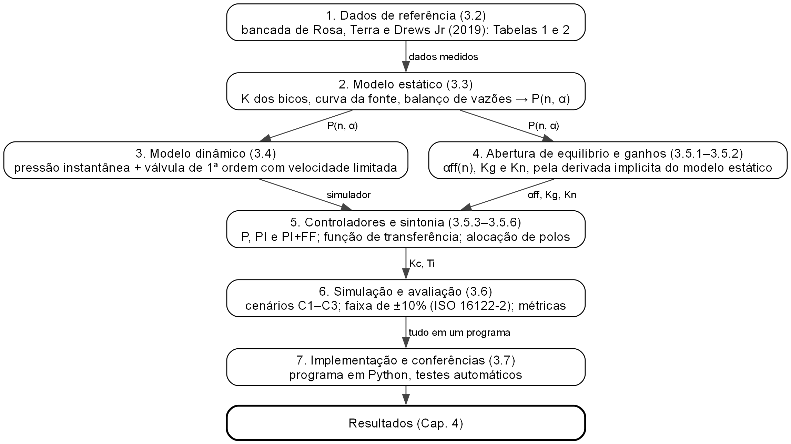{width=88%}

Fonte: elaborada pelo autor.

Na Figura 4, as setas indicam o que cada etapa entrega para a seguinte. O modelo estático (etapa 2) é a base: é reaproveitado pelo modelo dinâmico e pelo projeto do controle, e o programa (etapa 7) reúne as etapas 2 a 6.

## 3.2 Sistema de referência

*Etapa 1.* O sistema usado como referência é a bancada de Rosa, Terra e Drews Jr (2019), por três motivos:

- é uma barra com **controle bico a bico e alimentação em série**, que é o caso estudado;
- tem dados publicados de pressão e vazão para 1 a 7 bicos abertos;
- tem uma válvula de alívio, que é o atuador escolhido aqui.

A bancada tem:

- tanque de 100 L;
- bomba de pistão de 14 L/min com motor elétrico e inversor de frequência;
- barra de 5 m com sete bicos FanTip 0,2/110° e uma solenoide por bico;
- transmissores de pressão (PT) e de vazão (FT) e manômetros (PG);
- válvula agulha movida por servomotor, que devolve parte da calda ao tanque. Neste trabalho ela é chamada de **válvula de alívio (HV)**; o artigo também a chama de válvula reguladora (PV) e de válvula de recirculação.

As Figuras 5 a 8 mostram a montagem.

**Figura 5 – Visão geral da bancada de referência.**


Fonte: Rosa, Terra e Drews Jr (2019).

Na Figura 5, a barra de 5 m fica presa a uma treliça apoiada em dois cavaletes. A mangueira laranja ao longo da barra é a linha-tronco que alimenta os sete bicos em série. Embaixo de cada bico, um recipiente recolhe a calda e a devolve ao tanque, de modo que a bancada funciona em circuito fechado.

**Figura 6 – Conjunto do inversor de frequência, motor elétrico e bomba de pistão de 14 L/min.**


Fonte: Rosa, Terra e Drews Jr (2019).

A Figura 6 mostra, da esquerda para a direita, o inversor, o motor trifásico e a bomba de pistão, ligada ao motor por correia. Esse conjunto faz o papel do trator: o inversor ajusta a rotação, como a tomada de potência do trator faria no campo. Sobre a bomba ficam o regulador de pressão por mola e o manômetro do conjunto (PCV e PG-01 na Figura 9).

**Figura 7 – Válvula agulha de 1/4" acionada por servomotor (válvula de alívio HV).**

{width=55%}

Fonte: Rosa, Terra e Drews Jr (2019).

Na Figura 7, o servomotor gira a manopla da válvula agulha e muda a sua abertura. A válvula fica num ramo que sai da linha principal e devolve a calda ao tanque; é o atuador usado como referência neste trabalho.

**Figura 8 – Válvula solenoide de um bico.**

{width=55%}

Fonte: Rosa, Terra e Drews Jr (2019).

Na Figura 8, de cima para baixo, aparecem a conexão com a mangueira e o antigotejo, a válvula solenoide liga-desliga e a ponta de pulverização. A comutação dessa solenoide é a perturbação estudada neste trabalho.

A Figura 9 mostra o fluxograma de processo da bancada, que indica por onde o líquido passa e onde fica cada instrumento. Cada instrumento tem uma sigla (*tag*) da norma ISA 5.1: a primeira letra diz o que é medido ou controlado (P de pressão, F de vazão, H de manual) e as seguintes dizem a função (T de transmissor, G de indicador local, V de válvula).

**Figura 9 – Fluxograma de processo da bancada de referência.**

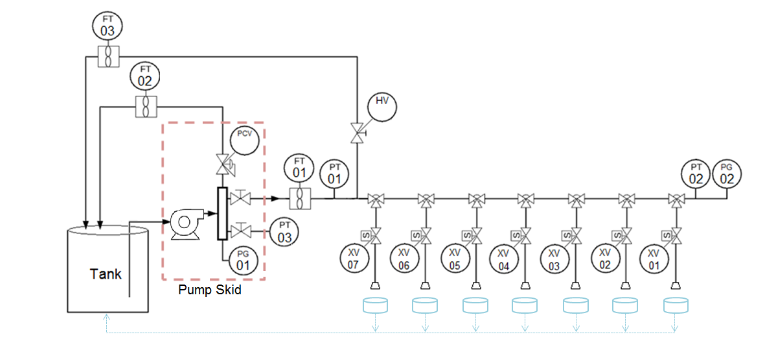

Fonte: Rosa, Terra e Drews Jr (2019).

Seguindo o caminho da calda na Figura 9:

1. **Tanque e conjunto da bomba** (retângulo tracejado, *pump skid*). Na saída da bomba há um distribuidor com três saídas:
   - uma **válvula de controle de pressão (PCV)**, autorregulada por mola, que devolve calda ao tanque pelo medidor FT-02 quando a pressão passa de um valor ajustado;
   - o transmissor PT-03 e o manômetro PG-01, na saída da bomba;
   - uma válvula manual que libera a calda para a linha principal.
2. **Entrada da barra.** O FT-01 mede a vazão que vai para a barra, e o PT-01 a pressão na entrada.
3. **Válvula de alívio (HV).** Logo depois do PT-01, um ramo com a válvula agulha HV devolve parte da calda ao tanque pelo FT-03. É a válvula ajustada à mão no ensaio da Tabela 2 e o atuador do controle proposto.
4. **Barra e bicos.** A linha-tronco passa pelas sete solenoides (XV-07, perto da entrada, até XV-01, na ponta), cada uma abrindo ou fechando um bico.
5. **Fim da barra.** O PT-02 e o PG-02 medem a pressão na ponta. PT-01 e PT-02 marcaram valores muito próximos (hipótese H2, seção 3.3).

Desse caminho saem dois balanços de vazão. Na saída da bomba, a vazão bombeada se divide entre a PCV (FT-02) e a barra (FT-01). Na entrada da barra, a vazão do FT-01 se divide entre a HV (FT-03) e os bicos abertos. Para o modelo, isso significa que a bomba e a PCV podem ser tratadas como uma única fonte, e a HV e os bicos como duas saídas ligadas ao mesmo ponto de pressão (seção 3.3, Figura 11).

A Tabela 1 mostra os dados medidos com a válvula de alívio (HV) fechada; nesse caso, o FT-01 mede a vazão que sai pelos bicos. As pressões são manométricas, em kgf/cm².

**Tabela 1 – Pressão e vazão da barra em função do número de bicos abertos.**

| Bicos abertos ($n$) | $P$ [kgf/cm²] | $Q$ [L/min] | $R_F$ equivalente = $P/Q^2$ |
|---|---|---|---|
| 7 | 3,57 | 5,60 | 0,114 |
| 6 | 3,88 | 5,07 | 0,151 |
| 5 | 4,24 | 4,40 | 0,219 |
| 4 | 4,64 | 3,60 | 0,358 |
| 3 | 4,96 | 2,80 | 0,633 |
| 2 | 5,27 | 2,00 | 1,318 |
| 1 | 5,58 | 1,00 | 5,580 |

Fonte: Rosa, Terra e Drews Jr (2019).

Os autores também fizeram um ensaio com a válvula de alívio: partindo de 4,00 kgf/cm² com a válvula fechada, seguiram a sequência da Tabela 2, ajustando a válvula à mão. A pressão inicial (4,00) é maior que a da Tabela 1 na mesma condição (3,57 com sete bicos), o que indica outra rotação da bomba; por isso esse ensaio é usado só para comparação qualitativa (seção 4.1).

**Tabela 2 – Ensaio de regulação da pressão pela válvula de alívio.**

| Etapa | Ação | Pressão resultante [kgf/cm²] |
|---|---|---|
| 1 | Fechamento dos bicos 1, 4 e 7 | 5,80 |
| 2 | Abertura da válvula em 11% | 4,40 |
| 3 | Fechamento dos bicos 2, 3 e 5 | 6,10 |
| 4 | Abertura da válvula em 33% | ≈ 4,00 |

Fonte: Rosa, Terra e Drews Jr (2019).

Na Figura 10, cada manômetro mostra a pressão no fim de uma etapa, os sete quadrados indicam o estado dos bicos (verde aberto, vermelho fechado) e a seta indica a ação feita entre uma leitura e a próxima.

**Figura 10 – Ensaio de regulação da pressão pela válvula de alívio.**

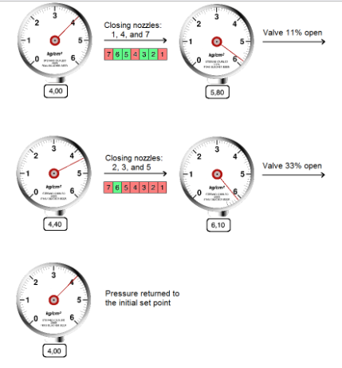{width=60%}

Fonte: Rosa, Terra e Drews Jr (2019).

## 3.3 Modelo estático

*Etapa 2.* Com os dados da bancada, o objetivo agora é obter uma equação que dê a pressão para qualquer número de bicos abertos e qualquer abertura da válvula, quando tudo já se acomodou. O modelo aplica a lei de orifício (Equação 2.3) a cada saída do circuito, os bicos e a válvula de alívio, e acrescenta uma curva para a fonte. Três caminhos se encontram no mesmo ponto de pressão $P$: a fonte, que empurra líquido para dentro, e os bicos e a válvula, que deixam o líquido sair (Figura 11).

**Figura 11 – Circuito hidráulico equivalente proposto.**

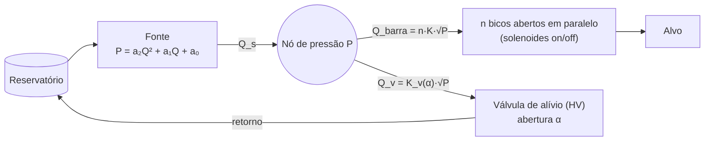

Fonte: elaborada pelo autor.

**Hipóteses adotadas** (simplificações feitas pelo autor):
- **H1:** o escoamento é permanente (não muda com o tempo), o líquido é incompressível e a barra é horizontal (BRUNETTI, 2008, p. 10 e 67; ROSA; TERRA; DREWS JR, 2019).
- **H2:** a perda de pressão ao longo da barra é desprezível, então todos os bicos trabalham com a mesma pressão $P$. Isso se apoia nas leituras quase iguais de PT-01 e PT-02 na bancada, onde a vazão é pequena (no máximo 5,6 L/min), e na prática comum de considerar, na análise dinâmica, só as restrições intencionais (orifícios) e desprezar as de tubos e conexões (MERRITT, 1967, p. 52). Em barras comerciais, com vazões dezenas de vezes maiores, essa hipótese precisaria ser revista (seção 3.8).
- **H3:** os bicos são iguais e todos seguem a lei de orifício.
- **H4:** a fonte (bomba, sua regulação interna e as perdas antes da barra) é representada por uma curva pressão-vazão de segundo grau, ajustada aos dados da Tabela 1 (seção 3.3.2).
- **H5:** a característica da válvula é linear (constante de vazão proporcional à abertura), porque a curva real da válvula não está nas fontes consultadas.

A Figura 11 é uma versão simplificada do fluxograma da Figura 9, com só o que importa para calcular a pressão. As setas mostram o sentido do líquido, com a vazão de cada trecho:

- **Fonte:** junta a bomba, a PCV e as perdas antes da barra (hipótese H4), descritas por uma única curva, a Equação (3.6): quanto maior a vazão $Q_s$, menor a pressão que a fonte mantém.
- **Nó de pressão $P$:** representa a barra inteira como um único ponto (hipótese H2).
- **Bicos abertos:** os $n$ bicos ficam em paralelo, com a mesma pressão, e deixam sair $Q_{barra}$ (Equação 3.3) para o alvo.
- **Válvula de alívio (HV):** o atuador do controle. Deixa sair $Q_v$ (Equação 3.8), que volta ao reservatório.

O ponto principal é que **todo líquido que entra no nó tem que sair por algum caminho**. Em regime, pela equação da continuidade para líquido incompressível (BRUNETTI, 2008, p. 75), a vazão da fonte é igual à soma das duas saídas, $Q_s = Q_{barra} + Q_v$, o que dá a Equação (3.10). Daí se entendem os dois tipos de mudança:

- **quando bicos fecham** ($n$ diminui), sobra menos caminho de saída, e a pressão sobe até a fonte entregar uma vazão que caiba nas saídas restantes (Tabela 1: de 3,57 para 5,58 kgf/cm²);
- **quando a válvula abre** ($\alpha$ aumenta), surge um caminho extra, e a pressão cai (Tabela 2).

Os dois efeitos são opostos. Por isso o controle pode usar a válvula para compensar os bicos: quando bicos fecham, ele abre a válvula até que a capacidade total de saída (bicos abertos mais válvula) volte a ser a de antes. As seções 3.3.1 a 3.3.4 escrevem isso em equações.

### 3.3.1 Bicos

Pela Equação (2.3), a vazão de um bico, como a de qualquer orifício, é proporcional à raiz da queda de pressão (BRUNETTI, 2008, p. 213; MERRITT, 1967, p. 41):

$$q = K\sqrt{P} \tag{3.1}$$

Na Tabela 1, a vazão de cada bico é $Q/n$, então cada linha dá um valor de $K = q/\sqrt{P}$, e o valor usado é a média das sete:

$$K = \frac{1}{7}\sum_{i=1}^{7}{\frac{Q_i}{n_i\sqrt{P_i}}} \tag{3.2}$$

Com $n$ bicos iguais em paralelo (H2 e H3), a vazão da barra é $n$ vezes a de um bico:

$$Q_{barra} = n\,K\sqrt{P} \tag{3.3}$$

Elevando ao quadrado e isolando $P$, aparece a forma de resistência da Equação (2.4), $P = R_{eq}(n)\,Q_{barra}^2$, com:

$$R_{eq}(n) = \frac{R_1}{n^2}, \qquad R_1 = \frac{1}{K^2} \tag{3.4}$$

**Este é o modelo de resistência da barra obtido neste trabalho.** A barra com $n$ bicos abertos se comporta como uma única restrição, cuja resistência equivalente $R_{eq}$ é a resistência de **um** bico, $R_1$, dividida por $n^2$ (associação em paralelo, Equação 2.6). Dobrando o número de bicos abertos, a resistência cai para um quarto. O modelo substitui a fórmula empírica (2.5) de Rosa, Terra e Drews Jr (2019):

- a fórmula (2.5) usa **quatro** coeficientes ajustados, sem significado físico, e só vale para a barra ensaiada;
- o modelo $R_1/n^2$ usa **um** parâmetro físico, a resistência (ou a constante $K$) de um bico, e vale para qualquer número de bicos iguais, desde que a perda ao longo da barra seja desprezível (H2).

As Equações (3.3) e (3.4) são o **mesmo modelo** escrito de duas formas. A (3.3) é a usada nas contas e no programa, com $K$ = 0,425, o que equivale a $R_1 = 1/K^2 \approx$ 5,54 (kgf/cm²)/(L/min)². A (3.4) serve para comparar com a fórmula (2.5) na seção 4.1; lá, para testar só a forma $1/n^2$, $R_1$ é tirado diretamente do ensaio com um bico (5,58), em vez de calculado por $K$.

### 3.3.2 Fonte

Com a válvula de alívio (HV) fechada, a vazão total caiu de 5,60 para 1,00 L/min conforme os bicos fecharam (Tabela 1). Se a bomba de pistão entregasse sempre a mesma vazão, isso não aconteceria; a vazão que chega à barra depende da pressão. O artigo não explica o motivo, mas o fluxograma (Figura 9) mostra a **PCV**, a válvula de controle de pressão por mola do conjunto da bomba, que devolve o excesso ao tanque. É o arranjo comum com bombas de deslocamento fixo: a PCV desvia para o tanque a vazão que a carga não usa, para segurar a pressão (MERRITT, 1967, p. 321 e 337). O mecanismo é representado pela curva de segundo grau da hipótese H4.

Os coeficientes $a_2$, $a_1$ e $a_0$ foram escolhidos pelo **método dos mínimos quadrados** (regressão polinomial), que minimiza a soma dos erros ao quadrado entre a curva e os sete pontos (CHAPRA; CANALE, 2011, p. 393):

$$S = \sum_{i=1}^{7}{\left(P_i - a_2Q_i^2 - a_1Q_i - a_0\right)^2} \tag{3.5}$$

Igualando a zero as derivadas de $S$ em relação a $a_2$, $a_1$ e $a_0$, obtém-se um sistema linear, as equações normais (CHAPRA; CANALE, 2011, p. 393). A curva fica:

$$P = a_2\,Q_s^2 + a_1\,Q_s + a_0 \tag{3.6}$$

No modelo, é mais útil a vazão em função da pressão. Isolando $Q_s$ pela fórmula de Bhaskara, com a raiz que dá vazão positiva (como $a_2 < 0$, a do sinal de menos):

$$Q_s(P) = \frac{-a_1 - \sqrt{a_1^2 - 4a_2(a_0 - P)}}{2a_2} \tag{3.7}$$

Acima de $P = a_0$, a fonte não entrega mais líquido, e o programa considera $Q_s = 0$.

### 3.3.3 Válvula de alívio

A válvula agulha também é uma restrição, um orifício de área variável (MERRITT, 1967, p. 39), e segue a lei de orifício. Pela hipótese H5, sua constante cresce em linha reta com a abertura $\alpha$, de 0 (fechada) a 1 (toda aberta):

$$Q_v = K_v(\alpha)\sqrt{P} \tag{3.8}$$

$$K_v(\alpha) = K_{v,max}\,\alpha \tag{3.9}$$

### 3.3.4 Ponto de operação

Em regime, o líquido que entra no nó é igual ao que sai. Igualando a Equação (3.7) à soma das vazões dos bicos (3.3) e da válvula (3.8):

$$Q_s(P) = \left[n\,K + K_v(\alpha)\right]\sqrt{P} \tag{3.10}$$

O termo entre colchetes é a capacidade total de saída, bicos abertos mais válvula, chamada aqui de $C$:

$$C(n,\alpha) = n\,K + K_{v,max}\,\alpha$$

Assim, a vazão que sai do nó é $Q_s = C\sqrt{P}$. Substituindo na curva da fonte, Equação (3.6):

$$P = a_2\,C^2\,P + a_1\,C\sqrt{P} + a_0$$

Chamando $x = \sqrt{P}$, fica uma equação de segundo grau em $x$:

$$\left(1 - a_2C^2\right)x^2 - a_1C\,x - a_0 = 0$$

Pela fórmula de Bhaskara, com a raiz positiva (como $a_2 < 0$ e $a_0 > 0$, o termo dentro da raiz é sempre positivo), e elevando ao quadrado, obtém-se o **modelo estático em forma explícita**:

$$P(n,\alpha) = \left[\frac{a_1C + \sqrt{a_1^2C^2 + 4a_0\left(1 - a_2C^2\right)}}{2\left(1 - a_2C^2\right)}\right]^2 \tag{3.11}$$

A pressão depende de $n$ e $\alpha$ só através de $C$: quanto maior a capacidade de saída, menor a pressão, e com tudo fechado ($C = 0$) a pressão é a da fonte sem vazão, $P = a_0$. Por isso a válvula consegue compensar os bicos: basta abrir o suficiente para que $C$ volte ao valor de antes.

No programa, a Equação (3.10) é resolvida numericamente pelo **método da bissecção** (CHAPRA; CANALE, 2011, p. 101–102), que serve para qualquer curva de fonte, mesmo sem forma explícita: parte-se de um intervalo que certamente contém a resposta (0 a $a_0$), testa-se o ponto do meio e fica-se com a metade em que a diferença entre os dois lados da Equação (3.10) troca de sinal. Com 100 repetições, o intervalo fica muito menor que qualquer erro de interesse, e o resultado coincide com a Equação (3.11) (diferença menor que 10⁻¹⁴ kgf/cm² para todos os $n$ e $\alpha$, conferida à parte). As Equações (3.10) e (3.11) são o modelo estático completo: dados $n$ e $\alpha$, elas dão a pressão $P$. A comparação com os dados medidos está na seção 4.1.

## 3.4 Modelo dinâmico

*Etapa 3.* O modelo estático diz **para onde** a pressão vai, mas não **quanto tempo** leva. Para simular o controle, é preciso saber o que demora. Na barra, duas coisas poderiam demorar: a pressão na linha, porque a mangueira estica e o líquido se comprime um pouco, guardando um pequeno volume (MERRITT, 1967, p. 14–16), o que funciona como uma capacitância hidráulica (OGATA, 2010, p. 90–92); e a válvula, movida por um motor. Este trabalho considera só a segunda.

### 3.4.1 Pressão instantânea

Pela continuidade com compressibilidade, a vazão que entra menos a que sai é igual a $(V/\beta)\,dP/dt$, em que $V$ é o volume da linha e $\beta$ o módulo de compressibilidade efetivo (MERRITT, 1967, p. 53). A mangueira da bancada é curta (5 m) e fica sempre cheia, então $V/\beta$ é pequeno, e a pressão se ajusta bem mais rápido que a válvula, que leva cerca de 0,2 s para reagir e até 2 s para percorrer todo o curso (seção 3.4.2). É a válvula que define a velocidade da correção. Foi adotada então mais uma hipótese:

- **H6:** a pressão na barra se ajusta **na hora** à posição da válvula e ao número de bicos abertos. Em cada instante, ela é a pressão de equilíbrio da Equação (3.10).

Assim, para saber a pressão num instante, basta resolver a Equação (3.10) com o $\alpha$ e o $n$ daquele instante, reaproveitando o modelo estático. O custo é que o modelo não mostra a pequena subida gradual da pressão logo depois que um bico fecha: a pressão pula direto para o novo valor. A seção 4.2 mostra que isso muda pouco os resultados.

### 3.4.2 Atuador da válvula

A válvula é movida por um motor. O controlador envia a abertura desejada, chamada de **comando** $\alpha_c$, e a abertura real $\alpha$ se aproxima dele como um sistema de primeira ordem:

$$\frac{d\alpha}{dt} = \frac{\alpha_c - \alpha}{\tau_a} \tag{3.12}$$

Ou seja, a válvula anda mais depressa quando está longe do comando e vai desacelerando ao se aproximar. Um sistema assim chega a 63,2% da mudança em uma constante de tempo $\tau_a$ e fica a 2% do valor final depois de quatro constantes de tempo (OGATA, 2010, p. 147). Foi usado $\tau_a$ = 0,2 s.

O motor, porém, tem um limite: **a abertura não muda mais que 0,5 por segundo** (curso completo em 2 s). Quando a Equação (3.12) pede uma velocidade maior que essa, a válvula anda nessa velocidade máxima, $\omega_{max}$ = 0,5 s⁻¹, em rampa. Limites desse tipo são a não linearidade mais comum em sistemas de controle (MERRITT, 1967, p. 277). Além disso, a abertura fica sempre entre 0 (fechada) e 1 (toda aberta).

Os valores de $\tau_a$ e $\omega_{max}$ são **estimativas**, porque a bancada de referência não informa a velocidade da válvula. Por isso também foram simuladas válvulas mais rápidas (seção 3.6.3).

### 3.4.3 Avançando no tempo

O computador divide o tempo em passos de $\Delta t$ = 1 ms e, em cada passo, usa o **método de Euler** (CHAPRA; CANALE, 2011, p. 588): a posição nova é a atual mais a velocidade vezes o passo:

$$\alpha_{k+1} = \alpha_k + \Delta t \cdot \left(\frac{d\alpha}{dt}\right)_k \tag{3.13}$$

em que $k$ é o número do passo e a velocidade vem da Equação (3.12), limitada a $\omega_{max}$. Com a abertura nova, a pressão é recalculada pelo modelo estático (H6; o laço completo está na seção 3.6.2). O erro global do método de Euler é proporcional ao tamanho do passo e diminui quando o passo diminui (CHAPRA; CANALE, 2011, p. 592). O passo de 1 ms é duzentas vezes menor que $\tau_a$ e faz cada troca de bicos acontecer no instante certo; a escolha foi conferida com passos de 2 e 10 ms (seção 4.2).

## 3.5 Estratégia de controle

*Etapas 4 e 5.* Com o modelo pronto, projeta-se o controle. A variável controlada é a pressão $P$; a variável manipulada é a abertura da válvula $\alpha$; a perturbação, ou distúrbio, é o número de bicos abertos $n(t)$, que o controlador não escolhe (OGATA, 2010, p. 2–3). A Figura 12 mostra como as peças se ligam.

**Figura 12 – Diagrama de blocos do controle proposto.**

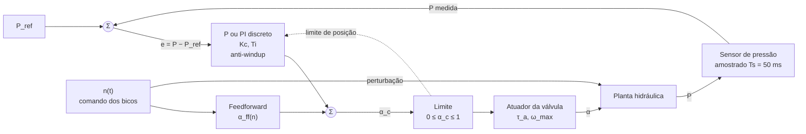

Fonte: elaborada pelo autor.

Na Figura 12, o sinal anda da esquerda para a direita. No primeiro somador, a pressão medida é comparada com a referência, gerando o erro $e$, que o controlador (P ou PI) transforma em uma correção da abertura. No segundo somador, a correção é somada à abertura do *feedforward*, calculada pelo número de bicos (nas configurações sem *feedforward*, uma abertura fixa $\alpha_0$). O comando é limitado entre 0 e 1 e vai para o atuador, que move a válvula e muda a pressão da planta, também afetada pelos bicos. A seta tracejada avisa o PI quando o comando está no limite, para ele parar de acumular erro.

### 3.5.1 Abertura de equilíbrio e compensação antecipativa (*feedforward*)

Para cada número de bicos $n$, existe uma abertura da válvula que mantém $P = P_{ref}$. Ela é chamada de **abertura de equilíbrio** $\alpha_{ff}(n)$ e sai do próprio modelo estático: basta isolar $\alpha$ na Equação (3.10) com $P = P_{ref}$:

$$Q_s(P_{ref}) = \left[n\,K + K_{v,max}\,\alpha\right]\sqrt{P_{ref}}$$

$$\frac{Q_s(P_{ref})}{\sqrt{P_{ref}}} = n\,K + K_{v,max}\,\alpha$$

$$\alpha_{ff}(n) = \frac{1}{K_{v,max}}\left[\frac{Q_s(P_{ref})}{\sqrt{P_{ref}}} - n\,K\right] \tag{3.14}$$

Os números do trabalho são $P_{ref}$ = 3,5 kgf/cm², escolhida abaixo da pressão que a fonte mantém com sete bicos e a válvula fechada (seção 4.1), e $K_{v,max}$ = 3,5 (L/min)/√(kgf/cm²), escolhido com folga sobre os 3,06 necessários sem nenhum bico aberto (Tabela 4). Com eles, $Q_s(P_{ref})/\sqrt{P_{ref}}$ = 5,72/1,871 = 3,057, e, com sete e com um bico:

$$\alpha_{ff}(7) = \frac{3{,}057 - 7 \times 0{,}425}{3{,}5} = 0{,}023 \qquad \alpha_{ff}(1) = \frac{3{,}057 - 0{,}425}{3{,}5} = 0{,}752$$

A Equação (3.14) é uma reta: cada bico que fecha pede $K/K_{v,max}$ = 0,121 a mais de abertura, porque o líquido que saía por ele agora precisa sair pela válvula.

A abertura de equilíbrio tem dois usos. O primeiro é o ponto de partida das simulações: com sete bicos, a válvula começa em $\alpha_0 = \alpha_{ff}(7)$ = 0,023, e esse mesmo valor fixo é usado pelos controladores sem *feedforward*. O segundo é a própria **compensação antecipativa**: o sistema que comanda os bicos sabe quantos estão abertos, então, a cada troca, pode mandar a válvula direto para $\alpha_{ff}(n)$, sem esperar o erro aparecer (seção 2.7.1). É a parcela $u_{ff}$ da Equação (2.12).

### 3.5.2 Quanto a pressão muda quando a válvula abre

Para escolher os ganhos, é preciso saber **quanto a pressão muda para cada pedaço de abertura da válvula**: o **ganho da planta**, $K_g$. Ele foi medido no próprio modelo estático: com $n$ bicos abertos e a válvula na abertura de equilíbrio $\alpha_{ff}(n)$ (Equação 3.14), a pressão é calculada com a válvula meio centésimo mais aberta e meio centésimo mais fechada, e a diferença das pressões é dividida pela diferença das aberturas. Essa conta é a **diferença dividida centrada**, que aproxima a derivada de uma função $f$ no ponto $x_i$ usando os pontos vizinhos, a uma distância $h$ para cada lado (CHAPRA; CANALE, 2011, p. 75):

$$f'(x_i) = \frac{f(x_{i+1}) - f(x_{i-1})}{2h} - O(h^2)$$

O termo $O(h^2)$ é o erro de truncamento, que diminui com o quadrado do passo $h$. Fazendo $f = P$, $x = \alpha$, $x_i = \alpha_{ff}$ e $h$ = 0,005 (portanto $2h$ = 0,01), e desprezando $O(h^2)$, obtém-se o ganho da planta:

$$K_g = \frac{P(\alpha_{ff} + 0{,}005) - P(\alpha_{ff} - 0{,}005)}{0{,}01} \tag{3.15}$$

**Tabela 3 – Ganho da planta medido no modelo estático.**

| Bicos abertos ($n$) | $\alpha_{ff}$ | $P$ com a válvula um pouco mais aberta [kgf/cm²] | $P$ com a válvula um pouco mais fechada [kgf/cm²] | $K_g$ [kgf/cm²] |
|---|---|---|---|---|
| 7 | 0,023 | 3,4867 | 3,5133 | −2,66 |
| 4 | 0,388 | 3,4867 | 3,5133 | −2,66 |
| 1 | 0,752 | 3,4867 | 3,5133 | −2,66 |

Fonte: elaborada pelo autor.

Abrir a válvula 0,01 baixa a pressão em cerca de 0,027 kgf/cm²; o sinal negativo quer dizer que **abrir a válvula diminui a pressão**.

**O número de bicos não muda o ganho.** O mesmo valor aparece para qualquer $n$ de 1 a 7. Pela Equação (3.11), a pressão depende de $n$ e $\alpha$ só através de $C = nK + K_{v,max}\alpha$. Com a pressão regulada em $P_{ref}$, $C$ tem sempre o mesmo valor (3,057), e abrir a válvula um pouco aumenta $C$ sempre na mesma proporção, $K_{v,max}$ (H5). Por isso $K_g$ não muda com $n$. Consequência prática: **uma única sintonia serve para qualquer número de bicos**.

### 3.5.3 Os três controladores e sua forma discreta

O erro é definido como $e = P - P_{ref}$, ao contrário do mais comum, porque aqui pressão acima da referência pede **abrir** a válvula. Com o PI e o *feedforward* juntos, o comando é:

$$\alpha_c(t) = \alpha_{ff}(n) + K_c\left[e(t) + \frac{1}{T_i}\int_0^t{e(\tau)\,d\tau}\right] \tag{3.16}$$

São três parcelas: a abertura antecipada ($\alpha_{ff}$), uma correção proporcional ao erro atual e uma proporcional ao erro acumulado. Os três controladores saem dessa equação:

- **P:** sem a parcela integral ($T_i$ infinito) e com a abertura fixa $\alpha_0$ = 0,023 no lugar de $\alpha_{ff}(n)$: $\alpha_c = \alpha_0 + K_c\,e$;
- **PI:** com a parcela integral, ainda com $\alpha_0$;
- **PI+FF:** a equação completa; o PI faz o papel da realimentação $u_{fb}$ da Equação (2.12).

**Forma discreta.** O controlador lê a pressão e atualiza o comando a cada $T_s$ = 50 ms, mantendo-o parado entre duas leituras. Por isso a integral vira uma **soma de retângulos** $I_k$, a forma mais simples de estimar a área sob a curva do erro (CHAPRA; CANALE, 2011, p. 493):

$$I_k = I_{k-1} + e_k\,T_s \tag{3.17}$$

$$\alpha_{c,k} = \alpha_{ff}(n_k) + K_c\left(e_k + \frac{I_k}{T_i}\right) \tag{3.18}$$

No controlador P, $I_k$ fica sempre em zero.

**Exemplo.** Sete bicos abertos, pressão medida de 3,6 kgf/cm² ($e$ = +0,1) e soma anterior $I$ = 0, com os ganhos do PI calculados na seção 3.5.5 ($K_c$ = 0,827 e $T_i$ = 0,084 s):

$$I = 0 + 0{,}1 \times 0{,}05 = 0{,}005$$

$$K_c\left(e + \frac{I}{T_i}\right) = 0{,}827 \times \left(0{,}1 + \frac{0{,}005}{0{,}084}\right) = 0{,}132$$

$$\alpha_c = 0{,}023 + 0{,}132 = 0{,}155$$

A válvula recebe ordem de abrir de 2,3% para 15,5%. Se na leitura seguinte o erro ainda for +0,1, a soma passa para 0,010 e a correção cresce. No controlador P, que usa o mesmo $K_c$, a correção seria só 0,083 e não cresceria.

**Anti-windup.** Foi usada a integração condicional da Equação (2.13) (FERNANDES; GOLDEMBERG, 2001). A válvula é considerada saturada quando o comando está no limite de posição (toda fechada ou toda aberta) e o erro pede para ir além; nesse caso, **$I_k$ não é atualizada**. Enquanto a válvula anda na velocidade máxima, o integrador continua somando; o efeito dessa escolha é medido na seção 4.5.

### 3.5.4 Função de transferência do sistema de controle

Para calcular os ganhos, e também para entender por que o P deixa erro, por que o PI o elimina e se o *feedforward* altera a estabilidade, a malha foi escrita com **funções de transferência**. A função de transferência é a relação entre a transformada de Laplace da saída e a da entrada, com condições iniciais nulas (OGATA, 2010, p. 13). Como ela só vale para sistemas lineares, o modelo foi **linearizado** em torno do ponto de operação com sete bicos abertos e $P = P_{ref}$, com duas simplificações a mais: a válvula sem limite de velocidade e o controlador contínuo, sem amostragem. As letras maiúsculas indicam a transformada de Laplace dos **desvios** em relação ao ponto de operação: $\Delta P(s)$ (pressão), $\Delta A(s)$ (abertura), $\Delta A_c(s)$ (comando) e $\Delta N(s)$ (número de bicos).

**Válvula.** Sem o limite de velocidade, a Equação (3.12) é um sistema de primeira ordem (OGATA, 2010, p. 147):

$$\frac{\Delta A(s)}{\Delta A_c(s)} = \frac{1}{\tau_a s + 1} \tag{3.19}$$

**Planta.** Pela hipótese H6, a pressão responde na hora à abertura e ao número de bicos. Linearizando a Equação (3.11):

$$\Delta P(s) = K_g\,\Delta A(s) + K_n\,\Delta N(s) \tag{3.20}$$

em que $K_g$ é o ganho da planta (seção 3.5.2) e $K_n = \partial P/\partial n$ é o **ganho do distúrbio**, calculado do mesmo jeito, por diferença centrada, com sete bicos e a válvula em $\alpha_0$, variando $n$ de 6,995 a 7,005. Os dois são negativos: abrir a válvula ou abrir um bico baixa a pressão. Como a pressão depende de $n$ e $\alpha$ só através de $C = nK + K_{v,max}\alpha$ (Equação 3.11), as duas derivadas passam por $C$: $K_g = K_{v,max}\,dP/dC$ e $K_n = K\,dP/dC$. Por isso a razão entre elas é sempre $K_n/K_g = K/K_{v,max}$ = 0,121. Diferente de $K_g$, o valor de $K_n$ muda um pouco com o número de bicos; o valor de sete bicos está na Tabela 4.

**Controlador.** O PI da Equação (2.8), sem a parcela derivativa (OGATA, 2010, p. 21):

$$G_c(s) = \frac{\Delta A_c(s)}{E(s)} = K_c\left(1 + \frac{1}{T_i\,s}\right) \tag{3.21}$$

com $E(s) = \Delta P(s)$, porque o erro é $e = P - P_{ref}$. Para o P, basta fazer $T_i \to \infty$.

**Diagrama de blocos.** A Figura 13 junta as Equações (3.19) a (3.21) num diagrama de blocos. É a versão linear da Figura 12, com cada bloco escrito como função de transferência. A saturação, o limite de velocidade da válvula e o anti-windup não aparecem, porque não são lineares. O sensor, que lê a pressão a cada $T_s$ = 50 ms, aparece como um atraso médio de $T_s/2$. Na análise abaixo esse atraso é desprezado, e o seu efeito é tratado na seção 3.5.5.

**Figura 13 – Diagrama de blocos da malha linearizada, no domínio de Laplace.**

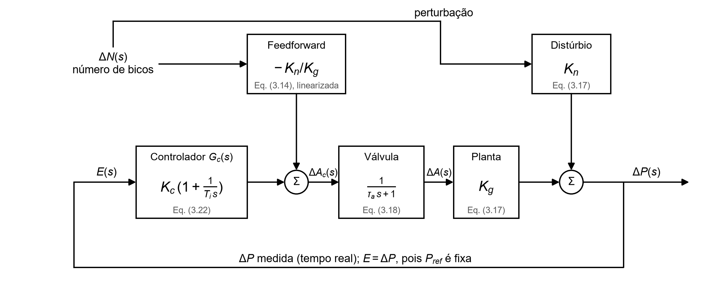{width=95%}

Fonte: elaborada pelo autor.

**Malha fechada.** Seguindo a malha da Figura 13, o erro $\Delta P$ gera o comando $\Delta A_c = G_c(s)\,\Delta P$, a válvula o atrasa pela Equação (3.19) e a planta, pela Equação (3.20), devolve $K_g$ vezes a abertura. As transformações são feitas em quatro passos.

*Passo 1 – juntar as equações.* Substituindo (3.19) e (3.21) em (3.20):

$$\Delta P = K_n\,\Delta N + K_g\,\frac{G_c(s)}{\tau_a s + 1}\,\Delta P$$

Como $K_g$ é negativo, escreve-se $K_g = -|K_g|$: uma pressão acima da referência gera uma correção que baixa a pressão, ou seja, a realimentação é negativa. Passando o termo com $\Delta P$ para o lado esquerdo:

$$\Delta P\left[1 + \frac{G_c(s)\,|K_g|}{\tau_a s + 1}\right] = K_n\,\Delta N$$

e dividindo, obtém-se a resposta da malha ao distúrbio, que é a parcela que entra direto na saída dividida por 1 mais o ganho da malha (OGATA, 2010, p. 22):

$$\frac{\Delta P(s)}{\Delta N(s)} = \frac{K_n}{1 + \dfrac{G_c(s)\,|K_g|}{\tau_a s + 1}} \tag{3.22}$$

Multiplicando o numerador e o denominador por $(\tau_a s + 1)$, para tirar a fração de dentro da fração:

$$\frac{\Delta P(s)}{\Delta N(s)} = \frac{K_n\,(\tau_a s + 1)}{\tau_a s + 1 + G_c(s)\,|K_g|}$$

*Passo 2 – controlador P.* Com $G_c(s) = K_c$, a expressão acima já é a função de transferência do P:

$$G_P(s) = \frac{\Delta P(s)}{\Delta N(s)} = \frac{K_n\,(\tau_a s + 1)}{\tau_a s + 1 + K_c\,|K_g|} \tag{3.23}$$

*Passo 3 – controlador PI.* Escrevendo a Equação (3.21) como uma só fração, $G_c(s) = K_c\,(T_i s + 1)/(T_i s)$, e substituindo:

$$\frac{\Delta P(s)}{\Delta N(s)} = \frac{K_n\,(\tau_a s + 1)}{\tau_a s + 1 + \dfrac{K_c\,|K_g|\,(T_i s + 1)}{T_i\,s}}$$

Multiplicando o numerador e o denominador por $T_i s$:

$$\frac{\Delta P(s)}{\Delta N(s)} = \frac{K_n\,T_i\,s\,(\tau_a s + 1)}{T_i\,s\,(\tau_a s + 1) + K_c\,|K_g|\,(T_i s + 1)}$$

Abrindo os produtos do denominador, $\tau_a T_i s^2 + T_i s + K_c|K_g|\,T_i s + K_c|K_g|$, e juntando os termos em $s$:

$$G_{PI}(s) = \frac{K_n\,T_i\,s\,(\tau_a s + 1)}{\tau_a T_i\,s^2 + T_i\,(1 + K_c|K_g|)\,s + K_c|K_g|} \tag{3.24}$$

*Passo 4 – PI com feedforward.* No *feedforward*, a abertura muda $-K_n/K_g$ = −0,121 por bico aberto, ou seja, +0,121 por bico fechado, como na Equação (3.14). Esse é o compensador ideal $G_d/G_p$ (LIU et al., 2018, p. 3) escrito com os ganhos estáticos da Equação (3.20). Esse comando também passa pela válvula, e chega à pressão como $K_g \cdot (-K_n/K_g)\,\Delta N/(\tau_a s + 1) = -K_n\,\Delta N/(\tau_a s + 1)$. Somado ao efeito direto do distúrbio, $K_n\,\Delta N$, o que sobra é:

$$K_n\left[1 - \frac{1}{\tau_a s + 1}\right] = K_n\,\frac{\tau_a s}{\tau_a s + 1}$$

Ou seja, o *feedforward* cancela o distúrbio em regime ($s \to 0$), mas não no instante da troca. Repetindo os passos 1 e 3 com $K_n\,\tau_a s/(\tau_a s + 1)$ no lugar de $K_n$, o fator $(\tau_a s + 1)$ do numerador é cancelado e fica:

$$G_{PI+FF}(s) = \frac{K_n\,\tau_a T_i\,s^2}{\tau_a T_i\,s^2 + T_i\,(1 + K_c|K_g|)\,s + K_c|K_g|} \tag{3.25}$$

**O que as funções de transferência mostram.**

- **O P deixa erro.** Pelo teorema do valor final (OGATA, 2010, p. 198), o valor final é o limite de $s$ vezes a saída quando $s \to 0$. Para um bico fechando ($\Delta N = -1/s$):

$$\Delta P(\infty) = \lim_{s \to 0} s\,G_P(s)\left(-\frac{1}{s}\right) = -G_P(0) = -\frac{K_n}{1 + K_c|K_g|}$$

  Como $K_n < 0$, a pressão termina acima da referência: é a Equação (2.9), agora tirada da função de transferência.
- **O PI zera o erro.** Fazendo a mesma conta com a Equação (3.24), $\Delta P(\infty) = -G_{PI}(0) = 0$, porque o $s$ do numerador zera a função em $s = 0$: a ação integral devolve a pressão à referência.
- **O *feedforward* não muda a estabilidade.** As Equações (3.24) e (3.25) têm o mesmo denominador, então têm os mesmos polos. A estabilidade depende só da equação característica:

$$\tau_a T_i\,s^2 + T_i(1 + K_c|K_g|)\,s + K_c|K_g| = 0$$

  Dividindo tudo por $\tau_a T_i$, para o termo em $s^2$ ficar com coeficiente 1:

$$s^2 + \frac{1 + K_c|K_g|}{\tau_a}\,s + \frac{K_c|K_g|}{\tau_a T_i} = 0$$

  Comparando termo a termo com a forma padrão de segunda ordem, $s^2 + 2\zeta\omega_n s + \omega_n^2$ (OGATA, 2010, p. 151):

$$\omega_n = \sqrt{\frac{K_c|K_g|}{\tau_a T_i}}, \qquad \zeta = \frac{1 + K_c|K_g|}{2\,\tau_a\,\omega_n}$$

  e o tempo de acomodação pelo critério de 2% é $t_s \approx 4/(\zeta\,\omega_n)$ (OGATA, 2010, p. 157). Na seção 3.5.5 essas relações são usadas no sentido contrário: escolhem-se $\zeta$ e $\omega_n$, e calculam-se os ganhos.

Essas funções de transferência não mostram o efeito da amostragem. Nelas, o P e o PI seriam estáveis com qualquer ganho, porque todos os coeficientes são positivos. O controlador real, porém, só lê a pressão a cada 50 ms, e isso impõe um ganho máximo, calculado na seção 3.5.5. As Equações (3.23) a (3.25) também foram simuladas no Python, pela função `resposta_linear`, e comparadas com o simulador completo na seção 4.2.

### 3.5.5 Sintonia por alocação de polos

Com a equação característica do PI escrita na forma padrão, a sintonia pode ser feita de trás para frente: primeiro se escolhe como a malha deve responder e depois se calculam os ganhos que dão essa resposta.

**Especificação.** Foram escolhidos:

- $\zeta$ = 0,7, que dá um sobressinal de cerca de 4,6% (seção 2.6.1) e fica perto do amortecimento que acomoda mais depressa;
- $t_s$ = 0,5 s pelo critério de 2%. A válvula sozinha leva cerca de $4\tau_a$ = 0,8 s para se acomodar depois de um comando (OGATA, 2010, p. 147). Pedir 0,5 s exige uma correção um pouco mais rápida que a da válvula livre, sem levar o ganho para perto do limite da amostragem (ver abaixo).

**Cálculo dos ganhos.** Da Equação (2.11), a frequência natural desejada é:

$$\omega_n = \frac{4}{\zeta\,t_s} \tag{3.26}$$

Comparando a equação característica da seção 3.5.4 com a forma padrão, o termo em $s$ dá $2\zeta\omega_n = (1 + K_c|K_g|)/\tau_a$. Isolando $K_c$:

$$K_c = \frac{2\zeta\omega_n\tau_a - 1}{|K_g|} \tag{3.27}$$

O termo independente dá $\omega_n^2 = K_c|K_g|/(\tau_a T_i)$. Isolando $T_i$:

$$T_i = \frac{K_c\,|K_g|}{\tau_a\,\omega_n^2} \tag{3.28}$$

O controlador P tem uma malha fechada de primeira ordem, com um único polo em $s = -(1 + K_c|K_g|)/\tau_a$ (Equação 3.23). Com um polo só, não há $\zeta$ para escolher. Por isso o P usa o mesmo $K_c$ do PI, e a comparação entre os dois mostra apenas o efeito da ação integral. Os valores numéricos estão na seção 4.2 (Tabela 9).

**Limite imposto pela amostragem.** O controlador lê a pressão a cada $T_s$ e mantém o comando parado até a leitura seguinte. Nesse intervalo, a válvula segue a resposta de primeira ordem da Equação (3.12) (OGATA, 2010, p. 147). Depois de um período, ela percorre a fração $1 - a$ do caminho que faltava, com $a = e^{-T_s/\tau_a}$:

$$\alpha_{k+1} = a\,\alpha_k + (1 - a)\,\alpha_{c,k}$$

Com o controlador P, juntando essa equação à da planta, o erro passa de uma leitura para a seguinte multiplicado sempre pelo mesmo número:

$$e_{k+1} = \left[a - (1 - a)\,K_c|K_g|\right]\,e_k$$

Se esse número fica entre −1 e 1, o erro diminui a cada leitura. Se fica entre −1 e 0, o erro troca de sinal a cada leitura enquanto diminui: o controlador corrige demais para um lado e, na leitura seguinte, para o outro. Se fica abaixo de −1, essa oscilação cresce e a malha fica instável. O limite é o número igual a −1, o que dá o maior ganho estável:

$$K_{c,lim} = \frac{1 + a}{(1 - a)\,|K_g|} \tag{3.29}$$

Esse limite não aparece na função de transferência contínua, porque vem só de o controlador ler a pressão a intervalos. Por isso o ganho calculado pela Equação (3.27) precisa ficar bem abaixo de $K_{c,lim}$. Também se exige $T_i \ge T_s$, porque um tempo integral menor que o intervalo entre leituras faria a soma de retângulos da Equação (3.17) errar muito a integral.

**Por que não há ação derivativa.** Além do ruído e dos saltos de pressão (seção 2.6), a malha com o PI tem só dois polos, e os dois já foram colocados onde se queria com $K_c$ e $T_i$. Uma terceira ação não é necessária para atingir a especificação.

## 3.6 Simulação e métricas

*Etapa 6.*

### 3.6.1 Parâmetros

A Tabela 4 reúne os parâmetros e a origem de cada um; os ajustados aos dados são os mais confiáveis, e os estimados são suposições do autor.

**Tabela 4 – Parâmetros do modelo e do controle.**

| Parâmetro | Valor | Origem |
|---|---|---|
| $K$ | 0,425 (L/min)/√(kgf/cm²) | Ajustado aos dados (Tabela 1) |
| $a_2$, $a_1$, $a_0$ | −0,0355; −0,2018; 5,815 | Ajustados aos dados (Tabela 1) |
| $P_{ref}$ | 3,5 kgf/cm² | Escolha de projeto: abaixo dos 3,56 kgf/cm² que a fonte mantém com sete bicos e a válvula fechada (seção 4.1) |
| $K_{v,max}$ | 3,5 (L/min)/√(kgf/cm²) | Escolha de projeto: folga sobre o necessário com nenhum bico aberto (3,06) |
| $\tau_a$ | 0,2 s | Estimado |
| $\omega_{max}$ | 0,5 s⁻¹ (curso total em 2 s) | Estimado |
| $T_s$ | 50 ms | Escolha de projeto |
| $\Delta t$ | 1 ms | Passo da simulação |
| $K_g$ | −2,66 kgf/cm² | Medido no modelo estático (Equação 3.15) |
| $K_n$ | −0,323 kgf/cm² por bico | Medido no modelo estático, com sete bicos (seção 3.5.4) |
| $\zeta$, $t_s$ | 0,7; 0,5 s | Escolha de projeto (seção 3.5.5) |
| $K_c$, $T_i$ do PI | 0,827 (kgf/cm²)⁻¹; 0,084 s | Equações (3.27) e (3.28), também usados no PI+FF |
| $K_c$ do P | 0,827 (kgf/cm²)⁻¹ | Igual ao do PI (seção 3.5.5) |

Fonte: elaborada pelo autor.

### 3.6.2 Como a simulação funciona, passo a passo

Cada simulação recebe uma lista de eventos ("no instante $t$, passam a existir $n$ bicos abertos") e a duração total, e repete o seguinte laço a cada passo de 1 ms:

1. **Atualiza os bicos:** se chegou a hora de um evento, troca o valor de $n$.
2. **Roda o controlador, se for a vez dele:** a cada 50 passos, lê a pressão, calcula o erro, decide se $I_k$ pode ser atualizada (anti-windup, seção 3.5.3) e calcula o comando pelas Equações (3.17) e (3.18).
3. **Move a válvula:** velocidade pela Equação (3.12), limitada a $\pm\omega_{max}$, abertura pela Equação (3.13), mantida entre 0 e 1.
4. **Calcula a pressão:** resolve a Equação (3.10) pela bissecção (H6).
5. **Guarda os valores** de tempo, pressão, abertura e número de bicos.

No início, a pressão está em $P_{ref}$ e a válvula em $\alpha_0 = \alpha_{ff}(7)$.

### 3.6.3 Cenários e configurações

Os cenários (Tabela 5) repetem as sequências do ensaio da bancada e acrescentam situações mais difíceis.

**Tabela 5 – Cenários de simulação.**

| Cenário | Sequência de $n(t)$ | Objetivo |
|---|---|---|
| C1 | 7 → 1 → 7, um bico por vez, a cada 2 s (26 s) | Passar por toda a faixa de operação |
| C2 | 7 → 4 em t = 2 s (fecha 1, 4 e 7) → 1 em t = 8 s (fecha 2, 3 e 5) (14 s) | Repetir a sequência da Tabela 2, com degraus de três bicos |
| C3 | Um bico sorteado troca de estado a cada 0,1–0,5 s, com $n$ entre 1 e 7 (20 s, 66 trocas) | Imitar a aplicação localizada, com trocas frequentes |

Fonte: elaborada pelo autor.

No C3, o sorteio usa uma semente fixa, para que os resultados possam ser repetidos.

Os cenários C1 a C3 foram simulados em malha aberta (válvula parada em $\alpha_0$) e com os três controladores da seção 3.5.3 (P, PI e PI+FF).

Os cenários C2 e C3 também foram repetidos com o PI e o PI+FF para três velocidades máximas da válvula (0,5, 1,0 e 2,0 s⁻¹), porque $\omega_{max}$ é estimado e é o parâmetro que mais limita a correção.

### 3.6.4 Métricas

**Faixa de tolerância.** Foi usada a tolerância de ±10% na pressão da norma ISO 16122-2 (seção 2.5):

$$0{,}9\,P_{ref} \le P \le 1{,}1\,P_{ref} \tag{3.30}$$

Para $P_{ref}$ = 3,5 kgf/cm², a faixa vai de **3,15** a **3,85 kgf/cm²**, o que mantém a vazão de cada bico a cerca de ±5% do valor desejado (Equação 3.1).

**Métricas calculadas** em cada simulação, com $N$ amostras de 1 ms:

- **tempo fora da faixa:** a porcentagem das amostras fora da Equação (3.30). Com a máquina em velocidade constante, é também a porcentagem da área aplicada fora da tolerância:

$$\text{fora} = \frac{100}{N}\sum_{k=1}^{N}{\left[P_k \notin \text{faixa}\right]} \tag{3.31}$$

  O colchete vale 1 quando a amostra está fora e 0 quando está dentro. Por exemplo, no C2 com PI+FF, 946 das 14 000 amostras ficaram fora, o que dá 6,8%;
- **integral do erro absoluto (IAE):** a área entre a curva da pressão e a linha de $P_{ref}$; o módulo impede que erros para cima e para baixo se cancelem. Quanto menor, melhor:

$$\mathrm{IAE} = \sum_{k=1}^{N}{\left|P_k - P_{ref}\right|\Delta t} \tag{3.32}$$

  O tempo fora da faixa diz **se** a pressão saiu da faixa; o IAE mede **quanto** ela errou, mesmo dentro dela;
- **desvio máximo:** o maior $|P - P_{ref}|$, em porcentagem de $P_{ref}$ (um pico de 4,5 kgf/cm² dá 29%);
- **tempo de acomodação:** depois de cada troca de bicos, o tempo até a pressão entrar e não sair mais da faixa de ±2% de $P_{ref}$ (3,43 a 3,57 kgf/cm²), como na definição usual (OGATA, 2010, p. 155). No C3, as trocas são mais rápidas que isso, e a métrica não foi usada.

**Validação.**
- **Estática:** os pontos de operação previstos com a válvula fechada foram comparados com a Tabela 1. Também foi feita uma **validação cruzada *leave-one-out*** (LOO, "deixa um de fora"): para cada um dos sete pontos, $K$ e a curva da fonte foram ajustados com os outros seis, e o ponto de fora foi previsto.
- **Dinâmica:** só qualitativa, comparando a malha aberta do C2 com a Tabela 2, porque o artigo não traz medições no tempo.

## 3.7 Implementação em Python

*Etapa 7.* O modelo, o controlador e a simulação foram programados num único arquivo, `simulacao/modelo_barra.py`, em Python 3, com só duas bibliotecas: **numpy**, para contas com vetores e mínimos quadrados, e **matplotlib**, para os gráficos. A simulação no tempo foi programada diretamente, sem bibliotecas de controle, para que cada passo ficasse visível no código. Para rodar, a partir da pasta do trabalho:

```
py -3 simulacao/modelo_barra.py
```

O programa grava os números em `simulacao/resultados.json` e os gráficos em `simulacao/figuras/`. Todos os números e figuras do Capítulo 4 vêm dessa execução. O código completo está no Apêndice A.

### 3.7.1 Organização do programa

O arquivo está dividido em blocos executados na ordem da Figura 14, que é a mesma do roteiro da seção 3.1 (Figura 4): etapas 2 a 6, em sequência.

**Figura 14 – Fluxo de execução do programa.**

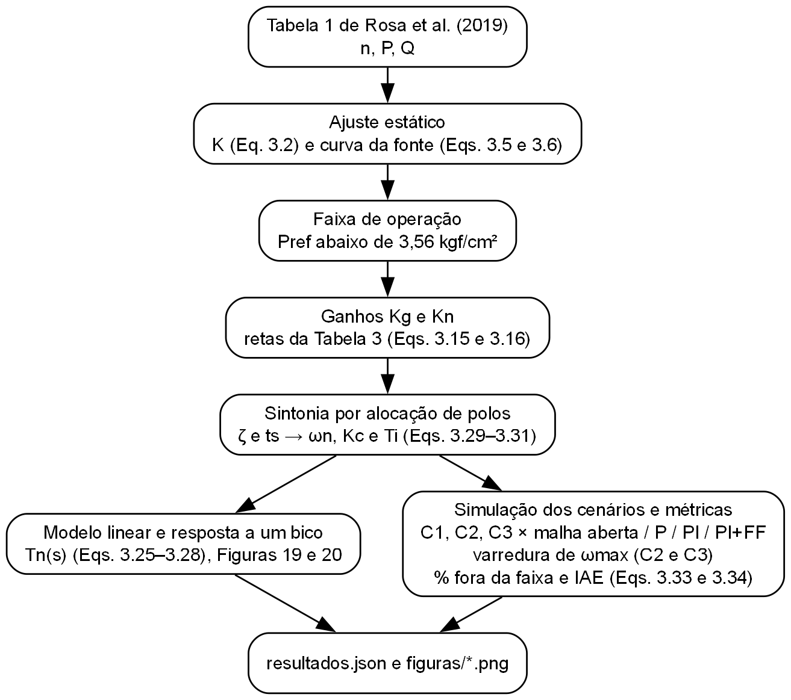{width=56%}

Fonte: elaborada pelo autor.

Na Figura 14, se uma das conferências falha, o programa para com uma mensagem de erro (seção 3.7.3). O Quadro 2 liga cada função à equação que ela implementa.

**Quadro 2 – Funções do programa e equações correspondentes.**

| Função | O que faz | Equações |
|---|---|---|
| `q_fonte` | Calcula a vazão da fonte para uma pressão | (3.7) |
| `p_regime` | Acha a pressão de equilíbrio por bissecção | (3.10) |
| `identificacao` | Ajusta $K$ e a curva da fonte e compara com a Tabela 1 | (3.2), (3.5), (3.6) |
| `validacao_cruzada` | Refaz o ajuste sem um ponto e prevê esse ponto | (3.2), (3.5), (3.10) |
| `alpha_ff` | Calcula a abertura antecipada para $n$ bicos | (3.14) |
| `ganho_kg` | Mede o ganho da planta abrindo e fechando a válvula um pouco | (3.15) |
| `sintonia_polos` | Calcula $\omega_n$, $K_c$ e $T_i$ a partir de $\zeta$ e $t_s$ | (3.26)–(3.28) |
| `kc_limite` | Calcula o maior ganho estável do controlador P amostrado | (3.29) |
| `modelo_linear`, `resposta_linear` | Calculam $K_n$, as funções de transferência, os polos, $\omega_n$ e $\zeta$, e simulam a resposta linear | (3.19)–(3.25) |
| `simular` | Roda o laço no tempo (modos malha aberta, P, PI e PI+FF) | (2.13), (3.10), (3.12), (3.13), (3.17), (3.18) |
| `metricas` | Calcula tempo fora da faixa, IAE, desvio e acomodação | (3.30)–(3.32) |
| `cenarios` | Monta as sequências de bicos dos cenários | Tabela 5 |

Fonte: elaborada pelo autor.

### 3.7.2 Trechos principais

Esta seção mostra os trechos que concentram as contas; o código completo está no Apêndice A.

**Pressão de equilíbrio (`p_regime`).** Resolve a Equação (3.10) pela bissecção da seção 3.3.4: se, num certo valor de pressão, a fonte entrega **mais** líquido do que as saídas deixam passar, a pressão de equilíbrio está acima desse valor; se entrega **menos**, está abaixo.

**Quadro 3 – Pressão de equilíbrio por bissecção (funções `q_fonte` e `p_regime`).**

```python
def q_fonte(p, fonte=FONTE):
    # Eq. (3.7): raiz positiva de a2 Q² + a1 Q + (a0 - p) = 0
    a2, a1, a0 = fonte
    if p >= a0:
        return 0.0
    return (-a1 - math.sqrt(a1 * a1 - 4 * a2 * (a0 - p))) / (2 * a2)

def p_regime(k_total, fonte=FONTE):
    # Eq. (3.10): Qs(P) = k_total·√P, por bissecção em [0, a0]
    lo, hi = 0.0, fonte[2]
    for _ in range(100):
        mid = 0.5 * (lo + hi)
        if q_fonte(mid, fonte) - k_total * math.sqrt(mid) > 0:
            lo = mid        # fonte entrega mais: P está acima
        else:
            hi = mid        # fonte entrega menos: P está abaixo
    return 0.5 * (lo + hi)
```

Fonte: elaborada pelo autor.

**Laço da simulação (`simular`).** Implementa os passos da seção 3.6.2.

**Figura 15 – Fluxograma da função `simular`.**

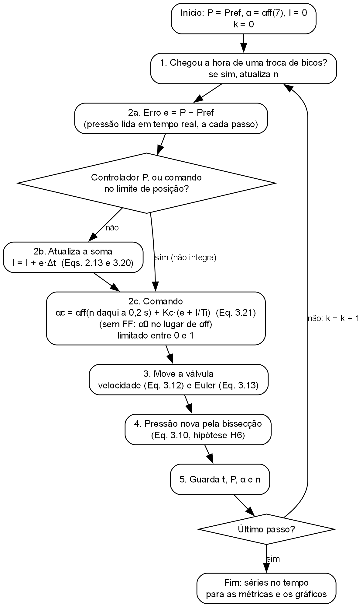{width=80%;altmax=17}

Fonte: elaborada pelo autor.

Na Figura 15, cada volta do laço é um passo de 1 ms; o losango de cima decide se é a vez do controlador, e o segundo é o anti-windup. No Quadro 4, os números dos comentários correspondem aos blocos da Figura 15, e `sat_pos` indica o limite de posição ($s_k = 0$ na Equação 2.13).

**Quadro 4 – Laço principal da simulação (função `simular`, trecho simplificado).**

```python
for k in range(passos):
    t = k * dt
    # 1. comutação dos bicos
    while ev and ev[0][0] <= t:
        n = ev.pop(0)[1]
    # 2. controlador, só a cada Ts (50 passos)
    if k % cada == 0 and modo != "aberta":
        e = p - P_REF                  # 2a. abrir a válvula reduz P
        ff = alpha_ff(n) if modo == "PI+FF" else bias   # bias = α0
        u = ff + kc * (e + integ / ti)     # no P, ti = infinito
        sat_pos = (u >= 1 and e > 0) or (u <= 0 and e < 0)
        # 2b. anti-windup, Eq. (2.13), e soma, Eq. (3.17)
        if modo != "P" and not sat_pos:
            integ += e * TS
        # 2c. comando, Eq. (3.18)
        alpha_c = min(max(ff + kc * (e + integ / ti), 0), 1)
    # 3. válvula: Eq. (3.12) e Euler, Eq. (3.13)
    v = min(max((alpha_c - alpha) / tau_a, -w_max), w_max)
    alpha = min(max(alpha + v * dt, 0), 1)
    # 4. pressão pelo modelo estático, Eq. (3.10)
    p = p_regime(n * K + KV_MAX * alpha)
```

Fonte: elaborada pelo autor.

**Métricas (`metricas`).** Calcula os números da Tabela 10 pelas Equações (3.30) a (3.32). No Quadro 5, em vez de um laço, o numpy compara todas as amostras de uma vez e gera um vetor de verdadeiro/falso, cuja média é a fração do tempo fora da faixa.

**Quadro 5 – Cálculo do tempo fora da faixa e do IAE (função `metricas`, trecho).**

```python
FAIXA = (0.90, 1.10)                     # Eq. (3.30), ISO 16122-2
fora = (p < FAIXA[0] * P_REF) | (p > FAIXA[1] * P_REF)
fora_pct = fora.mean() * 100             # Eq. (3.31)
IAE = np.sum(np.abs(p - P_REF)) * dt     # Eq. (3.32)
desvio_max = np.max(np.abs(p - P_REF)) / P_REF * 100
```

Fonte: elaborada pelo autor.

### 3.7.3 Conferências automáticas

O programa interrompe a execução se algo sair do esperado:
- o ajuste estático precisa dar $K$ = 0,425 e erros máximos abaixo de 0,75% na pressão e de 2,3% na vazão (obtidos: 0,73% e 2,27%);
- a referência precisa ser atingível com sete bicos e a válvula fechada;
- o $K_g$ de cada número de bicos não pode diferir mais de 2% do valor de $n$ = 4;
- o $K_c$ calculado precisa ficar abaixo do ganho-limite do controlador amostrado, Equação (3.29);
- a função de transferência do PI, com os ganhos calculados, precisa ter o $\zeta$ e o $\omega_n$ especificados, com diferença menor que 1%;
- $T_i$ não pode ser menor que $T_s$.

Assim, se um dado ou uma fórmula for alterado e quebrar o modelo, o programa avisa em vez de gerar gráficos errados.

## 3.8 Limitações

- Os parâmetros estáticos vêm de uma bancada de sete bicos e 5 m; uma barra comercial tem dezenas de bicos e pode ter perda de pressão relevante ao longo da barra (H2).
- A curva da fonte vale na faixa medida (1,0 a 5,6 L/min; 3,57 a 5,58 kgf/cm²). Com a válvula aberta, a vazão da fonte chega a 5,7 L/min em $P_{ref}$ = 3,5 kgf/cm², uma pequena extrapolação.
- A pressão foi tratada como instantânea (H6). Em barras longas, com mangueiras grossas ou com ar na linha, essa hipótese precisaria ser revista.
- $\tau_a$, $\omega_{max}$ e a curva da válvula (H5) foram estimados sem dados da bancada. Os resultados dinâmicos, os ganhos e o ganho-limite dependem deles.
- O sensor de pressão foi tratado como perfeito. Num teste à parte, com sete bicos e ruído aleatório de 1% a 2% na leitura, a pressão continuou dentro da faixa, mas a válvula se moveu de 2,1 a 2,5 vezes mais do que com um PI de ganho 2,5 vezes menor ($K_c$ = 0,33). Num equipamento real isso gastaria mais o motor. Se for preciso, a própria especificação permite reduzir o ganho: pedir um $t_s$ maior dá um $K_c$ menor pela Equação (3.27).
- O modelo não inclui atraso das solenoides, vento ou falhas mecânicas.

---

# 4 RESULTADOS

Todos os números deste capítulo foram gerados pelo programa da seção 3.7 e estão gravados em `simulacao/resultados.json`.

## 4.1 Modelo estático

**Constante do bico.** Pela Equação (3.2), os sete valores de $K$ ficaram entre 0,418 e 0,436, com média **$K$ = 0,425 (L/min)/√(kgf/cm²)**. Valores tão próximos confirmam que a vazão de cada bico segue a raiz da pressão (Equação 3.1). Para os 4,0 bar do catálogo (4,08 kgf/cm²), esse $K$ dá 0,86 L/min por bico, cerca de 7% abaixo dos 0,92 L/min do catálogo do fabricante (ROSA; TERRA; DREWS JR, 2019). Uma explicação possível é a perda de pressão na solenoide e na válvula antigotejo, que ficam entre o sensor de pressão e a ponta, de modo que o bico trabalha com uma pressão um pouco menor que a medida.

**Resistência equivalente.** A Tabela 6 e a Figura 16 comparam o modelo $R_1/n^2$ deste trabalho (Equação 3.4), a fórmula empírica (2.5) e os valores medidos. Diferente do simulador, que usa $K$ = 0,425 ($R_1$ = 5,54), aqui $R_1$ foi tirado diretamente do ensaio com **um único bico aberto** (última linha da Tabela 1), para testar só a forma $1/n^2$:

$$R_1 = \frac{P}{Q^2} = \frac{5{,}58}{1{,}00^2} = 5{,}58\ \text{(kgf/cm}^2\text{)/(L/min)}^2$$

e o modelo fica:

$$R_{eq}(n) = \frac{5{,}58}{n^2} \qquad \text{por exemplo,}\quad R_{eq}(7) = \frac{5{,}58}{49} = 0{,}114$$

Usar o ponto de um bico como base testa só a **forma** da lei (se a resistência cai com $n^2$), sem misturar com o ajuste de $K$; é também o ponto pelo qual a fórmula empírica (2.5) passa, o que deixa a comparação justa. O valor é coerente com o $K$ médio: $1/\sqrt{5{,}58}$ = 0,423, contra 0,425 da Equação (3.2).

**Tabela 6 – Resistência equivalente da barra: medida e modelos.**

| $n$ | Medida | Modelo $R_1/n^2$ (3.4) | Erro | Eq. (2.5) | Erro |
|---|---|---|---|---|---|
| 7 | 0,114 | 0,114 | 0,0% | 0,093 | −18,5% |
| 6 | 0,151 | 0,155 | +2,7% | 0,147 | −2,7% |
| 5 | 0,219 | 0,223 | +1,9% | 0,233 | +6,3% |
| 4 | 0,358 | 0,349 | −2,6% | 0,371 | +3,8% |
| 3 | 0,633 | 0,620 | −2,0% | 0,621 | −1,9% |
| 2 | 1,318 | 1,395 | +5,9% | 1,320 | +0,2% |
| 1 | 5,580 | 5,580 | 0,0% | 5,581 | 0,0% |

Unidade: (kgf/cm²)/(L/min)². Fonte: elaborada pelo autor com dados de Rosa, Terra e Drews Jr (2019).

**Figura 16 – Resistência equivalente em função do número de bicos abertos.**


Fonte: elaborada pelo autor com dados de Rosa, Terra e Drews Jr (2019).

Na Figura 16, a resistência está em escala logarítmica, porque vai de 0,1 a 5,6. Os pontos pretos são as medições, a linha azul é o modelo deste trabalho e a laranja tracejada é a fórmula empírica (2.5); a diferença aparece em $n$ = 7, onde a fórmula empírica fica abaixo do ponto medido.

A fórmula (2.5) tem erro absoluto menor (RMSE de 0,012 contra 0,030), porque acerta melhor as resistências grandes ($n$ = 1 e 2), que dominam o RMSE. Já o erro relativo do modelo deste trabalho é mais uniforme: no máximo 5,9%, contra 18,5% da fórmula (2.5) em $n$ = 7, o que daria uma vazão cerca de 11% maior que a real. E o modelo usa um único número com significado físico.

**Curva da fonte.** O ajuste por mínimos quadrados da Equação (3.5) deu:

$$P = -0{,}0355\,Q_s^2 - 0{,}2018\,Q_s + 5{,}815 \quad [\text{kgf/cm}^2,\ \text{L/min}] \tag{4.1}$$

com RMSE de 0,006 kgf/cm² e coeficiente de determinação R² de 0,9999 (CHAPRA; CANALE, 2011, p. 384). Uma reta teria RMSE de 0,073 kgf/cm², doze vezes maior, o que justifica a curva de segundo grau.

**Pontos de operação.** Resolvendo a Equação (3.10) com a válvula fechada para cada $n$, o modelo reproduziu os sete pontos medidos com erro máximo de **0,7% na pressão** ($n$ = 4) e **2,3% na vazão** ($n$ = 2) (Tabela 7 e Figura 17).

**Tabela 7 – Pontos de operação previstos e medidos (válvula fechada).**

| $n$ | $P$ previsto | $P$ medido | $Q$ previsto | $Q$ medido |
|---|---|---|---|---|
| 7 | 3,562 | 3,57 | 5,616 | 5,60 |
| 6 | 3,899 | 3,88 | 5,036 | 5,07 |
| 5 | 4,250 | 4,24 | 4,382 | 4,40 |
| 4 | 4,606 | 4,64 | 3,649 | 3,60 |
| 3 | 4,956 | 4,96 | 2,839 | 2,80 |
| 2 | 5,285 | 5,27 | 1,955 | 2,00 |
| 1 | 5,577 | 5,58 | 1,004 | 1,00 |

$P$ em kgf/cm², $Q$ em L/min. Fonte: elaborada pelo autor com dados de Rosa, Terra e Drews Jr (2019).

**Figura 17 – Curva da fonte e curvas de carga da barra.**


Fonte: elaborada pelo autor com dados de Rosa, Terra e Drews Jr (2019).

Na Figura 17, a curva preta grossa é a fonte (Equação 4.1) e as azuis finas são as curvas de carga da barra, $P = (Q/nK)^2$, uma para cada $n$. O ponto de operação é o cruzamento da fonte com a curva de carga, e os pontos laranja (medidos) caem praticamente sobre esses cruzamentos. A linha verde pontilhada marca $P_{ref}$ = 3,5 kgf/cm².

**Validação cruzada.** A Tabela 8 mostra o resultado da validação "deixa um de fora". Os erros de previsão ficaram do mesmo tamanho dos erros de ajuste (no máximo **0,9% na pressão** e **2,7% na vazão**): o modelo também prevê bem um ponto que ficou fora do ajuste.

**Tabela 8 – Validação cruzada: cada ponto previsto sem ser usado no ajuste.**

| $n$ | $K$ | $P$ prev. | $P$ med. | Erro $P$ | $Q$ prev. | $Q$ med. | Erro $Q$ |
|---|---|---|---|---|---|---|---|
| 7 | 0,4254 | 3,563 | 3,57 | −0,18% | 5,621 | 5,60 | +0,37% |
| 6 | 0,4244 | 3,902 | 3,88 | +0,56% | 5,030 | 5,07 | −0,78% |
| 5 | 0,4247 | 4,251 | 4,24 | +0,27% | 4,378 | 4,40 | −0,49% |
| 4 | 0,4263 | 4,597 | 4,64 | −0,92% | 3,656 | 3,60 | +1,56% |
| 3 | 0,4261 | 4,959 | 4,96 | −0,02% | 2,847 | 2,80 | +1,66% |
| 2 | 0,4233 | 5,288 | 5,27 | +0,34% | 1,947 | 2,00 | −2,66% |
| 1 | 0,4254 | 5,566 | 5,58 | −0,25% | 1,004 | 1,00 | +0,36% |

$n$: ponto retirado do ajuste; $K$: valor ajustado com os outros seis pontos; prev.: previsto; med.: medido. $P$ em kgf/cm², $Q$ em L/min. Fonte: elaborada pelo autor.

**Faixa de operação do controle.** A válvula de alívio só consegue **baixar** a pressão, então a referência precisa ficar abaixo do que a fonte mantém com a válvula fechada e sete bicos abertos: 3,56 kgf/cm² (Tabela 7). Uma referência de 4,0 kgf/cm², perto da pressão de catálogo do bico, não seria atingível com seis ou sete bicos (3,90 e 3,56 kgf/cm²); por isso foi adotado $P_{ref}$ = 3,5 kgf/cm². Numa máquina real, isso vira uma regra de projeto: a bomba precisa dar vazão para a barra inteira na pressão de trabalho e ainda sobrar um pouco para a válvula aliviar.

**Ressalva.** A Tabela 2 registra 6,10 kgf/cm², acima do máximo que a Equação (4.1) permite (5,82 kgf/cm², com vazão zero); como indicado na seção 3.2, esse ensaio foi feito com outra rotação da bomba e não serve para conferir a Equação (4.1).

## 4.2 Sintonia e conferências

**Ganho da planta.** $K_g$ = −2,66 kgf/cm² para qualquer número de bicos (Tabela 3), então uma única sintonia serve para todos os casos.

**Ganhos.** A Tabela 9 aplica as Equações (3.26) a (3.28) à especificação da seção 3.5.5.

**Tabela 9 – Sintonia por alocação de polos.**

| Grandeza | Valor | Origem |
|---|---|---|
| Amortecimento $\zeta$ | 0,7 | Especificação |
| Tempo de acomodação $t_s$ | 0,5 s | Especificação |
| Frequência natural $\omega_n$ | 4/(0,7 × 0,5) = 11,43 rad/s | Equação (3.26) |
| $K_c$ do P e do PI | (2 × 0,7 × 11,43 × 0,2 − 1)/2,66 = **0,827** (kgf/cm²)⁻¹ | Equação (3.27) |
| $T_i$ do PI | (0,827 × 2,66)/(0,2 × 11,43²) = **0,084 s** | Equação (3.28) |

Fonte: elaborada pelo autor.

O ganho da malha $K_c\,|K_g|$ vale 2,2. O tempo integral ficou maior que o período de amostragem (0,084 contra 0,050 s), como pede a seção 3.7.3, mas com pouca folga: entre duas leituras o erro muda bastante, e a soma de retângulos da Equação (3.17) é só uma aproximação grosseira da integral. Essa é uma das razões por que o simulador amostrado se afasta um pouco da função de transferência (Figura 18).

**Distância do limite da amostragem.** Pela Equação (3.29):

$$a = e^{-T_s/\tau_a} = e^{-0{,}25} = 0{,}779 \;\Rightarrow\; K_{c,lim} = \frac{1{,}779}{0{,}221 \times 2{,}66} = 3{,}02$$

O ganho adotado é 27% desse limite, uma folga grande. Com esse ganho, o número que multiplica o erro a cada leitura (seção 3.5.5) vale $0{,}779 - 0{,}221 \times 2{,}2 = 0{,}29$: o erro cai a menos de um terço a cada leitura, sem trocar de sinal.

**Função de transferência.** Com os ganhos da Tabela 9, as funções de transferência da seção 3.5.4 dão:

- **erro do P** pelo teorema do valor final, com $K_n$ = −0,323 por bico:

$$\Delta P(\infty) = \frac{0{,}323}{1 + 0{,}827 \times 2{,}66} = 0{,}101\ \text{kgf/cm}^2$$

- **polos do PI**: dividindo a equação característica por $\tau_a T_i$ = 0,2 × 0,084 = 0,0168 e usando $K_c|K_g|$ = 2,2:

$$s^2 + 16{,}0\,s + 130{,}6 = 0 \;\Rightarrow\; s = -8{,}0 \pm j\,8{,}2$$

  Os dois polos têm parte real negativa, então a malha linear é estável, com frequência natural $\omega_n = \sqrt{130{,}6}$ = 11,43 rad/s, coeficiente de amortecimento $\zeta = 16{,}0/(2 \times 11{,}43)$ = 0,70 e tempo de acomodação:

$$t_s \approx \frac{4}{\zeta\,\omega_n} = \frac{4}{0{,}70 \times 11{,}43} = 0{,}50\ \text{s}$$

  São os valores especificados, como era de esperar, já que a Tabela 9 fez a mesma conta no sentido contrário.

A Figura 18 compara, para um bico fechando (7 → 6), a resposta das funções de transferência (Equações 3.23 a 3.25), simuladas no Python, com a do simulador completo, com e sem o limite de velocidade da válvula.

**Figura 18 – Resposta a um bico fechando: função de transferência e simulador.**

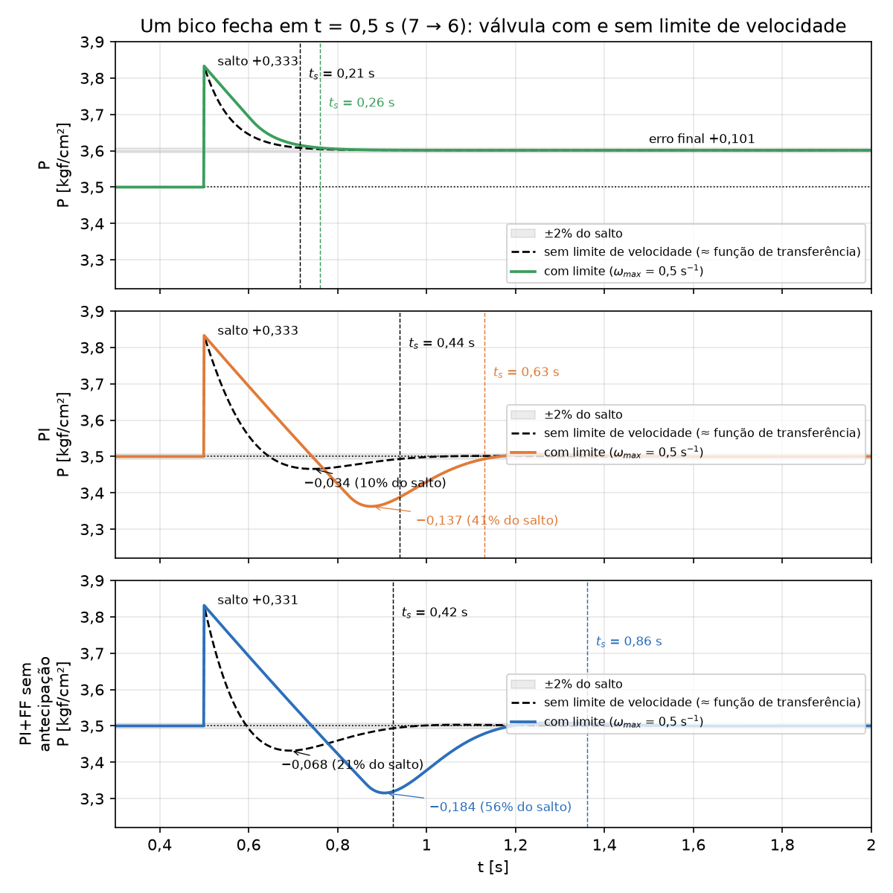

Fonte: elaborada pelo autor.

Na Figura 18, a função de transferência (tracejada) acerta o **valor final** nos três controladores: o P para em 3,60 kgf/cm², 0,10 acima da referência, como previsto, e o PI e o PI+FF voltam a 3,5. Sem o limite de velocidade (curva cinza), o simulador fica perto da função de transferência; a diferença que sobra vem da amostragem de 50 ms. Com o limite (curva colorida), a válvula anda em rampa e a correção demora mais que os 0,50 s previstos. Ou seja, **o modelo linear explica o comportamento da malha, mas o limite de velocidade da válvula é o que define o tempo de resposta**.

**Conferência da hipótese H6.** Os cenários C2 e C3 foram repetidos, com os mesmos ganhos, num modelo que inclui o armazenamento de líquido na mangueira. A maior diferença no tempo fora da faixa foi de 0,4 ponto percentual (C3 com PI+FF), e as conclusões não mudam. Com a mangueira, o ganho-limite do P sobe para cerca de 5,0, porque o líquido armazenado amortece a pressão; os ganhos adotados ficam ainda mais longe do limite de estabilidade.

**Passo de integração.** Com $\Delta t$ = 2 ms, o tempo fora da faixa do C3 mudou no máximo 0,2 ponto percentual, então 1 ms é suficiente. Com 10 ms, o PI+FF mudava 1,2 ponto, porque os instantes das trocas ficavam arredondados.

## 4.3 Respostas nos cenários

A Tabela 10 reúne as métricas, e as Figuras 19 a 21 mostram as respostas no tempo. As seções 4.4 a 4.6 discutem um controlador de cada vez.

**Tabela 10 – Desempenho por cenário e configuração.**

| Cenário | Configuração | Tempo fora da faixa (Eq. 3.31) | IAE (Eq. 3.32) [kgf/cm²·s] | Desvio máximo | Acomodação média (±2%) |
|---|---|---|---|---|---|
| C1 | Malha aberta | 69,2% | 24,72 | 57,8% | não acomoda (11 de 12 degraus) |
| C1 | P | 38,5% | 7,45 | 24,7% | não acomoda (11 de 12 degraus) |
| C1 | PI | **0,0%** | 1,01 | **9,5%** | 0,51 s |
| C1 | PI+FF | **0,0%** | **0,78** | **9,5%** | **0,44 s** |
| C2 | Malha aberta | 85,7% | 18,38 | 57,8% | não acomoda |
| C2 | P | 46,6% | 5,97 | 38,9% | não acomoda |
| C2 | PI | 7,5% | 0,93 | 29,7% | 1,06 s |
| C2 | PI+FF | **6,8%** | **0,82** | **29,6%** | **1,00 s** |
| C3 | Malha aberta | 90,5% | 23,26 | 57,8% | — |
| C3 | P | 50,0% | 7,09 | 25,0% | — |
| C3 | PI | **11,5%** | **3,58** | **19,2%** | — |
| C3 | PI+FF | 12,4% | 3,67 | 21,1% | — |

"Não acomoda (11 de 12 degraus)": em 11 das 12 trocas, a pressão não voltou à faixa de ±2% antes da troca seguinte. No C3 as trocas de bicos (0,1 a 0,5 s) acontecem antes de a pressão acomodar, então essa métrica não se aplica. Fonte: elaborada pelo autor.

**Figura 19 – Cenário C1: fechamento e reabertura dos bicos, um por vez.**


Fonte: elaborada pelo autor.

As Figuras 19 a 21 têm três gráficos empilhados, com o mesmo eixo de tempo:
- **em cima**, a pressão, com a faixa de ±10% (Equação 3.30) em verde e $P_{ref}$ pontilhada; curva cinza para a malha aberta, verde para o P, laranja para o PI e azul para o PI+FF;
- **no meio**, a abertura da válvula, que sobe quando bicos fecham e desce quando abrem (parada na malha aberta);
- **embaixo**, o número de bicos abertos, que é a perturbação.

**Figura 20 – Cenário C2: sequência do ensaio de Rosa, Terra e Drews Jr (2019).**


Fonte: elaborada pelo autor.

**Figura 21 – Cenário C3: troca aleatória de bicos.**


Fonte: elaborada pelo autor.

**Malha aberta.** Sem controle, a pressão sobe de 3,5 para até 5,5 kgf/cm² (desvio de 58%) quando os bicos fecham, no mesmo sentido do ensaio da Tabela 2. Na Figura 19 (C1), a curva cinza sobe em escada e sai da faixa no segundo degrau; nos três cenários, a pressão fica fora da faixa de 69% (C1) a 91% (C3) do tempo.

## 4.4 Controlador P

O controlador P reduz o tempo fora da faixa (Tabela 10), mas deixa a pressão parada **acima** da referência depois de cada fechamento de bicos.

Na Figura 20, quando três bicos fecham em t = 2 s, a curva verde para em cerca de 3,81 kgf/cm², e não em 3,5; quando os outros três fecham, em t = 8 s, ela para em 4,12 kgf/cm², já fora da faixa. Por isso o P passa quase metade do C2 fora da faixa.

Esse é o erro em regime permanente da Equação (2.9). Com quatro bicos abertos, a malha aberta chegaria a 4,54 kgf/cm² ($d$ = 1,04 kgf/cm²), e com ganho de malha 2,2:

$$e_{reg} = \frac{1{,}04}{1 + 2{,}2} = 0{,}32 \qquad P = 3{,}5 + 0{,}32 = 3{,}82$$

O simulador deu 3,81 kgf/cm². Com um bico aberto ($d$ = 2,03), a equação prevê 4,13 e o simulador dá 4,12; a pequena diferença vem de o modelo não ser exatamente linear. No C1, a pressão sai da faixa a partir do quarto bico fechado (3,91 kgf/cm² com três bicos abertos), por isso o P passa 38% do C1 fora da faixa. O P sozinho, portanto, não atende a tolerância quando muitos bicos fecham. Aumentar $K_c$ diminuiria o erro, mas nunca o zeraria (Equação 2.9), e aproximaria a malha do limite de 3,02 imposto pela amostragem (Equação 3.29).

## 4.5 Controlador PI

A ação integral elimina o erro que o P deixava. Na Figura 20, a curva laranja volta para 3,5 kgf/cm² depois de cada fechamento, e o mesmo acontece em todos os degraus do C1. Com isso:

- no **C1**, a pressão fica dentro da faixa 100% do tempo. Cada troca de bico causa um pico de cerca de 9,5%, que fica dentro da faixa e é corrigido em cerca de 0,51 s;
- no **C2**, o tempo fora da faixa cai de 47% (P) para 7,5%; o que sobra é o pico de cada fechamento triplo, discutido abaixo;
- no **C3**, o tempo fora da faixa cai de 50% (P) para 11,5%. As saídas da faixa que sobram acontecem quando várias trocas no mesmo sentido chegam seguidas e a válvula não consegue acompanhar.

**Efeito do anti-windup só por posição.** Enquanto a válvula anda na velocidade máxima, o integrador continua somando o erro, e essa soma extra precisa ser descarregada depois, o que deixa a correção um pouco mais lenta. Num teste à parte, congelando o integrador também durante o movimento na velocidade máxima, o C3 cairia para 4,8% (PI) e o C2 acomodaria em 0,84 s; sem nenhum anti-windup, o C3 subiria para 34%. Foi mantida a forma descrita por Fernandes e Goldemberg (2001), que trata só do limite de posição; estender o anti-windup ao limite de velocidade fica como melhoria indicada por esse teste.

**Por que o pico do C2 não some.** Quando três bicos fecham, a pressão salta para cerca de 4,54 kgf/cm² **no mesmo instante**, em qualquer configuração, porque a válvula ainda está na posição antiga. Por isso o desvio máximo do C2 (29,7%) é praticamente o salto da malha aberta. **O que o controlador define é quanto tempo a pressão leva para voltar.** No gráfico do meio da Figura 20, a abertura sobe em rampa quase reta: a válvula anda na velocidade máxima e precisa mudar 0,36, o que leva cerca de 0,7 s só para ela chegar; com a acomodação final da pressão, o total fica em 1,06 s (Tabela 10). Para reduzir o próprio pico, seria preciso começar a abrir a válvula um pouco **antes** de fechar os bicos.

## 4.6 PI com *feedforward*

O *feedforward* leva a válvula direto para a abertura calculada pelo modelo no instante da troca. Nas trocas espaçadas (C1 e C2), a correção ficou mais rápida: o IAE do C1 caiu 22% e a acomodação passou de 0,51 para 0,44 s no C1 e de 1,06 para 1,00 s no C2. Nas trocas rápidas (C3), o resultado **piorou** um pouco, de 11,5% para 12,4% fora da faixa (Tabela 10).

**Por que o *feedforward* piora o C3.** No C3 os bicos trocam, em média, a cada 0,3 s, e a válvula passa a maior parte do tempo na velocidade máxima: 75% do tempo com o PI e 78% com o PI+FF. A cada troca, o *feedforward* manda a válvula para a abertura de equilíbrio do novo $n$, mas antes de ela chegar outra troca já mudou o alvo. O PI só corrige o erro que de fato apareceu, e em trocas que se desfazem logo (um bico fecha e outro abre) esse erro é pequeno; por isso ele acompanha melhor as trocas rápidas. Com uma válvula mais rápida, os dois controladores melhoram:

- com $\omega_{max}$ = 1,0 s⁻¹ (curso total em 1 s), o C2 fica 4,1% do tempo fora com o PI e 3,4% com o PI+FF, e o C3 fica 3,5% e 4,2%;
- com $\omega_{max}$ = 2,0 s⁻¹ (curso total em 0,5 s), o C2 fica 2,4% e 1,8%, e o C3 fica 1,3% e 3,0%. O *feedforward* continua ajudando no C2 e atrapalhando no C3.

O *feedforward* só compensa quando a válvula chega à posição calculada antes da próxima troca: com os ganhos adotados, ajuda nas trocas espaçadas (C1 e C2) e atrapalha nas muito rápidas (C3), mesmo com uma válvula quatro vezes mais rápida. A velocidade da válvula é também o que mais pesa em qualquer controlador: dobrar $\omega_{max}$ corta o tempo fora da faixa do PI quase pela metade no C2 e para cerca de um terço no C3.

**No campo.** A 15 km/h a máquina anda cerca de 4,2 m por segundo. No C2, os 6,8% de 14 s do PI+FF somam quase 1 s fora da faixa nos dois fechamentos, o que corresponde a uns 4 m com a pressão fora da tolerância.

---

# 5 CONCLUSÃO

Este trabalho tentou responder se é possível manter estável a pressão de uma barra com alimentação em série, enquanto os bicos abrem e fecham, usando uma válvula de alívio, um modelo baseado em resistências fluídicas e um controlador simples.

O primeiro objetivo era modelar a relação entre pressão, vazão e número de bicos, incluindo a fonte e a válvula. O modelo estático, com uma única constante de bico (o que dá a resistência equivalente da barra $R_1/n^2$, no lugar da fórmula empírica de quatro coeficientes) e uma curva de segundo grau para a fonte, reproduziu os pontos publicados por Rosa, Terra e Drews Jr (2019) com erro de até 0,7% na pressão e 2,3% na vazão. Na validação cruzada, prevendo cada ponto sem usá-lo no ajuste, o erro ficou em até 0,9% e 2,7%. O modelo também mostrou um limite de projeto: a válvula de alívio só baixa a pressão, então a referência precisa ficar abaixo do que a fonte sustenta com todos os bicos abertos.

O segundo objetivo era acrescentar a dinâmica da válvula. Com a pressão tratada como instantânea, a comparação com um modelo que inclui o armazenamento de líquido na mangueira mostrou diferença de no máximo 0,4 ponto percentual no tempo fora da faixa.

O terceiro objetivo era sintonizar os controladores P e PI. O ganho da planta, medido no modelo estático, não depende do número de bicos abertos, e por isso uma única sintonia serve para todos os casos. Os ganhos foram calculados por alocação de polos, a partir da função de transferência da malha. Pedindo amortecimento de 0,7 e acomodação em 0,5 s, obtiveram-se $K_c$ = 0,827 e $T_i$ = 0,084 s, com o P usando o mesmo $K_c$. Os polos do PI ficaram em −8,0 ± j8,2, como especificado. A leitura da pressão a cada 50 ms limita o ganho do controlador a 3,02, e o ganho adotado fica em 27% desse limite.

O quarto objetivo era acrescentar a compensação antecipativa, que saiu do próprio modelo estático (Equação 3.14): 0,121 de abertura por bico fechado, somada ao mesmo PI.

O quinto objetivo era comparar os controladores em simulação, usando como tolerância a faixa de ±10% na pressão da norma ISO 16122-2. Os três passos tiveram papéis diferentes:

- o **P** reduziu o tempo fora da faixa em relação à malha aberta (de 69% a 91% para 38% a 50%), mas deixou a pressão parada acima da referência, no valor previsto pela conta do erro em regime permanente. Com quatro bicos fechados, esse erro já tira a pressão da faixa;
- o **PI** eliminou esse erro. A pressão ficou fora da faixa 0% do tempo na troca de um bico por vez e 11,5% na troca aleatória;
- o **PI com *feedforward*** acelerou a correção quando as trocas são espaçadas, mas piorou um pouco o resultado quando os bicos trocam muito depressa (de 11,5% para 12,4% fora da faixa). A causa é a velocidade da válvula: ela não chega à posição calculada antes da próxima troca. Uma válvula mais rápida melhorou os dois controladores, mas o *feedforward* continuou atrapalhando nas trocas rápidas.

Em todos os controladores, quando três bicos fecham ao mesmo tempo, a pressão salta para fora da faixa no mesmo instante e leva cerca de 1 s para voltar, porque a válvula não se move rápido o bastante.

Por isso, a hipótese foi **confirmada em parte e só em simulação**: o modelo permitiu sintonizar, por um método simples, um controlador PI que atende a tolerância nas trocas de um bico e na maior parte da troca aleatória, mas não nas trocas simultâneas de vários bicos. Os parâmetros da válvula foram estimados, e não medidos, e os ganhos foram calculados num modelo linear que não inclui o limite de velocidade da válvula. A validação com medições no tempo é o passo que falta para transformar esses resultados em uma conclusão sobre um sistema real.

Como trabalhos futuros, ficam:
- medir em bancada a velocidade da válvula e sua curva de abertura, que são os parâmetros que mais pesam no resultado e nos ganhos;
- medir na bancada a resposta da malha e ajustar a especificação ($\zeta$ e $t_s$) considerando o ruído do sensor de pressão;
- testar uma válvula mais rápida ou mandar o comando da válvula um pouco antes do comando das solenoides, para reduzir os picos das trocas grandes;
- estender o anti-windup ao limite de velocidade da válvula, que no teste à parte reduziu o tempo fora da faixa do C3 de 11,5% para 4,8%;
- estender o modelo para barras comerciais, com perda de pressão ao longo da barra e, se necessário, com o armazenamento de líquido na mangueira;
- validar o modelo com registros de pulverizadores em campo.

---

# REFERÊNCIAS

AGRIQ. **Preparo da calda de agrotóxico**: como fazer com segurança? [S. l.], [2025]. Disponível em: https://agriq.com.br/preparo-da-calda-de-agrotoxico/. Acesso em: 25 maio 2025.

BRUNETTI, F. **Mecânica dos fluidos**. 2. ed. rev. São Paulo: Pearson Prentice Hall, 2008.

CASALI, A. L. **Condições de uso de pulverizadores e tratores na região Central do Rio Grande do Sul**. 2012. 109 f. Dissertação (Mestrado em Engenharia Agrícola) – Universidade Federal de Santa Maria, Santa Maria, 2012.

CHAPRA, S. C.; CANALE, R. P. **Métodos numéricos para engenharia**. 5. ed. Porto Alegre: AMGH, 2011.

FERNANDES, L. A. P.; GOLDEMBERG, C. **Técnicas anti-windup**. São Paulo: EPUSP, 2001. 12 p. (Boletim Técnico da Escola Politécnica da USP, Departamento de Engenharia de Energia e Automação Elétricas, BT/PEA/0119).

HARTMANN-SCHMIDT, M. A. **Deposição da calda de pulverização na cultura da soja em função do tipo de ponta e do volume aplicado**. 2006. 47 f. Dissertação (Mestrado em Agronomia) – Universidade Estadual do Oeste do Paraná, Marechal Cândido Rondon, 2006.

HOLTERMAN, H. J. et al. Modelling spray drift from boom sprayers. St. Joseph: American Society of Agricultural and Biological Engineers, 2016. [A CONFERIR — o artigo com este título parece ser de 1997, Computers and Electronics in Agriculture, v. 19, p. 1-22]

INTERNATIONAL ORGANIZATION FOR STANDARDIZATION (ISO). **ISO 16122-2**: Agricultural and forestry machinery – Inspection of sprayers in use – Part 2: Horizontal boom sprayers. Geneva: ISO, 2015. (Adotada como BS EN ISO 16122-2:2015. London: BSI, 2015.)

JACTO. **Pulverizador agrícola**: tudo o que você precisa saber. 2017. Disponível em: https://blog.jacto.com.br/pulverizador-agricola-tudo-o-que-voce-precisa-saber/. Acesso em: 24 maio 2025.

KUHN. **Pulverizadores agrícolas**. [S. l.], [2025]. Disponível em: https://www.kuhnbrasil.com.br/cultivos/pulverizadores. Acesso em: 25 maio 2025.

LIU, L.; TIAN, S.; XUE, D.; ZHANG, T.; CHEN, Y. Industrial feedforward control technology: a review. **Journal of Intelligent Manufacturing**, 2018. Publicado *online* em fev. 2018. DOI: https://doi.org/10.1007/s10845-018-1399-6.

MACHADO, A. L. et al. **Máquinas para preparo do solo, semeadura, adubação e tratamentos culturais**. Pelotas: UFPel, 2005.

MANTOVANI, E. C.; QUEIROZ, D. M.; DIAS, G. P. Máquinas e operações utilizadas na agricultura de precisão. In: MANTOVANI, E. C. (org.). **Agricultura de precisão**: fundamentos e aplicações. Viçosa: Editora UFV, 2009. cap. 4, p. 109.

MERCALDI, H. V. **Automação de um sistema de pulverização para aplicação de agroquímicos a taxa variada usando injeção direta**. 2012. Dissertação (Mestrado) – Escola de Engenharia de São Carlos, Universidade de São Paulo, São Carlos, 2012.

MERRITT, H. E. **Hydraulic control systems**. New York: John Wiley & Sons, 1967.

MILHORANCE, F. Brasil lidera o ranking de consumo de agrotóxicos. **O Globo**, Rio de Janeiro, 2015.

MOVIMENTO NACIONAL ODS. **Movimento Nacional ODS – Mato Grosso**. [S. l.], [2025]. Disponível em: https://movimentoods.org.br/mato-grosso/. Acesso em: 25 jun. 2025.

OGATA, K. **Engenharia de controle moderno**. Tradução de Heloísa Coimbra de Souza. 5. ed. São Paulo: Pearson Prentice Hall, 2010.

RIBEIRO, M. L. et al. Contaminação de águas subterrâneas por pesticidas: avaliação preliminar. **Química Nova**, v. 30, n. 3, p. 688-694, 2007.

ROSA, G. R. A. da; TERRA, F. P.; DREWS JR, P. L. J. Pulverizador agrícola em barras com aplicação a taxa variada: modelagem física. In: SIMPÓSIO BRASILEIRO DE AUTOMAÇÃO INTELIGENTE, 14., 2019, Ouro Preto. **Anais** [...]. Campinas: Galoá, 2019. p. 2286-2291. DOI: 10.17648/sbai-2019-111478.

SHIRATSUCHI, L. S.; CHRISTOFFOLETI, P. J. Aplicação localizada de herbicidas em pós-emergência na cultura de soja. **Planta Daninha**, Viçosa, v. 20, n. 1, p. 71-76, abr. 2002.

STEWARD, B. L.; HUMBURG, D. S. Modeling the Raven SCS-700 chemical injection system with carrier control with sprayer simulation. **Transactions of the ASAE**, St. Joseph, v. 43, n. 2, p. 231-245, 2000.

VAL AÇO. **Válvulas globo tipo agulha**. [S. l.]: Val Aço, [20--]. Disponível em: https://www.valaco.com.br/inf_tecnicas/tipo_agulha.html. Acesso em: 4 nov. 2026.


---
---

# APÊNDICE A – CÓDIGO-FONTE DA SIMULAÇÃO

Este apêndice traz o programa completo descrito na seção 3.7, `simulacao/modelo_barra.py`. Ele foi escrito em Python 3 e usa só as bibliotecas numpy e matplotlib. Executado a partir da pasta do trabalho (`py -3 simulacao/modelo_barra.py`), roda em cerca de 3 minutos e gera todos os números e gráficos do Capítulo 4. Os números entre parênteses nos comentários são os das equações do texto.

```python
"""Modelo e simulação do controle de pressão de uma barra de pulverização bico a bico.

Implementa as equações do Capítulo 3 do TCC (contexto/17.md):
  1. identificação estática a partir da Tabela 1 de Rosa, Terra e Drews Jr (2019),
     com validação cruzada "deixa um de fora";
  2. modelo dinâmico simplificado: a pressão segue o modelo estático a cada instante
     e só o atuador da válvula tem dinâmica (atraso + limite de velocidade);
  3. sintonia por alocação de polos (ζ e tempo de acomodação escolhidos), com
     conferência do ganho-limite do controlador amostrado;
  4. controladores P, PI e PI + feedforward em n, discretos, com anti-windup;
  5. cenários C1-C3, métricas e figuras.
Versões anteriores: simulacao/v07/ (com capacitância na linha), simulacao/v09/ (sintonia lambda)
e simulacao/v16/ (sintonia pelo ganho crítico).

Unidades: P em kgf/cm², Q em L/min, t em s.
Rodar:  py -3 simulacao/modelo_barra.py
Saída:  simulacao/resultados.json e simulacao/figuras/*.png
"""

import json
import math
from pathlib import Path

import numpy as np
import matplotlib

matplotlib.use("Agg")
import matplotlib.pyplot as plt

AQUI = Path(__file__).resolve().parent
FIG = AQUI / "figuras"

# ---------------------------------------------------------------------------
# 1. Dados (Rosa; Terra; Drews Jr, 2019, Tabela 1) e identificação estática
# ---------------------------------------------------------------------------
TABELA1 = [  # n bicos abertos, P [kgf/cm²], Q [L/min]  (válvula de recirculação fechada)
    (7, 3.57, 5.60), (6, 3.88, 5.07), (5, 4.24, 4.40), (4, 4.64, 3.60),
    (3, 4.96, 2.80), (2, 5.27, 2.00), (1, 5.58, 1.00),
]
N_T = np.array([r[0] for r in TABELA1])
P_T = np.array([r[1] for r in TABELA1])
Q_T = np.array([r[2] for r in TABELA1])

K = float(np.mean(Q_T / (N_T * np.sqrt(P_T))))         # constante do bico, eq. (3.2)
FONTE = tuple(np.polyfit(Q_T, P_T, 2))                 # curva da fonte (a2, a1, a0), eq. (3.5)
A2, A1, A0 = FONTE


def eq27(n):
    """Expressão empírica de Rosa et al. (2019), eq. (2.5) do texto."""
    return 42.59 * math.exp(-2.335 * n) + 2.307 * math.exp(-0.4591 * n)


def q_fonte(p, fonte=FONTE):
    """Vazão da fonte para a pressão p: raiz positiva de a2 Q² + a1 Q + (a0 - p) = 0."""
    a2, a1, a0 = fonte
    if p >= a0:
        return 0.0
    return (-a1 - math.sqrt(a1 * a1 - 4 * a2 * (a0 - p))) / (2 * a2)


def p_regime(k_total, fonte=FONTE):
    """Pressão de regime: Qs(P) = k_total·√P, resolvida por bissecção em [0, a0]."""
    lo, hi = 0.0, fonte[2]
    for _ in range(100):
        mid = 0.5 * (lo + hi)
        if q_fonte(mid, fonte) - k_total * math.sqrt(mid) > 0:
            lo = mid
        else:
            hi = mid
    return 0.5 * (lo + hi)


def identificacao():
    r1 = P_T[-1] / Q_T[-1] ** 2
    r_med = P_T / Q_T ** 2
    tab_r = []
    for n, rm in zip(N_T, r_med):
        tab_r.append({"n": int(n), "medida": rm, "R1_n2": r1 / n ** 2, "eq27": eq27(n)})
    tab_op = []
    for n, p, q in TABELA1:
        pp = p_regime(n * K)
        tab_op.append({"n": n, "P_prev": pp, "P_med": p, "Q_prev": n * K * math.sqrt(pp), "Q_med": q})
    res = lambda f: math.sqrt(np.mean([(f(t["n"]) - t["medida"]) ** 2 for t in tab_r]))
    pfit = np.polyval(FONTE, Q_T)
    lin = np.polyval(np.polyfit(Q_T, P_T, 1), Q_T)
    sst = float(((P_T - P_T.mean()) ** 2).sum())
    out = {
        "K": K, "K_min": float(np.min(Q_T / (N_T * np.sqrt(P_T)))),
        "K_max": float(np.max(Q_T / (N_T * np.sqrt(P_T)))),
        "fonte": {"a2": A2, "a1": A1, "a0": A0,
                  "rmse": float(np.sqrt(np.mean((P_T - pfit) ** 2))),
                  "r2": 1 - float(((P_T - pfit) ** 2).sum()) / sst,
                  "rmse_linear": float(np.sqrt(np.mean((P_T - lin) ** 2))),
                  "q_fonte_p0": q_fonte(0.0)},
        "rmse_R1_n2": res(lambda n: r1 / n ** 2), "rmse_eq27": res(eq27),
        "tabela_resistencia": tab_r, "tabela_operacao": tab_op,
        "erro_max_P_pct": max(abs(t["P_prev"] - t["P_med"]) / t["P_med"] * 100 for t in tab_op),
        "erro_max_Q_pct": max(abs(t["Q_prev"] - t["Q_med"]) / t["Q_med"] * 100 for t in tab_op),
    }
    # regressão: números publicados no texto (o 05.md trazia 0,6%/2,5%, calculados com P arredondado)
    assert abs(out["K"] - 0.425) < 1e-3, out["K"]
    assert out["erro_max_P_pct"] < 0.75 and out["erro_max_Q_pct"] < 2.3, out
    return out


def validacao_cruzada():
    """Deixa um de fora: ajusta K e a fonte com 6 pontos e prevê o 7º."""
    linhas = []
    for i, (n, p, q) in enumerate(TABELA1):
        m = np.arange(len(TABELA1)) != i
        k_i = float(np.mean(Q_T[m] / (N_T[m] * np.sqrt(P_T[m]))))
        fonte_i = tuple(np.polyfit(Q_T[m], P_T[m], 2))
        pp = p_regime(n * k_i, fonte_i)
        qq = n * k_i * math.sqrt(pp)
        linhas.append({"n": n, "K": k_i, "P_prev": pp, "P_med": p, "Q_prev": qq, "Q_med": q,
                       "erro_P_pct": (pp - p) / p * 100, "erro_Q_pct": (qq - q) / q * 100})
    return {"linhas": linhas,
            "erro_max_P_pct": max(abs(l["erro_P_pct"]) for l in linhas),
            "erro_max_Q_pct": max(abs(l["erro_Q_pct"]) for l in linhas)}


# ---------------------------------------------------------------------------
# 2. Parâmetros de projeto e hipóteses dinâmicas (H5, H6)
# ---------------------------------------------------------------------------
P_REF = 3.5          # kgf/cm², abaixo da P máxima com 7 bicos e válvula fechada
KV_MAX = 3.5         # (L/min)/√(kgf/cm²), válvula toda aberta; K_v(α) = KV_MAX·α (linear)
BASE = {"tau_a": 0.2, "w_max": 0.5}   # s, 1/s
TS = 0.05            # período do controlador [s]
DT = 1e-3            # passo de integração [s]; 10 ms já distorce o horário das trocas no C3
DALFA = 0.01         # degrau de abertura usado para medir o ganho K_g
FAIXA = (0.90, 1.10)             # ±10% na pressão (ISO 16122-2:2015, 4.5.4)


def alpha_ff(n, p_ref=P_REF):
    """Feedforward: abertura que mantém P = P_ref em regime com n bicos (modelo nominal)."""
    kv = q_fonte(p_ref) / math.sqrt(p_ref) - n * K
    return min(max(kv / KV_MAX, 0.0), 1.0)


def ganho_kg(n):
    """K_g = ΔP/Δα medido no modelo estático: abre e fecha a válvula DALFA/2 em torno de α_ff."""
    a = alpha_ff(n)
    p_mais = p_regime(n * K + KV_MAX * (a + DALFA / 2))
    p_menos = p_regime(n * K + KV_MAX * (a - DALFA / 2))
    return {"n": n, "alpha_ff": a, "P_mais": p_mais, "P_menos": p_menos,
            "Kg": (p_mais - p_menos) / DALFA}


ZETA = 0.7           # amortecimento desejado da malha fechada do PI
TS_ESPEC = 0.5       # tempo de acomodação desejado [s], critério de 2% (OGATA, 2010, Eq. 5.22)


def sintonia_polos(kg, par, zeta=ZETA, ts=TS_ESPEC):
    """Alocação de polos: iguala o denominador da malha PI (Eq. 3.24) a s² + 2ζωn·s + ωn².
    ωn = 4/(ζ·ts) (3.26); Kc·|Kg| = 2ζωn·τa − 1 (3.27); Ti = Kc·|Kg|/(τa·ωn²) (3.28).
    O P usa o mesmo Kc do PI."""
    wn = 4 / (zeta * ts)
    g, ta = abs(kg), par["tau_a"]
    kc = (2 * zeta * wn * ta - 1) / g
    ti = kc * g / (ta * wn ** 2)
    return {"P": (kc, math.inf), "PI": (kc, ti)}, wn


def kc_limite(kg, par):
    """Maior Kc estável do P amostrado com válvula de 1ª ordem: z = a − (1−a)Kc|Kg| = −1 (3.29)."""
    a = math.exp(-TS / par["tau_a"])
    return (1 + a) / ((1 - a) * abs(kg))


# ---------------------------------------------------------------------------
# 3. Simulação
# ---------------------------------------------------------------------------
def n_degraus(seq, dur):
    """Converte lista de n em degraus de duração 'dur' → lista de (t_inicio, n)."""
    return [(i * dur, n) for i, n in enumerate(seq)]


def simular(eventos, t_fim, modo, par, kc, ti, dt=DT):
    """modo: 'aberta' (α fixo para n=7), 'P' e 'PI' (bias fixo) ou 'PI+FF'.
    No 'P', ti = math.inf e a integral fica sempre zero."""
    n = eventos[0][1]
    alpha = alpha_ff(7) if modo == "aberta" else alpha_ff(n)
    bias = alpha
    p, integ, alpha_c = P_REF, 0.0, alpha
    passos = int(round(t_fim / dt))
    cada = int(round(TS / dt))
    ev = list(eventos)
    t_out, p_out, a_out, n_out = (np.empty(passos) for _ in range(4))
    for k in range(passos):
        t = k * dt
        while ev and ev[0][0] <= t + 1e-12:              # comutação dos bicos
            n = ev.pop(0)[1]
        if k % cada == 0 and modo != "aberta":          # controlador amostrado a cada TS
            e = p - P_REF                                # abrir a válvula reduz P
            ff = alpha_ff(n) if modo == "PI+FF" else bias
            u = ff + kc * (e + integ / ti)
            sat_pos = (u >= 1 and e > 0) or (u <= 0 and e < 0)
            if modo != "P" and not sat_pos:              # anti-windup: integração condicional no limite de posição
                integ += e * TS
            alpha_c = min(max(ff + kc * (e + integ / ti), 0.0), 1.0)
        v = min(max((alpha_c - alpha) / par["tau_a"], -par["w_max"]), par["w_max"])
        alpha = min(max(alpha + v * dt, 0.0), 1.0)       # atuador: 1ª ordem com limite de velocidade
        p = p_regime(n * K + KV_MAX * alpha)   # pressão segue o modelo estático
        t_out[k], p_out[k], a_out[k], n_out[k] = t, p, alpha, n
    return {"t": t_out, "P": p_out, "alpha": a_out, "n": n_out}


def metricas(sim, eventos):
    t, p = sim["t"], sim["P"]
    dt = t[1] - t[0]
    e = p - P_REF
    fora = (p < FAIXA[0] * P_REF) | (p > FAIXA[1] * P_REF)
    acom = []
    tempos = [ev[0] for ev in eventos[1:]] + [t[-1] + dt]
    for t0, t1 in zip(tempos[:-1], tempos[1:]):
        seg = (t >= t0) & (t < t1)
        ruins = np.where(np.abs(e[seg]) > 0.02 * P_REF)[0]
        if len(ruins) == 0:
            acom.append(0.0)
        elif ruins[-1] == seg.sum() - 1:
            acom.append(None)                         # não acomodou dentro do intervalo
        else:
            acom.append(float(t[seg][ruins[-1] + 1] - t0))
    ok = [a for a in acom if a is not None]
    return {"fora_pct": float(fora.mean() * 100), "IAE": float(np.sum(np.abs(e)) * dt),
            "desvio_max_pct": float(np.max(np.abs(e)) / P_REF * 100),
            "t_acom_medio": float(np.mean(ok)) if ok else None,
            "degraus_sem_acomodar": sum(a is None for a in acom), "degraus": len(acom)}


def cenarios():
    rng = np.random.default_rng(42)
    t, ev, estado = 0.0, [(0.0, 7)], np.ones(7, bool)
    while t < 20:
        t += float(rng.uniform(0.1, 0.5))
        estado[rng.integers(7)] ^= True
        if not estado.any():
            estado[rng.integers(7)] = True
        ev.append((round(t, 3), int(estado.sum())))
    return {
        "C1": (n_degraus([7, 6, 5, 4, 3, 2, 1, 2, 3, 4, 5, 6, 7], 2.0), 26.0),
        "C2": ([(0.0, 7), (2.0, 4), (8.0, 1)], 14.0),
        "C3": ([e for e in ev if e[0] < 20], 20.0),
    }


# ---------------------------------------------------------------------------
# 4. Figuras
# ---------------------------------------------------------------------------
COR = {"aberta": "#888888", "P": "#3A9E5C", "PI": "#E07B39", "PI+FF": "#2C6FBB"}


def fig_estatica(ident):
    n = np.arange(1, 8)
    nn = np.linspace(1, 7, 200)
    r1 = P_T[-1] / Q_T[-1] ** 2
    fig, ax = plt.subplots(figsize=(6, 4))
    ax.semilogy(N_T, P_T / Q_T ** 2, "ko", label="Medida (Rosa et al., 2019)")
    ax.semilogy(nn, r1 / nn ** 2, "-", color=COR["PI+FF"], label=r"$R_1/n^2$ (modelo deste trabalho)")
    ax.semilogy(nn, [eq27(x) for x in nn], "--", color=COR["PI"], label="Eq. (2.5) de Rosa et al.")
    ax.set_xlabel("Bicos abertos $n$")
    ax.set_ylabel(r"$R_F$ equivalente [(kgf/cm²)/(L/min)²]")
    ax.set_xticks(n)
    ax.grid(True, which="both", alpha=0.3)
    ax.legend()
    fig.tight_layout()
    fig.savefig(FIG / "a_resistencia_n.png", dpi=150)
    plt.close(fig)

    fig, ax = plt.subplots(figsize=(6, 4.5))
    q = np.linspace(0, ident["fonte"]["q_fonte_p0"], 200)
    ax.plot(q, np.polyval(FONTE, q), "k-", lw=2, label="Curva da fonte (ajustada)")
    for ni in range(1, 8):
        qq = np.linspace(0, 6.2, 200)
        ax.plot(qq, (qq / (ni * K)) ** 2, "-", color=COR["PI+FF"], alpha=0.5, lw=1)
        qa = min(6.0, ni * K * math.sqrt(6.3))
        ax.text(qa, (qa / (ni * K)) ** 2, f" n={ni}", fontsize=8, va="bottom")
    ax.plot(Q_T, P_T, "o", color=COR["PI"], label="Pontos medidos (Tabela 1)")
    ax.axhline(P_REF, color="green", ls=":", label=f"$P_{{ref}}$ = {P_REF}")
    ax.set_xlim(0, 7)
    ax.set_ylim(0, 6.5)
    ax.set_xlabel("Q [L/min]")
    ax.set_ylabel("P [kgf/cm²]")
    ax.grid(alpha=0.3)
    ax.legend(loc="lower left")
    fig.tight_layout()
    fig.savefig(FIG / "b_fonte_carga.png", dpi=150)
    plt.close(fig)


def fig_tempo(sims, nome, arquivo):
    fig, ax = plt.subplots(3, 1, figsize=(8, 7), sharex=True,
                           gridspec_kw={"height_ratios": [3, 2, 1]})
    ax[0].axhspan(FAIXA[0] * P_REF, FAIXA[1] * P_REF, color="green", alpha=0.12,
                  label="Faixa ±10% (ISO 16122-2)")
    for modo, s in sims.items():
        ax[0].plot(s["t"], s["P"], color=COR[modo], label="malha aberta" if modo == "aberta" else modo)
        ax[1].plot(s["t"], s["alpha"], color=COR[modo])
    ax[0].axhline(P_REF, color="k", ls=":", lw=1)
    ax[2].step(next(iter(sims.values()))["t"], next(iter(sims.values()))["n"], "k", where="post")
    ax[0].set_ylabel("P [kgf/cm²]")
    ax[1].set_ylabel("Abertura α")
    ax[2].set_ylabel("n")
    ax[2].set_xlabel("t [s]")
    ax[0].set_title(nome)
    ax[0].legend(loc="upper left", fontsize=8, ncol=2)
    for a in ax:
        a.grid(alpha=0.3)
    fig.tight_layout()
    fig.savefig(FIG / arquivo, dpi=150)
    plt.close(fig)


def frac_vel_max(sim, par):
    """Fração do tempo em que a válvula se move na velocidade máxima ω_max."""
    v = np.abs(np.diff(sim["alpha"])) / DT
    return float(np.mean(v >= 0.999 * par["w_max"]) * 100)


# ---------------------------------------------------------------------------
# 4b. Modelo linear: funções de transferência ΔP(s)/ΔN(s) em torno de n = 7, P = P_ref
#     (válvula de 1ª ordem sem limite de velocidade, controlador contínuo, sem amostragem)
# ---------------------------------------------------------------------------
def modelo_linear(kg, ganho, par):
    """Coeficientes (numerador, denominador em potências decrescentes de s), polos, ωn e ζ."""
    a0 = alpha_ff(7)
    kn = (p_regime(7.005 * K + KV_MAX * a0) - p_regime(6.995 * K + KV_MAX * a0)) / 0.01   # ∂P/∂n
    ta, g = par["tau_a"], abs(kg)
    kc_p = ganho["P"][0]
    kc, ti = ganho["PI"]
    den_pi = [ta * ti, ti * (1 + kc * g), kc * g]
    tf = {"P": ([kn * ta, kn], [ta, 1 + kc_p * g]),
          "PI": ([kn * ta * ti, kn * ti, 0.0], den_pi),
          "PI+FF": ([kn * ta * ti, 0.0, 0.0], den_pi)}
    wn = math.sqrt(den_pi[2] / den_pi[0])
    zeta = den_pi[1] / den_pi[0] / (2 * wn)
    return {"Kn": kn, "tf": tf, "polos_PI": [complex(r) for r in np.roots(den_pi)],
            "polo_P": -(1 + kc_p * g) / ta, "wn": wn, "zeta": zeta, "ts_2pct": 4 / (zeta * wn),
            "erro_P_regime": kn * -1 / (1 + kc_p * g)}


def resposta_linear(lin, kg, ganho, par, modo, t_fim=3.0, t_ev=0.5, dt=DT):
    """Resposta no tempo do modelo linear a um bico fechando (Δn = −1) em t_ev, por Euler."""
    kc, ti = ganho[modo]
    t = np.arange(0, t_fim, dt)
    da, integ = 0.0, 0.0                                   # desvios de α e soma do integrador
    p = np.empty_like(t)
    for k, tk in enumerate(t):
        dn = -1.0 if tk >= t_ev else 0.0
        dp = kg * da + lin["Kn"] * dn                      # pressão instantânea, linearizada (H6)
        dff = -lin["Kn"] / kg * dn if modo == "PI+FF" else 0.0
        dac = dff + kc * (dp + (integ / ti if ti != math.inf else 0.0))
        integ += dp * dt
        da += dt * (dac - da) / par["tau_a"]
        p[k] = P_REF + dp
    return t, p


def fig_linear(lin, kg, ganho, par):
    ev, tf = [(0.0, 7), (0.5, 6)], 3.0
    sem_lim = {**par, "w_max": 1e3}                       # válvula sem limite de velocidade
    fig, axs = plt.subplots(3, 1, figsize=(8, 7), sharex=True)
    for ax, modo in zip(axs, ("P", "PI", "PI+FF")):
        s = simular(ev, tf, modo, par, *ganho[modo])
        s2 = simular(ev, tf, modo, sem_lim, *ganho[modo])
        t, p = resposta_linear(lin, kg, ganho, par, modo, tf)
        ax.plot(s["t"], s["P"], color=COR[modo], lw=1.8, label="simulador")
        ax.plot(s2["t"], s2["P"], color="#555555", lw=1.0, label="simulador sem limite de velocidade")
        ax.plot(t, p, color="k", ls="--", lw=1.2, label="função de transferência")
        ax.axhline(P_REF, color="k", ls=":", lw=0.8)
        ax.set_ylabel(f"{modo}\nP [kgf/cm²]")
        ax.grid(alpha=0.3)
    axs[0].legend(fontsize=8, loc="upper right")
    axs[0].set_title("Um bico fecha em t = 0,5 s (7 → 6): função de transferência × simulador")
    axs[-1].set_xlabel("t [s]")
    axs[-1].set_xlim(0.3, 2.0)
    fig.tight_layout()
    fig.savefig(FIG / "g_funcao_transferencia.png", dpi=150)
    plt.close(fig)


# ---------------------------------------------------------------------------
# 5. Execução
# ---------------------------------------------------------------------------
def main():
    import sys
    sys.stdout.reconfigure(encoding="utf-8")   # console do Windows (cp1252) não tem α, τ
    FIG.mkdir(exist_ok=True)
    for velho in ("e_sensibilidade.png", "f_margens.png", "e_C5_erro_modelo.png", "f_ganho_critico.png"):   # versões anteriores
        (FIG / velho).unlink(missing_ok=True)
    ident = identificacao()
    loo = validacao_cruzada()
    p_max = {n: p_regime(n * K) for n in range(1, 8)}
    assert P_REF < p_max[7], "P_ref inatingível com 7 bicos e válvula fechada"
    ganhos = [ganho_kg(n) for n in range(1, 8)]
    kg = ganhos[3]["Kg"]                                   # n = 4; os outros ficam quase iguais
    assert max(abs(g["Kg"] - kg) for g in ganhos) < 0.02 * abs(kg), "K_g depende de n"

    tun, wn_espec = sintonia_polos(kg, BASE)
    ganho = {"P": tun["P"], "PI": tun["PI"], "PI+FF": tun["PI"]}
    kc, ti = tun["PI"]
    kc_lim = kc_limite(kg, BASE)
    assert 0 < kc < kc_lim, ("Kc fora da faixa estável do laço amostrado", kc, kc_lim)
    assert ti >= TS, "Ti menor que o período de amostragem"

    resultados = {"identificacao": ident, "validacao_cruzada": loo,
                  "P_max_valvula_fechada": p_max, "ganho_Kg": ganhos,
                  "projeto": {"P_ref": P_REF, "KV_max": KV_MAX, "Ts": TS, "dt": DT, "faixa": FAIXA,
                              **BASE, "Kg": kg, "zeta": ZETA, "ts_espec": TS_ESPEC, "wn": wn_espec,
                              "Kc_lim": kc_lim, "P_Kc": kc, "PI_Kc": kc, "PI_Ti": ti,
                              "alpha_ff": {n: alpha_ff(n) for n in range(0, 8)}},
                  "cenarios": {}, "varredura_w_max": {}}

    cen = cenarios()
    modos = ["aberta", "P", "PI", "PI+FF"]
    for nome, (ev, tf) in cen.items():
        sims = {m: simular(ev, tf, m, BASE, *ganho.get(m, (0.0, math.inf))) for m in modos}
        resultados["cenarios"][nome] = {m: {**metricas(s, ev), "vel_max_pct": frac_vel_max(s, BASE),
                                            "P_final": float(s["P"][-1])} for m, s in sims.items()}
        resultados["cenarios"][nome]["eventos"] = len(ev)
        fig_tempo(sims, f"Cenário {nome}", f"{'c' if nome != 'C3' else 'd'}_{nome}.png")

    for w in (0.5, 1.0, 2.0):                              # velocidade da válvula e o feedforward
        par = {**BASE, "w_max": w}
        resultados["varredura_w_max"][w] = {
            c: {m: metricas(simular(cen[c][0], cen[c][1], m, par, *ganho[m]), cen[c][0])["fora_pct"]
                for m in ("PI", "PI+FF")} for c in ("C2", "C3")}

    lin = modelo_linear(kg, ganho, BASE)
    assert abs(lin["Kn"] - kg * K / KV_MAX) < 0.01 * abs(lin["Kn"]), lin["Kn"]   # válvula linear (H5)
    assert all(r.real < 0 for r in lin["polos_PI"]), "malha linear instável"
    assert abs(lin["zeta"] - ZETA) < 0.01 * ZETA and abs(lin["wn"] - wn_espec) < 0.01 * wn_espec, \
        ("polos diferentes dos especificados", lin["zeta"], lin["wn"])
    fig_linear(lin, kg, ganho, BASE)
    resultados["modelo_linear"] = {**{k: v for k, v in lin.items() if k not in ("polos_PI", "tf")},
                                   "polos_PI": [[r.real, r.imag] for r in lin["polos_PI"]],
                                   "tf": {m: {"num": n, "den": d} for m, (n, d) in lin["tf"].items()}}

    fig_estatica(ident)
    (AQUI / "resultados.json").write_text(json.dumps(resultados, indent=2, ensure_ascii=False),
                                          encoding="utf-8")

    print(f"K = {ident['K']:.4f}  fonte: a2={A2:.4f} a1={A1:.4f} a0={A0:.3f}  "
          f"erro max P={ident['erro_max_P_pct']:.2f}% Q={ident['erro_max_Q_pct']:.2f}%")
    print(f"LOO: erro max P={loo['erro_max_P_pct']:.2f}% Q={loo['erro_max_Q_pct']:.2f}%")
    print("P max (válvula fechada):", {n: round(p, 3) for n, p in p_max.items()})
    for g in ganhos:
        print(f"  n={g['n']}  α_ff={g['alpha_ff']:.3f}  P(α+)={g['P_mais']:.4f}  "
              f"P(α−)={g['P_menos']:.4f}  Kg={g['Kg']:.3f}")
    print(f"Polos: ζ={ZETA}  ts={TS_ESPEC} s  ωn={wn_espec:.3f} rad/s  "
          f"Kc={kc:.4f}  Ti={ti:.4f} s  Kc_lim={kc_lim:.3f}  Kc/Kc_lim={kc / kc_lim:.3f}")
    for nome, r in resultados["cenarios"].items():
        for modo in modos:
            x = r[modo]
            ta = "—" if x["t_acom_medio"] is None else f"{x['t_acom_medio']:.2f}s"
            print(f"{nome:3s} {modo:6s} fora={x['fora_pct']:5.1f}%  IAE={x['IAE']:.3f}  "
                  f"desv.max={x['desvio_max_pct']:5.1f}%  t_acom={ta}  "
                  f"sem acomodar={x['degraus_sem_acomodar']}/{x['degraus']}  "
                  f"vel.max={x['vel_max_pct']:4.1f}%  P_final={x['P_final']:.3f}")
    print(f"Linear: Kn={lin['Kn']:.4f}  polo P={lin['polo_P']:.2f}  polos PI={lin['polos_PI']}  "
          f"ωn={lin['wn']:.2f} rad/s  ζ={lin['zeta']:.3f}  ts(2%)={lin['ts_2pct']:.3f} s  "
          f"erro P={lin['erro_P_regime']:.4f}")
    for m, (n, d) in lin["tf"].items():
        print(f"  G_{m}(s): num={np.round(n, 5).tolist()}  den={np.round(d, 5).tolist()}")
    for w, r in resultados["varredura_w_max"].items():
        print(f"ω_max={w:.2f}/s  " + "  ".join(
            f"{c}: PI {x['PI']:.1f}% PI+FF {x['PI+FF']:.1f}%" for c, x in r.items()))


if __name__ == "__main__":
    main()
```

---

# NOTAS DE REVISÃO — remover antes da entrega

## A17. Alterações em relação ao 16.md (05/11/2026)

Motivo: erro conceitual apontado pelo autor. A planta vista pelo controlador é de 1ª ordem ($K_g/(\tau_a s+1)$, H6): a resposta ao degrau não tem forma de S (1º método de Ziegler-Nichols dá L = 0; ensaio à parte em `simulacao/ensaio_zn1.py` e `ensaio_zn1_explicado.pdf`) e a planta contínua não oscila com P (o $K_{cr}$ do 2º método vinha só da amostragem, $P_{cr} = 2T_s$). Pelo Ogata (2010, p. 523–524), nenhum dos dois métodos se aplica. Decisão do autor: sintonia por **alocação de polos** e Ziegler-Nichols fora do texto, sem nenhuma menção.

- **Especificação (autor):** $\zeta$ = 0,7 e $t_s$ = 0,5 s (2%); P com o mesmo $K_c$ do PI. Leitura do controlador mantida a cada 50 ms.
- **Ganhos:** $\omega_n$ = 11,43 rad/s, $K_c$ = 0,827 (P e PI), $T_i$ = 0,084 s; polos −8,0 ± j8,2; $K_{c,lim}$ = 3,02 (27%). Antes: P 1,46; PI 1,32 / 0,083 s.
- **Cap. 2:** 2.6.1 reescrita (forma padrão Eq. 2.10, $t_s$ Eq. 2.11, $M_p$ sem número; Ogata p. 151, 156, 157, 522, 658). Saíram as Eqs. 2.10–2.11 de ZN.
- **Cap. 3:** saiu a 3.5.4 (ganho crítico); a função de transferência virou 3.5.4; nova 3.5.5 com Eqs. 3.26–3.28 (ganhos) e 3.29 ($K_{c,lim}$, com a dedução por $e_{k+1} = [a-(1-a)K_c|K_g|]e_k$). Eqs. antigas 3.26–3.28 → 3.30–3.32. Tabela 4, Quadro 2 e 3.7.3 atualizados; 3.8 com o teste de ruído novo.
- **Cap. 4:** saiu a Figura 17 (ensaio de ganho crítico); Figuras 18–21 → 17–20. Tabela 9 = ganhos por alocação de polos. Tabela 10 e 4.4–4.6 com números novos. C1 PI 0%; C2 PI 7,5% / PI+FF 6,8% (iguais); C3 PI 8,9 → 11,5%, PI+FF 9,7 → 12,4%; P: C1 10,2 → 38,5%, C3 26,9 → 50,0% (sai da faixa a partir do 4º bico fechado). Com $\omega_{max}$ = 2, o FF agora continua pior no C3 (1,3% × 3,0%).
- **Testes avulsos refeitos** (`simulacao/testes_avulsos.py`, saída em `testes_avulsos_v17.txt`): H6 com mangueira, dif. máx. 0,41 p.p.; ganho-limite com mangueira 5,0; dt 2 ms ≤ 0,2 p.p., 10 ms 1,2 p.p.; ruído 1–2%: válvula 2,1–2,5× mais que $K_c$ = 0,33. Anti-windup também na velocidade: C3 PI 4,8%, C2 acomoda em 0,84 s; sem anti-windup, C3 34%.
- **Script:** saíram `ENSAIO_KCR`, `oscilacao`, `ganho_critico`, `sintonia_zn`, `fig_ganho_critico`; entraram `ZETA`, `TS_ESPEC`, `sintonia_polos`, `kc_limite` e conferências ($K_c < K_{c,lim}$; ζ e ωn da TF iguais aos especificados). Script da v16 em `simulacao/v16/`. Apêndice A regerado.
- **Resumo/Abstract/Conclusão/palavras-chave/objetivo/Quadro 1/Símbolos:** ZN → alocação de polos; números novos. Saiu ZIEGLER; NICHOLS (1942) das Referências.
- **Figura 13 nova (diagrama de blocos em $s$):** `build/fig/fig12_freq.py`, na 3.5.4 antes de "Malha fechada"; sensor amostrado como $\approx e^{-sT_s/2}$, desprezado na conta (ver Eq. 3.29). Figuras 13–20 → 14–21.
- **Pendente:** slides e roteiro ainda descrevem ZN; nota C abaixo ainda lista Ziegler (1942) como referência a conferir (não é mais citada).

## A16. Alterações em relação ao 15.md (04/11/2026)

Revisão de clareza e concisão por três leitores independentes (`contexto/revisao_clareza_15.md`), aplicada conforme a seção 8 do relatório, e código completo no apêndice. Script e números inalterados.

- **Correções:** retirada a nota "[Versão parcial…]" da conclusão; controlador renomeado de $C(s)$ para $G_c(s)$ (colidia com a capacidade $C$ da Eq. 3.11); a linearização da planta parte da (3.11), com $K_g = K_{v,max}\,dP/dC$, $K_n = K\,dP/dC$ e $K_n/K_g = K/K_{v,max}$; sinal do *feedforward* (−0,121 por bico aberto); "alguns décimos de segundo" → "cerca de 0,9 s"; Resumo e Abstract em tempo **fora** da faixa; "correção antecipada" → "compensação antecipativa"; ruído "2,5 a 3,4 vezes mais do que com um ganho quatro vezes menor" (Cap. 2 dizia "do que sem ruído"); intervalo de equações do Quadro 2.
- **Cap. 2 enxuto:** 2.4.1 (Reynolds, Eq. 2.1) virou uma frase na lei de orifício; Eqs. 2.6–2.8 ($R_{F,D}$, $R_{F,T}$, $P_S$) viraram uma frase; saiu a Eq. 2.11 ($Q_{ref}$); saíram TDP, Venturi, deriva (Costa), 1º método de ZN detalhado, realimentação do integrador, repetições do FF; o argumento da ISO 4.8.9 para desprezar a perda na barra foi trocado pelo da bancada; os motivos "pouco ganho" e "amostragem" para não usar a ação D foram para 3.5.4. Subseções 2.4.2–2.4.4 → 2.4.1–2.4.3. Saíram das referências Garcia (2005), Felizardo et al. (2016) e Costa et al. (2007), que deixaram de ser citados.
- **Cap. 3:** hipóteses H1–H5 logo depois da Figura 11; $P_{ref}$ e $K_{v,max}$ justificados antes da conta de $\alpha_{ff}$; "o número de bicos não muda o ganho" explicado pela (3.11); critério de oscilação do ensaio de ZN (pico a pico > 10⁻⁴); motivo da bissecção; LOO por extenso. Cortes: exemplos triviais (0,2005; 26 000 passos; $K_g$ com sete bicos; abertura de 0,36 em 3.4.2), anúncios, aspas coloquiais, "coração do programa", PG-02, lista de configurações; Figuras 14, 15 e 17 e Quadro 3 (repetiam equações); laço da simulação descrito só em 3.6.2.
- **Cap. 4–5:** prosa que só repetia a Tabela 10 condensada; repetições de "velocidade da válvula", "FF piora C3" retiradas de 4.2 e 4.6; frases imprecisas corrigidas ("passa de 69% a 91%", "dobro do ganho oscilaria", "voltou a ajudar", "amostragem limita o ganho", "0,95 s fora"); Tabela 10 com Eqs. 3.27–3.28 no cabeçalho e negrito coerente.
- **Referências:** BRASIL → MOVIMENTO NACIONAL ODS, [2025]; AGRIQ e KUHN com [2025]; Liu sem "[s. l.]", como versão *online*.
- **Listas:** siglas AP, ISA, TDP e ZN retiradas; HV explicada como rótulo do fluxograma; símbolos acrescentados ($q$, $Q_{barra}$, $Q_t$, $Q_r$, $\rho$, $v$, $A_1$, $A_2$, $V$, $\beta$, $u$, $G_d$, $G_p$, $G_f$, $G_c$, $e_k$), retirados ($R_{F,D}$, $R_{F,T}$, $Re$), unidades de $a_2$, $a_1$, $a_0$ e nota sobre símbolos parecidos.
- **Apêndice A:** `simulacao/modelo_barra.py` completo (gerado por script a partir do arquivo); 3.7 remete a ele.
- **Renumeração** (antigo → novo). Eqs. Cap. 2: 2.2→2.1, 2.3→2.2, 2.4→2.3, 2.5→2.4, 2.9→2.5, 2.10→2.6, 2.12→2.7, 2.13→2.8, 2.14→2.9, 2.15→2.10, 2.16→2.11, 2.17→2.12, 2.18→2.13 (saíram 2.1, 2.6–2.8, 2.11). Figuras: 16→14, 18→15, 19→16, 20→17, 21→18, 22→19, 23→20, 24→21. Quadros: 4→3, 5→4, 6→5. Tabelas e Eqs. do Cap. 3 inalteradas.

## A15. Alterações em relação ao 14.md (04/11/2026)

Versão de clareza, conforme `contexto/plano_v15.md` e `contexto/revisao_clareza_14.md`. Os números, o escopo e o script ficaram iguais.

- **Roteiro da metodologia:**
  - a 3.1 virou "Tipo de pesquisa e roteiro do trabalho", com o **Quadro 1** (as 7 etapas: entrada, o que é feito, saída, seção do método e seção do resultado) e a figura do roteiro (hoje **Figura 4**) (`build/fig/fig_etapas.dot`);
  - cada seção do Cap. 3 abre com "*Etapa N*";
  - a 3.7 diz que o programa segue o mesmo roteiro.
- **Reorganização do Cap. 3:**
  - as seções 3.5.1 e 3.5.2 trocaram de ordem: primeiro a abertura de equilíbrio α_ff e o *feedforward* (Eq. 3.13), depois o K_g (Eq. 3.14);
  - a 3.4.2 foi simplificada: a Eq. 3.11 ficou dα/dt = (α_c − α)/τ_a, e o limite de velocidade passou a ser explicado em palavras, sem a notação "sat";
  - a 3.5.5 ganhou:
    - a frase que explica por que a função de transferência entra;
    - o sinal da realimentação explicado seguindo a malha;
    - a origem do termo do FF (0,121 por bico, cancela o distúrbio em regime e não no instante da troca);
    - o ponto de cálculo de K_n;
    - a observação de que P e PI seriam estáveis com qualquer ganho na forma contínua;
  - os números da função de transferência (0,066, polos, ω_n, ζ, t_s) foram para a 4.2.
- **Modelo R₁/n²:**
  - as Eqs. 3.3 e 3.4 são apresentadas como o mesmo modelo;
  - fica explícito que o simulador usa R₁ = 5,54 (K = 0,425) e a 4.1 usa 5,58;
  - "vale para qualquer número de bicos, desde que H2".
- **Nomes únicos:**
  - "válvula de alívio (HV)", com os sinônimos explicados uma vez em 3.2; a PCV deixou de ser chamada de válvula de alívio;
  - α₀ = α_ff(7) = 0,023, com `bias  # α0` no Quadro 5.
- **Correções de clareza** (itens da revisão), por seção:
  - **3.3:** não parte mais da Eq. 2.8, e as hipóteses foram reescritas;
  - **3.2:** aviso sobre a pressão inicial da Tabela 2 (4,00 contra 3,57);
  - **Tabela 4:** linha nova com K_n;
  - **Tabela 5:** C2 com 14 s, e o exemplo das 946 amostras agora diz qual é o cenário;
  - **3.7.3:** "abaixo de 2,3% (obtido 2,27%)";
  - **Tabela 7:** previstos em três casas;
  - **4.2:**
    - a fórmula do K_cr teórico, (1 + a)/((1 − a)|K_g|), que dá 3,02;
    - amostragem (período) separada do limite de velocidade (dente de serra);
  - **4.3:** "11 de 12" explicado e a Figura 23 citada, com transição;
  - **4.5:**
    - 0,7 s da válvula contra 0,95 s de acomodação;
    - o anti-windup por posição justificado, e a extensão ao limite de velocidade indicada como melhoria;
  - **4.6:** por que o PI acompanha melhor as trocas rápidas, e "0,95 s fora" explicado como 6,8% de 14 s;
  - **Conclusão:** um parágrafo por objetivo (K_g no 3º; o *feedforward* ganhou parágrafo próprio, o 4º), mais um trabalho futuro novo, o anti-windup no limite de velocidade.
- **Cap. 1 e Cap. 2:**
  - frase com a ordem dos assuntos no início do Cap. 2;
  - **2.3:** PCV com "provavelmente";
  - **2.4.2:** a veia contraída definida com citação (Brunetti, p. 212; Merritt, p. 40), e a Eq. 2.4 escrita também como Q = K√ΔP, com K explícito;
  - **2.4.4:** a lógica da H2 corrigida;
  - **2.5:** a faixa vem do item 4.5.4, e o 4.8.8 é só comparação;
  - **2.6:** o parágrafo da Eq. 2.11 reordenado e ligado à pressão;
  - **2.6.1:** a remissão passou a ser só "seção 3.8";
  - **1.3:** repetição cortada;
  - **1.4:** roteiro com R₁/n² e a função de transferência.
- **2.7.1:** saiu o [REF. PENDENTE]; o *feedforward* passou a citar LIU et al. (2018), *Journal of Intelligent Manufacturing* (definição p. 1–2; G_f = G_d/G_p, p. 3; condições, p. 4; ganhos estáticos na prática, p. 12). O PDF usado é a versão on-line (2018, sem paginação do volume, páginas citadas pelo PDF). **Conferir** volume e páginas da versão impressa (provavelmente v. 30, 2019) antes da entrega.
- **2.6, por que não há ação derivativa:** quatro motivos com citação: ruído (Ogata, p. 159), saltos de pressão (p. 541), pouco ganho sem inércia (p. 201–202) e T_d = 0,125·P_cr ≈ 12,5 ms, menor que T_s (Tabela 8.2).
- **Símbolos novos:** P_ref, α₀, C(s), G(s), E(s), os desvios Δ, t_s, d e e_reg.
- **Retirados a pedido do autor:** a Figura 4 da v15 (diagrama de blocos das resistências, de Rosa et al.) e sua explicação, e a frase que ligava a Eq. 2.7 à fórmula universal de perda de carga. As figuras seguintes recuaram um número (o roteiro é a Figura 4).
- **Figuras e quadros:**
  - Figura 5 nova; as figuras 5–24 passaram a 6–25;
  - Quadro 1 novo; os quadros 1–5 passaram a 2–6;
  - o md2docx mapeia os diagramas mermaid para as Figuras 12 e 13 a partir da v15;
  - os rótulos das Figuras 13, 14 e 15 foram atualizados (Eqs. 3.13/3.14, "Limite").
- **Não aplicado:** a referência do *feedforward* na 2.7.1 (aguarda o livro) e os itens adiados da banca da v10.
- **Modelo estático explícito (pedido do autor):** na seção 3.3.4, depois da (3.10), a dedução com $C = nK + K_{v,max}\alpha$ e $x = \sqrt{P}$ leva à fórmula fechada $P(n,\alpha)$, nova Equação (3.11). Corrigida a frase "essa equação não tem solução direta": a (3.10) tem solução por Bhaskara; o programa continua usando a bissecção, que coincide com a (3.11) (diferença máxima 2,7·10⁻¹⁵ kgf/cm², conferida para n = 0…7 e α = 0…1). Script e números inalterados. Equações 3.11–3.27 renumeradas para 3.12–3.28 (texto, quadros de código, Lista de Símbolos e Figuras 11, 12, 13, 15 e 16). Símbolo $C$ na Lista de Símbolos.
- Seção 3.3.2: retirado "resolvido no Python com numpy.polyfit" (pedido do autor).
- Seção 3.5.2: a Equação (3.15) agora parte explicitamente da diferença dividida centrada de Chapra e Canale (2011, p. 75, Eq. 4.22), $f'(x_i) = [f(x_{i+1}) - f(x_{i-1})]/2h - O(h^2)$, com $f = P$, $x = \alpha$, $x_i = \alpha_{ff}$, $h$ = 0,005 (display sem número; numeração inalterada).
- Seção 3.5.5 (pedido do autor): passo a passo das transformações: dedução da (3.22) a partir de (3.19)–(3.21); passos 2–4 com as contas intermediárias até (3.23), (3.24) e (3.25); valor final do P escrito como limite; $\omega_n$ e $\zeta$ obtidos dividindo a equação característica por $\tau_a T_i$. Só displays sem número; numeração inalterada.

## A14. Alterações em relação ao 13.md (04/11/2026)

- **Mais citações no Cap. 3**, com páginas conferidas: Brunetti (H1, continuidade no nó, lei de orifício), Merritt (complacência da linha p. 14–16, continuidade com compressibilidade Eq. 3-53 p. 53, orifício p. 39–41, resistências desprezadas p. 52, válvulas p. 321, fonte com alívio em desvio p. 337, saturação p. 277), Ogata (variáveis e distúrbio p. 2–3, capacitância p. 90–92, 1ª ordem p. 147, acomodação p. 155) e **Chapra e Canale (2011)**, nova referência (mínimos quadrados p. 393, R² p. 384, bissecção p. 101–102, Euler p. 588 e 592, diferença centrada p. 75, retângulos p. 493). Arquivos de contexto novos: `Chapra_2011_metodos_numericos.md`, `Merritt_1967_hidraulica.md`, `Ogata_2010_trechos.md`; cópia ASCII do PDF do Chapra em `referencias base/Chapra_2011_Metodos_Numericos.pdf`.
- **Modelo $R_1/n^2$ explícito** (3.3.1, Eq. 3.4 reescrita como $R_{eq}(n) = R_1/n^2$, comparação com a fórmula empírica em lista; 4.1 com $R_{eq}(n) = 5{,}58/n^2$; Conclusão; símbolo novo).
- **Função de transferência** (seção nova 3.5.5, Eqs. 3.18–3.24, baseada em Ogata p. 13, 21, 22, 147, 151, 157 e 198): válvula 1/(τa s+1), planta linearizada com $K_g$ e $K_n$ = −0,323, PI, malha fechada com distúrbio, $G_P$, $G_{PI}$, $G_{PI+FF}$; erro do P pelo valor final (0,066, igual à Eq. 2.14 e ao simulador); polos −11,3 ± j9,1, ωn 14,5 rad/s, ζ 0,78, ts ≈ 0,36 s. Script: `modelo_linear`, `resposta_linear`, `fig_linear` (conferências: $K_n = K_g K/K_{v,max}$ e polos estáveis); nova **Figura 21** (4.2) compara FT × simulador com e sem limite de velocidade. Números de C1–C3 iguais.
- Renumeração: equações 3.18–3.20 → 3.25–3.27; figuras 21–23 → 22–24.

## A13. Alterações em relação ao 12.md (04/11/2026)

- **Cenário C4 (erro de modelo) retirado**, por estar fora do escopo. Saíram: a seção 4.7, a Tabela 11, a Figura 23, a linha C4 da Tabela 5, a descrição do C4 na 3.6.3, a menção no objetivo específico, no Quadro 1, na leitura da Figura 12 e na Conclusão, e "com erros no modelo" do Resumo e do Abstract. No script, saíram `casos_c4`, `fig_c4`, `PLANTA` e o parâmetro `planta` de `simular`. Os números de C1–C3 não mudam. Figura 12 regenerada sem o bloco C4.
- **Testes avulsos refeitos com o anti-windup só por posição** (`simulacao/testes_avulsos.py`). Na conferência da H6, o `simular` da v07 recebeu o mesmo anti-windup.
  - Conferência da H6 com mangueira: a maior diferença caiu de 1,7 para **0,6 p.p.** (C3 PI+FF); Kcr com mangueira 5,01, sem mudança.
  - Passo de 2 ms: até 0,09 p.p. (o texto continua dizendo "no máximo 0,1"); passo de 10 ms: o PI+FF muda **1,1 p.p.** (antes 0,9).
  - Ruído de 1% e 2%: válvula 3,4× e 2,5× mais movimento que com Kc 0,33 ("2,6 a 3,4 vezes" no texto, sem mudança relevante); 0% fora da faixa nos dois.
- Com isso, o item "Não refeitos" da A12 está resolvido.
- **Nova Figura 3** (válvula globo tipo agulha, vista e corte) na seção 2.3, com um parágrafo explicando o obturador em agulha e a regulagem fina (VAL AÇO, [20--]; imagem em `img/valvula_agulha_valaco.png`, baixada da página citada). As figuras 3–22 passaram a 4–23; o md2docx mapeia os diagramas mermaid para as Figuras 11 e 12 a partir da v13.
- Frase final da antiga 4.7 ("a ação integral é o que garante...") movida para o fim da 4.6.

## A12. Alterações em relação ao 11.md (04/11/2026)

- **Anti-windup só no limite de posição** (integração condicional clássica). Antes, o integrador também era congelado com a válvula na velocidade máxima, uma extensão própria e sem fonte. Script alterado (`simular`) e rodado de novo; o script da v11 está em `simulacao/v11/`. Ganhos de ZN iguais, porque o ensaio usa só P.
- **Números novos** (v11 → v12):

| Métrica | v11 | v12 |
|---|---|---|
| C1, PI: IAE / acomodação | 0,77 / 0,35 s | 0,94 / 0,46 s |
| C1, PI+FF: IAE / acomodação | 0,61 / 0,33 s | 0,72 / 0,40 s |
| C2, PI: IAE / acomodação | 0,88 / 0,79 s | 0,89 / 0,95 s |
| C2, PI+FF: IAE / acomodação | 0,74 / 0,68 s | 0,79 / 0,90 s |
| C3: fora da faixa, PI / PI+FF | 5,0% / 5,9% | 8,9% / 9,7% |
| C3: válvula na velocidade máxima, PI / PI+FF | 64% / 71% | 75% / 77% |
| C4: fora da faixa, PI / PI+FF, K −10% | 2,0% / 4,0% | 5,8% / 6,1% |
| C4: fora da faixa, PI / PI+FF, a0 +5% | 6,2% / 9,2% | 9,7% / 10,8% |
| C4: fora da faixa, PI / PI+FF, válvula quadrática | 4,9% / 11,9% | 7,7% / 8,1% |
| C3 com ω_max = 1 / 2 s⁻¹, PI / PI+FF | 1,2/1,6; 1,0/0,8 | 2,7/3,0; 1,4/1,0 |

- **Conclusões ajustadas**: o PI fica dentro da faixa 91% do tempo no C3 (antes 95%). O FF piora "um pouco" no C3 e com erro de modelo; o caso da válvula quadrática deixou de ser grave. Com válvula 4× mais rápida o FF volta a ajudar (com 2×, ainda não ajuda no C3). Parágrafo novo na 4.5 sobre o custo da escolha (teste à parte: congelar também na velocidade dá 5,0%; sem anti-windup, 38%).
- **Citações novas**: FERNANDES; GOLDEMBERG (2001), boletim EPUSP BT/PEA/0119, para windup (p. 1 e 4), integração condicional (p. 5) e realimentação do integrador (p. 4–5; o nome "back-calculation" foi retirado, porque no boletim ele designa outra técnica). Ogata (2010, p. 7) para "malha aberta só convém sem distúrbios". `[REF. PENDENTE]` fica só no *feedforward* de perturbação (2.7.1).
- Figuras 11 e 15: rótulos "saturação de posição" e "comando no limite de posição".
- **Não refeitos com o novo anti-windup** (testes à parte, fora do script): conferência da H6 com mangueira (1,7 p.p.; Kcr ≈ 5,0), passo de 2 e 10 ms (0,1 e 0,9 p.p.) e teste de ruído (válvula 2,6–3,4× mais movimento). O Kcr não muda (ensaio só com P); os outros números podem variar um pouco.

## A11. Alterações em relação ao 10.md (04/11/2026)

Sem mudança no script: números, tabelas e figuras de resultado são os da v10. Itens do relatório da banca da v10 **não** aplicados (decisão do autor).

- **Brunetti (2008) como fonte das fórmulas de fluidos** (mapa conferido em `contexto/Brunetti_2008_formulas.md`): Reynolds e limites 2000/2400 (Garcia 1100/3500 citado como variação entre autores), Bernoulli, continuidade, veia contraída e $C_D$, forma Venturi da Eq. 2.4, Darcy-Weisbach como origem da $R_{F,T}$ e diagrama de Moody. Saíram HUGHES e BEGA das referências; entrou BRUNETTI.
- **Equações duplas separadas**, uma por número: Bernoulli/continuidade, $R_{F,D}$/$R_{F,T}$, regras ZN P/PI, $Q_{barra}$/forma de resistência, $Q_v$/$K_v$, $I_k$/$\alpha_{c,k}$.
- **Contas tiradas do texto corrido** para linhas próprias sem número (dedução do orifício, $C_D$, série, $K_p$–$K_c$, erro do P, $\alpha_{ff}$, exemplos numéricos de Euler, $K_g$, PI e $R_1$). O conversor passou a aceitar `$$…$$` sem `\tag` e a traduzir `\approx`, `\ldots`, `\cdots`.
- **Síntese** de cerca de 18% no corpo (Cap. 2 −25%, Cap. 3 −20%, Cap. 4 −15%): leituras de figuras encurtadas, explicações repetidas cortadas, equações repetidas da 3.7.2 trocadas por referência.
- **Figuras 12–16** (fluxogramas) reduzidas em 20%; **quadros de código Python** com cores de sintaxe (conversor).

Renumeração (antigo → novo). Cap. 2: 2.2 → 2.2 e 2.3; 2.3 → 2.4; 2.4 → 2.5; 2.5 → 2.6 e 2.7; 2.6 → 2.8; 2.7 → 2.9; 2.8 → 2.10; 2.9 → 2.11; 2.10 → 2.12; 2.11 → 2.13; 2.12 → 2.14; 2.13 → 2.15 e 2.16; 2.14 → 2.17; 2.15 → 2.18. Cap. 3: 3.3 → 3.3 e 3.4; 3.4 → 3.5; 3.5 → 3.6; 3.6 → 3.7; 3.7 → 3.8 e 3.9; 3.8 → 3.10; 3.9 → 3.11; 3.10 → 3.12; 3.11 → 3.13; 3.12 → 3.14; 3.13 → 3.15; 3.14 → 3.16 e 3.17; 3.15 → 3.18; 3.16 → 3.19; 3.17 → 3.20.

## A10. Alterações em relação ao 09.md (02/11/2026)
Plano e decisões em `contexto/plano_v10.md`.
- **Artigo base único:** Rosa, Terra e Drews Jr (2019). Steward e Humburg (2000) ficaram só como uma frase em 2.6. Saíram o Raven da 1.3, da 2.3, da 2.4.2, da 2.4.3, da 3.1, da H4 e da 3.4.2, a equação de malha (antiga Eq. 2.9) e o parágrafo da tubulação do Raven. A H2 agora se apoia também na ISO 16122-2, item 4.8.9.
- **Faixa de tolerância:** ±10% direto na pressão (ISO 16122-2:2015, item 4.5.4; o item 4.8.8 é citado junto). Antes era ±5% na vazão, via Steward. Nova parte sobre a tolerância na seção 2.5, e Eq. 3.15 = 0,9·Pref a 1,1·Pref (antes 0,9025 a 1,1025).
- **Controle:** sequência P → PI → PI+FF. Em 2.6 entram o erro do P (nova **Eq. 2.12**) e a nova seção **2.6.1, Ziegler-Nichols** (**Eq. 2.13**, Ogata 2010, Tabela 8.2).
- **Sintonia:** saiu o SIMC/lambda (λ, τ₁, θ, G(s) e a transformada de Laplace). Entrou o **segundo método de ZN (ganho crítico)**, com o ensaio feito no simulador (3.5.4): Kcr = 2,93 e Pcr = 0,100 s. Os ganhos ficaram em P: Kc = 1,46; PI: Kc = 1,32, Ti = 0,083 s.
  - A curva de reação (primeiro método) foi testada e descartada. Os ganhos dela (P 3,01; PI 2,71) ficavam acima ou perto do Kcr discreto e oscilavam a 10 Hz.
  - A tabela 8.1 do Ogata não divide pelo ganho K da planta.
- **Resultados novos (Cap. 4 reorganizado por controlador):** 4.2 sintonia (Tab. 9, nova Fig. 19), 4.3 respostas (Tab. 10, Figs. 20 a 22), 4.4 P, 4.5 PI, 4.6 PI+FF, 4.7 C4 (Tab. 11, Fig. 23).
  - C3: P 26,9%, PI 5,0%, PI+FF 5,9%.
  - C2: P 46,6%, PI 7,5%, PI+FF 6,8%.
- **Conclusão sobre o FF mudou de novo:** com o PI do ZN, o FF ajuda no C1 e no C2 e piora no C3 e em todos os casos do C4. A causa é a válvula, que fica 71% do tempo na velocidade máxima no C3. Com ωmax ≥ 2 s⁻¹ o FF volta a ajudar. Essa é a única varredura de ωmax citada, sem tabela.
- **Retiradas:** a Tabela 9 antiga (com/sem mangueira) e a Tabela 11 antiga (varredura de ωmax) viraram uma frase cada.
  - A conferência da H6 foi refeita com os ganhos novos, usando `simulacao/v07/`: diferença máxima de 1,7 p.p. Com a mangueira, Kcr ≈ 5,0.
  - O teste do passo de integração foi refeito: com 2 ms a diferença fica em até 0,1 p.p.; com 10 ms, 0,9 p.p.
- **Limitações (3.8):** entrou o ruído do sensor. Num teste à parte, com 1 a 2% de ruído, a válvula se move de 2,6 a 3,4 vezes mais que com o PI da v09 (Kc 0,33), e a pressão fica na faixa. Esse teste não faz parte do script.
- **Cap. 2 enxugado:** 2.1 e 2.2 mais curtas. Saíram as frases com SCHLOSSER, ZHANG; PIERCE e SHIRATSUCHI et al. 2013, que estavam com referência pendente.
- **Linguagem:** saíram "decorando", "como manda", "acorda", "insistindo", "enxerga", "viu", "sentir" e outras aspas coloquiais.
- **Equações renumeradas:**
  - Cap. 2: Q_ref = 2.9, PID = 2.10 e 2.11, erro do P = 2.12, ZN = 2.13, FF = 2.14, anti-windup = 2.15.
  - Cap. 3: αff = 3.12, PI = 3.13, PI discreto = 3.14, faixa = 3.15, fora = 3.16, IAE = 3.17. Saíram as antigas 3.12, 3.16 e 3.17.
- **Figuras:** a nova Fig. 19 (`f_ganho_critico.png`) entrou e as de resultado foram renumeradas para 20 a 23. Os fluxogramas 12, 13, 15 e 16 foram atualizados (P, ZN, faixa, equações).
- **Script:** `simulacao/modelo_barra.py`.
  - Funções novas: modo `"P"`, `oscilacao`, `ganho_critico` e `sintonia_zn`.
  - Saíram `sintonia` (SIMC), `margens` e `LAMBDA`; `FAIXA` = (0,90; 1,10).
  - Novas conferências: Kcr dentro de 5% do teórico (3,02), Pcr = 2·Ts e Kc < Kcr.
  - A versão 09 do script, de `resultados.json` e das figuras está em `simulacao/v09/`.
- **Referências:** entraram ISO (2015), Ogata (2010) e Ziegler e Nichols (1942); saiu Skogestad (2003).
- Corrigido o `\varphi` da nota A09.

## A09. Alterações em relação ao 08.md (29/10/2026)
- **Steward e Humburg (2000):** deixado explícito que o trabalho deles modela o **Raven SCS-700** (injeção direta com controle da vazão de calda) e que lá a válvula fica **em série**, estrangulando a vazão; aqui ela fica em derivação (1.3, 2.3, 2.4.2, 2.4.4, 3.1, H4, 3.4.2).
- **2.4.1:** retiradas a frase sobre os limites variarem entre autores e a frase sobre o Re da bancada.
- **2.4.2:** dedução da lei de orifício em três passos e explicação do coeficiente de descarga (vena contracta, perdas, valor obtido em ensaio, embutido em $K$).
- **2.4.3:** significado de $R_{F,D}$ (elementos deprimogênios: pontas e válvulas) e $R_{F,T}$ (trechos de tubulação), conforme o artigo base.
- **2.4.4 reescrita:** série → paralelo (nova **Eq. 2.8**) → malha de Steward (**Eq. 2.9**, notação $R_V(\varphi)$, $R_N$, $R_M$, $R_T$) → perda na tubulação ligada à H2. Equações seguintes renumeradas: $Q_{ref}$ = 2.10, PID = 2.11 e 2.12.
- **2.6:** retirado o trecho final sobre as três limitações de Steward e Humburg.
- **Nova seção 2.7** (compensação antecipativa e anti-windup), com as Eqs. 2.13 e 2.14. As seções 3.5.2 e 3.5.3 passaram a remeter a ela.
- **3.2:** quatro fotos novas da bancada (Figuras 4 a 7: visão geral, conjunto motor e bomba, válvula agulha, solenoide). Figuras antigas 4 a 14 renumeradas para 8 a 18. Retirado "Pelo símbolo,". Figura do ensaio (agora 9) em 60% da largura.
- **3.4.2 simplificada:** a saturação de velocidade continua no modelo; o texto explica os dois regimes (rampa e exponencial) com o exemplo do C2.
- **Folga de estabilidade retirada** do 3.5.4, do 4.2.1, do 3.5.3, do 2.6, do 3.7 (Quadro 1) e da Conclusão. A função `margens` continua no script, mas não é citada.
- **4.1:** explicada a origem de $R_1$ = 5,58 (resistência medida com um bico, Tabela 1) e a relação com $K$.
- **Citações *apud* retiradas** (Milhorance, Ribeiro, Holterman, Hughes, Garcia, Merritt, Bega) e incluídas nas Referências, junto com Felizardo et al. (2016). **Os originais ainda não foram lidos**: os dados vêm das listas de Rosa et al. (2019) e de Steward e Humburg (2000). Conferir antes da entrega, principalmente o ano de Holterman (provavelmente 1997) e as páginas de Felizardo.
- **3.7 reescrita:** cada trecho de código vem com as equações que implementa (repetidas com o mesmo número), um fluxograma (Figuras 13 a 16: `alpha_ff`, `p_regime`, `simular`, `metricas`) e o código. Novo Quadro 3 (`q_fonte` e `p_regime`); quadros agora 1 a 5. A Figura 12 virou imagem do Graphviz, sem a menção às margens. Figuras de resultados renumeradas para 17 a 22. Fontes dos fluxogramas em `build/fig/fig12_programa.dot` a `fig16_metricas.dot`.
- **Código nunca dividido entre páginas:** o `md2docx.py` marca as linhas dos blocos de código para ficarem juntas (e junto da linha "Fonte").
- **Nenhum resultado numérico mudou**: o script não foi alterado.

## A08. Alterações em relação ao 07.md (28/10/2026)
- **Modelo dinâmico simplificado (3.4):** saiu a capacitância da linha ($C_h$, $V$, $\beta$) e a equação diferencial da pressão. Nova hipótese H6: a pressão se ajusta na hora e é calculada pela Equação (3.8) a cada passo. Só a válvula tem dinâmica (Eq. 3.9) e o Euler vale só para ela (Eq. 3.10).
- **Linearização removida (3.5.1):** $K_g$ agora é medido no modelo estático com duas bissecções (Eq. 3.11, Tabela 3), e continua igual para todo $n$ (−2,66). A planta para a sintonia é $K_g/(\tau_a s + 1)\,e^{-\theta s}$ (Eq. 3.12).
- **Sintonia (3.5.4):** $\tau_1 = \tau_a$, $\theta = T_s/2$, **$\lambda$ = 0,2 s** fixo (item da banca sobre ruído). $K_c$ = 0,334, $T_i$ = 0,200 s, MF = 83,6°, MG = 23,0 dB. Saiu a busca de $\lambda$ e a seção de margens virou um parágrafo, sem equações.
- **C5 → C4** (item da banca).
- **Resultados novos (4.2):** C3 PI 9,7%, PI+FF 6,5%; C2 7,9%/6,7%. Novas tabelas: comparação com/sem armazenamento na mangueira (Tabela 9, diferença máx. 1,6 p.p.) e varredura de $\omega_{max}$ (Tabela 11). Pico do C2 (29,7%) explicado pelo salto no instante da troca, independente de $\omega_{max}$ (item da banca).
- **Conclusão sobre o *feedforward* mudou:** com o PI mais calmo, o FF ajuda no nominal e com erro nos bicos ou na fonte, e só piora com a válvula quadrática (9,2% → 11,7%).
- **Equações renumeradas:** 3.9 a 3.20 (antes 3.9 a 3.26). Tabelas 3 a 12. Figuras 6, 7 e 8 atualizadas.
- **Script:** `simulacao/modelo_barra.py` simplificado (Δt = 1 ms; 10 ms foi testado e distorce o C3). A versão 07 do script, `resultados.json` e figuras está em `simulacao/v07/`.

## A0. Ajustes de 28/10/2026 (na versão 07)
- **3.2:** Figura 4 trocada pela imagem do fluxograma (Fig. 10 da versão em inglês do artigo), com a explicação das *tags* ISA, o caminho da calda e os dois balanços de vazão. Novas siglas: HV, PCV, PG e XV.
- **Figura 5:** trocada pela imagem do ensaio (Fig. 12 PT / Fig. 13 EN), com explicação de como ler.
- **3.3.2:** a interpretação de alívio por mola agora se apoia na PCV que aparece no fluxograma.
- **3.3:** "Como ler a Figura 6" detalhado, ligando cada bloco à bancada e incluindo o balanço $Q_s = Q_{barra} + Q_v$. Na Figura 6, o rótulo da fonte foi corrigido de Eq. 3.3 para Eq. 3.5.
- **2.4.3:** retirada a comparação com a lei de Ohm.
- **Cap. 1:** seção 1.4 (mudanças em relação ao projeto) removida, sem nenhuma menção ao pré-projeto. A escolha da bancada, do atuador (válvula de alívio, três motivos) e da validação com dados publicados passou para a Justificativa (1.3). "Estrutura do trabalho" virou 1.4.
- **2.6:** explicação do PID detalhada (partes da malha, cada ação, forma com $K_c$, $T_i$, $T_d$ como nova Equação 2.11, sinal do erro e motivo de usar PI).
- As Figuras 4 e 5 vêm de Rosa, Terra e Drews Jr com texto em inglês. Conferir se a banca aceita assim ou se é preciso traduzir os rótulos.

## A. Alterações em relação ao 06.md
- **Linguagem:** texto reescrito com linguagem mais simples, e cada termo de controle explicado na primeira vez que aparece.
- **Matemática:** deduções passo a passo, com equações intermediárias:
  - estimativa de $K$ (3.2) e mínimos quadrados (3.4);
  - fonte em função da pressão (3.6);
  - capacitância (3.9) e método de Euler (3.12);
  - linearização com a prova de que não depende de $n$ (3.13–3.16);
  - PI discreto (3.19), regra de sintonia (3.20–3.21) e margens (3.22–3.23);
  - fórmulas das métricas (3.25–3.26).
- **Simulação:** explicada passo a passo (3.6.2).
- **Programa:** explicado no corpo do texto (3.7), com a Figura 8 e os Quadros 1 a 4. O Apêndice A foi removido.
- **Gráficos:** cada figura tem um parágrafo "Como ler".
- **$C_h$:** 0,5 mL/(kgf/cm²), estimado pelo volume e elasticidade da mangueira (antes, 8 mL assumido).
- **Sintonia:** a constante de tempo dominante passou a ser a da válvula, e $\lambda$ é escolhido pela margem de fase. Novos valores: $\lambda$ 0,05, $K_c$ 0,863, $T_i$ 0,200. **Todos os resultados dinâmicos mudaram.**
- **Novo:** validação cruzada (Tabela 7) e cenário C5 de erro de modelo (Tabela 10, Figura 14).
- **Removido:**
  - a seção de sensibilidade (antiga 4.2.3);
  - o cenário C4;
  - a figura de margens × $C_h$;
  - a menção ao microcontrolador da bancada.
- **Conclusão:** "hipótese confirmada em parte", organizada pelos objetivos específicos.
- **Banca:**
  - justificativa da escolha do atuador e da validação com dados publicados (1.3);
  - interpretação da curva da fonte como alívio por mola (3.3.2);
  - explicação para a diferença de 7% em relação ao catálogo (4.1);
  - tabela do ensaio de Rosa numerada (Tabela 2).
- **Hipóteses renumeradas:** a característica linear da válvula agora é H5.

## B. Lacunas
1. **$\tau_a$, $\omega_{max}$:** estimados. São os parâmetros que mais limitam o resultado (C2), decidem se o FF ajuda (4.6) e entram no ganho crítico. Precisam de ensaio ou de dados do fabricante da válvula.
2. **Hipótese H6 (pressão instantânea):** a conferência citada em 4.2 usa uma capacitância estimada (0,5 mL/(kgf/cm²), de $V/\beta$ com $\beta$ sem fonte). Os números (diferença máxima de 0,6 p.p.; Kcr ≈ 5,0 com mangueira) vêm de `simulacao/testes_avulsos.py`, que roda o `simular` de `simulacao/v07/`. Esse teste não está no script principal nem no Apêndice A.
3. **ZN sem ajuste fino:** decisão do autor. O Ogata recomenda ajuste fino depois do ZN. Com ruído no sensor, os ganhos do ZN fazem a válvula trabalhar 2,5 a 3,4 vezes mais (3.8). A banca pode perguntar por que não foi feito o ajuste.
4. **Ganho crítico depende do período de amostragem:** Pcr = 2·Ts. Se o controlador real tiver outro Ts, o ensaio precisa ser refeito.
5. **Mecanismo da fonte na bancada de Rosa:** o fluxograma (Figura 9) mostra uma PCV no conjunto da bomba, o que apoia a interpretação como alívio por mola. O artigo não informa a pressão de ajuste dela; confirmar com os autores.
6. **Validação dinâmica:** não há série temporal publicada.
7. **Seção 1.3:** confirmar com o orientador a justificativa do atuador e da validação com dados publicados.
8. **Forma explícita (3.11) × bissecção:** a coincidência (< 10⁻¹⁴) foi conferida à parte; não está nas conferências automáticas do script.

## C. Referências pendentes
- **ISO 16122-2:** a versão lida é a BS EN ISO 16122-2:2015. Conferir se existe adoção ABNT (NBR ISO 16122-2) para citar.
- **Ziegler e Nichols (1942):** os dados vêm da lista de referências do Ogata (2010); o artigo original não foi lido.
- **Liu et al. (2018):** citada pela versão *online*; conferir volume e páginas da versão impressa (provavelmente v. 30, 2019).
- **Holterman et al.:** ano e veículo [A CONFERIR] (o artigo com esse título parece ser de 1997, Computers and Electronics in Agriculture, v. 19, p. 1-22).
- **Mantovani, Queiroz e Dias (2009):** página final do capítulo. **Mercaldi (2012):** número de folhas. **Milhorance (2015):** data completa, URL e acesso. **Ribeiro et al. (2007)** e **Ziegler e Nichols (1942):** conferir número do fascículo.
- Ler as originais citadas diretamente: Holterman et al., Merritt (1967), Milhorance (2015), Ribeiro et al. (2007).
- DOI de Steward e Humburg (2000).

## D. Pendências
1. Medir ou obter os parâmetros da válvula e rodar o programa de novo.
2. Validação dinâmica com algum dado no tempo.
3. Resolver as referências pendentes (C).
4. Ficha catalográfica, folha de aprovação e ano da defesa (marcadores na capa e na folha de rosto).
5. Se o script mudar, regerar o Apêndice A a partir de `simulacao/modelo_barra.py`.

## E. Dúvidas para o autor
1. Ano da defesa.
2. O FF piora o C3. Ele continua no trabalho por decisão do autor (02/11). Confirmar com o orientador se a discussão da seção 4.6 basta.
